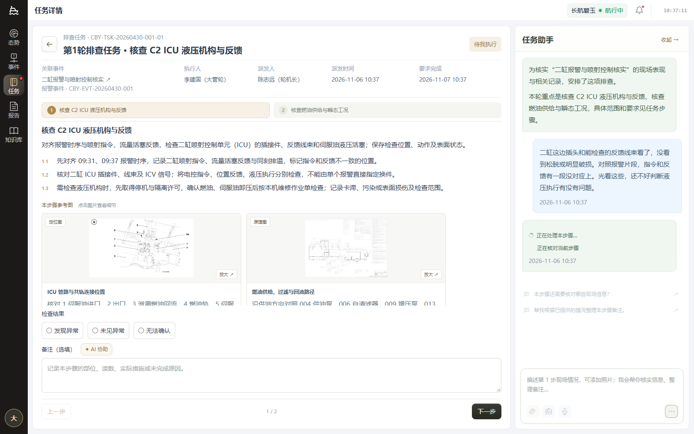
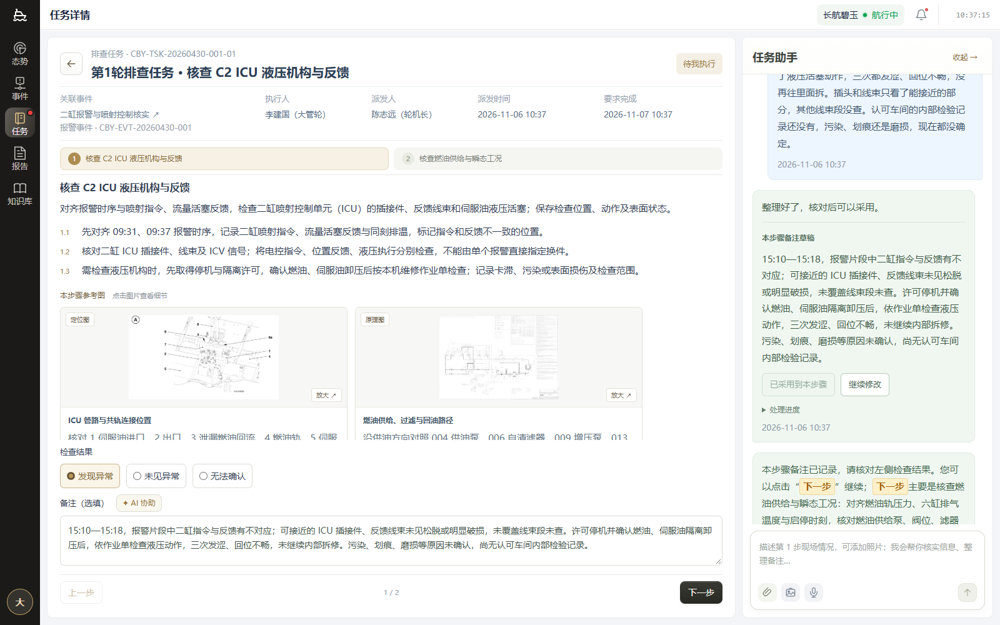
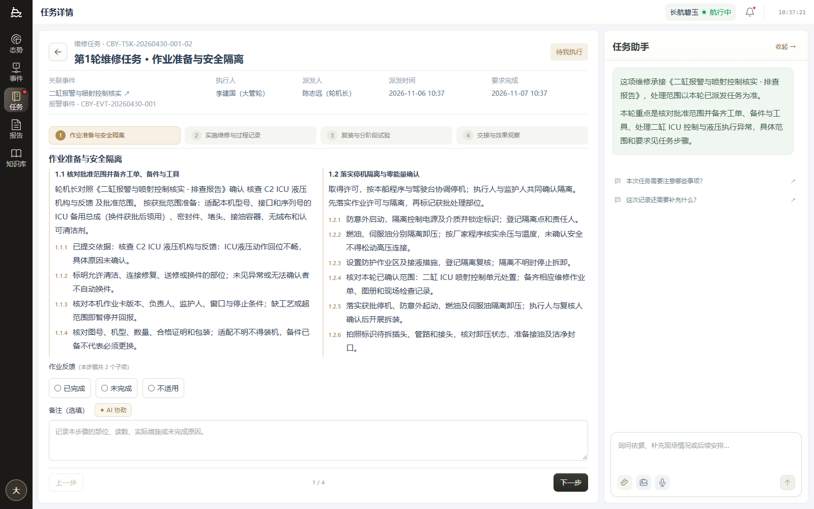
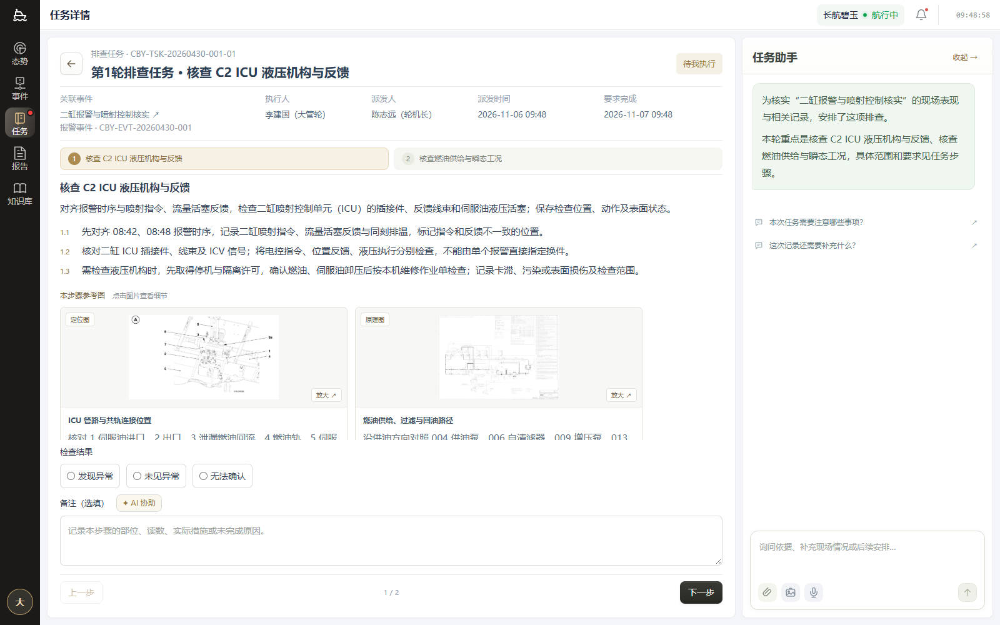
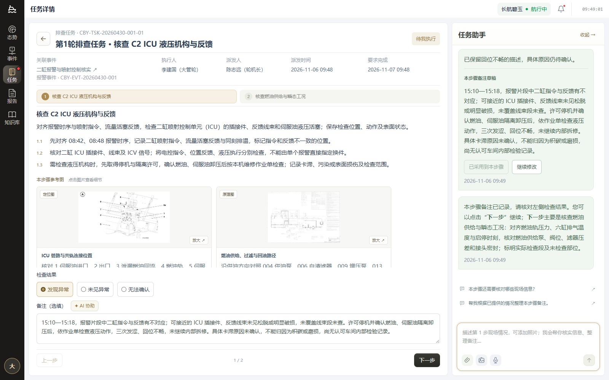
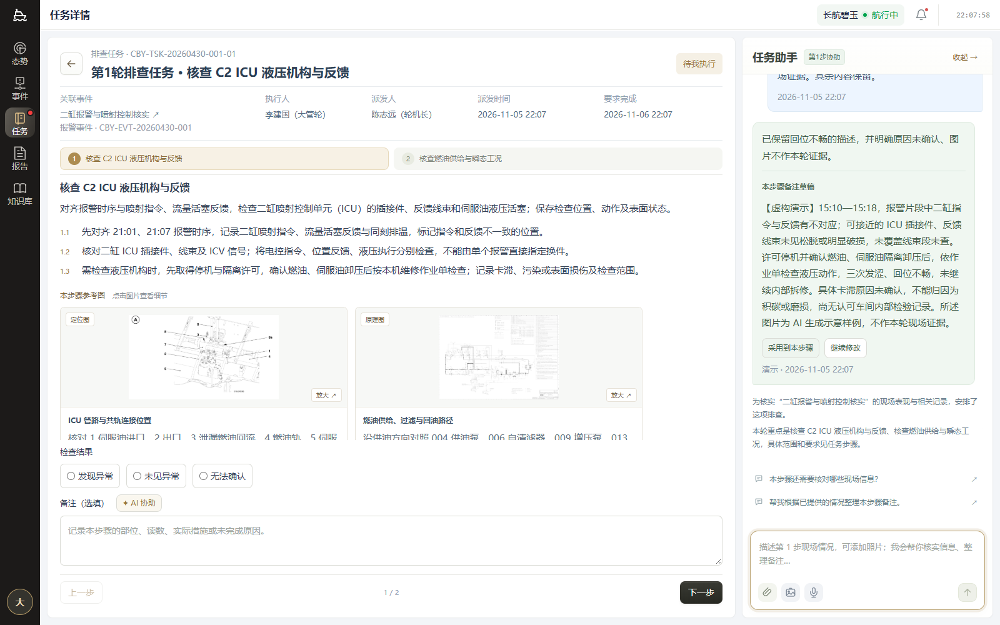
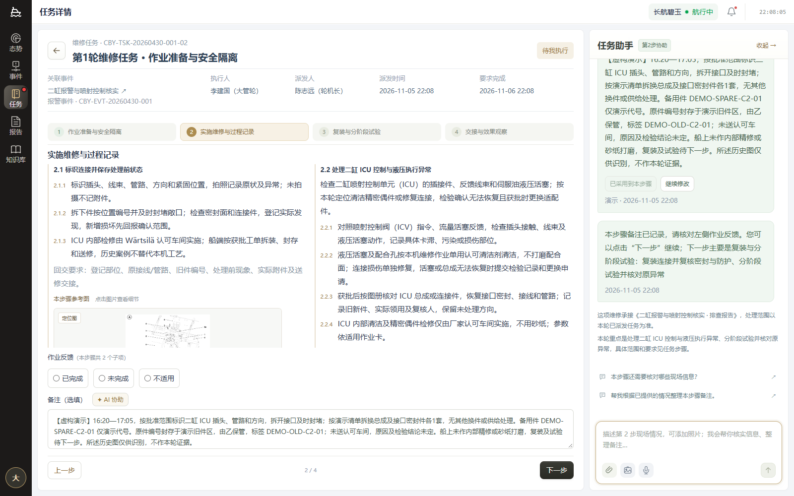

# 二缸步骤协作视觉与交互核验

## 2026-11-06 当前调整：直接聊天、可选往返与处理进度

当前步骤匹配到固定原话时，可从右侧普通聊天直接进入步骤协作，无需每次点击 AI 协助。AI 协助仍提供定位、点亮与图片准备入口；未匹配的自由提问不被强制转为步骤备注，图片不能成为固定脚本事实的来源。

14 条原话改为日常作业口吻。各主步骤首句独立；可跳过原因强调、措施修订及确认补充，采用已有草稿后由人进入下一步。本步必要事实不足时先短追问；后续有新事实或与所选结果冲突时先核对，不用旧预设草稿覆盖新情况。选择结果、采用备注、下一步和最终提交仍是相互独立的人员操作。

固定回复展示三段处理状态，完成后可在“处理进度”中回看；程序配置的等待合计为追问 1.6 秒、草稿 1.8 秒，不含传输与页面调度。进度只说明程序所处阶段，不是模型隐藏思维，不代表固定回复分析了图片或实际调用模型。采用回执中的“下一步”以橙黄色底色、边框和加粗文字强调；其余已验收的默认展开、首条浅绿简介、36 px 草稿按钮及报告入口规则保留。

二缸 ICU 维修的准备步骤收敛为两项：范围／工单／备件工具合并，停机隔离与零能量确认独立保留。取消本步“1–2 项／3 项”分页；保留 4 个主步骤，子项总数按实际批准范围变化。待执行旧任务仅适配显示，快照与已提交原记录不改。

本轮结果如下；下方各轮记录只说明当时版本，不累计测试数，也不冒充本轮新增交互证据。

- 主回归 106 项与准备步骤密度回归 4 项，**110 项相关测试通过**；生产构建通过，保留既有大 chunk 与注释提示。
- 额外扩展的 `lifecycle-completeness` 两项失败已在修改前 `07aaf09` 独立副本复现。本轮未扩大修改这些既有断言；基线记录在 `tmp/repair-preparation-baseline-07aaf09`。相关测试通过不表述为所有扩展检查全绿。
- 正式本地 API `http://127.0.0.1:5180` 与 Chrome 完成排查 2 步、维修 4 步，视口为 1600 × 1000 和 390 × 844。全程在当前步聊天直接发送，未点击 AI 协助，跳过可选往返，采用前选择结果并保留选择，最终提交报告。复验明确等待“报告已生成，已交轮机长审阅。”后再刷新，两类报告均为完成态；不以提交后即出现的下载按钮代替生成完成检查。
- 9 次固定回复实测 1,676–1,881 ms；分段状态及完成后的“处理进度”可见，采用回执的下一步为橙黄强调。维修准备同时展示两项，原分页移除。
- 非脚本回退仅触发一次本机测试提供方；报告生成使用受控响应。外部模型请求为 0，`console error` 与 `pageerror` 均为 0。原始浏览器记录为可视化证据目录下的 `step-direct-chat-qa.json`，本轮不新增真实模型验收声明。
- 6 张新图使用独立的 `ui-20261106b-*` 文件名，未覆盖历史证据；390 × 844 报告完成态截图已复核。完整索引见 [当前截图索引](docs/二缸步骤协作演示/README.md)。其中 `direct-chat` 刻意发送上一版完整原话验证兼容，不能据该图认定新脚本仍使用旧表达。

## 2026-11-06 前轮核验：默认助手及草稿采用

当前规则优先于后面的 11 月 5 日历史记录：任务助手默认展开，任务介绍位于对话最前方并使用浅绿背景；标题不再显示步骤协助标签，消息时间旁不显示路由来源。草稿操作按钮高度 36 px；采用回执中的“下一步”加粗为 15 px。执行记录页按钮为“本轮执行记录”，进入报告后才显示“← 返回本轮执行记录”。

检查结果或作业反馈可在采用前后选择。采用只更新当前步骤备注，保留人的结果选择；人工改过备注、换步或步骤要求变化仍阻止旧草稿覆盖。旧草稿的“练习记录”等前缀及已知图片来源尾句只在业务展示/采用时规整，原始会话、图片信息、历史报告版本保留。匹配只清理明确的来源短语，不吞掉同句后面的未查范围、未实施试验等业务事实。

两份操作脚本与 14 条固定输入/回复已统一为实际作业口吻；非脚本新事实仍走模型分支，不自动写入、选结果或提交。

- **相关测试 96 项通过**，生产构建通过。
- 扩展四缸检查 3 项中 1 通过、2 失败；已在 HEAD `798ba8eb` 独立副本重现相同失败：旧断言要求特定趋势措辞，以及 `analysisFormatVersion` 期望 5 而当前为 6。本轮不修改无关四缸业务。
- 浏览器验证排查 2 步、维修 4 步：默认展开、首条绿色介绍、聚焦光效、追问/草稿/修改、先选结果再采用、下一步强调、报告按钮切换均通过；排查第二步刷新后也可采用。
- 14 条原话通过正式步骤 API 固定分支，未访问模型；额外一条输入通过本机受控提供方验证模型分支，并带有 22 条当前任务上下文。报告生成使用受控响应验界面；本轮外部模型调用 0，页面错误 0。
- 12 张本轮截图见 [当前截图索引](docs/二缸步骤协作演示/README.md)，原截图未覆盖。

## 2026-11-05 历史核验记录

以下为当时版本的验证留档，其中步骤标签、来源标记、采用限制等已按上方当前规则调整。

## 对照范围与证据

- 来源视觉：用户选择的第一方案，`C:/Users/zstech/.codex/generated_images/01a1aae0-22e9-7e13-88c6-96fbeb6cafaa/exec-b0976959-2888-4386-815b-ced13e670595.png`，1568 × 1003 像素。
- 实现：本机 `http://127.0.0.1:5173` 二缸任务，Chrome 浏览器截图 1600 × 1000，CSS viewport 同尺寸，deviceScaleFactor=1；辅助验证 2560 × 1280、390 × 844。
- 状态：本步骤现场描述 → 追问 → 回答 → 备注草稿 → 继续修改 → 采用 → 下一步 → 提交报告。维修重点截图为第 2 步实施维修。
- 原图为概念排查态，实现含实际排查和维修态。只对照用户明确选取的协作入口、气泡、草稿操作、步骤提示、输入栏；原有业务布局与字体按“其余先不用管”保留，不进行全页逐像素复刻。
- 对照时将原图及实现截图在同一轮图像输入打开，逐项检查全页层次和右侧助手；没有把两张不同状态图宣称为相同状态的像素差分。

全页与局部证据均来自 [交互截图目录](docs/二缸步骤协作演示/README.md)。关注区域是右侧 400 px 助手、头部步骤标签、底部输入框和左侧备注字段；已在原始尺寸检查这些区域，无需额外放大文件。

## 五项视觉核验

| 范围 | 结果 |
| --- | --- |
| 字体与层级 | 保留原应用字体、标题层级和中文行距；步骤标签小于“任务助手”，气泡正文可换行，草稿标题及按钮可辨认。原概念的大标题和较宽助手不在本次变更范围。 |
| 间距与布局 | 备注仍位于检查结果下方；步骤提示移到助手标题旁；固定输入栏含附件、图片、语音图标，发送在右侧。小屏允许正常纵向滚动，未出现页面横向溢出。长维修说明在原有说明区域滚动，反馈及下一步可操作。 |
| 色彩与状态 | 用户气泡 `#edf5ff`、助手步骤消息 `#f0f7f1`；强调色沿用原应用。AI 协助和继续修改会聚焦并点亮输入框，不自动发送。 |
| 图片质量 | 沿用真实手册/历史参考资产；新增样例为 AI 生成图，文档明确其身份。原 PNG 1548 × 1016、2,554,493 bytes 保留；实际上传生成等比 JPEG 副本，data URL 250,107 字符，预览与发送一致，仍可放大。 |
| 文案与内容 | 正常追问不含后台技术字段；信息充分时显示“本步骤备注草稿”，提供采用和继续修改。采用后只确认备注记录并介绍下一步，不自动宣称检查通过。演示事实均标注虚构。 |

## 修复与复核记录

- 发现并修复：收起助手会卸载组件，丢失未发送草稿；改为保留组件显示状态，浏览器验证收起/展开后文字保留。
- 发现并修复：大样例 PNG 直接 base64 存储容易超过本地容量；增加明确标注的上传副本及 UTF-16 存储预算，在发送前拒绝超预算而不丢原记录。实际 PNG 上传、预览、发送、刷新恢复均通过。
- 发现并修复：旧草稿可能覆盖人工修改后的结果对应备注；采用时检查备注、结果、执行状态与步骤版本，变化时要求重新整理。
- 复核：最终交互截图与源方案的指定区域无待处理 P0/P1/P2 差异。原页面布局和较小卡片按钮为保留现有产品的明确范围约束。

## 验证边界

- 最终混合路由及相关回归 57/57 项通过；构建通过，重复回归不累计计数。
- 排查 2 步与维修 4 步浏览器动线通过，包括历史参考图、真实样例文件上传、继续修改、只采用备注、刷新恢复、跨步上下文隔离、报告提交保持助手展开。
- 浏览器 pageerror 与 console error 均为 0。
- 最终截图使用正式脚本匹配路由：排查 5 条、维修 9 条原话共 14 条都返回标注“演示”的固定回复，没有外部模型调用；报告提交的生成结果仍用受控响应验证界面。非脚本输入触发真实模型适配分支（本地假提供方验收），携带 22 条当前任务上下文及步骤/来源标识，未混入其他任务。
- 用户明确授权后完成过 18 次真实 `api.deepseek.com` 调用，问题、修复与实际回复均保存在 [真实模型验收](docs/二缸步骤协作演示/真实模型验收.md)。随后按用户要求改为固定演示优先，停止追加真实调用；历史单次模型通过不代表所有输入可靠。
- 语音输入复用已有识别流程，测试覆盖状态与文本写入；未在本轮录制真实现场语音。

## 实施核对

1. C2 排查、维修当前步骤入口、标题提示、输入高亮已接通。
2. 追问和待采用草稿分离；采用、继续修改及下一步回执已验证。
3. 两套内容脚本、样例图片及 8 张浏览器截图已归档。
4. 固定演示只在原话、步骤及前序对话匹配时生效；新增事实进入真实模型，仍需人员核对。界面回复保持一句追问或短备注，不写成报告。

final result: passed
