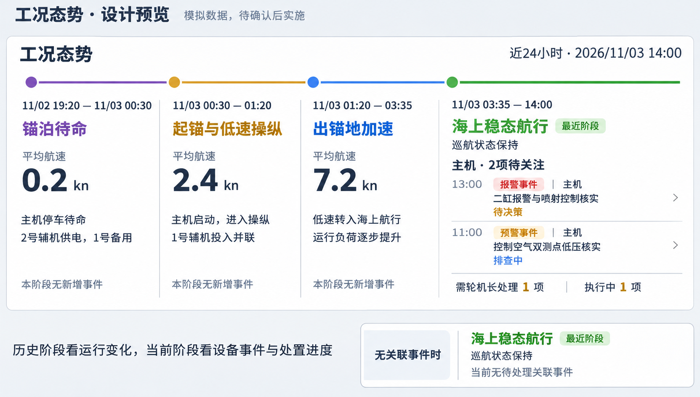

# 事件时间与工况态势方案（待确认，尚未修改产品）

2026-11-03。本方案只讨论报警、预警案例时间和首页工况态势；当前案例数值、流程和航行卡片尚未按此方案改动。

## 本轮已确认的约定与待审设计

- 用户已确认：新的独立无痕会话建立新的时间基准 T。同一无痕存储会话的刷新、角色切换及其他窗口共用 T；关闭全部无痕窗口后重新开启，才是新的无痕会话。不需要另加“开始新一轮”按钮。
- 用户已确认：历史阶段平均航速可以模拟。本图采用 0.2 / 2.4 / 7.2 kn 作为三个历史阶段的模拟均速，不声称是现有区间算出的实测平均值。
- 工况态势布局仍待审阅；本次只提供设计预览，未修改业务页面或案例时间。
- 图像由内置 imagegen 生成，展示有事件与无关联事件两种状态。设计提示：沿用白底、深蓝正文和四阶段时间线；前三列为模拟平均航速及运行变化，当前列为设备、事件类型、名称、发现时间及处置状态；不增加“设备故障”推断和重复实时数字。



## 1. 推荐：一轮演示共用一个时间基准

每轮开始记下 T：报警事件在 T 前 1 小时建立，预警事件在 T 前 3 小时建立。打开当天的新一轮，便是当天的近期案例；同一轮刷新页面、切角色、派任务时不重新移动时间。

| 时间内容 | 建议规则 |
|---|---|
| 报警事件发现/建立 | T − 1 小时 |
| 预警事件发现/建立 | T − 3 小时 |
| 初始信息的数据窗口 | 事件发现前 30 分钟至发现时刻，沿用已确认展示规则 |
| 初始 AI 生成时间 | 发现后 5 分钟；不得早于其所引用的最后一条报警 |
| 报警原有先后顺序 | 两条报警间 6 分钟的差值保留；建议以后一条作为该组事件的发现时刻，前一条落在它之前 6 分钟，避免 AI 分析早于所引用报警 |
| 案例曲线、短时窗口与时间标记 | 对同一原始案例用同一个偏移量整体平移，所有测点值、相对间隔、峰值和趋势保持原样；不能只改卡片日期而曲线仍是旧日 |
| 派发、执行、报告、闭环 | 使用用户实际点击操作时间，已经形成的人工流程记录不再平移 |
| 一缸/四缸长期基线案例 | 保留原有月度历史时间；长期分析不是近几小时事件，不混入本次改时范围 |
| 证据来源 | 原始附件、原始编号和文件内容保留；在证据资料显示原始时间与本轮映射关系，界面角色和事件标题不增加“演示”字样 |

例如本轮 T = 2026-11-03 14:00：报警发现 13:00、AI 13:05；预警发现 11:00、AI 11:05。数据值、事件类型和已有结论均不因此改变；这里只映射案例时间。原始长周期/维修历史日期保留来源含义，不把资料引用日期机械替换成当天。

**刷新不重置；新的独立无痕会话才建立新时间基准。** 新会话自动开始，不增加专门的重置按钮。同一来源案例在本轮保持稳定身份；常规浏览器已有任务和报告不因打开新的无痕会话被改写。

## 2. 工况态势改为回答三个问题

1. 这段时间船舶和机舱发生了什么运行变化？
2. 哪台设备出现了哪种异常线索，现在处理到哪里？
3. 当前是否有需要轮机长处理的事项？

保留时间线、阶段名称、起止时间和最后的“最近阶段”。阶段航速采用有依据的平均值；转速、负荷的重复数字、航向、辅机台数、时段末经纬度退出主卡片。左侧船图继续承担实时航速、转速、负荷展示。

### 历史阶段：运行摘要 + 当时发生的事件

每个阶段显示至多三条有意义的信息，再列关联事件。

| 阶段 | 建议主要内容 | 有关联事件时 |
|---|---|---|
| 锚泊待命 | 平均航速；主机停车待命；供电切换/备用变化（只有变化时显示） | 设备 + 报警/预警标签 + 事件简称 + 当前处置状态 |
| 起锚与低速操纵 | 平均航速；主机启动与操纵变化；供电切换节点 | 同上 |
| 出锚地加速 | 平均航速；低速转入航行；负荷上升/稳定等阶段变化 | 同上 |

无事件时可以安静显示“本阶段无新增事件”，不再塞入坐标等凑数。这里表示系统没有关联事件，不能解释成全部设备健康。

本次原型按用户确认采用独立设置的阶段模拟均速，随回放配置保存，不把现有速度范围的中点当作实测平均。未来接入真实采样后，再按时间加权统计阶段均速。暂不增加油耗、效率或备用能力评分。

### 当前阶段：设备异常线索 + 当前处置

当前阶段不再重复左侧实时读数，改为运行状态和当前未结束事项：

```text
海上稳态航行                         最近阶段
巡航工况持续；本阶段无新增运行方式切换

主机 · 2 项待关注
[报警事件] 二缸报警与喷射控制核实     待决策  →
[预警事件] 控制空气双测点低压核实     排查中  →

需轮机长处理 1 项 · 执行中 1 项
```

这是布局文字示意，数量和状态实际由事件/任务计算，不能写死。若没有设备相关未结束事项，就显示“当前无待处理关联事件”，保持简洁。

红色表示报警线索，橙色表示预警，处置状态另列；不能只因有报警就显示“主机故障”或“航行受限”。有人工确认的具体限制时才展示限制内容，不根据事件存在自动推断。

## 3. 时间、设备与事件怎么关联

- 事件发生时间落在哪个航行阶段，就展示在哪个阶段，点击直接进入原事件；不为填满四列而移动事件。
- 当前内置“海上稳态航行”阶段约覆盖最近 10 小时，所以前 1 小时报警与前 3 小时预警都会落在最后一列，这是合理结果。
- 历史阶段的事件保留其发生位置；如果尚未结束，当前列同时展示“此前发生，仍处理中”，表示处置延续，不伪装成当前新报警。
- 原事件进入独立效果观察后显示“观察中”，按同一关联链统计一次；观察子事件不算第二次报警。闭环后历史标记保留为“已闭环”，从当前待关注中退出。
- 通过事件的设备关联展示“主机/辅机”等；当前两个案例均关联主机，不将其扩展成全船设备异常。
- 当前待决策数来自真实待办；排查、维修、观察各有明确状态。AI 分析生成失败不会把已回交的任务重新算成未提交。

## 4. 建议确认后一次实施的范围

采用“固定本轮 T + 报警前 1 小时/预警前 3 小时 + 同一案例时间轴整体平移”；首页采用“历史阶段运行摘要 + 当前阶段设备与处置”，保留现有四阶段时间线。先不增加地图、预测、油耗指标或复杂评分。

验收时检查：跨日仍按上海时间显示；刷新及角色切换时间不跳；曲线与事件标记一致；报警先后顺序保留；历史来源可回查；原有人工任务/报告不被重写；当前链路不重复计数；无关联事件不误称设备全部正常。
