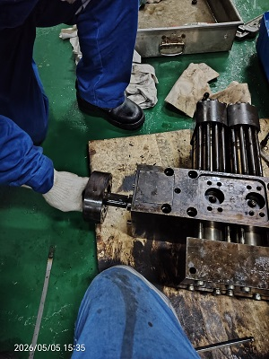

# 二缸步骤协作说明

本目录提供“助手介绍与开场选择 → 现场原话和图片 → 必要追问 → 备注草稿 → 人员核对采用 → 提交报告”的完整路径。开场选择可跳过，不替代现场描述或结果选择。检查结果或作业反馈由人员选择，可以先选结果再采用草稿，也可以先采用再选；采用只写备注。适用范围仅为二缸报警事件 `real-alarm-0430`（事件编号 `CBY-EVT-20260430-001`）当前执行人的排查与维修任务。

当前按 **固定脚本优先、非脚本输入调用真实模型** 运行。两份脚本原有现场描述共 14 条指定用户原话，使用接近日常作业交流的口语表达，在对应当前步骤返回预设短追问或备注草稿。页面不插入“虚构演示”“练习”“演示人员”等业务话术，也不显示原有“演示”时间前缀。固定回复不调用模型；脚本外的改写、新事实或问题进入模型分支。已知原话缺少本步必要信息或与所选结果冲突时，先返回简短核对问题，不为缺少前序而调用模型。

已有草稿中的旧前缀及已知样例图片说明按当前业务展示格式规整；同句中的实际措施、未检查范围、未完成项和待确认事项仍须保留。原始会话、历史版本和来源元数据保留，不因显示调整改写原始记录。

本目录是产品流程复现材料，预设文字本身不构成独立取得的现场证据。实际任务仍按已完成检查与当前记录填写。图片的真实来源保留在下方技术附记中；采用实际作业口吻不改变图片的来源与证据属性。

## 当前页面与填写顺序

每项任务只有一个右侧任务助手，首次进入时默认展开；对话最前的浅绿色消息简短介绍“我是任务助手，可以帮你把现场情况整理成排查／维修备注”，并说明可发送现场描述、照片或读数截图，需要时会追问，最后由人员核对采用。头部只保留“任务助手”，不显示“第 N 步协助”标签；当前记录对象由左侧所选步骤确定。对话正文采用两端对齐，短句末行保持自然排列。

首次进入任务时，输入框上方出现一次针对整项任务的选择卡：排查问 **这项排查，你想先从哪里开始？**，提供 **记录检查情况／先看检查要点**；维修问 **这项维修，你想先从哪里开始？**，提供 **记录作业情况／先看作业要点**。选中后点 **确认**，助手简短回应，再接续两份脚本中的原有现场描述；也可直接在输入框自由输入，不要求先作选择。开场选择不自动填写结果、备注或判断作业已经完成。

左侧备注旁的 **AI 协助** 按钮已移除。二缸当前可执行任务默认进入任务协作，直接在右侧输入、添加图片／附件或使用语音即可；非脚本输入走真实模型并携带本任务上下文。切换步骤仍保持同一个助手和完整任务对话，不重置、不重复开场；草稿的写入位置跟随左侧当前步骤，各步未发送文字与图片分别保留，不混入其他步骤。事件助手的修改建议、报告补充等入口继续按各自用途处理。

固定回复先显示“正在核对当前步骤”“正在整理已提供的现场信息”等三段处理状态，再给出追问或草稿；完成后可展开 **处理进度** 回看。三段预设等待合计为追问 1.6 秒、草稿 1.8 秒，不含传输与页面调度时间。这些是程序处理状态，不是模型的隐藏思维，也不代表固定回复执行了图片识别或真实模型推理。

备注草稿不是每次回复的固定产物：沿用原逻辑，信息不足先追问，事实足够才生成整理稿。本次只增加一次任务开场，并改变采用／继续修改的确认形式。草稿正文保留在对话中；**采用到本步骤／继续修改** 移到输入框上方的选择卡，选中后点 **确认**。继续修改会定位并点亮输入框，不自动发送或覆盖已有输入；采用只写当前步备注。采用回执中的 **下一步** 使用橙黄色底色与加粗文字强调。先选检查结果再采用不会被误判为“草稿已变化”；人员选择保留。若备注正文或步骤要求确实已修改，仍须重新整理，避免覆盖新记录。

提交后，左侧通过执行记录和报告页签切换。只读执行记录也按步骤切换，每次展示所选步骤的要求、反馈和备注，不把全部步骤连续铺开；页签下不重复显示黑字“本轮执行记录”标题。

填写过程中，本步骤必填项齐全后步骤条即时显示绿色，包括当前正在查看的步骤；绿色表示记录填写齐全，不等于检查正常、维修成功或已正式提交。检查结果与实际未完成范围仍按人员填写保留。必填指合法结果选择；“无法确认／受限”还需选择实际执行情况，备注继续为选填。

报告下载按钮统一显示 **下载**，下载文件仍为 Markdown。事件阶段报告移除重复的报告类型／生成时间行，下载与报告选择器同行。任务助手输入框内不再显示“补充报告”标签，顶部 **通过对话补充报告** 入口继续保留。任务提交摘要行移除重复的“待审阅”，不改变报告生成及轮机长审阅流程。

## 从哪里开始

1. 使用专用演示环境或独立浏览器配置；不要清空或覆盖正在使用的业务记录。
2. 以轮机长身份打开二缸事件，派发本轮排查给大管轮；切换为该执行人，进入待执行任务。已提交、等待或终止的任务不作为入口。
3. 依照 [排查演示脚本](排查演示脚本.md) 完成两步协作并提交排查报告。
4. 轮机长审阅该排查报告，仅安排其中已定位的 ICU 方向维修；再切换为执行人，依照 [维修演示脚本](维修演示脚本.md) 完成四步反馈并提交维修报告。

已有任务是派发时的快照，步骤不同可能来自旧版本或不同批准范围；先核对任务标题与步骤，不要为了匹配脚本覆盖已填记录。本套脚本使用当前默认模板，不调用 AI 重写任务计划。

## 与实际步骤的对应

轮机长可在事件页按主步骤查看 AI 建议与已派发任务；轮机员在本轮未提交时只见进入任务的入口，需到任务页查看、填写步骤，提交后才在事件页显示本轮只读步骤和配图。历史已提交轮次仍可查看，不因新任务尚未提交而隐藏。

任务正文不重复导航中的步骤标题；维修导航显示 **作业准备／实施维修／复装试验／效果观察**，下表保留完整步骤含义，脚本匹配及已存记录不因短名称而改变。轮机长在建议页选择 **通过对话修改任务** 后，可用界面短名或序号说明修改，如“去掉步骤三，复装试验”；“复装实验”的常见口语写法也能匹配。编号与名称冲突或指向不唯一时须先澄清，不猜测删除目标。

| 任务 | 主步骤 | 本次路径的人员选择 |
| --- | --- | --- |
| 排查第 1 步 | 核查 C2 ICU 液压机构与反馈 | 发现异常；卡滞原因待检验 |
| 排查第 2 步 | 核查燃油供给与瞬态工况 | 未见异常；限定已检查范围 |
| 维修第 1 步 | 作业准备与安全隔离 | 已完成；批准范围、准备与复核记录齐备 |
| 维修第 2 步 | 实施维修与过程记录 | 已完成；获批总成更换，不开展船端内部精修 |
| 维修第 3 步 | 复装与分阶段试验 | 未完成；有限工况测试与尚缺资料分别记录 |
| 维修第 4 步 | 交接与效果观察 | 已完成；完成交接，不代表观察已经达标 |

当前维修任务保留 **4 个主步骤**，子项总数随实际批准范围变化。第 1 步固定收敛为两项：范围、工单与备件工具合为一项，停机隔离与零能量确认独立保留，不再出现“1–2 项／3 项”的子项分页。已派发但待执行的旧任务通过只读显示适配呈现；不改写其快照，已提交的原记录保持原样。

步骤协作的可写备注以左侧当前主步骤为单位。真实模型读取当前任务助手的完整已记录上下文（单次最多 100 条），区分当前步骤、其他步骤和普通任务对话；其他步骤只帮助理解来意，不能把其措施写成本步已执行事实。同一事件下的排查与维修也不能混用上下文。采用草稿只写入当前步骤备注，不选择或改写人员已选结果，不自动换步，不提交报告。

## 固定脚本如何命中

直接复制脚本中标明“发送”的用户原话，逐段发送，不把助手示例回复一并复制进去。规则只容忍空白、全半角及部分标点形式差异，不作语义模糊匹配；改动事实、同义改写或额外加一句说明都会转入真实模型。

任务类型、当前步号及步骤标题必须对应。每个主步骤的首句独立命中，不要求完成上一主步骤的可选修改或补充。回答和修订只使用同一步已提供的信息；直接发送补充句但缺少必要事实时，先追问缺少的检查范围、动作或措施。已知的可选对话、重复发送及“谢谢”等简短回应不会使已有本步信息失效，也不要求首句和回答紧挨着。

先发回答后补前文时，可合并本步已有事实生成草稿，不重复追问已说清的人名或旧件去向；重复早期原话仍保留后来补充的限制。如本步后来出现脚本外的新情况，再发旧的固定句不会直接覆盖新事实，而是先请人核对实际情况；所选结果与脚本事实冲突时也先核对。已生成草稿后再选择结果，不会仅因此阻止采用；采用前仍由人员核对备注与所选结果是否一致。旧版本已发布的完整原话保留兼容，但人员、编号、数值或事实变化不会被兼容规则抹去。

| 当前步骤 | 固定原话顺序 | 固定回复 |
| --- | --- | --- |
| 排查第 1 步 | 初次描述 → 动作检查回答；原因强调可跳过 | “液压活塞动作检查做了吗，结果怎么样？” → 备注草稿；按需更新草稿 |
| 排查第 2 步 | 供给检查描述；可接资料缺口补充 | 直接给备注草稿；补充后保留未提供压力数值 |
| 维修第 1 步 | 准备与隔离描述 → 执行／复核人回答 | “谁执行隔离、谁复核，工单签认了吗？” → 备注草稿 |
| 维修第 2 步 | 总成处置描述 → 实际拆换回答；措施边界强调可跳过 | “总成这次具体怎么处理的，拆换了还是做了连接修复？” → 备注草稿；按需更新草稿 |
| 维修第 3 步 | 复装及受限试验描述；可接后续尚未实施补充 | 直接给备注草稿；补充后明确尚未完成 |
| 维修第 4 步 | 交接描述；可接时限未确认补充 | 直接给备注草稿；补充后仍保留时限待安排 |

上述共 14 条现场原话，其中原因／措施修订和三条确认补充均可按需跳过；本轮另在它们之前加入排查／维修各两项开场选择。开场选择只说明记录意图，不作为现场事实，也不阻断后续原话命中。采用已有草稿后，可由人员直接进入下一主步骤。接续规则只认当前步骤先前发送的用户原话，不把别步同一句话、助手草稿或图片内容当作已提供的事实。固定脚本可以无外部模型完成步骤协作，但最后的报告生成仍走现有报告流程；它不属于这 14 条预设回复。

## 技术附记：图片目录及真实来源

图片集中在 `images/`，演示时通过右侧任务助手的图片图标（“添加现场照片”）选择文件；回形针入口用于文字附件。不要把文件路径粘贴成“已上传”。原话可以直接粘贴，也可以点麦克风口述；识别后先核对草稿，再点发送。

| 文件 | 用途 | 证据身份 |
| --- | --- | --- |
| [c2-icu-demo-generated.png](images/c2-icu-demo-generated.png) | 排查第 1 步的图片输入练习 | AI 生成演示图片；不是真实设备照片，不能证明部件编号、动作卡滞、隔离状态或本轮发现 |
| [c2-icu-historical-reference.jpeg](images/c2-icu-historical-reference.jpeg) | 维修第 2 步的历史结构参考 | 原知识库历史照片；不是本轮拆检、换件、复装或验收证据 |

生成样例为本轮专门制作的机舱部件近景图，只用于图文输入及身份辨识练习，不用于核对真实 RT-flex50 构造或工艺。文件约 2.44 MiB，低于当前单图 3 MiB 上限。

历史照片原文件：`public/wiki_rt-flex50/images/changhangbiyu_20260430_icu_servo_piston_disassembly.jpeg`。关联知识条目为《长航碧玉主机2缸ICU伺服油液压活塞卡阻故障案例》，原始报告条目为《长航碧玉主机2缸ICU伺服油液压活塞故障报告0430》。照片可见时间戳为 **2026/05/05 15:35**，与案例叙述的 2026-04-30 至 05-01 时间段不同；演示保留这一差异，不改写拍摄时间，也不据图推定当前事件日期。

单张图片须为 PNG、JPEG 或 WebP，且不超过 3 MB；本次当前任务上下文累计最多 4 张、合计不超过 6 MB。两份脚本各用一张图片即可，不要求每步配图。固定演示回复不分析图片，也不依据图片推断事实；脚本外的图文请求才需要支持图片输入的模型。若该模型不支持图片，系统应明确提示，不把“忽略图片只答文字”当成成功。

本次浏览器实测上传上述 PNG 时，系统生成了标明“上传压缩副本”的 JPEG，实际请求中的 data URL 长度为 250,107 个字符；目录中的原始 PNG 保留。上传副本用于对话与刷新恢复，不覆盖原文件，也不改变生成样例的身份。

## 本轮交互核验

本轮 **108／108 项相关测试通过**，生产构建通过。无截图浏览器以 1600 × 1000、390 × 844 两种视口完成 12 组检查，覆盖事件页角色与提交前后可见性、六步备注采用，以及排查／维修两条步骤协作路径。

开场选择接续原有追问，信息足够后才生成草稿；选择继续修改会聚焦并点亮输入框，采用只写备注、不会自动选择结果。换步保持同一个任务助手及连续对话，不重新开场。三个输入图标、正文两端对齐及小屏布局完成检查。本轮共 13 次本地脚本请求，浏览器错误 0、外部模型调用 0、截图 0；详细边界见 [交互核验记录](../../design-qa.md)，不新增真实模型质量验收结论。

## 文档留档与前轮核验

按最新要求，已删除 `images/` 中全部 26 张界面截图文件，并清理本说明中的截图链接和索引；后续不再截图。目录保留生成样例与知识库历史参考图两张原始图片。主 HTML 中既有内嵌图保留为历史版本记录，不作为当前页签和状态样式的证据。

此前页签调整一轮的 20 个相关测试文件合计 **118／118 项通过**，生产构建通过。无截图浏览器核验覆盖两步排查、四步维修：提交前必填项齐全后整张步骤卡变绿，“无法确认／受限”需补实际执行情况；提交后使用页签和逐步只读记录，支持键盘切换。下载、顶部对话补充聚焦、输入框无“补充报告”标签及事件报告同排下载均通过检查，只读切换不改写数据。

1600 × 1000 与 390 × 844 两种视口均无页面横向溢出，控制台错误为 0；本轮截图 0 张、外部模型调用 0 次。扩展检查及构建提示详见 [交互核验记录](../../design-qa.md)。该段和下方各轮数字、浏览器结论分别属于此前版本；最新的开场问答、草稿确认与可见性调整以核验记录顶部为准，不累计计数。

## 11 月 6 日前轮页面与验证：直接聊天及处理进度

本轮主回归 106 项、准备步骤密度回归 4 项，**110 项相关测试通过**；生产构建通过。另行扩展检查的两项 `lifecycle-completeness` 失败已在修改前 `07aaf09` 的独立副本中复现，本轮不扩大修改，详见 [视觉与交互核验](../../design-qa.md)。前轮 96／99 项等计数仍归各自历史记录，不与本轮相加。

Chrome 在 1600 × 1000 与 390 × 844 视口验证两步排查和四步维修：均从当前步普通聊天直接发送，未点击 AI 协助；跳过可选修改／补充，先选结果再采用，最后提交报告。两类报告均等待明确生成完成消息后再刷新，完成状态保持。结果选择始终保留，页面及控制台没有脚本错误。维修准备同时展示两项，无原“1–2 项／3 项”分页。

共 9 次固定回复经过正式脚本路由，实测耗时 1,676–1,881 ms，包含程序预设等待与本机传输、调度；完成后保留“处理进度”入口。一条非脚本输入另用本机测试提供方验证模型回退，外部模型请求为 0；报告生成仍使用受控响应。两类报告的受控生成响应复验完成。此次结果验证步骤协作路由和界面行为，不增加真实模型验收次数，也不代表真实报告质量已验收。

## 11 月 6 日前轮页面与验证：默认助手及草稿采用

本节保留直接聊天进入步骤协作与分段处理进度调整前的验收记录；对应外链界面截图已按最新要求删除。

本轮 **96 项相关测试通过**。另行扩展的 C4 `suggestion-business-context` 共 3 项，其中 1 项通过、2 项失败；这两项已在修改前 `798ba8eb` 的独立归档副本中复现相同失败，本轮未修改 C4 业务。合计 99 项：97 项通过、2 项既有失败；不表述为全部测试通过。

本轮使用正式本地 API 与固定脚本路由，排查 2 步、5 条原话及维修 4 步、9 条原话全部命中。六步均验证先选结果再采用，原结果保留；排查第二步刷新后仍可采用。助手默认展开、浅绿色简介位于对话首项、无右侧步号标签、草稿按钮实测高度 36 px、回执强调下一步，以及执行记录／报告入口的不同名称均通过浏览器检查。未发现页面脚本错误，生产构建通过。

一条非脚本输入触发一次本机测试提供方，携带 22 条当前任务上下文；本轮浏览器外部模型调用为 0。报告提交后的生成响应仍受控，因此本轮验证不增加真实模型外发次数，也不代表真实报告质量验收。

## 11 月 5 日历史页面与验证

以下为 11 月 5 日固定脚本路由的历史核验记录，当时仍有步号标签和“演示”前缀，不能据此判定当前页面样式。逐条原话经本地 API 入口和匹配器返回预设对话，**报告提交后的生成响应受控**；对应界面截图文件现已删除，不代表真实外部模型已生成对话或报告结论。

当时维修追问、草稿及采用核验对应 **第 2 步“实施维修与过程记录”**，历史照片和具体措施均在该步上下文中，不把准备步骤当作已完成拆换。

11 月 5 日该轮 **57 项相关测试全部通过**，`npm run build` 与 `git diff --check` 均通过。浏览器实际命中排查 5 条、维修 9 条，共 14 条固定原话，外部模型调用为 0。另加一条非脚本输入，只调用一次本机测试提供方，携带 22 条当前任务上下文且保留脚本来源元数据；这是回退路径验证，不是新增 DeepSeek 外发调用。两类任务均完成逐步采用、人工选择结果和最后提交，无页面脚本错误。

前轮受控阶段的 47 项测试、生产构建、三种视口及刷新保留验证已通过，存储计数调整后的 12 项相关回归也通过；这些历史结果不与本轮测试数相加，对应历史结果保留，不恢复已删除的截图文件。

## 真实模型历史验收

用户授权后，已对 `api.deepseek.com` 的 `deepseek-v4-flash` 完成首轮与两次复验，共 18 次真实调用，现已停止继续外发。最终一轮两条动线均完成“追问 → 草稿 → 修改后草稿”的结构；首轮失败及后续复验原始证据仍保留，不将最终结构通过解释为普遍可靠或内容均无问题。

详见 [最终一轮真实验收](真实模型验收.md)、[首轮记录](真实模型验收-首轮.md) 与 [第一次复验](真实模型验收-复验1.md)。这些调用发生在混合路由接入前：当时仅外发获准的虚构演示资料，排查包含生成图原图，维修只以文字说明历史照片身份、未外发历史原图；知识检索返回空列表。其结果不替代完整知识库、全部任务上下文及本轮混合路由的端到端验收，也不证明真实现场事实。固定脚本回复与这里的真实模型返回须分开理解。

## 当前交互如何判定成功

固定原话命中时，按上表展示简短对话和草稿，不需要为了重现流程反复调用真实模型。非脚本输入走真实模型时，通常一句追问或确认，再给紧凑连续的备注正文；事实较多时可适当延长，不能为缩短而删掉否定、未完成或待确认项。真实回复无需逐字匹配脚本，但不能写成整份报告或整套检查清单。

逐项确认：进入任务页即显示助手，对话最前为浅绿色简短自我介绍；头部无步号标签，左侧无 **AI 协助** 按钮。输入框上方有面向整项任务的开场问题，可选择并确认，也可直接输入；换步不重置对话或重复开场。固定回复显示分段状态，完成后可展开 **处理进度**；有草稿时输入框上方改为 **采用到本步骤／继续修改** 选择卡。先选检查结果，再选择采用并确认，备注成功写入且原结果不变；继续修改只点亮输入框，内容由人发送。右侧确认已记录，以橙黄色突出 **下一步**。可选往返不阻塞下一主步骤，人员自行切换步骤和提交，报告生成进度在助手中显示。

未返回草稿、请求失败或人员尚未采用时，不应改动左侧备注。上传失败需重选图片；不要口头声称系统已收到了不存在的附件。任何草稿若把历史照片说成本轮证据，或把“待检验”“未覆盖”改成已确认，先在问题卡选择 **继续修改** 并确认，再补充纠正，核对新稿后采用。

## 范围与核对依据

本套材料只覆盖二缸当前任务的步骤协作，不代表已推广到其他事件、维保任务或整份报告自动分配。报告最终仍走现有提交、生成与轮机长审阅流程；脚本不要求报告生成后自动闭环或自动安排观察。

步骤与分支依据：`src/workflow/eventLifecycle.js` 的实际任务生成、`src/workflow/repairPlanning.js`、`src/workflow/repairStepGroups.js`、`src/mock/compactRepair.js`。图片及上下文约束依据 `src/workflow/stepAssistContract.js`，14 条现场原话与短回复依据 `src/workflow/stepAssistDemo.js`，开场问题与固定回应依据 `src/workflow/taskAssistantOpening.js`。本文是操作材料，自动化测试和浏览器验收结果以本轮最终修改稿为准。
