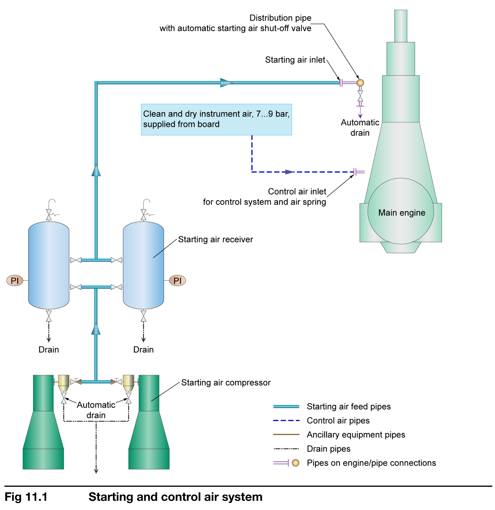
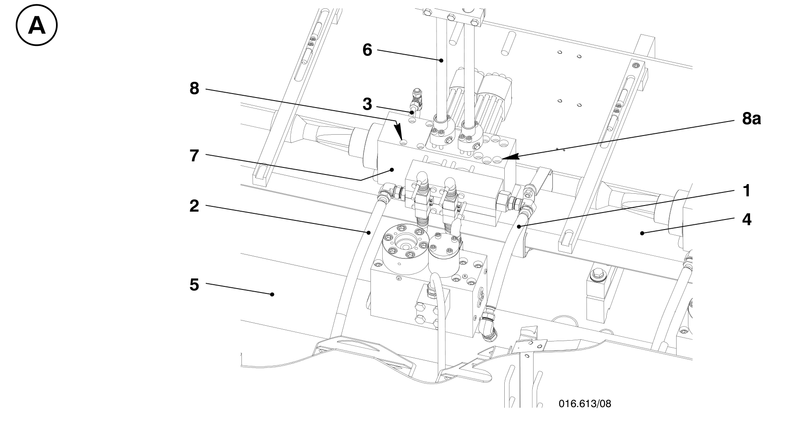

# 厂家图纸辅助排查与测点核对

## 空气供给路径与两个不同版本

WinGD RT-flex50-D安装手册MIM a5（2017-04-12）PDF第103页、印刷11-1、Fig 11.1给出启动空气与控制空气路径。第105页、印刷11-3说明船舶仪用气源为8 bar表压、允许7–9 bar；第22页同样将-D机型控制空气发动机入口列为7–9 bar。第105页给出的6缸控制空气设计流量为14.4 Nm³/h，用于外部管路与设施选型，不是本船实测流量。

2005年RT-flex50纸质表则列控制空气发动机入口6–7.5 bar、正常6.5 bar。这一差异必须标注机型和版本，不能直接把两个资料的数值视为同一测点的统一限值。排气阀空气弹簧总分配管在两份资料均列6–7.5 bar、正常6.5 bar。详见[[持续运行参数与版本对照]]。

MIDS空气系统PDF第3页图PTAA011965（1/2）标出41启动空气进口、43控制空气进口。可以用来定位接口，但不能据图认定数据库中的两个压力通道一定分列某个减压阀两侧。先记录现场位号、调压阀位置、独立表计与趋势读数，再判断供气侧还是局部支路问题。以上为厂家示例，不代表本船两组减压阀的完整实装拓扑。

## 冷却水：先分HT、LT和海水

MIM第70页、印刷8-4说明气缸高温冷却回路采用三通温控阀，测温传感器在发动机出口，控制可以为电动或电气动。第21–22页给出2017-D气缸出口温度设定90 ℃及稳态±2 ℃、瞬态±4 ℃容差。这是控制设计条件，不可替代2005报警表的各缸出口报警值。

处理单缸温度偏离时，同时对齐其余缸出口、总入口温度与压力、主机运行状态；处理扫气温度时，核对实际为空冷器LT淡水还是海水配置。安装接口可查MIDS冷却水图和管路连接总图，来源定位见[[本地厂家说明书与图纸目录]]。缺少流量测点时，不得凭温差直接宣称冷却流量正常。

## ICU：辨认油路、燃油与反馈

RT-flex50-D维修手册文件2020-10版本，PDF第352页，章节5564–1/A1，图A 016.613/08，印刷1/3（单页修订2013-08）。编号1为伺服油入口、2为出口、3为泄漏燃油回流、4为燃油轨、5为伺服油轨、6为高压燃油管、7为喷射控制单元ICU。第353页拆卸说明另列出9先导阀和12位置传感器的电缆插头（位号定义见第352页图例）。

分析喷射异常时，应区分燃油供给压力、燃油轨压力、伺服油压力以及位置反馈；它们属于不同物理量，不能用其中一项替代另一项。图示用于识别和回报位置，不足以直接确认先导阀卡滞或油路堵塞。

手册第352页明确：ICU作业需主机停机、燃油增压泵和伺服油泵停用，燃油轨卸压并遵照操作手册0510–1；ICU内部维修原则上由制造商进行，先导阀不提供内部维护、需要时整体更换。第353页强调拆开燃油轨后防止异物进入。具体作业按本船适用手册和获批作业卡进行，不能从连接图自行扩展拆修范围。

## 来源核验

两张图复用项目已核验的裁图，来源清单为`doc/图纸以及图片/任务步骤参考图/manifest.json`，保留原PDF、页码、图号和裁图哈希。原PDF版本、总页数和SHA见[[本地厂家说明书与图纸目录]]。本条是针对空气、冷却和ICU的定向萃取，不代表全部483页维修手册已逐页整理。
