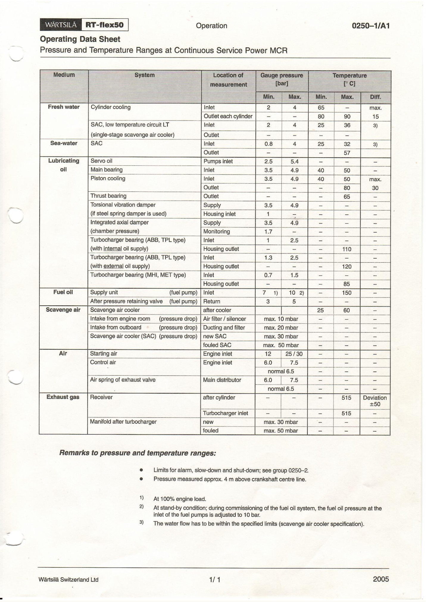
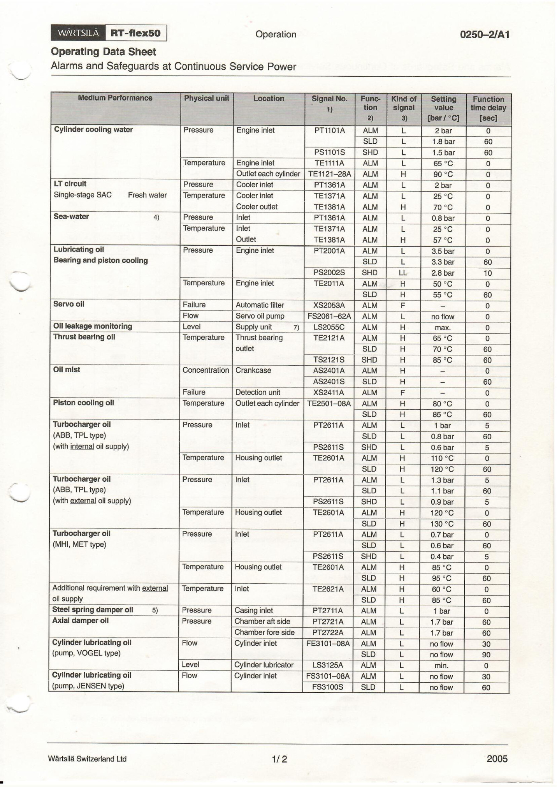
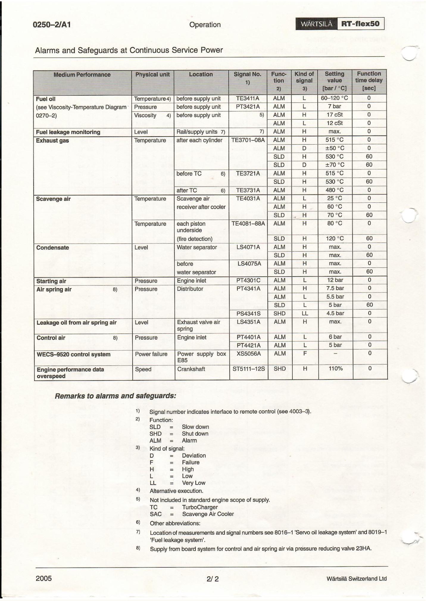

# 长航碧玉主机运行参数纸质说明书

## 来源与适用条件

用户提供文件：`doc/图纸以及图片/长航碧玉主机运行参数 纸质说明书.pdf`，共3页。原页标识 Wärtsilä RT-flex50，页脚2005。SHA-256：`09e596c63527c6f0026bb5e9c66f34e7c63e121d624941d4f0aba41d4523f06c`。

这是厂家持续服务功率下的参数表，并非本船当前自动化系统设定导出。运行范围、报警、减速和停机设定分别记录；本船使用须核对实际机型、附件型式、测点位号及现行设定。压力为表压，测量位置约在曲轴中心线上方4 m。停机或启动过渡不能直接套用持续服务功率范围。

本次逐页目视核对，保留原页图像并整理关键参数。未将这些阈值自动写入检测规则或设备控制系统。

| PDF页 | 原章节 / 印刷页 | 内容 | 萃取条目 |
|---|---|---|---|
| 1 | 0250–1/A1，1/1 | MCR压力与温度运行范围 | [[持续运行参数与版本对照]] |
| 2 | 0250–2/A1，1/2 | 冷却水、润滑油、增压器、气缸润滑保护 | [[主机报警与保护设定速查]] |
| 3 | 0250–2/A1，2/2 | 燃油、排气、扫气、空气及转速保护 | [[主机报警与保护设定速查]]、[[扫气温度正常范围与测点辨识]] |

## 第1页：运行范围

## 第2页：报警与保护（1）

## 第3页：报警与保护（2）

## 版本关系

已有[[第6章-技术参数与报警设定]]标注来源2009-07；本页2005表的部分滑油压力与该章不同，不能无标识合并。2017年RT-flex50-D安装手册也有不同配置条件，见[[持续运行参数与版本对照]]及[[本地厂家说明书与图纸目录]]。
