# 发动机概述

## 发动机基本信息

RT-flex50 是 Wartsila（原 Sulzer）制造的船用低速柴油发动机，主要特征如下：

| 特征 | 说明 |
|------|------|
| 发动机类型 | 单作用（single acting）、二冲程（two-stroke）、十字头式（crosshead design）柴油发动机 |
| 增压方式 | 废气涡轮增压（exhaust gas turbocharging），定压增压原理 |
| 扫气方式 | 直流扫气（uniflow scavenging） |
| 燃油系统 | Sulzer Common Rail（共轨系统） |
| 电子控制 | [[WECS-9520控制系统]] 全电子控制燃油喷射和排气阀驱动 |
| 推进方式 | 直接耦合螺旋桨驱动，可逆转（reversible） |
| 结构特点 | 拉杆（tie rods）将机座（bedplate）、机架（columns）和气缸体（cylinder block）绑定在一起 |
| 曲柄箱分隔 | 曲柄箱与气缸体之间通过隔板分隔，隔板上设有活塞杆密封填料箱（sealing gland boxes） |
| 推力轴承 | 位于发动机驱动端（driving end） |
| 盘车机构 | 位于发动机驱动端 |
| 辅助系统 | 润滑油泵、冷却水泵、燃油供给/增压泵、空气压缩机等属于机舱安装设备 |

## RT-flex与传统RTA对比

### 历史发展

#### RTA系列
- RTA于1982年推出
- 超过2,660台RTA发动机售出，总功率65,626,310 BHP / 48,254,639 kW

#### RT-flex系列
- 1996年举办首个RT-flex车间
- 2001年首台RT-flex发动机启动（6RT-flex58T-B / GYPSUM CENTENNIAL）
- 截至2008年5月，已售出678台RT-flex发动机，总功率21,880 MW

### 技术对比（RTA vs RT-flex）

| 对比项 | RTA（传统凸轮轴） | RT-flex（共轨） |
|-------|------------------|----------------|
| **燃油压力建立** | 每缸一个燃油泵 | 供油单元上的燃油泵 |
| **燃油压力存储** | — | 燃油轨（Fuel Rail） |
| **喷油正时** | 凸轮轴上的燃油凸轮 | WECS-9520 / ICU |
| **排气阀驱动压力建立** | 每缸一个驱动泵 | 供油单元上的伺服油泵 |
| **伺服油压力存储** | — | 伺服油轨（Servo Rail） |
| **排气阀驱动正时** | 凸轮轴上的气门凸轮 | WECS-9520 / VCU |
| **调速器执行器（RTA）/ 燃油泵执行器（RT-flex）** | 调速器调节喷油量 | 保持燃油轨压力，由WECS-9520控制 |
| **电子调速器** | 将燃油喷油泵位置释放给执行器 | 将燃油命令释放给WECS-9520 |
| **喷油量控制** | 调速器和燃油喷油泵 | WECS-9520 / ICU根据调速器燃油命令 |
| **启动空气正时** | 启动空气分配器 | WECS-9520 |
| **倒车** | 凸轮换向 | WECS-9520 |
| **报警和监控系统** | 外部（内部：OSC-3） | 外部 |
| **应急控制** | 通过机械轴和凸轮作用于发动机控制的气动阀 | 备用面板向WECS输入提供操纵信号和燃油命令，独立于RC输入通道 |
| **负荷信号** | RC从中间轴角度变送器接收负荷信号 | WECS向RC系统提供燃油命令反馈作为负荷信号 |
| **VIT, VEC** | RC系统提供的功能 | WECS包含这些功能（加VEO） |
| **发动机到外部接线** | 独立电缆 | 总线系统 |

### RT-flex技术优势

相比传统RTA发动机，RT-flex具有以下优势：
- **更高效率**：比传统发动机更低的燃油消耗
- **更低部分负荷燃油消耗和烟度**：部分负荷时性能更优
- **减少排放可能性**：具备降低排放的潜力
- **更低最低发动机转速**：可在更低转速下稳定运行
- **更好操纵性**：电子控制提供更灵活的操纵性能

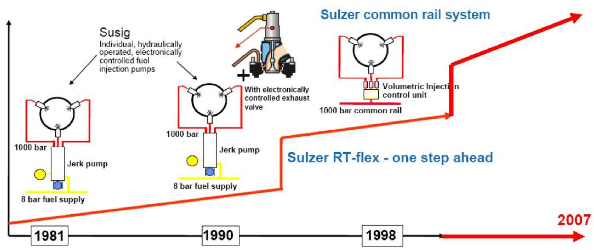

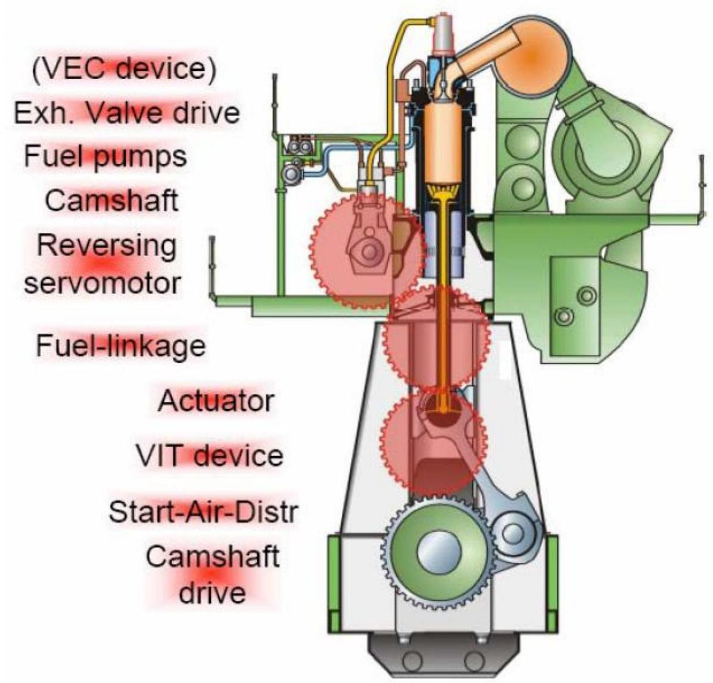

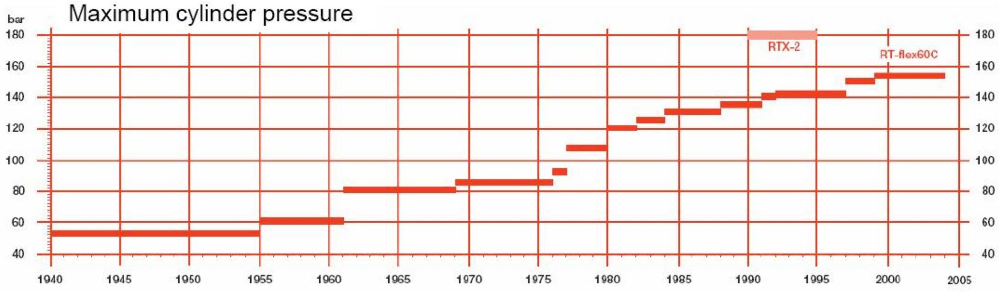

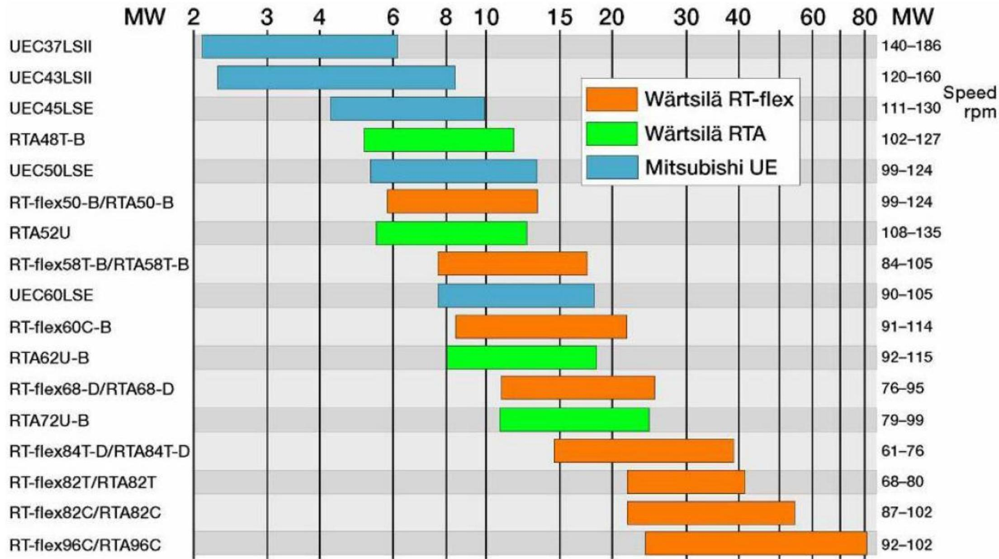

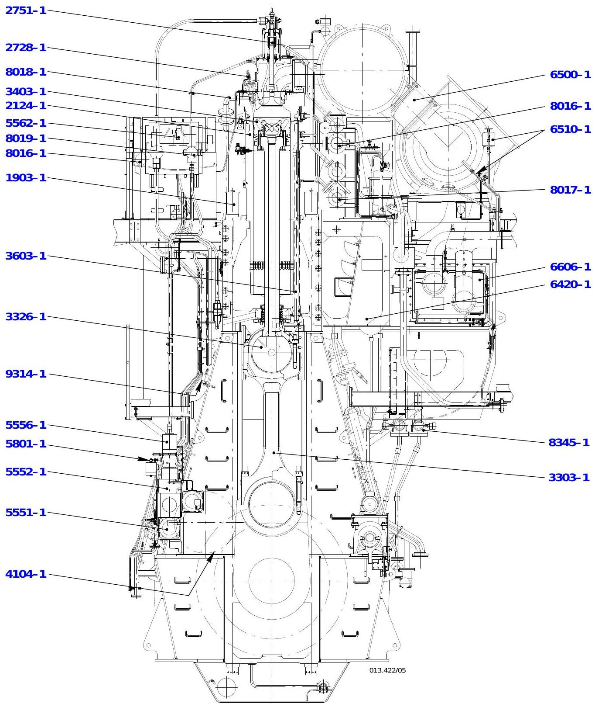

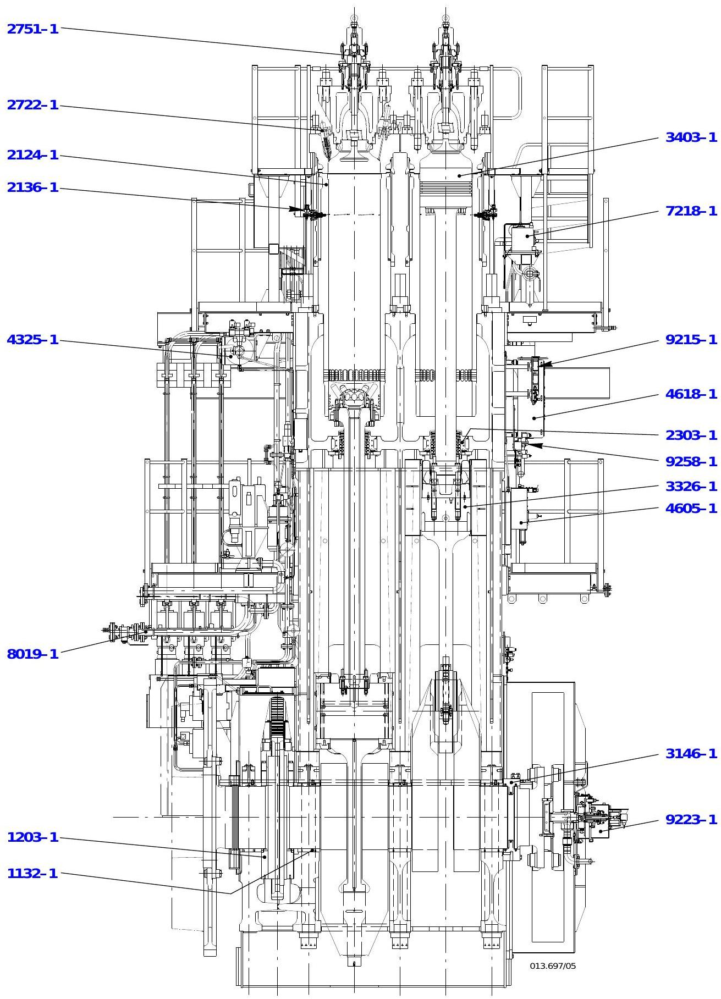

### 发动机结构层次

从横截面图可见，RT-flex50 从上到下的结构层次：

| 层次 | 主要组件 | Group编号 |
|------|---------|----------|
| 顶部（气缸盖与排气系统） | 气缸盖、排气阀、喷油器 | 6500-1、8016-1、8017-1 |
| 中上部（气缸与活塞） | 气缸套、活塞组件 | 6606-1、6420-1 |
| 中部（共轨系统核心） | 燃油轨(3.05)、伺服油轨(4.11)、喷射控制单元(3.02)、排气阀控制单元(4.10) | 8019-1、8016-1 |
| 中下部（曲轴箱与曲柄连杆） | 曲轴、连杆、十字头 | 3326-1、3303-1 |
| 底部（机座） | 机座、推力轴承、盘车齿轮 | 4104-1 |

**纵截面图可见的关键布局**：发动机各气缸沿纵轴呈直线排列；推力轴承(1132-1)位于驱动端（flywheel端），用于吸收螺旋桨推力；盘车齿轮(9223-1)同样位于驱动端；排气总管沿发动机顶部布置，连接各缸排气阀至涡轮增压器；扫气箱位于气缸体下方，存储增压后的扫气空气。

**管路走向**：
- 冷却水：从机座进入 → 气缸套冷却水套 → 气缸盖 → 排出
- 润滑油：油底壳 → 油泵 → 滤器/冷却器 → 主轴承/连杆/活塞冷却
- 燃油：外部供给 → 燃油轨(高压) → 喷射控制单元 → 喷油器
- 伺服油：轴承油分支 → 自动滤器 → 伺服油泵 → 伺服油轨 → 排气阀/喷射控制执行器

### 系统概述

| 系统    | 说明                                  |
| ----- | ----------------------------------- |
| 排气阀   | 由伺服油系统液压开启，气动关闭。油源来自轴承油系统经精细滤器      |
| 伺服油系统 | 供油单元中的伺服油泵通过两根上升管向伺服油轨提供所需压力        |
| 活塞冷却  | 由轴承油冷却                              |
| 燃油喷射  | 供油单元中的燃油泵将燃油加压送入燃油轨，经喷射控制单元至各喷油器    |
| 气缸冷却  | 气缸和气缸盖采用淡水冷却                        |
| 扫气冷却  | 单级冷却器，中央淡水冷却（闭式回路）                  |
| 启动系统  | 压缩空气经启动阀进入气缸，由 [[WECS-9520控制系统]] 控制 |
| 排气系统  | 废气从气缸经排气阀进入排气总管，至涡轮增压器              |
| 辅助鼓风机 | 低负荷时独立驱动的辅助鼓风机向扫气空间供气               |

## 工作原理（二冲程循环）

RT-flex50 采用二冲程循环，两个行程完成一个完整的工作循环。

### 第一行程：压缩行程

| 阶段              | 描述            |                                  |
| --------------- | ------------- | -------------------------------- |
| 活塞在 BDC（[[缩写术语表|下止点]]）        | 扫气口和排气阀打开，扫气空气进入气缸，将废气经排气阀压入排气总管 |
| 活塞上行            | 扫气空气继续进入并清扫废气 |                                  |
| **ES 点**        | 扫气口被活塞关闭      |                                  |
| **AS 点**        | 排气阀关闭，压缩开始    |                                  |

### 第二行程：做功行程（点火-燃烧-膨胀-排气-扫气）

| 阶段             | 描述                       |        |
| -------------- | ------------------------ | ------ |
| 接近 TDC（[[缩写术语表 | 上止点]]）                   | 燃油喷入气缸 |
| 点火             | 燃油在压缩热空气中点燃，燃烧开始         |        |
| 膨胀/做功          | 燃气膨胀推动活塞下行               |        |
| **AO 点**       | 排气阀打开，废气流出气缸进入排气总管       |        |
| **EO 点**       | 扫气口被下行活塞揭开，扫气空气进入并清除残余废气 |        |

> 参见二冲程原理示意图：
> 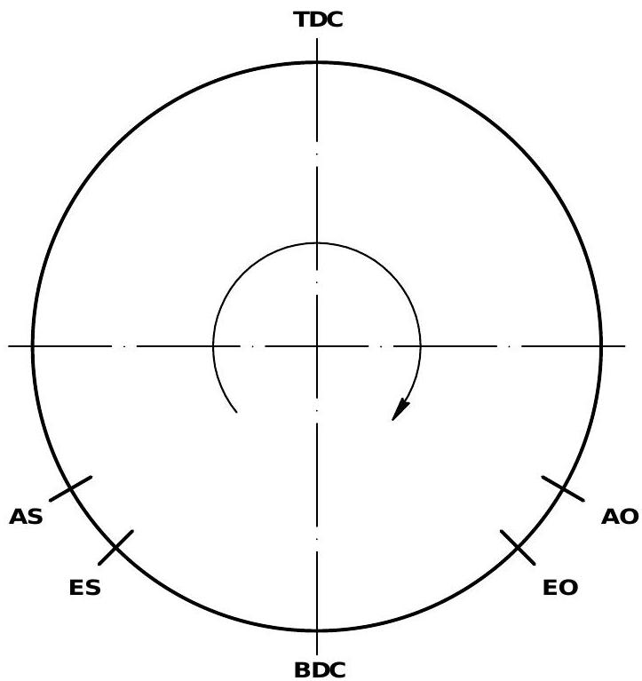
> 另见涡轮增压系统原理图 [[第7章-发动机特性图与原理图]]（#4-增压系统原理）

### 关键时间点总结

| 标记 | 全称 | 含义 |
|------|------|------|
| ES | Exhaust Scavenge ports close | 扫气口关闭 |
| AS | After Scavenge / exhaust valve Shut | 排气阀关闭，压缩开始 |
| AO | exhaust valve Open | 排气阀打开 |
| EO | Exhaust scavenge ports Open | 扫气口打开 |

## 设计分组编号体系

发动机文档按设计分组（Group）编号组织，各组内容如下：

| 分组 | 名称 | 主要内容 |
|------|------|----------|
| Group 0 | 一般说明与操作 | 前言、目录、符号缩写、发动机概述(0050)、工作原理(0060)、发动机/螺旋桨关系(0070)、编号与命名(0080)、启动准备、正常运行、操作数据表(0250)、机动操作、停机、异常运行、操作介质、故障排除 |
| Group 1 | 机座和拉杆 | 主轴承(1132)、推力轴承(1203)、拉杆(1903) |
| Group 2 | 气缸套和气缸盖 | 气缸套(2124)、气缸套润滑油嘴(2136)、活塞杆密封(2303)、喷油器(2722)、启动阀(2728)、排气阀(2751) |
| Group 3 | 曲轴、连杆和活塞 | 轴向减振器(3146)、连杆及连杆轴承(3303)、十字头和导板(3326)、活塞(3403)、活塞冷却和十字头润滑(3603) |
| Group 4 | 发动机控制与控制元件 | [[WECS-9520控制系统]](4002)、用户参数(4002-3)、定期检查(4002-4)、控制图(4003)、驱动供油单元(4104)、启动空气截止阀(4325)、控制空气供应(4605)、本地控制面板(4618)、转速测量探头(4628) |
| Group 5 | 供油单元、伺服油泵和燃油泵 | 伺服油泵(5551)、供油单元(5552)、燃油泵(5556)、燃油泵切出/切入(5556-2)、燃油压力控制阀(5562)、调节连杆(5801) |
| Group 6 | 扫气系统 | 扫气接收器(6420)、涡轮增压(6500)、涡轮清洗(6510)、辅助鼓风机(6545)、扫气冷却器(6606)、扫气放气阀(6735) |
| Group 7 | 气缸润滑 | 气缸润滑(7218)、气缸润滑油消耗测量(7218-2) |
| Group 8 | 管路系统 | 润滑油系统(8016)、冷却水系统(8017)、启动空气图(8018)、燃油系统(8019)、排放和冲洗管路(8345) |
| Group 9 | 发动机监测 | 仪表板(9215)、曲柄角传感器(9223)、压力开关和压力变送器(9258)、油雾检测器(9314)、flex电子元件位置(9362) |

> **发动机编号图**：
> 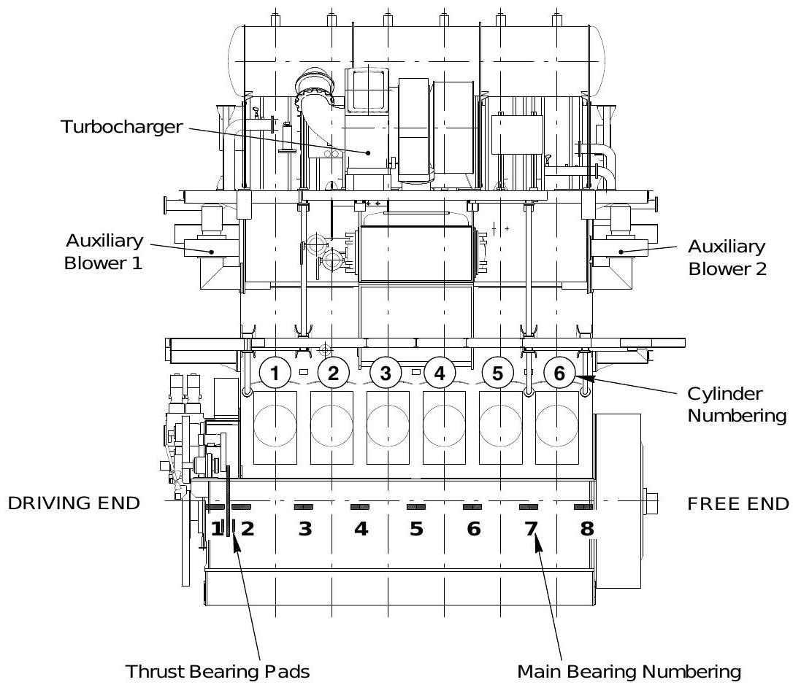
> 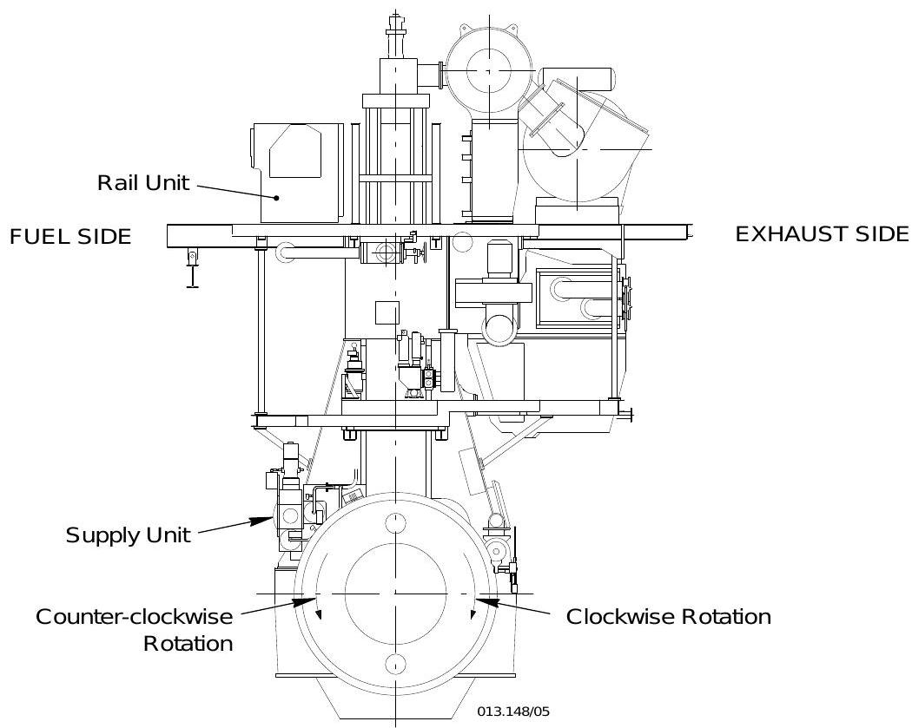
> 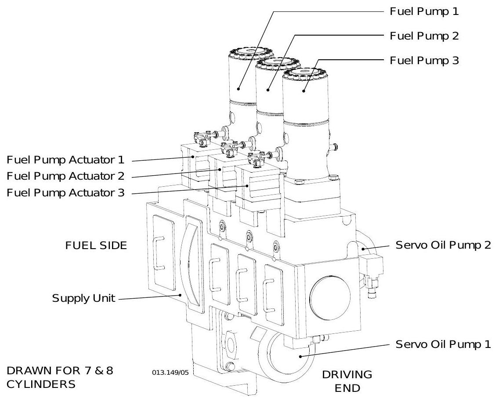
> 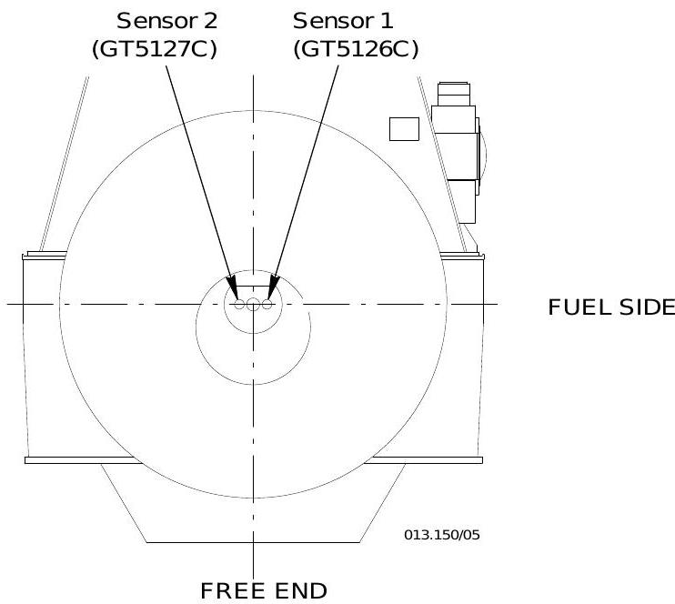

## 发动机与螺旋桨关系

对于配备定距桨（FPP）的船舶，螺旋桨转速与吸收功率之间存在确定关系：

$$P_1 / P_2 = (n_1 / n_2)^3$$

该公式的曲线称为**螺旋桨特性线（propeller characteristic）**。通过 CMCR（[[缩写术语表|合同最大持续功率]]）点（即标称功率在标称转速下，100%功率/100%转速）的螺旋桨特性线称为**标称螺旋桨特性线**。

> 参见原始文档图：
> 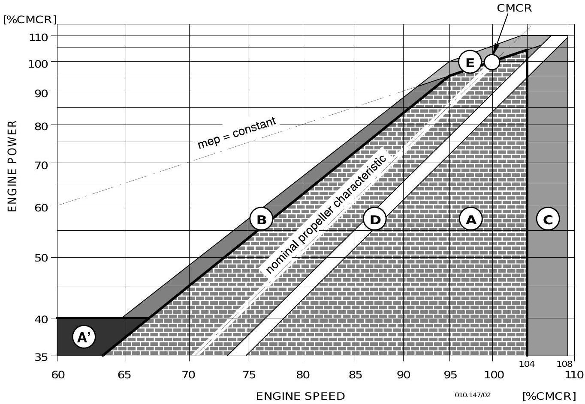

### 定距桨（FPP）运行区域

| 区域     | 说明                                                                                     |
| ------ | -------------------------------------------------------------------------------------- |
| **A**  | 标称螺旋桨特性线右侧：相对于选定CMCR点无连续运行限制的服务范围。左侧：仅用于瞬态运行（加速），应避免连续运行                               |
| **A'** | 最大允许发动机功率为40% CMCR，约在50%至67% CMCR转速范围内                                                 |
| **B**  | 有限运行时间的服务范围，遵循特性 P ≈ n^2.45。该特性线源于参考点 95% CMCR功率 / 95% CMCR转速。在此区域长时间运行会导致热过载和潜在的发动机损坏 |
| **C**  | 超速运行区域，104%~108% CMCR转速，仅在发动机厂家授权代表在场时的海试中允许                                           |
| **D**  | 定距桨推荐布置范围，适用于最大吃水、清洁船体、合同约定的天气和海况条件                                                    |
| **E**  | 过载区域，仅在发动机厂家授权代表在场时的海试中允许最多1小时                                                         |

### 调距桨（CCP）运行区域

| 要素 | 说明 |
|------|------|
| 怠速运行 | 启动后在最高70%额定转速下以零螺距运行 |
| 线⑥（下负荷限） | 70%~100%转速之间的下负荷限，螺距位置使得100%转速时至少达到37%功率（F点） |
| 线⑧（恒速模式） | 从37%功率（F点）到100%功率（CMCR）在100%转速下，用于轴带发电机运行 |
| 线⑤（上负荷限） | 上负荷限，对应允许的扭矩极限 |
| 线⑦（组合曲线） | 变速模式的典型组合曲线 |
| 运行区域 | 70%~100%转速之间、线⑤和线⑥之间的区域 |
| 禁止区域 | 标称转速下低螺距或零螺距运行不允许。超过3分钟报警，超过5分钟必须降至怠速（70%以下） |

> 参见原始文档图：
> 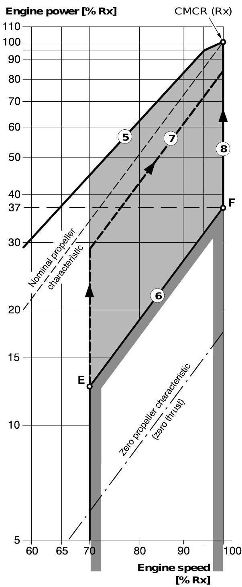
> 
> 

## RT-flex机械特性

### 共轨系统核心部件

RT-flex共轨系统由两大核心存储单元和多个控制执行器组成：

| 部件 | 功能 | 关键参数 |
|------|------|---------|
| [[燃油轨]] | 存储和分配高压燃油 | 600-800 bar，伴热系统 |
| [[伺服油轨]] | 存储和分配高压伺服油 | 80-190 bar（随负载），6μm过滤 |
| [[喷射控制单元ICU]] | 每缸燃油喷射控制 | 由2个[[轨阀RV-2]]预控制 |
| [[气门控制单元VCU]] | 每缸排气阀控制 | 由1个[[轨阀RV-2]]预控制，直接安装在伺服油轨上 |
| [[轨阀RV-2]] | 3/2通快速电磁阀 | 动作~1ms，电流50-60A，不可维修 |
| [[RT-flex燃油泵]] | 向燃油轨供油 | 柱塞式，无定时，齿条调节供油量 |
| [[RT-flex伺服油泵]] | 向伺服油轨供油 | Dynex品牌，带补偿阀和电磁阀 |
| [[曲柄角度传感器]] | 曲轴位置检测 | 0.1°分辨率，冗余设计 |

### 燃油系统机械特点

- **燃油轨**：整体式燃油轨管，"花生"形内腔，配备伴热管路系统防止燃油冷凝
- **喷射控制单元ICU**：燃油侧与伺服油侧完全分离，燃油量传感器远离热块安装
- **燃油泵**：无定时设计，通过调节齿条转动柱塞改变供油量（位置0=无供油，5=半供油，10=全供油）

### 伺服油系统机械特点

- **伺服油轨**：气门控制单元(VCU)直接安装在伺服油轨上，内部节流孔补偿排气阀驱动泄漏
- **排气阀驱动**：与传统RTA相比，采用双活塞驱动节省油体积，两个冗余行程传感器监控

### 控制系统机械特点

- **轨阀RV-2**：每缸3个（2个ICU+1个VCU），极短动作时间（~1ms）对精确控制至关重要
- **曲柄角度传感器**：绝对不可缺少，至少一个必须工作；两个都故障时发动机立即停机；弹簧联轴器吸收曲轴轴向和纵向运动

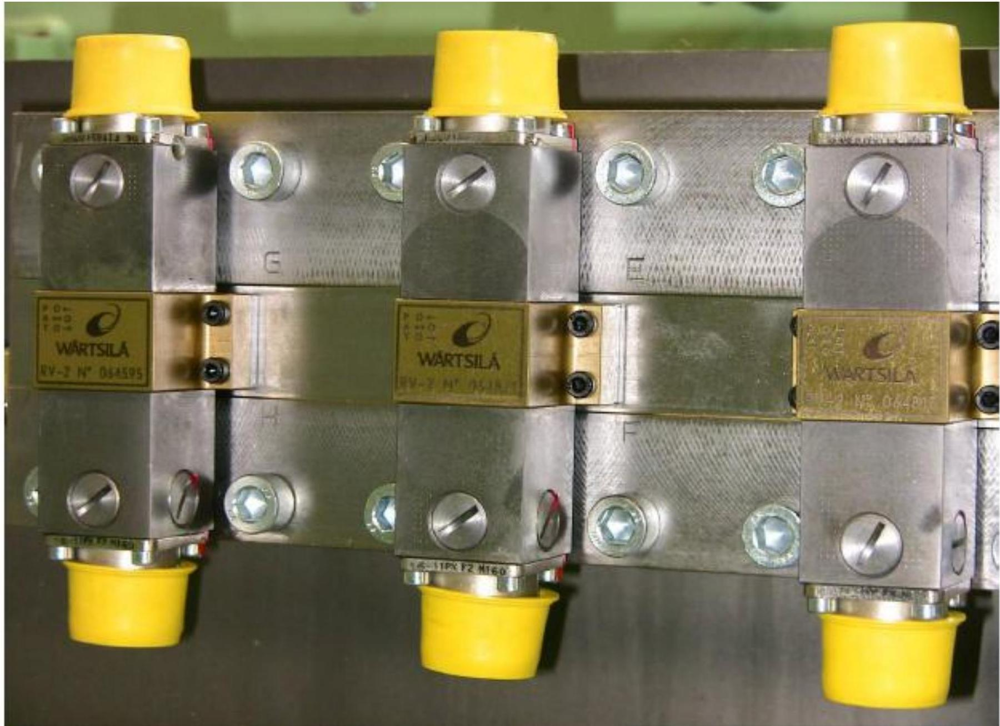

## 关联概念

- [[缩写术语表]] - 发动机相关缩写和符号说明（含 CMCR、BDC、TDC 等定义）
- [[WECS-9520控制系统]] - 发动机电子控制系统
- [[燃油轨]] - 共轨系统燃油存储部件
- [[伺服油轨]] - 共轨系统伺服油存储部件
- [[喷射控制单元ICU]] - 燃油喷射执行器
- [[气门控制单元VCU]] - 排气阀控制执行器
- [[轨阀RV-2]] - ICU/VCU预控制电磁阀
- [[RT-flex燃油泵]] - 燃油轨供油泵
- [[RT-flex伺服油泵]] - 伺服油轨供油泵
- [[曲柄角度传感器]] - 曲轴位置检测传感器
