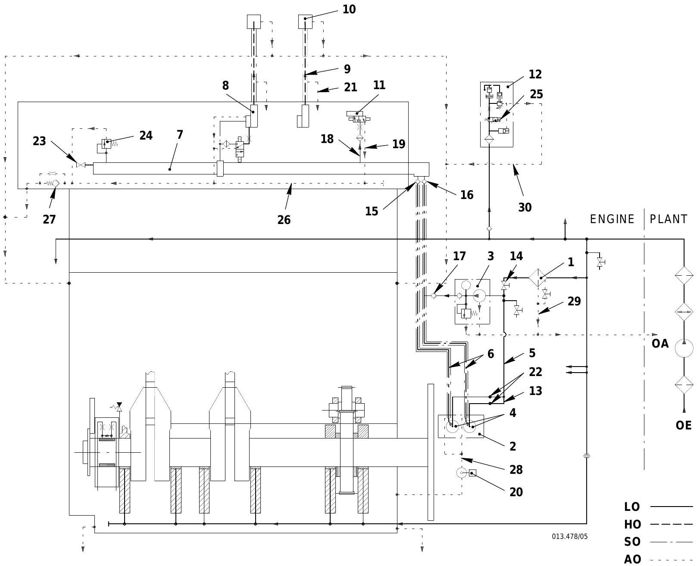
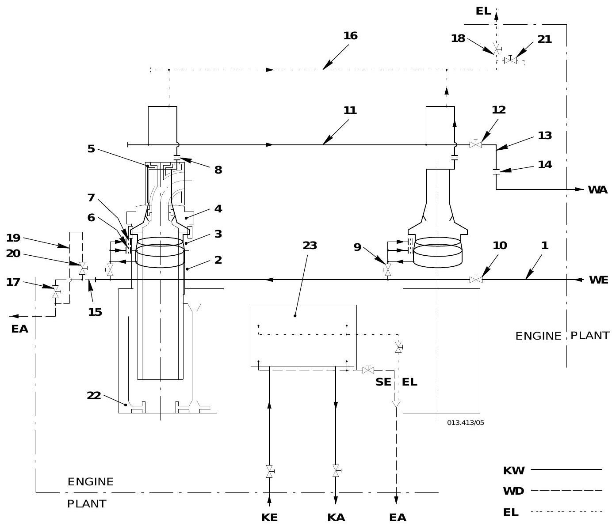
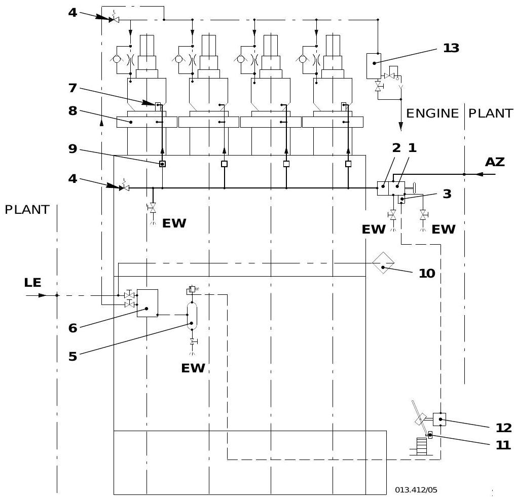

# 系统描述

## 概述

Wartsila RT-flex50 二冲程船用柴油机采用 Sulzer 共轨（Common Rail）技术，由 [[WECS-9520控制系统]] 统一管理发动机所有相关和气缸相关的控制功能。发动机包含以下 8 大系统，各系统相互关联、协同工作。

> 参考文档：OM-RT-flex50 (2009-07), Group 4-9

---

## 1. 燃油系统

燃油系统分为低压回路和高压回路（共轨系统），详细描述见 [[燃油系统]]。


### 1.1 低压回路

由机舱安装的增压泵将燃油经燃油进口管 1 (3.24) 输送至燃油泵 3 (3.14)。供油量远大于发动机实际需求，多余燃油通过燃油出口管 4 经压力保持阀 6 (3.53) 返回系统。

### 1.2 高压回路（共轨）

燃油泵 3 (3.14) 通过上升管 8 (3.29) 将燃油以高压送入燃油轨 12 (3.05)。喷油控制单元 13 (3.02) 控制每个喷油阀 15 (3.01) 的喷油量。为安全起见，轨道单元 30 为双层壁设计。

> **图解要点**：低压回路(BL线)从燃油进口经燃油泵供油；高压回路(HD线)从燃油泵经上升管 8 到燃油轨 12，再分配至各缸喷射控制单元 13 和喷油阀 15。泄漏监测液位开关 17/18/19 分布在轨道单元、喷射管路和上升管位置。

| 编号 | 名称 | 代码号 | 功能 |
|------|------|--------|------|
| 1 | 燃油进口管 | 3.24 | 低压燃油进入发动机 |
| 3 | 燃油泵 | 3.14 | 将燃油加压送入燃油轨 |
| 4 | 燃油出口管 | - | 多余燃油返回系统 |
| 6 | 压力保持阀 | 3.53 | 调节低压回路压力 |
| 8 | 燃油上升管 | 3.29 | 高压燃油从泵到轨的输送 |
| 9-11 | 止回阀 | 3.81-1/2/3 | 防止上升管破裂时燃油轨泄压 |
| 12 | 燃油轨 | 3.05 | 高压燃油储存与分配 |
| 13 | 喷油控制单元 | 3.02 | 控制各缸喷油量 |
| 14 | 喷油管 | 3.47 | 燃油轨到喷油阀的管路 |
| 15 | 喷油阀 | 3.01 | 将燃油喷入气缸 |
| 21 | 燃油压力控制阀 | 3.06 | 正常时关闭，超压约1050 bar时开启泄压 |
| 22 | 燃油关断先导阀 | 3.08 | 紧急停机时降低燃油压力至200 bar以下 |

---

## 2. 伺服油系统

伺服油系统用于控制排气阀运动和喷油控制单元的执行。所需液压油取自轴承油系统。



### 2.1 油路走向

轴承油 → 自动过滤器 1 (4.20) → 伺服油泵 4 (4.15) → 上升管 6 (4.55) → 伺服油轨 7 (4.11) → 排气阀控制单元 8 (4.10) / 喷油控制单元 11 (3.02)

### 2.2 系统参数

- 伺服油压力范围：100 - 200 bar（取决于发动机负荷）
- 高负荷时约 200 bar，低负荷时压力降低
- 电控压力调节系统：设定值取决于发动机负荷，由 PWM 信号控制
- 每台伺服油泵内置机械压力调节器，由 PWM 信号控制电气设定值
- 两台泵分别由缸 3、4 的 FCM-20 模块控制，分散化设计提高可用性
- 闭环控制补偿伺服油泵与伺服油轨之间的管路压力损失

### 2.3 关键组件

| 编号 | 名称 | 代码号 | 功能 |
|------|------|--------|------|
| 1 | 自动过滤器 | 4.20 | 过滤进入伺服油泵的轴承油 |
| 3 | 伺服油服务泵 | 4.88 | 电动泵，用于功能检查和泄漏测试 |
| 4 | 伺服油泵 | 4.15 | 摇板泵，为系统提供高压伺服油 |
| 7 | 伺服油轨 | 4.11 | 储存和分配伺服油 |
| 14 | 截止阀 | 4.37 | 运行时必须保持打开 |
| 23 | 截止阀 | 3.40 | 伺服油轨泄压和排油用 |
| 24 | 安全阀 | 4.23 | 伺服油系统超压保护 |

> 相关操作见 [[第3章-操作规程]]

---

## 3. 排气阀驱动系统

排气阀采用**液压开启、气动关闭（空气弹簧）** 的工作方式。

### 3.1 开启过程

排气阀控制单元中的活塞受伺服油驱动，液压油通过接头 14 压入上壳体 3，推动阶梯活塞下行。阀杆 6 连同空气弹簧活塞 10 被推下，排气阀打开。排气气流冲击旋转翼 17，使阀杆旋转。

### 3.2 关闭过程

当来自排气阀控制单元的液压油压力消失时，空气弹簧 'LF' 中的压力作用在空气弹簧活塞上，将阀杆 6 推向上方，排气阀关闭。

### 3.3 空气弹簧

压缩空气通过接头 'LE' 和进气孔 'EB' 进入空气弹簧空间。正常运行压力约 6 bar（经减压阀 23HA 从 7-8 bar 船用压缩空气系统减压）。

---

## 4. 冷却水系统

冷却水系统为闭式循环，连接膨胀水箱以保持静压。冷却水必须使用经批准的冷却水缓蚀剂处理。



### 4.1 缸套冷却回路

冷却水泵通过排气管侧的分配管 1 将冷却水输送到各缸，依次流经：
- 气缸套 2（含上下导水套 3）
- 气缸盖 4
- 排气阀壳 5

节流盘 6、7、8 控制各处水流量。出水管 13 经温度调节阀回到冷却器。

> **图解要点**：冷却水为串联冷却路线 -- 气缸套(2) -> 气缸盖(3) -> 排气阀壳(4)，优先冷却温度最高的燃烧室部件。每缸出口设有节流盘(8)控制流量，总出水管(13)设有节流盘(14)调节系统工作压力。扫气空冷器(23)通过独立接口 KE/KA 连接。

### 4.2 空冷器冷却

扫气空冷器 23 使用中央淡水冷却（闭式回路）。

### 4.3 温度控制要求

- 恒定负荷时温度波动：+/-2 degC
- 负荷变化时温度波动：+/-4 degC

> 参数限值见 [[第6章-技术参数与报警设定]] (0250-1, 0250-2)

---

## 5. 润滑油系统

### 5.1 轴承油系统

泵 1 将油加压至轴承油压力（3.5 - 4.9 bar）。油路分配：
- 主轴承 6、推力轴承 8
- 活塞冷却（伸缩管 12）、十字头销 11、连杆大端轴承 10
- 轴向减振器 5、振动减振器 23
- 供油单元 16 的轴承、喷嘴和燃油泵
- 涡轮增压器 29（经通风柜 30 回油）

### 5.2 涡轮增压器油系统

轴承油经排气管侧的分配管 4 通过进油管 28 供给涡轮增压器 29，回油经通风柜 30（空气分离器）和出口管 31 返回轴承油系统。

> 介质规格见 [[工作介质规格]] (0750-1)

---

## 6. 扫气系统

### 6.1 系统构成

涡轮增压器（定压增压）→ 扩压管 13 → 扫气空冷器 14 → 水分离器 15 → 接收器预空间 'VR' → 空气挡板 2 → 接收器空间 'RC' → 扫气口 → 气缸

### 6.2 辅助鼓风机

在发动机启动和低负荷运行时，安装在接收器两端的辅助鼓风机 7 从预空间 'VR' 吸入空气，经吸入管 11 压入接收器空间 'RC'。空气挡板防止空气回流。

### 6.3 关键组件

| 编号 | 名称 | 功能 |
|------|------|------|
| 1 | 扫气空气接收器 | 焊接组件，含接收器、涡轮增压器支座、扩压管、空冷器壳体 |
| 2 | 空气挡板 | 防止空气回流至预空间 |
| 7 | 辅助鼓风机 | 低负荷时补充扫气 |
| 10 | 安全阀 | 接收器空间超压保护 |
| 14 | 扫气空冷器 | 冷却增压空气 |
| 15 | 水分离器 | 分离冷凝水 |

> 注意：污油排放口 17 必须保持畅通，否则存在重大火灾风险。

---

## 7. 起动空气系统



### 7.1 系统构成

起动空气瓶 → 截止阀 1 → 止回阀 2 → 控制阀和阀单元 E (3) → 起动阀 7 → 气缸盖 8

### 7.2 参数

| 介质 | 压力 |
|------|------|
| 起动空气（来自起动空气瓶） | 最大 25 / 30 bar |
| 控制空气（来自船用系统） | 7 - 8 bar（经减压阀 23HA 调整至 6.5 bar） |

### 7.3 安全措施

- 阻火器 9 防止火焰传播
- 盘车机联锁阀 12 防止盘车机啮合时起动
- 定期打开排放阀排除冷凝水

---

## 8. 控制空气系统

控制空气由控制空气供给单元 A (6) 和控制空气瓶 5 (A) 提供，经自动精过滤器 10 过滤后分配到各控制功能：
- 起动空气截止阀的控制
- 空气弹簧空气供给
- 各类气动控制元件

> **图解要点**（起动空气图8018-1）：系统分为三条气路 -- 起动空气(AL)经截止阀1、止回阀2到起动阀7；控制空气(LE)经自动精过滤器10到控制空气供给单元6和气瓶5；空气弹簧空气(LF)为排气阀提供关闭力。盘车机联锁阀12确保安全起动。

控制空气必须保持清洁和干燥。

---

## 系统间关联

```
轴承油系统 ──→ 自动过滤器 ──→ 伺服油系统 ──→ 排气阀驱动
                                            ──→ 喷油控制单元 ──→ 燃油系统
控制空气 ──→ 起动空气系统                    ──→ 燃油压力控制阀
         ──→ 空气弹簧（排气阀关闭）
燃油系统（低压）──→ 燃油泵 ──→ 燃油轨 ──→ 喷油阀
冷却水系统 ──→ 缸套冷却 + 空冷器冷却
扫气系统 ──→ 涡轮增压器 + 辅助鼓风机
```

---

## 关联概念

- [[WECS-9520控制系统]] - 发动机控制核心
- [[燃油系统]] - 燃油供给与喷射
- [[第3章-操作规程]] - 各系统操作步骤
- [[第6章-技术参数与报警设定]] - 压力、温度等参数限值
- [[工作介质规格]] - 润滑油、冷却水等规格要求

---

*来源：OM-RT-flex50 操作说明书 (2009-07), 4002-1, 5551-1, 5552-1, 5556-1, 5562-1, 6420-1, 6606-1, 7218-1, 8016-1, 8017-1, 8018-1, 8019-1*
