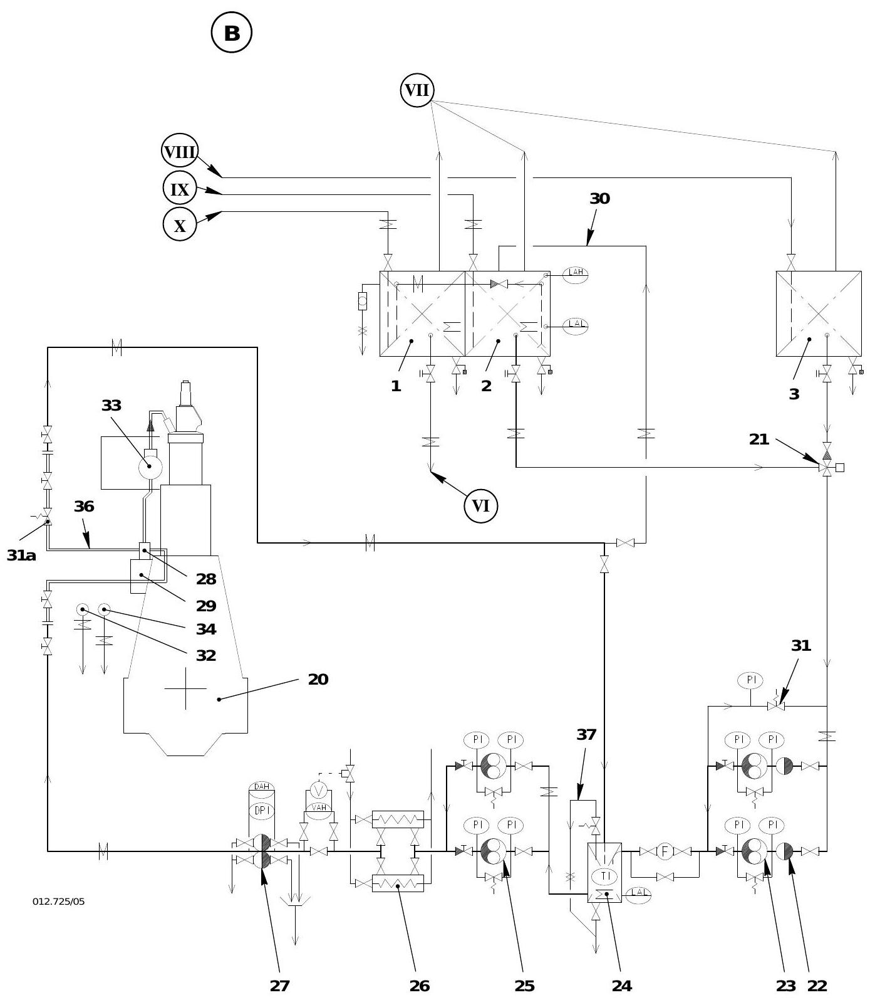
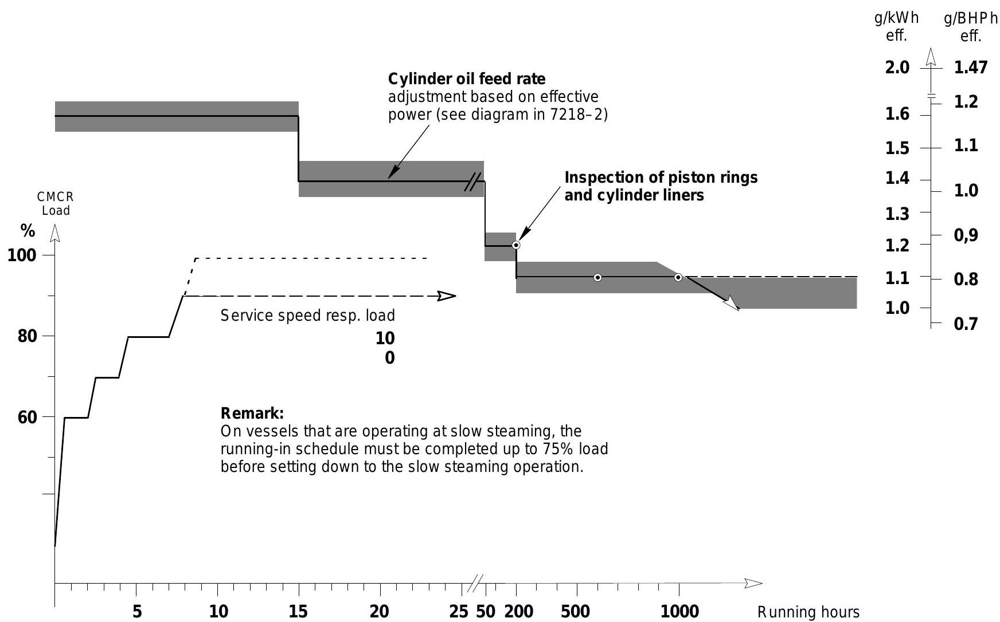

# 操作规程

> 本章汇总 Wartsila RT-flex50 船用低速柴油机的完整操作规程，涵盖从启动准备到停机后维护的全部流程。所有参数值参见 [[第6章-技术参数与报警设定]]。

---

## 一、启动准备（短时停机后，0110-1）

适用于停机一天或数天后的启动准备。前提条件：所有检修过的部件已正确装复，工具和杂物已清除，燃油泵设置和执行器连杆正常。

### 1.1 基本检查与准备

1. 检查各系统油箱液位（包括泄漏排放柜）
2. 确认冷却水和润滑油系统所有截止阀处于正确位置
3. 打开控制空气供应（来自船舶系统）
4. 预热润滑油至约 **35°C**（通过分油回路或油底壳加热）
5. 预热气缸冷却水至不低于 **60°C**
6. 启动 [[WECS-9520控制系统]]：
   - 合上电源箱 E85 所有断路器
   - 检查所有 FCM-20 模块上两个绿色指示灯亮起
   - 倒计时结束后无红色 LED 亮起表示模块功能正常
7. 准备伺服油系统（见 0130-1）
8. 启动气缸冷却水泵和轴承油泵，将压力调至正常值
9. 接通自动过滤器控制箱
10. 接通伺服油工作泵主开关
11. 准备 [[燃油系统]]（见 0120-1）
12. 确保所有系统已充分放气
13. 在遥控模式下手动开关各排气阀数次，确保排气阀液压执行器充分放气

### 1.2 盘车与润滑

1. 打开各缸示功阀
2. 用盘车机转动发动机至少一整圈，检查运动部件正常。示功阀不得有水、油或燃油喷出
3. 同时开启气缸润滑（控制台上的预润滑/后润滑按钮）：
   - 一次触发预润滑约 **10 分钟**，约等于曲轴转一圈
4. 关闭示功阀
5. 确认所有曲轴箱门已用全部夹扣锁紧
6. 检查燃油泵调节连杆活动自如

### 1.3 启动空气系统准备

1. 检查启动空气瓶压力，打开排放阀排尽冷凝水
2. 打开排放和试验阀 2.06 直到无水排出
3. 关闭放气阀 2.21 和 2.27，打开启动空气瓶 9.01 的主截止阀
4. 将启动空气截止阀 2.03 置于 **AUTOMAT** 位置
5. 打开连接 A1 处的截止旋塞
6. 确认仪表板上启动空气和控制空气压力显示正常

### 1.4 最终准备

1. 将辅助鼓风机开关置于 **AUTOMAT**
2. 关闭伺服油工作泵
3. 脱开盘车机并固定操纵杆
4. 短暂打开试验阀 2.06，确认启动空气截止阀 2.03 开启（可听到明显声响）后关闭
5. 在 [[WECS-9520控制系统]] 手动控制面板上按 **SLOW TURNING** 按钮，执行一圈慢转
6. 根据启动位置（驾驶台/集控室/机旁），激活相应控制模式
7. 再次确认飞轮附近无人员
8. 向驾驶台报告准备就绪

---

## 二、慢转操作（0220-1）

> 目的：确认运动部件转动自如。建议每次启动前至少慢转一圈（操纵间隔内的停机除外）。船级社如有更严格要求，从其规定。

### 2.1 盘车机盘车

- 盘车机转速约 **1圈/10分钟**
- 通过飞轮旁的指针观察曲轴旋转及方向

### 2.2 启动空气慢转（SLOW TURNING）

- 慢转速度约 **5-10 rpm**，通过控制释放启动空气量实现
- 由 [[WECS-9520控制系统]] 的 SLOW TURNING 命令触发

**触发位置：**

- 遥控系统
- 集控室 ECR 手动控制面板
- 机旁控制面板

**前提条件：**

| 条件 | 要求 |
|------|------|
| 盘车机 | 已脱开 |
| WECS-9520 | 已开启 |
| 油泵 | 轴承油和十字头油泵运行中 |
| 控制站 | 已激活 |
| 示功阀 | 已关闭 |
| 手轮 2.10 | 在 AUTOMAT 位置 |
| 启动空气瓶截止阀 | 已打开 |
| 空气弹簧压力 | 正确设定 |
| 气缸润滑 | 已开启 |

**工作原理：**

1. 截止阀 2.03 由控制阀 2.05 打开，启动空气到达气缸盖启动阀 2.07
2. FCM-20 模块控制启动阀前的 3/2 电磁阀，使启动阀短间隔开闭
3. 可通过遥控系统调整启动阀开关定时来优化慢转速度

---

## 三、启动程序（0230-1）

> 每次启动（包括试车和启动空气转动）的前提是发动机处于完整运行准备状态（见 0110-1、0120-1、0130-1）。

### 3.1 集控室遥控启动

1. 在 WECS-9520 手动控制面板上按 **REMOTE AUTOM. CONTROL** 键
2. 在集控台按 **REMOTE AUTOM. CONTROL** 键接管控制
3. 将车钟从 STOP 移至任何位置即可自动启动

### 3.2 机旁控制面板启动

> 此模式适用于电子调速系统或遥控系统故障时。操作人员不得离开机旁操纵台，必须持续监控转速。

1. 在 WECS-9520 手动控制面板上按 **LOCAL MANUAL CONTROL**
2. 按 **AUX. BLOWER PRESEL.** 按钮
3. 按 **FUEL CONTROL MODE** 按钮
4. 将燃油喷射量旋钮转至约 **15%** 起动燃油量
5. 按 **START AHEAD** 或 **START ASTERN** 直到发动机运转
6. 缓慢调整燃油喷射量旋钮至所需转速

---

## 四、正常运行监控要点（0240-1）

> 最佳运行效果通常在恒定功率下获得。负荷/转速变化应缓慢进行。

### 4.1 核心监控项目

| 监控项目 | 要点 |
|----------|------|
| 压力与温度 | 定期检查，不得超出 [[第6章-技术参数与报警设定]] 的限值 |
| 仪表读数对比 | 与验收记录值对比，偏差须排查（发动机/系统/仪表故障） |
| 关键参数 | 燃油喷射量、燃油轨/伺服油轨压力、转速、增压器转速、扫气压力、涡轮前排气温度 |
| 日燃油消耗 | 考虑低热值，作为运行评估指标 |
| 冷却水截止阀 | 运行中各缸进出口截止阀必须全开（仅供检修时断开使用） |
| 温度调节 | 发现异常高温/低温时须缓慢调整至正常值，禁止骤变 |
| 排气温度 | 涡轮前最高 **515°C**，各缸出口温度偏差不得超过正负 **50°C** |
| 排烟颜色 | 烟囱不得有黑烟排出 |
| 扫气温度 | 保持正常水流下正确的空冷后扫气温度 |
| 扫气压降 | 空冷器压阻过大会导致发动机进气不足 |
| 燃油处理 | 详见 [[燃油系统]]；定期排放燃油柜和过滤器的水和油泥 |
| 燃油粘度 | 按 Viscosity-Temperature Diagram 0270-2 保持适当加热 |
| 气缸润滑油消耗 | 定期测算，避免过度润滑 |
| 冷却水泵 | 在正常工作点运行，进出口温差应在设计范围内 |
| 冷却水透气 | 最高点透气阀须保持常开 |
| 油水液位 | 检查所有油水柜和泄漏管路排放柜液位 |
| 油过滤器 | 检查压差，必要时清洗 |
| 示功图 | 手绘示功图评估燃烧和缸内压力 |
| 润滑油 | 离心分离，定期取样化验 |

### 4.1.x 辅助风机控制

- **扫气压力控制**：辅助风机根据扫气压力自动启停
  - 启动压力：**0.45 bar**（扫气压力降至此值时启动）
  - 停止压力：**0.6 bar**（扫气压力升至此值时停止）
- **转速区间注意**：辅助风机频繁启停的转速区间约为 **95-100 rpm**
- **运行建议**：长江航行或低负荷航行时，应避开此转速区间以避免辅助风机频繁启停
- **扫气压力监控**：正常运行中需保持扫气压力稳定，异常波动需排查增压器或空冷器

### 4.2 主要运行参数范围（持续服务功率 MCR 下）

| 介质   | 系统      | 测量位置  | 压力 [bar]       | 温度 [°C]       |
| ---- | ------- | ----- | -------------- | ------------- |
| 淡水   | 气缸冷却    | 进口    | 2-4            | 65-（上限见下）     |
| 淡水   | 气缸冷却    | 各缸出口  | -              | 80-90（温升最大15） |
| 淡水   | 空冷器LT回路 | 进口    | 2-4            | 25-36         |
| 海水   | 空冷器     | 进口    | 0.8-4          | 25-32         |
| 海水   | 空冷器     | 出口    | -              | 最高57          |
| 润滑油  | 主轴承     | 进口    | 5.0-6.0        | 40-50         |
| 润滑油  | 活塞冷却    | 进口    | 5.0-6.0        | 40-50         |
| 润滑油  | 活塞冷却    | 出口    | -              | 最高80（温升最大30）  |
| 润滑油  | 推力轴承    | 出口    | -              | 最高65          |
| 润滑油  | 伺服油     | 泵进口   | 4.0-6.5        | -             |
| 燃油   | 供油单元    | 泵进口   | 7-10           | 最高150         |
| 燃油   | 燃油泵后    | 回油    | 3-5            | -             |
| 启动空气 | -       | 发动机进口 | 12-25/30       | -             |
| 控制空气 | -       | 发动机进口 | 6.0-7.5（正常6.5） | -             |
| 空气弹簧 | -       | 主分配器  | 6.0-7.5（正常6.5） | -             |
| 排气   | 各缸后     | 接收器   | -              | 最高515（偏差正负50） |
| 排气   | 涡轮前     | -     | -              | 最高515         |
| 扫气   | 空冷器后    | -     | -              | 25-60         |

> 完整报警、减速和停机设定值参见 [[第6章-技术参数与报警设定]]。

---

## 五、操纵注意事项（0260-1）

### 5.1 操纵范围

- 操纵范围指从离港到 SEA SPEED 释放，以及从进港到 FINISHED WITH ENGINE 的整个过程
- 操纵速度范围至 FULL AHEAD 和 FULL ASTERN
- 定距桨 FULL 操纵转速约对应标称转速的 **70%**（约 **35%** 标称功率），此时可达约 **2/3** 标称船速
- 在操纵范围内可使用启动燃油限制器和扫气空气限制器，无时间和性能限制

### 5.2 负荷变化要求

| 操作 | 最短时间 |
|------|----------|
| 从全操纵功率增加到服务功率 | 不少于 **30 分钟**（推荐 40-50 分钟） |
| 从服务功率减少到全操纵功率 | 不少于 **15 分钟**（推荐 40-50 分钟） |

> **例外：** 机舱关键报警条件下需要更快减负荷，或停机/自动减速系统触发时。

### 5.3 机旁操纵特殊注意事项

- 从遥控切换到机旁手动控制时，工程师必须始终在机旁操纵台值守
- 可调螺距桨或离合器联轴器安装须特别注意：
  - 仅在螺旋桨处于极限位置（正车或倒车）时启动发动机
  - 发动机运行中不得改变螺距
  - 离合器在发动机运行时不得脱开

### 5.4 紧急操纵

> 紧急情况下解除所有限速限制，可调用发动机全部功率——**船舶安全第一**。

---

## 六、燃油切换步骤（0270-1）

> 参见 [[燃油系统]]

> 燃油系统布置图（图 B）展示了标准加压燃油系统从日用柜到发动机的完整流程。主要组件包括：三通阀 21（柴油/重油切换）、低压供油泵 23、混合单元 24（可加热保温）、增压泵 25、末端加热器 26、燃油滤器 27（可加热）、燃油泵 28、压力调节阀 31 和压力保持阀 31a。系统保持全程加压以防止高温下水分蒸发，燃油粘度由粘度计控制末端加热器自动调节。

### 6.1 柴油 -> 重油切换

**装置侧：**

1. 切换三通阀 21 后，混合柜 24 内形成柴油/重油混合物
2. 粘度计控制终端加热器 26，保持所需粘度（预热温度）
3. 升温速度不得超过 **15°C/分钟**（突然温度变化会导致燃油泵柱塞咬合）
4. 保持燃油过滤器和管路加热，直至达到所需预热温度
5. 检查低压供油泵后压力和燃油泵进口压力

**发动机侧：**

1. 切换时必须接通发动机伴热（供油单元和燃油轨），所有轨道装置盖板必须关闭
2. 如机舱完全冷却，提前约 **1 小时**接通伴热
3. 切换期间负荷不得超过 **75% CMCR**
4. 停机前切换必须完全完成，避免燃油轨内柴油/重油混合物造成下次启动粘度问题

**重油粘度示例：**

| 重油规格（50°C） | 燃油泵前推荐加热温度 |
|------------------|---------------------|
| 150 mm^2/s (cSt) | 108-120°C |

### 6.2 重油 -> 柴油切换

**装置侧：**

1. 将三通阀 21 切换至柴油位
2. 混合柜中重油/柴油混合物粘度随柴油比例增加迅速下降
3. 短时间后可关闭加热

**发动机侧：**

1. 切换时同时关闭发动机伴热
2. 低负荷运行时完成切换时间更长

**注意事项：**

- **运行柴油油且伴热开启对发动机极其危险！**
- 切换时负荷建议在 **50% CMCR** 以下
- 停机前切换必须完全完成

---

## 七、低负荷运行注意事项（0280-1）

1. 遵守 0240-1 中的检查和预防措施
2. 保持 [[燃油系统]] 伴热运行
3. 冷却介质温度保持在正常范围内
4. 确保燃油正确处理
5. 气缸润滑油量由 DENIS-9520 控制系统根据发动机负荷自动调节
6. 长期低负荷运行需检查气缸润滑是否处于最佳设定

### WECS-9520 喷射控制

- 低负荷时 [[WECS-9520控制系统]] 自动切断每缸两个喷油器中的一个
- 确保最佳雾化和燃烧，降低排烟和油耗
- 系统定期交替切换两个喷油器的切除，均匀分布燃烧室热负荷
- **低负荷运行无时间限制**（因该范围燃烧已优化）

---

## 八、超负荷运行限制（0290-1）

| 限制项 | 要求 |
|--------|------|
| 超负荷定义 | **110% CMCR** 功率 |
| 适用场景 | 通常仅在试航时，须有发动机制造商授权代表在场 |
| 时间限制 | 每天最多 **1 小时** |
| 监控要求 | 特别密切监控发动机；出现异常迹象须立即降负荷 |
| 负荷指示 | 正常运行中不得超过全负荷位置（燃油喷射量） |
| 最大位置 | 见验收记录，不得超出 |
| 冷却温度 | 必须保持在正常范围内 |

**航行阻力增加的情况：**

强逆风、大浪、船体严重附生物、浅水等会增加船舶阻力，在未改变转速设定的情况下，调速器维持转速但燃油喷射量指示将增大。

---

## 九、停机程序（0310-1）

### 9.1 卸载

- 条件允许时建议缓慢降低负荷（见操纵 0260-1）

### 9.2 停机方式

**集控室遥控停机（正常方式）：**

- 将车钟移至 STOP 位置

**集控室备用控制箱停机：**

- 降低发动机转速/功率后，在 ECR 手动控制面板按 **STOP** 按钮
- 由 [[WECS-9520控制系统]] 执行停机

**机旁控制面板停机：**

- 降低发动机转速/功率后，在 WECS-9520 手动控制面板按 **STOP** 按钮

**紧急停机：**

1. 按下集控室或机旁控制面板的 **EMERGENCY STOP** 按钮
2. 通过燃油关断阀 3.07 释放燃油轨压力
3. 同时燃油泵执行器将燃油泵调节齿条移至"0"位

**其他紧急停机方式：**

- 切断电源箱 E85 的 WECS-9520 电力（仅作为最后紧急手段！）

---

## 十、停机后措施（0320-1）

### 10.1 短期停机（数天至数周）

#### 发动机需保持可操纵状态

| 项目 | 要求 |
|------|------|
| WECS-9520 | 保持开启 |
| 冷却水/润滑油/燃油泵 | 保持运行 |
| 控制空气 | 保持供应 |
| 启动空气瓶 | 补充压力 |
| 气缸冷却水 | 维持预热温度 |
| 润滑油 | 不得冷却 |
| 燃油温度 | 按粘度-温度图保持 |

#### 发动机无需保持可操纵状态

1. 冷却水和润滑油泵继续运行至少 **20 分钟**，使温度均匀化
   - 海水泵通常可立即停止
   - 介质温度不得低于正常进口温度
2. 重油运行停机后：
   - 喷油泵回路保持循环，燃油系统保持运行
   - 发动机燃油管路伴热保持开启
   - 若不需要伴热，应在停机前切换至柴油运行
3. 柴油运行停机后：可停止低压供油泵和增压泵
4. 关闭启动空气供应：
   - 关闭启动空气瓶截止阀
   - 手轮 2.10 转至 CLOSED
   - 打开放气阀 2.21 和 2.27 排放
5. 打开气缸盖示功阀
6. 可接入盘车机
7. 气缸后润滑：用盘车机转动曲轴约 **3 圈**，同时开启气缸润滑（每次触发约 10 分钟）
8. 定期（潮湿气候下建议每日）用盘车机带开示功阀转动数圈，润滑油泵运行并开启气缸润滑
   - 每次停转后确保活塞停在不同位置
9. 保持冷却水温热（防止发动机过度冷却）
10. 修复运行中发现的缺陷

### 10.2 长期停机（数周或数月）

- 参照 10.1 中发动机无需保持可操纵状态的措施
- 参照 0620-1 "长期停用前的措施"

---

## 十一、缸套/活塞环磨合规程（0410-1）

### 11.1 目的

新气缸套或更换活塞环后必须进行磨合，以尽快实现良好的环密封。**磨合面上不得出现任何拉伤。**

### 11.2 启动前准备

1. 按 0110-1 完成全部启动准备
2. 从活塞下方检查活塞环和缸套状况、有无冷凝或泄漏
3. 检查扫气接收器是否清洁、水分离器是否干净
4. 检查扫气接收器排放阀开启且高位报警功能正常
5. 设定磨合所需气缸润滑油供给率（见下表）
6. **关闭 VIT**（在遥控中将功能设为 'VIT OFF'）

### 11.3 燃油与润滑油

- **燃油：** 使用与正常运行相同的重油（HFO），正确处理和预热
- **气缸润滑油：** 使用高清洁度、高碱性（BN）气缸润滑油

### 11.4 润滑油供给率调整

> 磨合程序图展示了从 0 小时到 1000+ 小时的完整磨合过程。横轴为运行小时数，左纵轴为 CMCR 负荷百分比，右纵轴为效率指标 (g/kWh)。图中灰色区域标注了气缸油供给率调整和活塞环/缸套检查的关键时间节点。慢速航行船舶须在完成 75% 负荷磨合后方可进入慢速航行模式。

**磨合期间需提高润滑率，设定至最大 1.6 +/- 0.1 g/kWh。**

**泵元件设定示例（R1 标定，1620 kW/缸）：**

| 缸油供给率 [g/kWh] | 泵元件设定位置 | 泵速系数 |
|---------------------|---------------|---------|
| 1.6 | 5 | 0.95 |
| 1.4 | 4 | 1.1 |
| 1.2 | 4 | 0.95 |
| 1.1 | 4 | 0.9 |
| 1.0 | 3 | 1.0 |

**润滑率降低计划：**

| 运行时间 | 供给率 [g/kWh] |
|----------|----------------|
| 磨合开始 | 1.6 |
| 约 15 小时后 | 约 1.4 |
| 50 小时后 | 约 1.2 |
| 200 小时后（经检查确认） | 约 1.1 |
| 1000 小时后（确认状况良好） | 可按 0.1 g/kWh 步长逐步降低，每步间隔 500-1000 小时 |

> 任何降低供给率的决定都应基于通过扫气口对活塞环和缸套运行面的检查结果。

**最终正常供给率（低于 1.1 g/kWh）取决于：**

- 发动机运行条件
- 重油硫含量
- 维护水平
- 润滑油选择
- 活塞下方排放油分析

### 11.5 磨合程序

1. 严格按照磨合程序的负荷加载曲线执行，不得快于推荐速度
2. 定期通过扫气口检查活塞环和缸套运行面状况
3. 频繁检查气缸冷却水温度的稳定性和水平（不允许温度波动）
4. 单缸磨合可通过 'Inj. correction factor' 功能临时降低该缸负荷

---

## 十二、安全措施和警告（0210-1）

### 12.1 基本原则

- 良好的维护是安全运行的前提
- 发动机和机舱应保持清洁，特别注意 WECS 电子控制箱的清洁和干燥
- 任何泄漏应立即处理

### 12.2 重要安全规定

| 安全项目 | 具体要求 |
|----------|----------|
| 照明 | 除固定照明外，机舱各处应备有手灯 |
| 阀门开启 | 缓慢开启阀门，注意介质喷出方向，避免烫伤 |
| 部件拆卸 | 拆卸缸盖阀门时防止油/燃油滴落到热活塞上引起爆炸；预紧弹簧拆卸须使用合适工具 |
| 火灾 | 严格遵守灭火规则；焊接前确认无爆炸性气体；保持发动机关闭直到冷却；及时更换被油浸透的隔热材料 |
| 曲轴箱门开启 | 因怀疑运动部件过热停机时，至少等待 **20 分钟** 后方可拆卸曲轴箱门（防爆） |
| 温度检测 | 检修运动部件后运行 **10 分钟** 检查异常发热，约 **1 小时** 后重复，短时全负荷后再次检查 |
| 进入发动机空间 | 确保启动空气已切断、放气阀 2.21 和 2.27 打开、盘车机已接入；注意他船水流可能带动螺旋桨旋转 |
| CO2 灭火后 | 进入前必须充分通风（窒息风险） |
| 曲轴箱门关闭 | 发动机投入使用前所有曲轴箱门必须用全部锁扣关闭（即使短时间运行也不例外） |
| 盘车机 | 使用时示功阀必须打开（空气弹簧系统无压时除外）；确认危险区域无人员和工具；注意耦合螺旋桨同时转动 |
| 结冰危险 | 环境温度可能低于冰点时，必须排水防冻或加热机舱 |
| 工具与备件 | 工具整齐摆放，专用工具靠近使用位置；大型备件靠近安装位置存放，做好防腐保护 |
