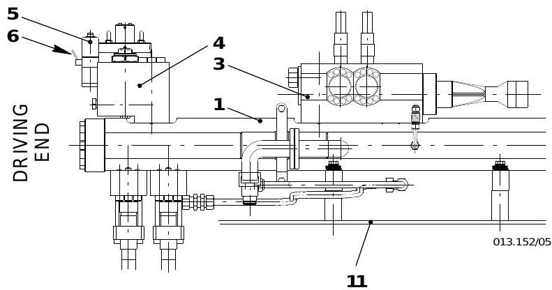
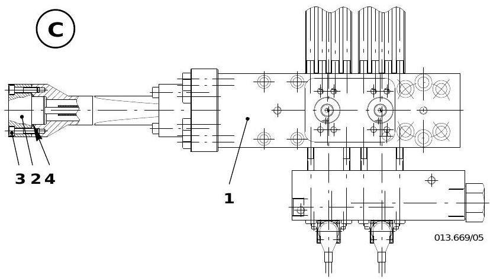
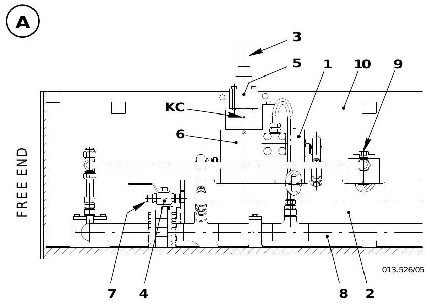
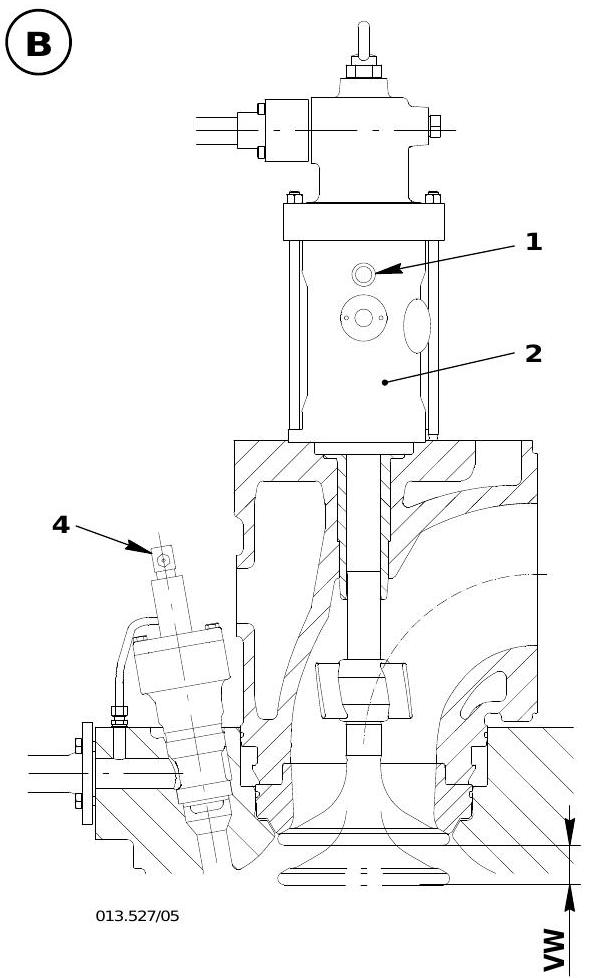
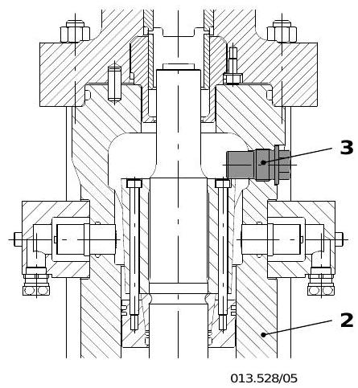

# 异常操作规程

> 所属章节: [[第2章-系统描述]] > 操作与维护 > 异常操作
> 关联页面: [[第3章-操作规程]], [[第6章-技术参数与报警设定]], [[WECS-9520控制系统]], [[第5章-故障诊断]]

## 扫气空间污脏与火灾防护 (0450-1)

### 污脏原因

扫气空间污脏的根本原因是燃烧产物通过活塞与气缸之间的间隙吹入扫气空间。燃烧不完全（冒黑烟）时污脏更严重。

**燃烧不良的原因**：
- 喷油器工作不正常（喷嘴端部积碳形成"喇叭口"）
- 燃油温度过低，尤其在低负荷时
- 发动机负荷急剧变化时暂时性空气不足
- 烟雾限制器设定过高
- 超负荷、机舱通风不足、增压器消音器/扩散器/滤网/喷嘴环脏污、废气锅炉/空冷器/气水分离器/扫气口堵塞

**窜气（blow-by）的原因**：
- 活塞环磨损、粘滞或断裂
- 气缸套磨损
- 个别气缸注油嘴故障
- 气缸套运行表面损坏

**残留物积聚位置**：活塞环与环槽之间、活塞裙部、扫气口、气缸体底部（活塞下方）、扫气接收器

### 火灾原因与征兆

- 窜气时，高温燃烧气体和火花通过活塞环与缸套表面之间进入活塞下方空间
- 活塞杆密封填料函漏油以及活塞下方排放管堵塞，会导致系统油和气缸润滑油积聚，构成重大火灾隐患

**火灾征兆**：
- 对应温度报警触发
- 相关气缸排气温度和活塞下方温度显著升高
- 涡轮增压器可能开始喘振

### 灭火措施

1. 降低发动机功率
2. 用用户参数 Inj. CUTOFF 切断相关气缸喷油
3. 调高对应气缸注油泵排量，确保高温下润滑充足
4. 若有 CO₂ 灭火系统，可连接到接收器上的预留接口（截止阀必须绝对密封）
5. 若担心火灾扩大，停机并向扫气空间充入 CO₂
6. 蒸汽灭火后须采取防腐蚀措施
7. 火灾通常在 **5~15 分钟**内熄灭（通过排气温度和活塞下方空间门温度确认）
8. 熄灭后必须停机查明原因

**灾后检查清单**：
- 气缸套运行表面、活塞和活塞环
- 接收器内气阀（必要时更换）
- 可能的泄漏点
- 活塞杆填料函
- 喷油器喷嘴

### 预防措施

- 使用雾化良好的喷油器，保持空气和燃气通道清洁（定期检查和清洁）
- 持续低负荷运行时，检查并调整气缸注油率
- 确保活塞下方污油永久排放畅通
- 定期检查活塞下方污油排放管是否堵塞（用手触摸各排放管感受温差判断——温度与环境温度相同则管路堵塞）

---

## 曲轴箱爆炸预防 (0460-1)

### 原理

曲轴箱爆炸极其罕见，仅在特定条件下发生：曲轴箱内油雾的可燃浓度范围极窄，必须有外部点火源（如过热发动机部件）才能引燃，且油雾与空气必须达到临界混合比。

发动机标配**油雾探测器**（9314-1），持续监测曲轴箱内油雾浓度，超过允许限度时触发报警。

### 报警时的措施

1. **远离发动机！爆炸危险！**
2. 立即降低发动机转速（功率）
3. 条件允许时立即停机
4. 查明原因并尽可能修复

**关键安全要求**：
- 若因怀疑运动部件过热而停机，**至少等待 20 分钟**才能打开曲轴箱门或检查盖——让过热部件冷却，防止接触新鲜空气后点燃
- 在过热部件冷却之前，爆炸危险始终存在
- **严禁站在曲轴箱门防爆阀附近**
- 若未连接灭火系统，打开曲轴箱门时必须准备便携式灭火器

---

## 总则

在"异常操作"章节中，描述了当发动机部件发生故障且无法立即修复、但发动机必须继续运行或尽快恢复运行时，必须采取的措施。

### 降功率运行原则

在紧急情况下，发动机必须在一个或多个气缸停缸、增压器停用或冷却液流量减少等条件下运行时，**必须降低发动机功率**，以防止热过载。

**硬性限制：**
- 在任何情况下，负荷指示（喷油量）的全负荷位置或涡轮前最大排气温度（参见操作数据表 0250-1）均不得超过
- 必要时，在观察任何禁用转速范围的前提下降低发动机转速和功率
- 必须持续观察排气烟色，不得在深色排气和产生烟灰的条件下运行；应降低转速和功率直至排气烟色达到可接受水平

### 停缸注意事项

当个别气缸停止工作时，增压器可能发生喘振。喘振表现为巨大的噪音，可通过扫气压力表上扫气压力的大幅波动来目视确认。

- 若喘振频繁或持续发生，必须适当降低转速
- 对于气缸数较少的发动机，停缸后发动机可能停在某个无法重新起动的位置（所有完好的活塞都不在起动范围内），此时应短暂反方向起动以将曲轴转至另一位置，需与驾驶台协调

---

## 1. 喷油切断操作 (0510-1)

> 该技术示意图展示了喷油切断操作涉及的组件位置（驱动端视图），包含编号标注的燃油轨、伺服油轨、截止阀和控制管路等。操作时须断开先导阀（轨道阀）的电气插头以确保安全。

### 适用场景
喷油系统缺陷（喷射控制单元、喷油管等）需停缸但继续运行发动机。

### 处理措施

| 步骤 | 操作内容 |
|------|---------|
| 1 | 在遥控系统中通过用户参数 `Inj. CUT OFF` 切断相关气缸的喷油 |
| 2 | 断开先导阀（轨道阀）的插头（安全要求） |
| 3 | 若长时间停缸喷油，将该缸润滑油供给率降至最低 |

**重要提示：** 若原因仅为喷油系统缺陷，排气阀应尽可能保持运行。

### 恢复喷油

| 步骤 | 操作内容 |
|------|---------|
| 1 | 停机，更换缺陷喷射控制单元 |
| 2 | 开启燃油增压泵 3.15、轴承油泵、伺服油工作泵 4.88，进行泄漏检查 |
| 3 | 调整该缸润滑油供给率恢复至原设定值 |
| 4 | 在遥控系统中通过用户参数 `Inj. RUN` 恢复喷油 |
| 5 | 重新连接先导阀插头 |

### 喷油管更换（临时措施）

- 缺陷喷油管只能在**停机状态**下更换
- 临时措施：从对应先导阀上拆下两个插头以隔离缺陷喷油管，剩余喷油管继续喷油（但会触发"喷油时间过长"报警）

---

## 2. 高压燃油系统故障 (0515-1)

### 2.1 燃油泵故障

| 识别特征            | 可能原因             | 处理措施              |
| --------------- | ---------------- | ----------------- |
| 相同输出下调节连杆位置偏高   | 柱塞卡死、弹簧断裂、调节套筒卡滞 | 停机，切断相应燃油泵        |
| 异常噪音（敲击、刮擦、叮当声） | 滚轮卡死、凸轮损坏、滚轮导套卡滞 | 更换缺陷部件            |
| 液位开关 LS3426A 报警 | 上升管断裂、调节连杆受限     | 检查燃油泄漏系统 (8019-1) |

### 2.2 执行器故障

**识别特征：**
- 故障执行器调节输出保持在原位或缓慢降至零供油
- 调节连杆对负荷变化无反应

**处理措施：**

| 故障类型    | 处理步骤                                                                   |
| ------- | ---------------------------------------------------------------------- |
| 单个执行器故障 | 在故障执行器对应的燃油泵调节齿条上安装隔块（工具94555），位置选"0"或"max."；将燃油压力控制阀 3.06 的滚花螺钉逆时针转到底 |
| 所有执行器故障 | 在所有燃油泵调节齿条上安装隔块，位置"max."；将燃油压力控制阀 3.06 的滚花螺钉逆时针转到底                     |

**注意：** 执行器全部失效时的运行应尽量避免，或仅维持数小时，同时降低轨道压力。

### 2.3 喷射控制单元故障

| 故障部件     | 识别/原因       | 处理措施                              |
| -------- | ----------- | --------------------------------- |
| 燃油量传感器   | WECS-9520报警 | 不需停机，可带故障运行；更换传感器（拧紧力矩 **18 Nm**） |

> **更换要点**：拆下插头（注意勿丢失插座内O型圈）→ 松开螺钉(2) → 取出传感器(3) → 润滑新O型圈(4)后装入新传感器 → 拧紧螺钉至 **18 Nm** → 插入插头并确保紧固密封。

| 燃油量活塞    | 活塞停在止点      | 在燃油截止导阀 3.08 手动短暂泄放燃油轨压力          |
| 先导阀（轨道阀） | 轨道阀卡滞在"喷油"位 | 停机更换，拧紧力矩 **2.5 Nm**，注意孔位对正       |
| 喷射控制单元   | 开裂、控制阀或活塞卡死 | 立即切断喷油（参见0510-1），降负荷运行            |
| 喷油管      | 破裂          | 切断喷油，停机后更换                        |
| 上升管      | 断裂          | 停机，关闭燃油增压泵，更换上升管                  |

### 2.4 燃油压力控制阀 3.06 故障

**识别特征：** 发动机负荷下降或停机、燃油系统压力过低、调节连杆位置异常偏高、运行时发出"哨声"噪音

**处理措施：**
1. 将滚花螺钉 4 旋至下止点
2. 尽早检修或更换燃油压力控制阀 2
3. 检查油路供给，清洁入口滤器

> 更换燃油压力控制阀只能在**停机状态**下进行，需确认燃油轨 3 和轴承油系统油路 7 均已泄压。

---

## 3. 排气阀控制单元切断 (0520-1)

### 3.1 排气阀关闭的应急运行

| 步骤 | 操作内容 |
|------|---------|
| 1 | 切断喷油（参见 0510-1） |
| 2 | 在遥控系统中通过用户参数 `EXH. VALVE AUTO / MAN.` 将相关气缸设为 `MAN. CLOSE` |
| 3 | 断开先导阀插头（安全要求） |

**限制条件：**
- 只能降负荷运行
- 各缸排气温度不得超过最大限制 **515 C**
- 排气阀保持关闭状态

### 3.2 排气阀开启的应急运行

**适用场景：** 燃烧室漏水（气缸盖或缸套裂纹）

| 步骤 | 操作内容 |
|------|---------|
| 1 | 停机 |
| 2 | 从下壳体 2 拆下螺塞 1 |
| 3 | 关闭控制空气供应中的排气旋塞 4.08，使排气阀保持开启 |
| 4 | 安装保持螺钉 3（工具 94259） |
| 5 | 恢复空气弹簧排气 4.08 至运行位置 |
| 6 | 拆下起动阀的控制信号插头 |

> 应急运行结束后，必须检查阀座和阀头的密封面状况（无硬质污垢沉积），严重沉积需按 2751-3 和 2751-4 检修。

### 3.3 恢复排气阀控制单元

更换缺陷排气阀控制单元或液压管路时，需：停机、关闭轴承油泵、泄放伺服油轨压力、更换部件、恢复运行并目视泄漏检查。

> **图A组件对照**：1-排气阀控制单元4.10、2-伺服油轨4.11、3-执行器管路4.66、4-截止阀3.40、7-锥形塞螺母、8-伺服油回油管4.63、9-安全阀4.23、10-轨道单元。

应急运行结束后恢复排气阀控制单元操作：
1. 关闭控制空气供应中的排气旋塞 4.08（标记A），使排气阀管路泄压，排气阀保持开启
2. 拆下保持螺钉 3（工具 94259），装回螺塞 1

3. 恢复喷油（参见 0510-1）
4. 将排气旋塞 4.08 转回运行位置
5. 重新连接先导阀（轨道阀）插头
6. 重新连接起动阀的控制信号插头 4

> **注意**：应急运行（排气阀开启模式）结束后，必须检查阀座和阀头的密封面状况，确保无硬质污垢沉积。严重沉积需按 2751-3 和 2751-4 检修。

---

## 4. 伺服油系统故障 (0525-1)

### 4.1 自动滤器故障

| 识别特征 | 可能原因 | 处理措施 |
|---------|---------|---------|
| 差压过高、冲洗间隔变短 | 滤芯堵塞 | 切换至旁通，手动清洁或更换滤芯 |
| 报警指示 (XS2053A) | 控制/电源故障 | 检查控制气源、电机、位置开关、气动冲洗阀 |
| — | 润滑油参数超限/油温过低 | 检查系统油状态 (0750-1) |

### 4.2 伺服油泵故障

- 单泵故障时，发动机可在**整个负荷范围**内继续运行
- 流量传感器 FS2061A / FS2062A 指示泵故障
- 应尽早更换缺陷伺服油泵

> **警告：** 单泵运行不得视为长期状态，第二泵故障将导致发动机无法运行！

### 4.3 排气阀控制单元故障（伺服油系统相关）

- WECS-9520报警"Exh. valve late/not opening"
- 自动切断喷油并触发 SLOW DOWN
- 先导阀更换拧紧力矩 **2.5 Nm**

---

## 5. 无负荷相关缸套润滑 (0530-1)

- 缸套润滑油流量由 DENIS-9520 控制系统根据负荷调节
- 调节失效时，紧急润滑模式自动启动
- 油供给率维持为 **100% 发动机负荷**时的值，在整个负荷范围内不变

**注意：** 若发动机在部分负荷下运行，可能导致气缸过度润滑。

---

## 6. 运动部件拆除运行 (0540-1)

### 6.1 活塞拆除

**适用故障：** 活塞开裂/泄漏、活塞和/或缸套严重损伤、活塞杆填料函和/或活塞杆损伤

| 步骤 | 操作内容 |
|------|---------|
| 1 | 切断喷油 (0510-1) |
| 2 | 切断排气阀控制单元 (0520-1 排气阀关闭模式) |
| 3 | 从起动空气管 6 拆下入口弯管 7，安装盲板法兰 8（工具 94831） |
| 4 | 拆下起动阀的控制信号插头 12 |
| 5 | 在活塞杆填料函位置安装盖板 9（工具 94345d） |
| 6 | 在十字头上安装盖板和提升板 10（工具 94324） |
| 7 | 必要时关闭相关气缸冷却水进出管路 |

### 6.2 活塞、十字头和连杆拆除

**适用故障：** 十字头或导板缺陷、连杆轴承严重损伤、十字头销或连杆缺陷

- 除不在十字头销上安装盖板和提升板外，执行上述 6.1 所有步骤
- 额外拆除内管 3 和导套 4
- 用法兰 11（工具 94337b）封堵活塞冷却和十字头润滑的供油口 'OS'

**限制条件：**
- 只能降负荷运行
- 各缸排气温度不得超过 **515 C**

---

## 7. 燃烧室漏水应急操作 (0545-1)

| 步骤 | 操作内容 |
|------|---------|
| 1 | 关闭受影响气缸的冷却水进出口阀门，通过排放管路排空冷却水 |
| 2 | 切断喷油 (0510-1) |
| 3 | 按排气阀开启模式切断排气阀控制单元 (0520-1) |

**原理：** 若该缸冷却被切断，压缩热会导致燃烧室过热，因此排气阀必须保持开启以防止进一步损坏部件。

> 此应急运行不得视为连续运行，应尽快更换缺陷气缸盖或缸套。

---

## 8. 空冷器停用 / 辅助鼓风机故障 (0550-1)

### 8.1 空冷器停用

- 海水冷却空冷器泄漏时，水可能进入扫气箱，通过冷凝水收集器排出
- 海水进入扫气箱会导致空气挡板等部件严重腐蚀

**处理措施：**
- 尽早更换缺陷冷却器
- 关闭缺陷冷却器的冷却水进出口管，打开排气和排放旋塞并保持开启
- 持续监控扫气温度，不得超过正常运行时的扫气温度
- 扫气温度过高时降低转速（最大允许扫气温度参见报警设定 0250-2）

### 8.2 辅助鼓风机故障

| 故障情况 | 影响 |
|---------|------|
| 单台辅助鼓风机故障 | 发动机可起动和运行，部分负荷时排气冒烟加重 |
| 两台辅助鼓风机均故障 | **发动机无法起动** |

---

## 9. 遥控故障 (0560-1)

- 遥控系统故障导致集控室无法控制发动机时，可在**机旁控制面板**操作
- 参考章节：起动 0230-1、操纵 0260-1、停机 0310-1、停机后措施 0320-1

> **注意：** 此方式仅在绝对必要时使用。轮机员不得离开操纵台，必须频繁观察转速以便在转速出现大偏差时立即采取行动。

---

## 10. 调速系统故障 (0570-1)

- 调速系统缺陷应尽快修复
- 若无法修复，可在机旁控制面板操作
- 若"燃油指令"信号从调速系统到 WECS-9520 丢失，发动机将以**最后已知的燃油指令**继续运行，并触发报警

> 同遥控故障一样，此方式仅在绝对必要时使用。

---

## 11. 增压器停用 (0590-1)

增压器故障时必须尽快停机以避免更严重损坏。若无法立即修复或更换，可在降负荷下应急运行。

### 可用输出

相对于 CMCR 的 **约 10%~15%**，取决于辅助鼓风机的输出。

### 有排气旁通管路的增压器

| 步骤 | 操作内容 |
|------|---------|
| 1 | 按增压器手册锁定增压器转子 |
| 2 | 若失去润滑油，封堵润滑油进出口管 |
| 3 | 从扫气箱拆下盖板 1，从风道拆下盖板 2 |
| 4 | 拆下增压器空气出口与扩散器之间的膨胀节，安装盖板 3（工具 94653） |
| 5 | 拆下增压器与排气总管之间的膨胀节 4，盲封燃气入口 |
| 6 | 盲封增压器燃气出口 |
| 7 | 拆下旁通管中的盲法兰 |
| 8 | 运行期间辅助鼓风机必须运行 |

### 无排气旁通管路的增压器

- 执行上述步骤 1~4
- 运行期间辅助鼓风机必须运行

**限制条件：**
- 涡轮前排气温度不得高于正常运行值
- 避免黑色浓烟排气

> **警告：** 此运行模式会导致过度过热，短时间内导致增压器进一步损坏！

---

## 12. 长期停机后起动准备 (0610-1)

| 序号 | 准备措施 |
|------|---------|
| 1 | 按控制系统的功能检查 4003-1 进行功能测试 |
| 2 | 若更换了轴承或运动部件，在正常油压下检查润滑油耗（通过打开运动部件门盖目视检查各轴承点油流） |
| 3 | 首次运行期间，在短间隔后停机检查新装部件温度，与未更换部件对比 |
| 4 | 新活塞、活塞环和缸套的磨合按 0410-1 执行 |
| 5 | 排放伺服油轨后检查截止阀 23(3.40) 是否关闭、锥形塞螺母 35 是否拧紧 |
| 6 | 确保扫气和排气通道畅通 |
| 7 | 若空冷器冷却水已排放，重新注水并排气 |
| 8 | 关闭排气总管和排气管上的排放阀 |
| 9 | 长期停机（数月）后分析润滑油质量 (0750-1) |

---

## 13. 长期停机前措施 (0620-1)

### 前提条件

建议停机前先使用柴油运行一段时间，特别是计划在停机期间对燃油系统部件进行作业时。

### 操作清单

| 序号 | 措施内容 |
|------|---------|
| 1 | 关闭起动空气瓶上的截止阀 |
| 2 | 将起动空气截止阀 2.03 的手轮 2.10 转至 CLOSED 位置，打开排气阀 2.21 和 2.27 |
| 3 | 合上盘车机 |
| 4 | 确认压力表无压力指示 |
| 5 | 停机后水和油泵至少继续运行 **20 分钟**，使冷却部件温度尽量均匀 |
| 6 | 关闭控制空气供应单元 A 和自动滤器 4.20 的气源 |
| 7 | 打开气缸盖上的示功阀 |
| 8 | 盘车约三圈进行后润滑（开启缸套润滑，约运行 10 分钟，对应约一圈曲轴转数） |
| 9 | 关闭燃油柜上的截止阀 |
| 10 | 打开排气总管和排气管上的排放阀 |
| 11 | 空冷器：完全排空或每天运行冷却水泵约 **30 分钟** |
| 12 | 缸套冷却水保持接近室温（注意防冻） |
| 13 | 增压器消音器用塑料薄膜密封（防止空气循环产生冷凝水） |
| 14 | 定期盘车（干燥气候每周、潮湿气候每天至少两整圈），同时开启油泵 |
| 15 | 修复运行期间发现的所有损伤和泄漏 |
| 16 | 按计划执行检修保养 (0011-1, 0012-1) |
| 17 | 关闭 WECS-9520（电源箱 E85 中的断路器） |
| 18 | 关闭自动滤器控制箱 |

---

## 关键参数速查

| 参数 | 限制值 | 说明 |
|------|--------|------|
| 排气温度（单缸最大） | **515 C** | 停缸运行时各缸不得超过 |
| 先导阀安装力矩 | **2.5 Nm** | 适用于伺服油和燃油系统先导阀 |
| 燃油量传感器安装力矩 | **18 Nm** | 喷射控制单元上的传感器螺栓 |
| 增压器停用可用输出 | **CMCR 的 10%~15%** | 取决于辅助鼓风机输出 |
| 停机后泵持续运行时间 | **至少 20 分钟** | 水泵和油泵 |
| 后润滑盘车 | **约三圈** | 对应约 10 分钟缸套润滑 |
| 停机期间盘车间隔 | 干燥气候每周 / 潮湿气候每天 | 至少两整圈 |

---

> 本页内容摘自 Wartsila RT-flex50 操作手册 (OM-RT-flex50 2009-07)，章节 0500-1 至 0620-1。
> 关联页面: [[第3章-操作规程]], [[第5章-故障诊断]], [[WECS-9520控制系统]], [[第6章-技术参数与报警设定]]
