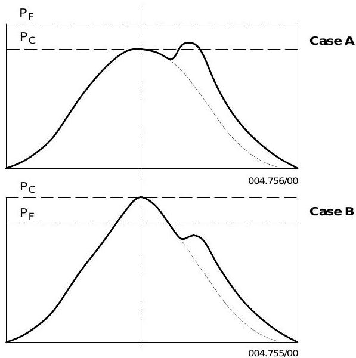
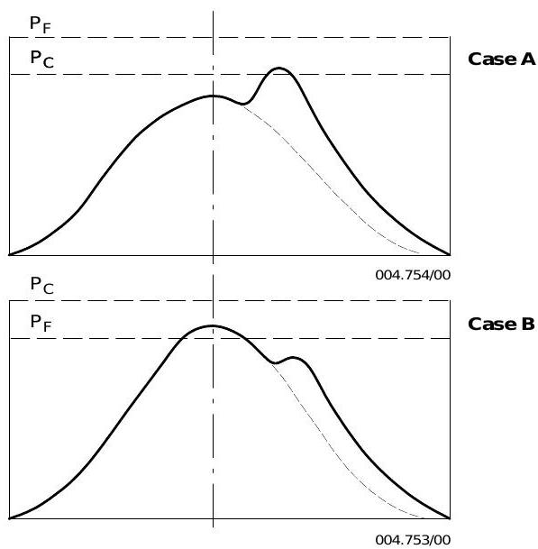
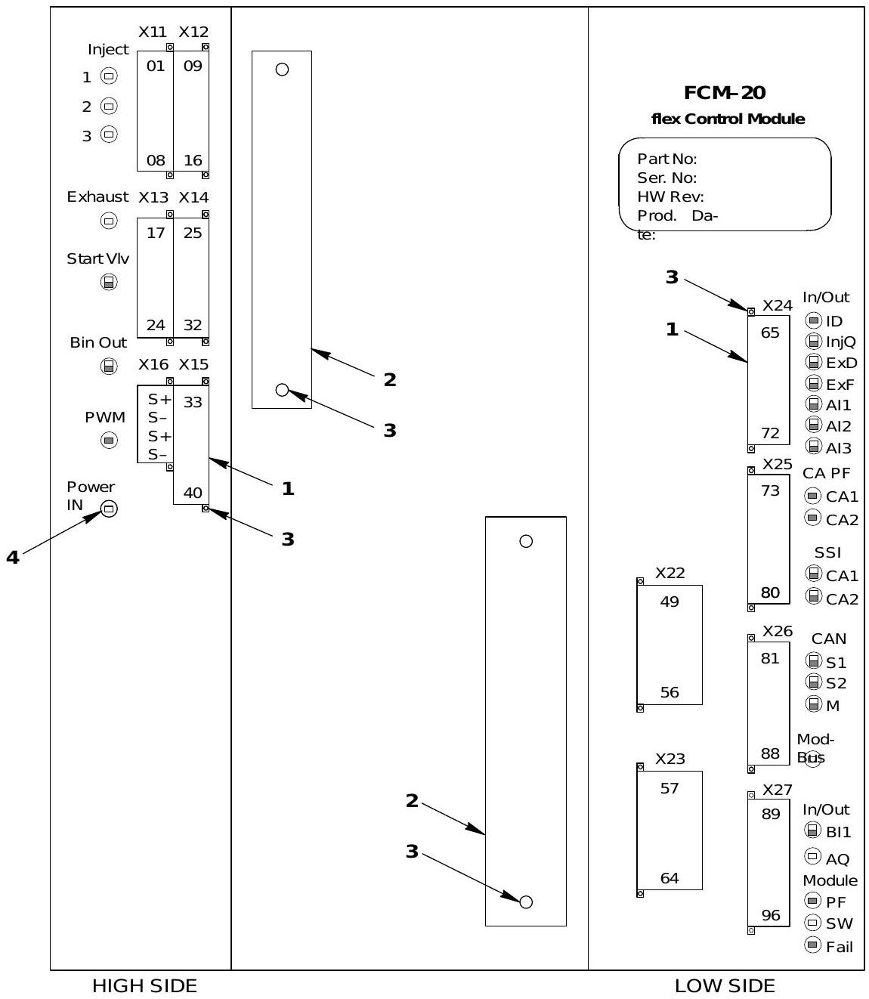

# 故障诊断

> 所属章节: [[第2章-系统描述]] > 操作与维护 > 故障诊断
> 关联页面: [[第4章-异常操作规程]], [[WECS-9520控制系统]], [[第6章-技术参数与报警设定]], [[第3章-操作规程]], [[排气阀驱动活塞卡滞故障案例]], [[ICU流量活塞探头杆脱落故障案例]], [[长航碧玉主机2缸ICU伺服油液压活塞卡阻故障案例]], [[长航碧玉30KG到8KG减压阀损坏故障案例]], [[增压器轴承损坏故障案例]], [[滑油变质致排气阀故障案例]], [[活塞冷却油伸缩管断裂故障案例]], [[缸套异常磨损致活塞环断裂故障案例]], [[主机不能正常启动故障案例]], [[主机偶发超速报警停车故障案例]], [[主机主启动阀漏气故障案例]], [[主机启动无转速故障案例]]

## 总则

若认真遵守操作和保养说明，大多数不可预见的运行中断可以避免。一旦发生故障，**不要盲目查找，而应系统地排查可能的原因**。这尤其适用于发动机起动和停机的故障。

---

## 实际故障案例汇总

本章收录了长航系列船舶RT-flex50主机的实际故障案例，供故障排查参考：

| 案例名称                     | 发生时间    | 涉及系统                | 对应Wiki页面                     |
| ------------------------ | ------- | ------------------- | ---------------------------- |
| 排气阀驱动活塞卡滞故障案例            | —       | 排气阀驱动系统             | [[排气阀驱动活塞卡滞故障案例]]            |
| ICU流量活塞探头杆脱落故障案例         | 2020-11 | 燃油喷射系统（ICU）         | [[ICU流量活塞探头杆脱落故障案例]]         |
| 长航碧玉主机2缸ICU伺服油液压活塞卡阻故障案例 | 2026-04 | 燃油喷射系统（ICU）、伺服油系统   | [[长航碧玉主机2缸ICU伺服油液压活塞卡阻故障案例]] |
| 长航碧玉30KG到8KG减压阀损坏故障案例    | 2026-05 | 控制空气系统、减压阀          | [[长航碧玉30KG到8KG减压阀损坏故障案例]]    |
| 增压器轴承损坏故障案例              | 2016-06 | 增压器系统、排气阀           | [[增压器轴承损坏故障案例]]              |
| 滑油变质致排气阀故障案例             | 2017-08 | 滑油系统、排气阀            | [[滑油变质致排气阀故障案例]]             |
| 活塞冷却油伸缩管断裂故障案例           | 2014-06 | 活塞冷却油系统             | [[活塞冷却油伸缩管断裂故障案例]]           |
| 缸套异常磨损致活塞环断裂故障案例         | 2020-06 | 缸套、活塞环              | [[缸套异常磨损致活塞环断裂故障案例]]         |
| 主机不能正常启动故障案例             | 2012-04 | 启动系统、WECS控制系统、CAN总线 | [[主机不能正常启动故障案例]]             |
| 主机偶发超速报警停车故障案例           | 2012-07 | 测速系统、RPM单元、超速报警     | [[主机偶发超速报警停车故障案例]]           |
| 主机主启动阀漏气故障案例             | —       | 启动空气系统、主启动阀         | [[主机主启动阀漏气故障案例]]             |
| 主机启动无转速故障案例              | 2025-07 | 转速传感器、TDC传感器、T型块    | [[主机启动无转速故障案例]]              |

---

## 一、起动与停机故障 (0810-1)

> **实际案例参考**（与起动故障相关）：
> - [[主机不能正常启动故障案例]] - 长航琥珀轮TDC传感器支架螺栓断裂、AC CAN A通讯线断裂导致主机不能正常启动的完整排查过程
> - [[主机主启动阀漏气故障案例]] - 长航水晶轮主启动阀漏气故障，含主启动阀控制原理、辅控制阀阀芯断裂问题及应急处理
> - [[主机启动无转速故障案例]] - 长航钻石轮2025年7月启动无转速故障，含TDC传感器T型块断裂、4个转速传感器全部损坏的详细排查过程
>
> *更多故障案例请参考本章开头"实际故障案例汇总"部分*

### 1. 起动故障

| 故障现象                           | 可能原因                                           | 处理措施                                   |
| ------------------------------ | ---------------------------------------------- | -------------------------------------- |
| **发动机起动时不转动**                  | 起动空气瓶截止阀关闭                                     | 打开截止阀                                  |
|                                | 起动空气压力过低                                       | 充注空气瓶                                  |
|                                | 油压/水压/空气弹簧压力过低，压力开关触发 SHUT-DOWN                | 复位 SHUT-DOWN                           |
| **集控室起动时（控制台不激活）**             | 按相应按钮进行模式转换或接管控制                               |                                        |
|                                | 遥控系统/车钟系统故障                                    | 检查遥控系统或联系供应商                           |
|                                | 遥控系统起动联锁                                       | 检查RCS中联锁指示（盘车机、停机、辅助鼓风机），解除联锁          |
|                                | RCS到WECS-9520信号中断                              | 检查插头、CAN-BUS活动，排查松动或断裂导线               |
| **机旁起动时**                      | 控制台不激活                                         | 按相应按钮进行模式转换                            |
|                                | 盘车机啮合，阻塞阀 2.13 阻止控制空气通过                        | 脱开盘车机                                  |
|                                | 控制阀 2.05 卡滞或未完全打开                              | 清洁控制阀 2.05                             |
|                                | 电磁阀 ZV7013C 和 ZV7014C 故障                       | 清洁或更换，检查线路                             |
|                                | 电磁阀插头未连接                                       | 插入插头                                   |
|                                | 起动空气截止阀在 CLOSED 手动关闭位置                         | 转至 AUTOMAT 位置                          |
|                                | 起动空气截止阀卡滞打不开、单向阀卡滞                             | 彻底清洁检修截止阀                              |
|                                | 辅助鼓风机未运行                                       | 起动辅助鼓风机                                |
|                                | 扫气箱空气挡板缺陷（辅助鼓风机无法建立压力）                         | 检修或更换空气挡板                              |
|                                | 空气弹簧无压力或压力过低                                   | 打开截止旋塞 4.08，调节控制空气供应单元 A 压力至 **6 bar** |
|                                | 排气阀单向阀装反，严重敲击且阀门不能完全关闭                         | 检查并正确安装 (2751-2)                       |
|                                | 起动阀卡滞或插头未连接                                    | 检修起动阀或重新连接插头                           |
|                                | 其他原因                                           | 尝试反向起动                                 |
| **发动机起动时来回摆动或无法达到转速**          | 个别气缸未收到或不足起动空气（管路限制、电磁阀 ZV7241 卡滞、FCM-20 线路中断） | 检查起动空气管路、火焰消除器，清洁或更换相应电磁阀，检查电信号        |
|                                | 起动空气压力过低                                       | 充注空气瓶                                  |
|                                | 截止阀 4.37 关闭                                    | 打开截止阀 4.37                             |
| **发动机用起动空气转动但收不到燃油（调节在 0% 位）** | 调速系统故障，未释放喷油量调节                                | 检查调速系统到 WECS-9520 的电信号                 |
| **发动机用起动空气转动但收不到燃油**           | 燃油轨压力过低，执行器与燃油泵连接断开                            | 安装连接件 (5801-1)                         |
|                                | 燃油轨压力过低，调节连杆卡在"零"位                             | 检查调节连杆，修复损伤                            |
|                                | 燃油轨压力过低，燃油压力控制阀 3.06 开启                        | 检查燃油压力控制阀 3.06 (0515-1)                |
|                                | 喷射控制单元 3.02 活塞/控制滑阀、先导阀 ZV7201 活塞卡死            | 更换喷射控制单元或先导阀 (0515-1)                  |
|                                | 高压燃油回路严重泄漏                                     | 检查泄漏 (8019-1)                          |
|                                | 燃油增压压力不足，保压阀设定过低，增压泵不排油                        | 调整燃油增压压力                               |
|                                | 发动机前截止阀关闭                                      | 打开截止阀                                  |
| **起动时无点火**                     | 喷油量过小，转速设定过低                                   | 重新调整转速设定                               |
|                                | 燃油不适用或粘度过高                                     | 准备燃油系统 (0120-1)                        |
|                                | 起动空气压力不足，无法使发动机转够快                             | 充注空气瓶                                  |
|                                | 辅助鼓风机或扫气箱空气挡板缺陷                                | 检修或更换                                  |
|                                | 压缩压力过低，活塞环状况差，排气阀关闭不严                          | 更换活塞环，研磨阀头和阀座密封面                       |
|                                | 高压回路泄漏（燃油泵、上升管、燃油轨、喷射控制单元）                     | 用伺服油工作泵运行排查泄漏；在燃油轨和伺服油轨间连接工具 94583     |
| **个别气缸起动时不点火或点火不良**            | WECS-9520 切断喷射控制单元                             | 在遥控系统中用 `Inj. RUN` 恢复                  |
|                                | 喷射控制单元被手动切断                                    | 恢复喷油 (0510-1)                          |
|                                | 喷射控制单元连接处泄漏                                    | 拧紧，重新研磨密封面                             |
|                                | 电磁阀 ZV7201C(F) 故障                              | 更换缺陷电磁阀                                |
|                                | 无电信号至电磁阀 ZV7201C(F)                            | 检查线路，检查 FCM-20 上 LED，必要时更换             |
|                                | 排气阀故障，无电信号至电磁阀 ZV7201A/B                       | 检查线路，检查 FCM-20 上 LED，必要时更换             |
|                                | 喷嘴泄漏、喷嘴针阀卡滞                                    | 更换喷油嘴                                  |
|                                | 喷嘴个别喷孔堵塞                                       | 更换喷嘴头部                                 |
|                                | 气缸压缩压力不足以点燃燃油                                  | 更换活塞环，研磨阀座密封面                          |
|                                | 排气阀阀杆卡死                                        | 更换缺陷部件                                 |
|                                | FCM-20 模块供电中断、插头拆除或接错、内部故障                     | 开启电源 (E85)，连接插头，更换 FCM-20              |
|                                | 排气阀控制单元 4.10 活塞/滑杆或先导阀 ZV7201 活塞卡死             | 更换排气阀控制单元或先导阀                          |
|                                | 排气阀控制单元被切断                                     | 恢复排气阀控制单元 (0520-1)                     |
|                                | 起动阀卡滞、损坏或无信号                                   | 检修或更换起动阀，检查线路                          |
| **起动时爆燃**                      | 燃油轨压力过高，燃油调节失效                                 | 检查电源、线路、调节连杆                           |
|                                | 起动前过度润滑，缸套油在燃烧室积聚                              | 降低转速设定（喷油量）直至积油烧尽，避免过度润滑               |
|                                | 之前起动尝试时辅助鼓风机未运行，燃油在燃烧室积聚                       | 降低转速设定（喷油量）                            |
|                                | 起动喷油量设定过高                                      | 降低转速设定（喷油量）                            |
|                                | 燃油限制器设定过高                                      | 重新调整至标准值                               |

### 2. 停机故障

| 故障现象               | 可能原因    | 处理措施                           |
| ------------------ | ------- | ------------------------------ |
| **集控室旋转开关/车钟无法停机** | 电缆连接器故障 | 用 EMERGENCY STOP 按钮停机 (0310-1) |
| **机旁旋转开关无法停机**     | 电缆连接器故障 | 用 EMERGENCY STOP 按钮停机 (0310-1) |

---

## 二、运行异常 (0820-1)

以下表格基于相同负荷指示下与历史读数或台架试验数据的对比。

### 2.1 扫气与增压系统

| 故障现象 | 可能原因 | 处理措施 |
|---------|---------|---------|
| **扫气压力下降** | 空冷器空气侧脏污/水分离器脏污或损坏 | 清洗空冷器空气侧 (6606-1) |
| | 增压器前进气温度过高 | 确保进气畅通 |
| | 增压器扩散器/叶轮/诱导轮脏污或损坏、消音器脏污、涡轮叶片脏污或损坏、喷嘴环损坏 | 清洗增压器 (6510-1) 及增压器手册 |
| | 废气锅炉脏污，涡轮后背压增大 | 尽早清洁 |
| **扫气压力上升** | 增压器喷嘴环脏污或部分堵塞 | 清洗增压器 (6510-1) |

### 2.2 排气温度异常

> **实际案例参考**（与排气温度异常相关）：
> - [[排气阀驱动活塞卡滞故障案例]] - Flex50主机高转速时单缸排温异常、透平喘振的完整排查过程
> - [[ICU流量活塞探头杆脱落故障案例]] - Flex50主机5#缸ICU流量活塞探头杆脱落导致排温偏差大的完整排查过程
> - [[长航碧玉主机2缸ICU伺服油液压活塞卡阻故障案例]] - 长航碧玉轮2#ICU伺服油液压活塞卡阻导致流量活塞报警、排温偏差和SLOW DOWN的完整处理过程
> - [[增压器轴承损坏故障案例]] - 长航水晶轮排气阀座漏水导致增压器涡轮端轴承进水损坏的完整排查过程
> - [[滑油变质致排气阀故障案例]] - 长航紫晶轮厂修后新旧滑油混合导致滑油变质，引发排气阀卡堵的完整排查过程
>
> *更多故障案例请参考本章开头"实际故障案例汇总"部分*

| 故障现象          | 可能原因                     | 处理措施                            |
| ------------- | ------------------------ | ------------------------------- |
| **涡轮前排气温度升高** | 增压器/消音器/空冷器缺陷或严重脏污导致空气不足 | 清洗增压器 (6510-1)、空冷器 (6606-1)     |
|               | 扫气箱空气挡板脏污或缺陷             | 清洁、检修或更换                        |
|               | 喷嘴磨损                     | 更换                              |
|               | 增压器前进气温度过高               | 确保进气畅通                          |
|               | 缸套扫气口脏污                  | 清洁                              |
| **单缸排气温度升高**  | 扫气箱空气挡板脏污或缺陷             | 清洁、检修或更换                        |
|               | 喷嘴磨损                     | 更换                              |
|               | 缸套扫气口脏污                  | 清洁                              |
|               | 活塞下部空间着火                 | 参见扫气空间污脏和火灾措施 (0450-1)          |
|               | 排气阀泄漏                    | 研磨阀座和阀头                         |
|               | 该缸排气温度计故障                | 更换                              |
| **单缸排气温度下降**  | 喷嘴状况差，喷嘴头部破裂             | 更换喷嘴头部                          |
|               | 该缸因高压管路或喷油阀泄漏而供油减少       | 研磨密封面或更换缺陷部件                    |
|               | 排气阀不开，排气阀控制单元或其执行管路缺陷    | 切断该缸喷油和排气阀控制单元 (0510-1, 0520-1) |
|               | 该缸排气温度计故障                | 更换                              |

### 2.3 爆发压力与转速

> **实际案例参考**（与转速相关）：
> - [[主机偶发超速报警停车故障案例]] - 长航琥珀轮flex50主机2012年7月偶发超速报警停车故障，KONGSBERG服务商指导排查及解决过程
>
> *更多故障案例请参考本章开头"实际故障案例汇总"部分*

> **示功图诊断参考**：以下示功图可用于判断爆发压力异常的原因。通过对比实际测量曲线与台架试验参考曲线（相同负荷下的历史数据），可快速定位故障方向。





**示功图快速判读**：
- 压缩压力 Pc 正常但爆发压力 P1 过高 → 喷油过早，调整 FQS 至"延迟"方向（参见 4002-3 用户参数）
- 压缩压力 Pc 正常但爆发压力 P1 过低 → 喷油过晚或喷嘴缺陷
- 压缩压力 Pc 偏低 → 活塞环泄漏或排气阀关闭不严
- 膨胀曲线出现次峰（后燃）→ 燃烧延迟，检查喷油正时和燃油品质
- 所有缸偏差一致方可调整 FQS，单缸偏差需排查该缸单独故障

| 故障现象 | 可能原因 | 处理措施 |
|---------|---------|---------|
| **所有气缸爆发压力下降** | 轴编码器驱动（曲柄角传感器单元）连接装置弹簧断裂 | 更换 |
| **发动机转速下降** | 调速系统减少或限制转速设定 | 检查调速系统 |
| | 重浪时为防止过载而限制喷油量 | 正常情况 |
| | 船体阻力增大（海生物/老化）、螺旋桨损坏 | 参见发动机与螺旋桨关系 (0070-1) |
| | 喷射控制单元或喷油管缺陷 | 切断或更换 (0510-1, 0515-1) |
| | 空气和排气通道脏污 | 参见"扫气压力下降" |

### 2.4 排气冒烟

| 故障现象 | 可能原因 | 处理措施 |
|---------|---------|---------|
| **排气冒烟** | 空气不足：增压器/空冷器/空气挡板/扫气口/废气锅炉脏污 | 参见"扫气压力下降" |
| | 发动机过载 | 减少喷油量 |
| | 缸套润滑油过量 | 参见 7218-1, 7218-2 |
| | 喷嘴雾化不良（喇叭状变形、喷孔磨损或堵塞） | 清洁、检查、重新调整或更换 |
| | 燃油不适用或粘度过高、预热不足 | 参见燃油泵前推荐粘度 (0270-1) |
| | 压缩压力过低（活塞环泄漏、排气阀泄漏） | 更换活塞环，研磨阀座和阀头 |
| | 排气阀上壳体排气螺钉孔堵塞，排气阀关闭过迟 | 检查并清洁 |
| | 伺服油压力过低（泵控制缺陷、油泄漏） | 检查油流，排查并修复泄漏 |
| | 部分负荷时无辅助鼓风机或仅一台运行 | 开启辅助鼓风机 |

### 2.5 运行不稳与失火

| 故障现象 | 可能原因 | 处理措施 |
|---------|---------|---------|
| **发动机运行不稳或间歇性失火（单缸或全部）** | 燃油含水量过高 | 参见重油处理 (0720-1) |
| | 燃油泵前油温过低或过高 | 参见燃油泵前推荐粘度 (0270-1) |
| | 燃油轨压力过低，燃油压力控制阀 3.06 故障，一台或多台燃油泵不供油 | 参见 0515-1，检查压力变送器 |

### 2.6 自行停机

| 故障现象               | 可能原因                                           | 处理措施                 |     |
| ------------------ | ---------------------------------------------- | -------------------- | --- |
| **发动机自行停机（无停机指示）** | 日用油柜空/供油中断/滤器堵塞/增压泵故障/切换错误/燃油轨压力过低/调节连杆缺陷/燃油泄漏 | 补充油柜、清洁滤器、逐一排查并修复    |     |
|                    | WECS-9520 供电故障                                 | 排除原因并重启 WECS-9520    |     |
|                    | 转速设定系统故障（如断线）                                  | 排除故障                 |     |
|                    | 重浪时发动机停机                                       | 开启重浪模式 (4002-3 用户参数) |     |

### 2.7 冷却水系统异常

| 故障现象            | 可能原因                 | 处理措施               |
| --------------- | -------------------- | ------------------ |
| **压力波动**        | 冷却空间或管路因排气不足而积气      | 排气                 |
|                 | 泵入口静压下降（回流管节流或膨胀柜排空） | 参见机舱管路说明           |
|                 | 排气漏入冷却水（缸套/气缸盖/阀笼裂纹） | 参见燃烧室漏水操作 (0545-1) |
| **单缸冷却水出口温度升高** | 该缸管路截止阀误关或缺陷         | 打开或更换              |
|                 | 冷却空间排气不足             | 排气                 |
|                 | 冷却水管或水道堵塞，水流不足       | 参见冷却水处理 (0760-1)   |
|                 | 活塞过热运行               | 参见部件损坏 (0840-1)    |
|                 | 排气漏入冷却水（裂纹）          | 参见燃烧室漏水操作 (0545-1) |
| **所有气缸冷却水温度升高** | 机舱侧故障（调节阀、冷却器等）      | 参见机舱管路说明           |

### 2.8 缸套润滑失效

> 缸套润滑全部或部分失效会导致活塞环和缸套早期磨损，甚至可能导致活塞咬缸。仅在紧急情况下，以降低功率和最短时间运行。

| 故障现象 | 可能原因 | 处理措施 |
|---------|---------|---------|
| **缸套润滑失效** | 缸套润滑油泵空/日用柜空/供应管截止阀关/滤器堵塞 | 补充日用柜、打开截止阀、清洁滤器 |
| | 流量传感器故障 | 更换 |
| | 泵模块截止阀关闭 | 打开截止阀 |
| | 缸套注油嘴堵塞 | 检修，更换缺陷部件 |
| | 分配器堵塞 | 清洁或更换 |
| | 单个泵模块内部机构故障（泵元件、偏心轴） | 更换缺陷部件，调整新泵元件位置 (7218-1) |
| | 角齿轮箱或电机故障 | 更换 |
| | 电流中断/过载/故障（控制箱） | 排除故障，检查断路器 |
| | 无遥控系统控制信号 | 检查 RCS 和线路 |

### 2.9 排气阀故障

| 故障现象 | 可能原因 | 处理措施 |
|---------|---------|---------|
| **排气阀敲击** | 排气阀阶梯活塞缺陷 | 检修，更换 |
| | 排气阀控制单元节流孔或滤器堵塞 | 清洁节流孔或滤器 (5612-1) |
| | 排气阀排气螺钉滤网孔严重扩大（侵蚀） | 更换排气螺钉 |
| | 液压管路泄漏 | 修复泄漏，更换管路 |
| **排气阀不开** | 排气阀单向阀故障 | 检修，更换 |
| | 排气阀控制单元活塞或滑杆卡死 | 整体更换排气阀控制单元 |
| | 先导阀（轨道阀）故障或电缆插头松动 | 更换先导阀或重新连接插头 (0525-1) |
| **排气阀不关** | 空气弹簧压力过低（**< 2 bar**） | 排查泄漏、减压阀、起动空气瓶压力 |
| | 排气阀阀杆或阶梯活塞卡死 | 检修，更换 |

### 2.10 控制空气压力低

> **实际案例参考**：
> - [[长航碧玉30KG到8KG减压阀损坏故障案例]] - 控制空气瓶压力降至约6.0KG，拆检发现30KG到8KG减压阀阀芯密封垫老化，切换备用阀并临时制作密封垫恢复。

### 2.11 增压器喘振

| 故障现象 | 可能原因 | 处理措施 |
|---------|---------|---------|
| **增压器喘振**（短促巨大的啸叫，同时空气侧压力波动） | 过载、空气不足 | 清洗增压器 (6510-1)、空冷器 (6606-1) |
| | 气缸停缸（喷油/排气阀控制故障） | 检查喷油和排气阀控制 |

### 2.12 油雾探测器报警

> **爆炸危险！远离发动机！尤其避开防爆阀附近区域 (0460-1)。**

| 故障现象 | 可能原因 | 处理措施 |
|---------|---------|---------|
| **油雾探测器报警** | 运动部件发热 | 立即降负荷（降速），在情况允许时尽快停机，排查原因 (0210-1, 0840-1) |

---

## 三、部件损坏 (0840-1)

> **实际案例参考**（与部件损坏相关）：
> - [[活塞冷却油伸缩管断裂故障案例]] - 长航玛瑙轮6缸活塞冷却油伸缩管断裂，滑油压力突降的完整排查过程
> - [[缸套异常磨损致活塞环断裂故障案例]] - 长航珊瑚轮RT-flex50主机6#缸缸套异常磨损导致活塞环断裂的完整排查过程
>
> *更多故障案例请参考本章开头"实际故障案例汇总"部分*

### 3.1 活塞过热运行

**识别特征**（燃烧正常时）：
- 活塞冷却油出口温度升高
- 缸套冷却水出口温度升高
- 活塞下部温度升高

| 可能原因 | 处理措施 |
|---------|---------|
| 活塞环缺陷或磨损导致窜气；缸套表面因缺油拉缸 | 1. 切断该缸喷油 (0510-1) |
| | 2. 增大该缸缸套润滑供油率 (7218-1) |
| | 3. 若温度仍不下降或恢复喷油后再次升高，再次切断喷油 (0510-1)，尽快停机，等待缸套和活塞冷却 |
| | 4. 检查活塞和缸套运行表面 |
| | 5. 轻微损伤可用油石修磨 |
| | 6. 严重损伤需更换活塞、活塞裙和缸套 |
| | 7. 若无法更换，拆除活塞并采取必要措施 (0540-1) |

### 3.2 运动部件过热运行

| 可能原因 | 处理措施 |
|---------|---------|
| 油管或管路接头缺陷 | 降速（降功率）并提高轴承油压 |
| 润滑油中有水（轴颈生锈） | 若温度持续升高，停机并冷却 |
| 润滑油中有杂质 | — |
| 轴承或轴颈安装时物理损伤 | 采取防止曲轴箱爆炸的措施 (0460-1) |
| 轴承间隙不足 | 检查并拆检过热轴承 |
| 轴承变形（腰形螺栓未按规定拧紧） | 视情况检修或更换损坏部件，或拆除缺陷运动部件 (0540-1) |
| 轴承油压不足（检查压力表和油压监控系统） | — |
| 油柜液位过低，泵部分吸入空气 | — |

---

## 四、WECS 组件故障 (0850-1)

> 本节与 [[WECS-9520控制系统]] 密切相关。WECS 组件故障在 WECS-9520 中产生故障信息，并传送至报警和监控系统。FCM-20 模块上的 LED 可提供更精确的故障定位。



> FCM-20（flex Control Module）是 WECS-9520 控制系统的核心模块，每个气缸配备一块。模块分为 HIGH SIDE（高压侧）和 LOW SIDE（低压侧）两个区域：
> - **HIGH SIDE**：连接喷油控制（X11/X12, Inject）、排气阀控制（X13/X14, Exhaust）、起动阀（X15, Start Vlv）、PWM 伺服油泵控制等
> - **LOW SIDE**：连接曲柄角传感器（X25, CA1/CA2）、CAN 总线（X22/X23, S1/S2）、Modbus 通信（X26）以及各种状态 LED
> - **LED 指示**（编号 1-4）：包括 Fail（故障）、各种功能状态 LED（InjQ、ExD、AI1/AI2、BI1 等），用于快速定位故障
> - **注意**：连接器 1（COMBICON）和电缆支架 2 的螺钉 3 必须始终保持拧紧状态

### 4.1 故障分级体系

WECS 所有故障按严重程度分为 **5 个等级**：

| 故障等级                                   | 故障影响                                                 | 处理要求                  |
| -------------------------------------- | ---------------------------------------------------- | --------------------- |
| **1级 - WECS 被动故障** (Passive)           | 冗余系统失效（冗余部件/系统/组件），对发动机运行**无直接影响**                   | 尽早排查原因并修复             |
| **2级 - WECS 公共故障** (Common)            | 公共类型故障，对发动机运行**影响较小**                                | 尽早排查原因并修复             |
| **3级 - WECS 气缸故障** (Cylinder)          | 导致丧失一个气缸功能，发动机功率降低，安全系统立即触发 **SLOW DOWN**            | 需立即修复以恢复全功率运行         |
| **4级 - WECS 压力故障** (Pressure)          | 发动机压力系统（燃油、伺服油轨等）少数故障，影响整台发动机，安全系统立即触发 **SLOW DOWN** | 不建议超越 SLOW DOWN，需立即修复 |
| **5级 - WECS 关键故障** (Critical / Engine) | 影响 WECS 触发发动机 **SHUT DOWN** 的故障                      | **必须立即修复才能重新起动发动机**   |

### 4.2 LED 指示说明

**RED LED (Fail.)：** 指示 FCM-20 模块上是否有故障及故障状态。

| 故障状态 | LED Fail. 表现 |
|---------|---------------|
| 当前故障（活动） | 闪烁 |
| 历史故障（已不活动） | 常亮 |
| 无故障 | 熄灭 |

> **注意：** 由于控制箱 E95.01 ~ E95.08 的位置关系，FCM-20 模块 LED 观察容易混淆，务必确认检查的是对应模块！

### 4.3 1级 - WECS 被动故障

| 故障名称 | LED | 闪烁次数 | 排查要点 | FCM-20 编号 |
|---------|-----|---------|---------|------------|
| 增压空气压力传感器 #1 测量故障 | AI2 YELLOW | 1 | 检查 PT4043C、24VDC 供电 (X27)、E12/E95.03 线路 | #3 |
| 增压空气压力传感器 #2 测量故障 | AI2 YELLOW | 1 | 检查 PT4044C、24VDC 供电 (X27)、E12/E95.04 线路 | #4 |
| 伺服油压力传感器 #1 测量故障 | AI2 YELLOW | 1 | 检查 PT2071C 及伺服油轨压力指示、24VDC (X27)、E95.01 线路 | #1 |
| 伺服油压力传感器 #2 测量故障 | AI2 YELLOW | 1 | 检查 PT2072C 及伺服油轨压力指示、24VDC (X27)、E95.02 线路 | #2 |
| 燃油轨压力传感器 #1 测量故障 | AI1 YELLOW | 1 | 检查 PT3461C、24VDC (X25)、E95.03 线路 | #3 |
| 燃油轨压力传感器 #2 测量故障 | AI1 YELLOW | 1 | 检查 PT3462C、24VDC (X25)、E95.04 线路 | #4 |
| FCM-20 模块 #00 故障 | Fail RED | 无 | 发动机可继续运行；检查 X22/X23 线路，必要时更换在线备用模块 | #00 (E90) |
| FCM-20 气缸识别丢失 | ID RED | 无 | 对应缸继续运行，但重新上电后该缸被切断；检查 X25 地址线 | #00~8 |
| CAN S-总线 #1 故障 | S1 RED | 无 | 检查 FCM-20 在线备用模块 X22 插头连接 | #00 (E90) |
| CAN S-总线 #2 故障 | S2 RED | 无 | 检查 FCM-20 在线备用模块 X23 插头连接 | #00 (E90) |
| 曲柄角 1 故障 | SSI CA1 RED | 1 | 检查曲柄角传感器 GT5126C，若所有模块报警则更换传感器；检查 X22 终端电阻 | #1~8 |
| 曲柄角 2 故障 | SSI CA2 RED | 1 | 检查曲柄角传感器 GT5127C，若所有模块报警则更换传感器；检查 X23 终端电阻 | #1~8 |
| 排气阀 #n 位置测量故障 | Ex.D/Ex.F YELLOW | 1 | 检查缸盖端子箱插头和传感器线路；若间歇性故障，拆下缺陷传感器插头 | #1~8 |
| 起动导阀 #n 回路故障 | Start Vlve RED | 无 | 检查电磁阀与 FCM-20 模块之间线路 (X15) | #1~8 |

### 4.4 2级 - WECS 公共故障

| 故障名称                 | LED         | 闪烁次数 | 排查要点                                               | FCM-20 编号 |
| -------------------- | ----------- | ---- | -------------------------------------------------- | --------- |
| 增压空气压力传感器 #1+#2 测量故障 | AI2 YELLOW  | 2    | 检查 PT4043C & PT4044C、24VDC (X27)、E12/E95.03/E95.04 | #3, #4    |
| 增压空气压力测量偏差过大         | AI2 YELLOW  | 3    | 对比两个压力指示，排查偏差传感器，必要时更换                             | #3, #4    |
| 伺服油压力传感器 #1+#2 测量故障  | AI2 YELLOW  | 2    | 检查 PT2071C & PT2072C、24VDC (X27)、E95.01/E95.02     | #1, #2    |
| 伺服油压力测量偏差过大          | AI2 YELLOW  | 3    | 大范围变负荷观察哪个传感器不跟随线性变化，更换偏差传感器                       | #1, #2    |
| 伺服油压力过高              | AI2 YELLOW  | 4    | 伺服油泵检修后压力控制器未正确调整                                  | #1, #2    |
| 伺服油压力过低              | AI2 YELLOW  | 5    | 检查自动滤器后油压、控制信号和线路、安全阀 4.23、泵传动/断裂点/泵故障             | #1, #2    |
| 伺服油泵 #1 故障           | PWM RED     | 1    | 检查泵 #1 与 E95.03 线路、CV7221C 插头、FCM-20 #3 是否断电       | #3        |
| 伺服油泵 #2 故障           | PWM RED     | 1    | 检查泵 #2 与 E95.04 线路、CV7222C 插头、FCM-20 #4 是否断电       | #4        |
| 燃油轨压力传感器 #1+#2 测量故障  | AI1 YELLOW  | 2    | 检查 PT3461C & PT3462C、24VDC (X25)、E95.03/E95.04     | #3, #4    |
| 燃油轨压力测量偏差过大          | AI1 YELLOW  | 3    | 变负荷对比两个压力指示，更换偏差传感器                                | #3, #4    |
| 燃油轨压力过高              | AI1 YELLOW  | 4    | 检查燃油泵执行器是否开启和正常动作                                  | #3, #4    |
| 燃油轨压力过低              | AI1 YELLOW  | 5    | 检查执行器、燃油供给压力 **7~10 bar**、泄漏报警、油压控制阀 3.06          | #3, #4    |
| 燃油泵执行器 #n 故障         | 无           | 无    | 燃油泵柱塞卡死、24VDC 断电、检查线路 (X27)、按 WOODWARD 手册调整        | #3, #5    |
| 曲柄角偏差                | SSI CA1 RED | 3    | 齿形带偏移或松弛；一缸 TDC 时两传感器应指示 0 CA；调整偏移参数或带位            | #1~8      |
| 曲柄角 #1/TDC 低偏移       | BI1 YELLOW  | 2    | 传感器或齿形带偏移、TDC 偏移调整错误、曲轴可能移位                        | #5        |
| 曲柄角 #2/TDC 低偏移       | BI1 YELLOW  | 4    | 同上                                                 | #5        |
| 曲柄角 #1/TDC 高偏移       | BI1 YELLOW  | 3    | 同上                                                 | #5        |
| 曲柄角 #2/TDC 高偏移       | BI1 YELLOW  | 5    | 同上                                                 | #5        |
| TDC 信号故障             | BI1 YELLOW  | 1    | 检查拾取器 ZS5123C 到 E95.05 的线路及距飞轮齿的距离                 | #5        |
| 喷油量传感器 #n 测量故障       | InjQ YELLOW | 1    | 检查信号线路、插头必须紧固、测量套筒安装是否正确                           | #1~8      |
| 喷油正时故障 - 时间过短        | InjQ YELLOW | 5    | 喷嘴开裂/卡滞/堵塞、喷油管泄漏、喷油阀开启压力过低、先导阀 3.76 故障             | #1~8      |
| 喷油正时故障 - 时间过长        | InjQ YELLOW | 6    | 同上                                                 | #1~8      |

### 4.5 3级 - WECS 气缸故障

> 触发安全系统 SLOW DOWN，需立即修复以恢复全功率运行。

| 故障名称 | LED | 闪烁次数 | 排查要点 | FCM-20 编号 |
|---------|-----|---------|---------|------------|
| FCM-20 模块 #n 故障 | Fail RED | 无 | 检查模块上 X22 & X23 线路；仅单模块故障时更换该模块 | #1~8 |
| 双 CA/TDC 低偏移 | BI1 YELLOW | 2, 4 | 曲柄角传感器或齿形带偏移、TDC 偏移调整错误、曲轴可能移位 | #5 |
| 排气阀 #n 迟开/不开 | Ex.D YELLOW | 2 | 先导阀 4.76 故障、线路中断、空气弹簧压力过高、油压过低（节流孔堵塞）、控制单元机械故障、FCM-20 模块缺陷 | #1~8 |
| 排气阀 #n 早关 | Ex.D YELLOW | 3 | 空气弹簧压力过高、油压过低（节流孔堵塞）、控制单元机械故障、FCM-20 模块缺陷 | #1~8 |
| 排气阀 #n 迟关/不关 | Ex.D YELLOW | 4 | 先导阀 4.76 故障、线路中断、空气弹簧压力过低（检查单向阀 4.06）、排气阀驱动或控制阀机械故障、FCM-20 模块缺陷 | #1~8 |
| 排气阀 #n 关闭死区过长 | Ex.D YELLOW | 5 | 空气弹簧压力过低（检查单向阀 4.06）、排气阀驱动或控制阀机械故障、FCM-20 模块缺陷 | #1~8 |
| 手动切断喷油 - 气缸 #n | 无 | 无 | 手动或自动切断喷油 | #1~8 |
| 喷油量活塞故障 - 迟回/不回 | InjQ YELLOW | 2 | 先导阀 3.76 故障（检查操作界面中 return ON-time）、传感器信号和线路 | #1~8 |
| 喷油量活塞故障 - 无动作 | InjQ YELLOW | 3 | 同上 | #1~8 |
| 喷油量活塞故障 - 卡在最大位 | InjQ YELLOW | 4 | 燃油粘度过高（长时间停机且关闭加热）；短按燃油截止导阀 3.08 的手动杆；若不恢复则活塞可能卡死，需更换喷射控制单元 | #1~8 |

### 4.6 4级 - WECS 压力故障

> 触发 SLOW DOWN，不建议超越慢速，需立即修复。

| 故障名称 | LED | 闪烁次数 | 排查要点 | FCM-20 编号 |
|---------|-----|---------|---------|------------|
| 增压空气过压 | AI2 YELLOW | 4 | 降低发动机功率，按增压器制造商手册采取对策 | #3, #4 |
| 伺服油压力极低 | AI2 YELLOW | 6 | 检查自动滤器后油压、控制信号和线路、安全阀 4.23、泵传动断裂/泵故障 | #1, #2 |
| 燃油轨压力极低 | AI1 YELLOW | 6 | 检查执行器、燃油供给压力 **7~10 bar**、泄漏报警、油压控制阀 3.06 | #3, #4 |

### 4.7 5级 - WECS 关键故障（发动机故障）

> 触发发动机 SHUT DOWN，**必须立即修复才能重新起动**。

| 故障名称 | LED | 闪烁次数 | 排查要点 | FCM-20 编号 |
|---------|-----|---------|---------|------------|
| 曲柄角 1+2 故障 | SSI CA1 RED & CA2 RED | 2 | 检查曲柄角传感器单元和端子箱 E96 是否损坏；检查 FCM-20 #1 的 X22/X23 终端电阻；若单模块报警则检查该模块线路并更换 | #1~8 |
| 双 CA/TDC 高偏移 | BI1 YELLOW | 3, 5 | 曲柄角传感器或齿形带偏移、TDC 偏移调整错误、曲轴可能移位 | #5 |
| 发动机超速 | 无 | 无 | 发动机转速超过标定转速的 **115%**；重浪时降低发动机转速；检查 CA 传感器或 FCM-20 模块的独立报警 | — |

---

## 关键参数速查

| 参数 | 数值 | 说明 |
|------|------|------|
| 控制空气压力 | **6 bar** | 控制空气供应单元 A 设定值 |
| 空气弹簧最低压力 | **2 bar** | 低于此值排气阀无法关闭 |
| 燃油供给压力 | **7~10 bar** | 燃油增压泵供给压力 |
| 超速阈值 | **115% 标定转速** | WECS 关键故障触发 SHUT DOWN |

---

## 快速诊断流程

```
故障发生
  |
  +-- 起动/停机问题 --> 参见第一节"起动与停机故障"
  |
  +-- 运行中异常 --> 参见第二节"运行异常"
  |     |
  |     +-- 扫气/排气/压力异常 --> 表 2.1~2.4
  |     +-- 停机/冷却水/润滑 --> 表 2.6~2.8
  |     +-- 排气阀/增压器/油雾 --> 表 2.9~2.11
  |
  +-- 部件损坏 --> 参见第三节"部件损坏"
  |     +-- 活塞过热 --> 表 3.1
  |     +-- 运动部件过热 --> 表 3.2
  |
  +-- WECS 报警 --> 参见第四节"WECS 组件故障"
        +-- 无直接影响 --> 1级 被动故障
        +-- 影响较小 --> 2级 公共故障
        +-- SLOW DOWN --> 3级 气缸故障
        +-- SLOW DOWN(全机) --> 4级 压力故障
        +-- SHUT DOWN --> 5级 关键故障
```

---

> 本页内容摘自 Wartsila RT-flex50 操作手册 (OM-RT-flex50 2009-07)，章节 0800-1 至 0850-1。
> 关联页面: [[第4章-异常操作规程]], [[WECS-9520控制系统]], [[第6章-技术参数与报警设定]], [[第3章-操作规程]]
