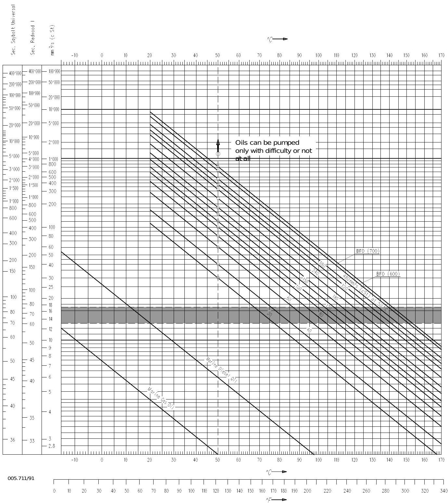
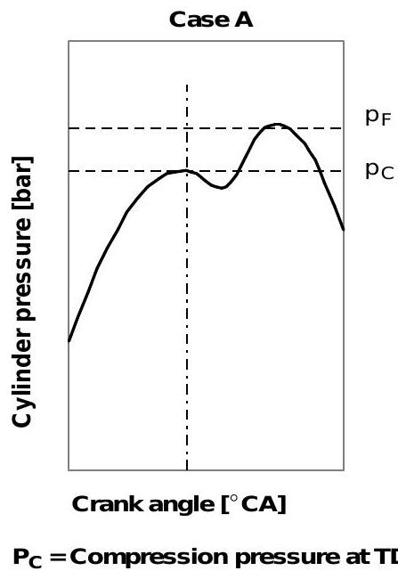
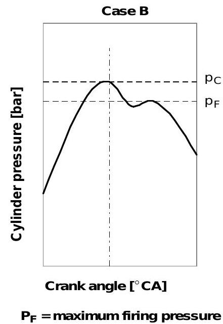
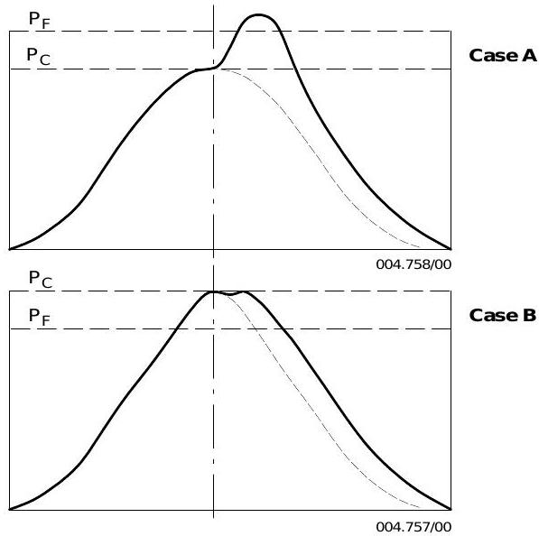
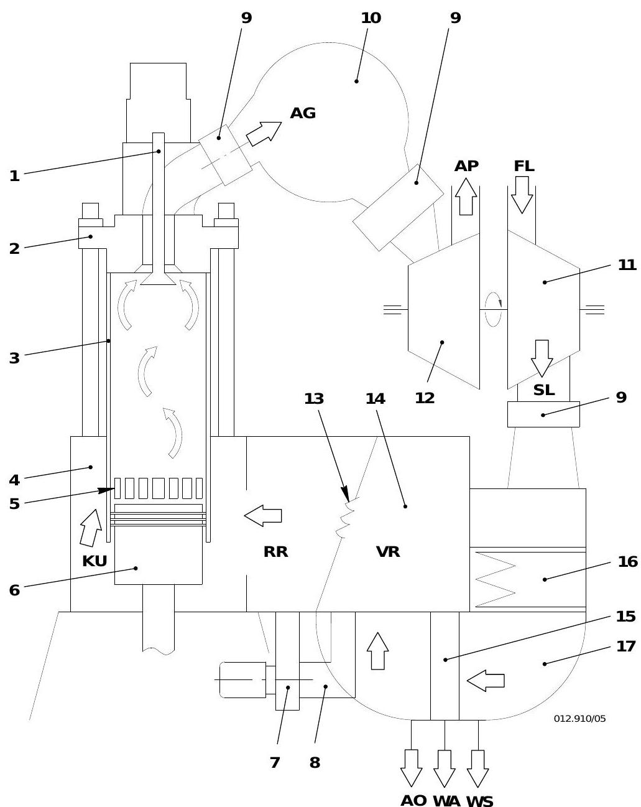
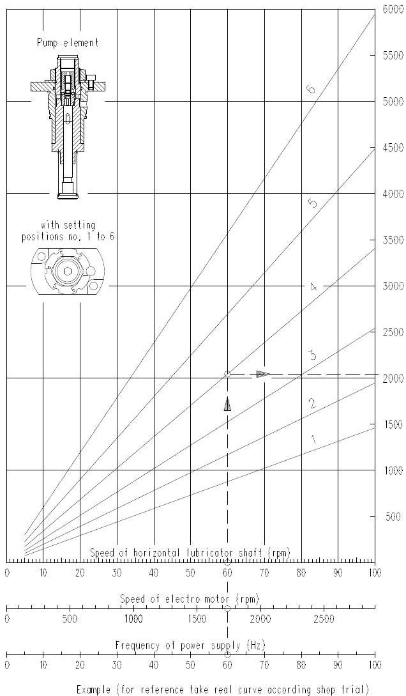
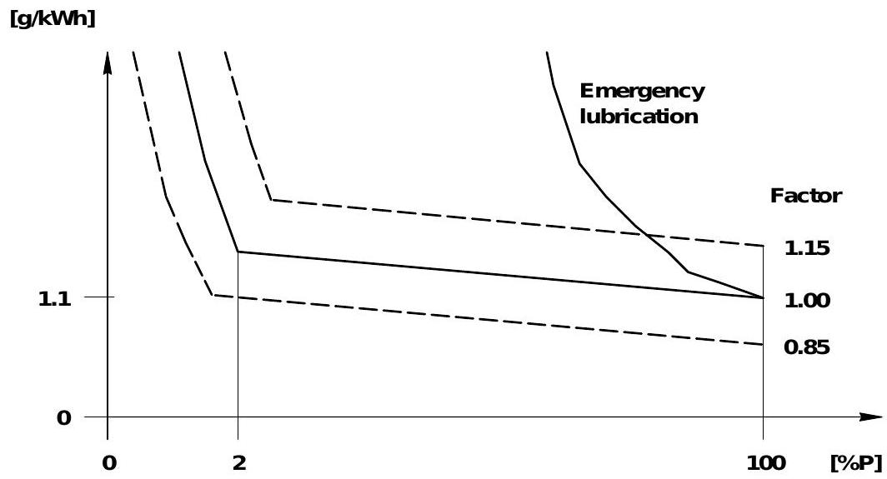

# 发动机特性图与原理图

> 源文件：OM-RT-flex50 Operating Manual, Group 0070-1, 0270-2, 0420-1, 6500-1, 7218-2
> 关联页面：[[第1章-发动机概述]], [[第3章-操作规程]], [[第6章-技术参数与报警设定]], [[工作介质规格]]

## 1. 螺旋桨特性 / 运行范围

### 1.1 基本关系

定距桨 (FPP) 船舶中，螺旋桨转速与吸收功率之间存在确定关系：

> P1/P2 = (n1/n2)^3

该公式的图形称为螺旋桨特性线。通过 CMCR 点（100% 功率、100% 转速）的特性线称为名义螺旋桨特性线。

- 热负荷主要取决于平均有效压力 (mep)
- 运行点距螺旋桨特性线越偏左，发动机供气越差，运行条件越不利
- 持续运行的最佳运行点应位于名义螺旋桨特性线右侧的 A 区域内

**运行点偏移的常见原因**：随着船体海生物附着和老化、螺旋桨粗糙或机械损伤、恶劣海况或浅水航行，螺旋桨所需扭矩增大，运行点会从原始螺旋桨特性线向左偏移。虽然清洗和重新涂装可以减轻阻力增加，但原始状态无法完全恢复。

### 1.2 定距桨 (FPP) 运行区域

| 区域 | 定义 |
|------|------|
| **A** | 名义螺旋桨特性线右侧：基于选定 CMCR 点的无限制持续运行范围。特性线左侧为瞬态工况（加速），应避免持续运行 |
| **A'** | 最大允许功率 40% CMCR，转速约 50%-67% CMCR 转速范围 |
| **B** | 运行时间受限区域，特性线 P = n^2.45，起点为 95% CMCR 功率/95% CMCR 转速。长时间运行将导致热过载和发动机损伤 |
| **C** | 超速区域 104%-108% CMCR 转速，仅在海试中由发动机制造厂授权代表在场时允许，且不得超过规定的扭振限值 |
| **D** | FPP 推荐匹配范围，适用于最大吃水、清洁船体、合同约定的海况和天气条件 |
| **E** | 过载区域，仅在海试中由发动机制造厂授权代表在场时允许最多 1 小时 |


### 1.3 调距桨 (CCP) 运行范围

#### 基本规则

- 起动后在零螺距下以空转转速（至多 70% 额定转速）运行
- 从空转以恒定转速增加螺距至至少 E 点（与线 6 的交点）
- **线 6**：70%-100% 转速之间的下负荷限值，100% 转速时最低功率 37%（F 点）
- **线 8**：从 37% 功率（F 点）到 100% 功率（CMCR）恒速模式，用于轴带发电机运行
- **线 5**：上负荷限值，对应允许扭矩极限
- **线 7**：变速模式典型组合曲线
- 在 70%-100% 转速、线 5 与线 6 之间为允许运行区域

#### 禁止运行区域

- 名义转速下低螺距或零螺距运行不允许
- 在禁止区域运行超过 3 分钟触发报警
- 超过 5 分钟须将转速降至空转（低于 70% 转速）
- 主机驱动发电机的装置须配备变频器，或由辅助发动机供电


#### 组合模式

| 模式 | 说明 |
|------|------|
| 组合模式 1 | 无轴带发电机运行，可在允许区域内设置任意组合曲线，通常为线 7 |
| 组合模式 2 | 轴带发电机运行，机动航行时沿线 6，海上恒速运行在 F 点到 100% 功率之间（线 8） |

## 2. 粘度-温度图

### 2.1 概述

粘度-温度图用于确定不同标称粘度的燃油达到发动机入口推荐粘度 (13-17 cSt) 所需的预热温度。



### 2.2 典型燃料油粘度值

| 燃料类型 | 粘度 50 C [cSt] | 推荐预热温度范围 |
|---------|-----------------|----------------|
| 轻质重油 | ~30 | ~70-80 C |
| 中质重油 | ~150 | 108-120 C |
| 重质重油 | ~380 | ~130-145 C |
| 最重质重油 | ~700 | ~145-160 C |

### 2.3 确定预热温度的方法

1. 在粘度-温度图纵轴上找到燃油在 50 C 时的标称粘度值
2. 沿该燃油的粘度-温度曲线移动
3. 找到与推荐粘度范围 (13-17 cSt) 相交的温度区间
4. 该温度区间即为所需预热温度

**示例**：标称粘度 150 cSt (50 C) 的燃油须预热至 108-120 C，以达到燃油泵入口推荐的粘度。

### 2.4 应用注意事项

- 燃油系统未达到所需温度前不可投入使用
- 机动航行使用重油时须保持足够加热以维持粘度在规定范围内
- 停机后短时间休息期间须保持燃油温度（参见 [[第3章-操作规程]]）
- 凝点以上 5-10 C 才能保证燃油可泵送

## 3. 示功图判读

### 3.1 基本说明

- 示功图应在恒定功率和转速、平静海面和深水条件下绘制
- 记录气缸编号、发动机转速、负荷指示器和 VIT 位置
- 试航期间绘制的示功图应作为参考基准

### 3.2 气缸压力定义

为满足 IMO 排放规则，采用了更高的压缩比和喷油延迟：

- 最高爆发压力与压缩压力之比范围：0.90-1.25（100% 负荷）
- 具体数值取决于发动机标定和 IMO 调整方案





> **Case A 与 Case B 的区别**：两种IMO调校方案下示功图的曲线形态不同，主要体现在压缩压力(pC)和最高爆发压力(pF)的数值关系上。具体比值为 pF/pC 在 0.90-1.25 范围内。

### 3.3 异常示功图诊断


#### 3.3.1 爆发压力过高，压缩压力正常

| 项目 | 说明 |
|------|------|
| 可能原因 | 喷油（喷油始点）过早，不适用于当前燃油类型 |
| 修正方法 | 调整 FQS 至"延迟"方向（参见用户参数 4002-3） |
| 注意 | 仅当所有气缸显示相同压力偏差时才可调整 FQS |

#### 3.3.2 爆发压力过低，压缩压力正常

| 项目 | 说明 |
|------|------|
| 可能原因 1 | 燃烧不良：喷嘴尖部形成积碳喇叭口或磨损 |
| 措施 1 | 检查喷油器 |
| 可能原因 2 | 喷油（喷油始点）过迟 |
| 修正方法 | 调整 FQS 至"提前"方向 |
| 注意 | 仅当所有气缸显示相同压力偏差时才可调整 FQS |

#### 3.3.3 压缩压力和爆发压力均过低

| 可能原因 | 采取措施 |
|---------|---------|
| 实际负荷低于假定值 | 确认实际负荷 |
| 排气阀泄漏 | 检查排气阀 |
| 扫气空气压力过低 | 清洗增压器或扫气空冷器 |
| 吸入温度过高 | 检查冷却系统 |
| VEC 正时错误（排气阀关闭过迟） | 检查 WECS-9520 参数 |



#### 3.3.4 压缩压力和爆发压力均过高

| 可能原因 |
|---------|
| 发动机过载 |
| VEC 正时错误 |

## 4. 增压系统原理

### 4.1 概述

涡轮增压器的功能是将空气吸入并压缩，供给发动机扫气和充气之用。空气可从机舱内或舷外吸入，取决于安装方式。



### 4.2 空气流动路径

```
新鲜空气 (FL) --> 滤清器/消音器 --> 压气机 (11) --> [压缩升温] --> 空气管路 (17)
--> 扫气空冷器 (16) --> [冷却] --> 水分离器 (15) --> [除水] --> 扫气箱前室 VR
--> 空气挡板 (13) --> 扫气箱空间 RR --> 活塞下方空间 KU --> 进气口 (5) --> 气缸 (3)
```

### 4.3 排气流动路径

```
燃烧膨胀后 --> 排气阀 (1) 打开 --> 排气总管 (10) --> 涡轮 (12) --> [驱动涡轮旋转]
--> 排气出口 (AP) --> 船侧排气系统 --> 大气
```

### 4.4 关键组件功能

| 组件 | 功能 |
|------|------|
| **涡轮 (12)** | 利用排气能量驱动同轴压气机 |
| **压气机 (11)** | 吸入并压缩新鲜空气至扫气压力 |
| **扫气空冷器 (16)** | 冷却压缩后的高温扫气空气 |
| **水分离器 (15)** | 分离冷却过程中产生的凝结水 |
| **空气挡板 (13)** | 防止空气回流至前室 VR |
| **辅助鼓风机 (7)** | 起动和低负荷时从 VR 供气至 RR |
| **消音器** | 降低进气噪音，兼作粗滤器 |

### 4.5 辅助鼓风机

- 安装在扫气箱两端
- 发动机起动或低负荷时自动开启
- 从扫气箱前室 VR 吸气，送入扫气箱空间 RR
- 辅助鼓风机故障时须加装盲板（参见 0590-1）

### 4.6 增压器清洗

| 清洗方式 | 对象 | 清洗间隔 | 运行条件 |
|---------|------|---------|---------|
| 水洗清洗 | 压气机 | 每 24 运行小时 | 全负荷工作温度 |
| 水洗清洗 | 涡轮 | 定期 | 降低发动机负荷 |
| 干洗 | 涡轮 | 定期 | 全负荷 |

清洗效果评估：扫气压力升高或排气温度降低。

## 5. 气缸润滑油消耗量图

### 5.1 气缸润滑系统组成

| 组件 | 数量 | 说明 |
|------|------|------|
| 日用柜 | 1 (船厂供应) | 位置高于发动机，靠静压供油 |
| 气缸润滑泵 | 1台/机 | 包含初始模块和终端模块 |
| 角齿轮箱+电机 | 1台/机 | 电机转速由遥控系统负荷控制 |
| 观察玻璃指示器 | 1个/缸 | 用于目视检查油流 |
| 递进式分配器 | 1个/缸 | 将润滑油分配至 6 个注油器 |
| 注油器+蓄能器 | 6个/缸 | 安装在气缸套上 |

### 5.2 注油率确定方法

气缸润滑由 DENIS-9520 遥控系统实现负荷相关控制。基本注油率在 100% 发动机输出时通过以下两个参数确定：

1. **电机转速（水平驱动轴转速）**：由遥控系统中变频器的频率决定
2. **调节盘位置**：每个泵元件有 6 个调节位置，对应不同排量

### 5.3 调节盘位置与排量

| 调节盘位置 | 每缸排量 [cm3/行程] |
|-----------|-------------------|
| 1 | 0.27 |
| 2 | 0.36 |
| 3 | 0.47 |
| 4 | 0.63 |
| 5 | 0.83 |
| 6 | 1.10 |

### 5.4 利用图 A 确定注油率

**步骤**：

1. 确定气缸润滑泵水平驱动轴转速（= 电源频率 x 1）
2. 在图 A 上以该转速作垂直线，与当前调节盘位置的特性线相交
3. 从交点作水平线，与当前单缸功率线相交
4. 该交点对应的纵坐标值即为比注油率 [g/kWh]

**示例**：水平驱动轴转速 60 rpm、调节盘位置 4（润滑槽行数 = 4）、单缸功率 1620 kW (100%) 时，比注油率为 **1.26 g/kWh**。



> **Diagram A 读法要点**：横轴为电机转速(rpm)/供电频率(Hz)，纵轴为比注油率(g/kWh)。6条曲线分别对应调节盘位置1-6，位置越高注油率越大。竖线代表不同单缸功率。通过电机转速与调节盘位置曲线的交点，再与功率线相交，即可读取比注油率。

### 5.5 负荷相关调节特性

- 2% 发动机负荷时，比注油率比 100% 负荷时高 25%
- 负荷突变或波动时自动增加注油率
- 低于 2% 负荷时注油率不再降低（电机转速恒定）
- 磨合期最大注油率设定为 1.6 +/-0.1 g/kWh

### 5.6 实际消耗量测定

**计算公式**：

> 比气缸油消耗 = (1000 x G) / P  [g/kWh]

- G = 气缸润滑油消耗 [kg/h]
- P = 有效发动机功率 [kW]，由负荷指示器 x 转速（FQ x rpm）曲线或扭矩仪确定

**推荐做法**：

- 磨合完成后逐步降低注油率
- 通过评估活塞、活塞环和气缸套运行表面来确定最经济的注油量
- 定期通过活塞下方泄油分析来监测磨损率和优化注油率

### 5.7 泵速因子调节限值

- 正常运行：泵速因子理想值为 1.00（变频器频率 = 船舶电源标称频率）
- 磨合期：泵速因子可超过 1.15，但须注意转换为应急润滑时高负荷范围可能润滑不足
- 磨合期两种方式：
  - 恒定润滑：全负荷范围注油率等于 100% 负荷值
  - 负荷相关润滑：全负荷注油率增加，部分负荷按负荷调节



## 6. 关联页面

- [[第6章-技术参数与报警设定]] - 运行参数限值和报警设定
- [[工作介质规格]] - 燃油、润滑油品质要求
- [[第3章-操作规程]] - 运行操作中引用的特性图
- [[第2章-系统描述]] - 各系统功能描述
- [[第1章-发动机概述]] - 发动机总体介绍
