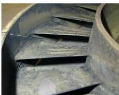
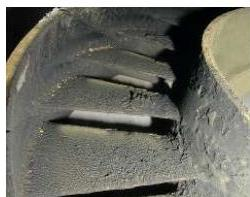
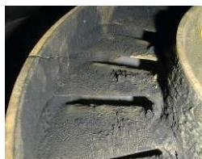
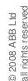
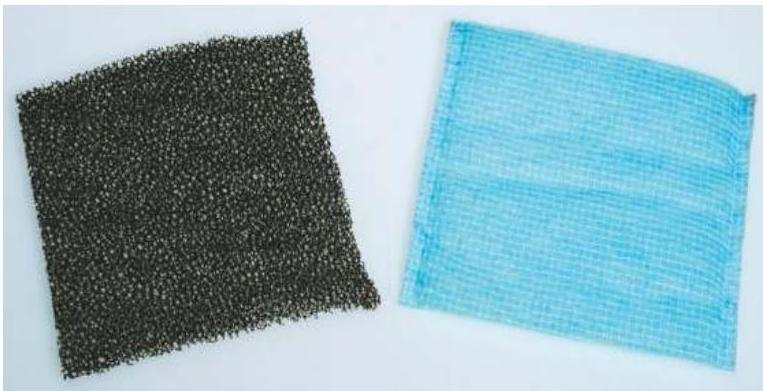
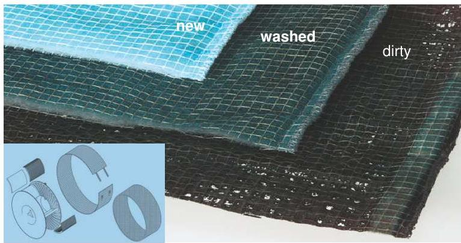
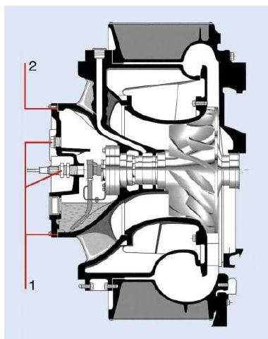

所属章节：[[第3章-操作规程]]

# ABB增压器操作维护提示

## 定义

ABB 增压器操作维护提示是基于 ABB 官方技术资料（CIAC 32, CIAC 41, CIAC 42）总结的 VTR/TPL 系列增压器操作员维护要点，涵盖故障预警、清洗规范、损伤机理、喘振诊断、应急操作、部件维护等关键内容，适用于 RT-flex50 主机配套的 ABB TPL77-B12 增压器。

## 1. 诱导轮故障早期预警

### 故障机理

**腐蚀原因：**
- 废气中的硫化物（Sulphur）
- 进气中的盐分（Salt）

**故障链路：**
```
硫化物 + 盐分 → 诱导轮叶片点蚀腐蚀
→ 缺口效应（Notch effect）
→ 高循环疲劳（HCF）故障
→ 诱导轮叶片断裂
```

### 检测建议

**荧光渗透检查（Fluorescent Penetrant Inspection）：**
- 建议定期对叶片进行荧光渗透检查
- 可早期发现点蚀和裂纹
- 预防疲劳断裂故障

## 2. 涡轮清洗最佳实践

### 清洗原则

**冷却和干燥时间：**
- 清洗**前**需适当冷却和干燥
- 清洗**后**需适当冷却和干燥
- **目的**：减少材料热应力，降低裂纹形成风险

### 清洗间隔判断

| 涡轮状态 | 清洗策略 |
|---------|---------|
| **很干净** | 清洗间隔可以延长 |
| **足够干净** | 无需改变清洗间隔 |
| **太脏** | 建议缩短清洗间隔 |

  

### 清洗频率影响

**过度清洗（Too frequent）：**
- 清洗效果好，但热应力增加
- 裂纹风险上升

**清洗间隔过长（Too long）：**
- 污垢堆积过多
- 增压器效率下降
- 排气温度升高



## 3. 增压器应急操作

### 预防措施

**ABB 官方建议：**
- 船舶机组人员应熟悉手册中的应急操作说明
- 定期进行应急操作培训
- 确保应急设备可用

### 应急场景

- 增压器故障时的主机运行限制
- 转子卡死后的应急处理
- 轴承损坏后的降速运行

## 4. TPL 喷嘴环裂纹安全评估

### 裂纹形成机理

**设计特点：**
- 为获得最佳热力学效率，喷嘴环叶片需要尽可能薄
- 薄叶片对热应力抵抗能力较弱

### 裂纹特性

**自然应力释放：**
- 细裂纹可能作为自然应力释放形式发展
- 裂纹可能在运行早期出现
- **关键特性**：裂纹生长到一定长度后会停止

### 安全性评估

**重要结论：**
- **此类裂纹不影响安全可靠运行**
- 不需要立即更换喷嘴环
- 定期检查裂纹长度是否稳定即可

## 5. TPS 滤垫维护

### 滤垫升级

**旧款 → 新款：**
- 原黑色聚氨酯滤环（left）
- 新聚酯网滤垫（right）



### 清洗要求

**定期清洗必要性：**
- 新聚酯网滤垫必须定期清洗
- **目的**：避免增压器喘振（Surging）
- 清洗间隔根据运行环境确定



## 6. VTR 油室失油根因分析

### 故障机理

**正常工况：**
- CS 轴承室（CS bearing chamber）内存在轻微负压（slight underpressure）

### 失油原因

**负压 + 密封不严：**
1. 塞子（plug）不够紧
2. 使用旧垫片（old gasket）
3. 负压导致空气流经轴承室到压气机
4. 油雾被空气流带走 → 油损失

### 预防措施

- 确保塞子拧紧
- 更换垫片时使用新垫片
- 定期检查油位



## 7. 阻塞装置（Blanking device）

### 功能说明

增压器阻塞装置用于：
- 应急情况下阻断增压器
- 允许主机在增压器故障时降速运行
- 保护增压器免受进一步损坏

## 8. 转子损伤机理（SIKO安全设计概念）

> 来源：CIAC 41 - SIKO (Safety Design Concept), Version 2.1

增压器转子在运行中承受极高载荷，即使在正常工况下部件也会经历损伤过程。理解损伤机理有助于区分故障类型和排查方向。

### 蠕变（Creep）

**定义：**持续、时间相关的损伤过程，导致永久变形，最终可导致故障。

**控制因素：**
- **温度水平**：排气温度越高，蠕变速率越快
- **应力水平**：离心力产生的应力（转速越高应力越大）

**故障排查指导：**
- 转子变形/叶片伸长 → 优先排查是否长期超温运行
- 蠕变损伤是渐进的，不会突然发生 → 追溯运行历史中的超温记录
- 更换间隔内出现蠕变故障 → 说明运行工况超出设计预期

### 疲劳（Fatigue）

**定义：**循环载荷引起的损伤过程，导致局部裂纹，最终可导致故障。

**控制因素：**
- **应力幅度**：载荷波动越大，疲劳发展越快
- **循环次数**：频繁变速/启停增加循环次数

**故障排查指导：**
- 转子裂纹/叶片断裂 → 排查运行模式（频繁变速？紧急倒车？）
- 疲劳裂纹需要一定循环次数才会扩展 → 不是"突然"发生，而是"突然发现"
- 与诱导轮HCF故障（第1节）机理一致

### 两类故障的排查方向对比

| 特征 | 蠕变类故障 | 疲劳类故障 | 腐蚀/磨损类故障 |
|------|-----------|-----------|---------------|
| **发展方式** | 渐进、时间相关 | 循环累积 | 环境侵蚀 |
| **关键因素** | 温度 + 应力 | 应力幅度 + 循环次数 | 介质（硫、盐、水） |
| **排查方向** | 是否超温/超速运行 | 是否频繁变速/启停 | 滑油品质/进气清洁度 |
| **SIKO覆盖** | 是 | 是 | 否 |
| **对应案例** | 喷嘴环裂纹（第4节） | 诱导轮HCF（第1节） | [[增压器轴承损坏故障案例]]（进水抱轴） |

**SIKO 不覆盖的故障类型：**
- 冲蚀（Erosion）导致的磨损
- 腐蚀（Corrosion）导致的损坏
- 这些需要从滑油品质、进气清洁度、冷却水泄漏等方向排查

## 9. 运行限值与更换间隔

### 操作限值

增压器铭牌上标注了关键运行限值：

| 参数 | 说明 |
|------|------|
| 转速限值（铭牌位置1-2） | 试验台110%超负荷限值 / 正常运行限值 |
| 更换间隔（铭牌位置5-6） | 压气轮推荐更换间隔 / 涡轮推荐更换间隔 |

**故障排查应用：**
- 部件在间隔前损坏 → 说明存在异常工况（超温、超速、腐蚀等）
- 需要调取运行历史数据（ATURB@WEB数据库）核实累计运行小时数

### 检修间隔（4冲程参考）

| 检修类型 | 间隔 | 内容 |
|---------|------|------|
| 中间检查 | 8,000-12,000 运行小时 | 拆装增压器、清洁和检查部件、检查公差 |
| 大修 | ~36,000 运行小时 | 轴承检查/更换、径向轴承目视检查+表面磨损、轴向轴承目视检查+轴向间隙、按需更换喷嘴环等附加磨损件 |

> 注意：上述间隔基于无额外精滤的发动机润滑油系统

## 10. 增压器喘振诊断与对策

> 来源：CIAC 42 - Surging, Version 2.1

### 喘振的物理本质

**正常运行：**
- 增压器沿运行线工作，由三个参数决定：压比、空气体积流量、增压器转速
- 空气经扩压器叶片导流→扩散→速度转化为压力

**喘振发生：**
- 边界层分离→空气速度无法转化为压力→压气机气流倒流→喘振

### 喘振三大原因

| 原因类别 | 具体项目 | 排查方向 |
|---------|---------|---------|
| **空气/燃气系统堵塞或脏污** | 空气滤器/消音器脏污、压气侧脏污/损坏、涡轮侧脏污/损坏 | 检查/清洗空气滤器、涡轮清洗、压气机清洗 |
| **燃油系统故障** | 循环泵/供给泵压力低、燃油含气、燃油含水、预热温度低、排气管路脱气阀故障 | 检查燃油压力、脱气、加热温度、脱气阀功能 |
| **负荷快速变化** | 急剧加减速、紧急倒车 | 按规程操纵，避免负荷突变 |

### 燃油系统具体排查清单

| 故障点 | 排查方法 |
|-------|---------|
| 循环泵/供给泵压力低 | 检查泵出口压力表读数 |
| 燃油含气 | 检查脱气罐液位和排气 |
| 燃油含水 | 检查分油机运行状态和排放 |
| 预热温度低 | 检查加热器和粘度计 |
| 脱气阀故障 | 检查排气管路顶部脱气阀开闭 |

### 喘振的危害

**高负荷喘振必须避免！**
- 转子瞬态转速可增加约 **15%**
- 旋转部件承受过大载荷，可能损坏
- 反复喘振可导致轴承损伤、叶片疲劳裂纹

### 系统布局对喘振的影响

| 配置 | 喘振倾向 | 说明 |
|------|---------|------|
| 单增压器 + 单扫气箱 | **固有稳定** | 不易发生喘振 |
| 双增压器 + 单扫气箱 | **固有不稳定** | "强"的增压器或发动机系统缺陷可使"弱"的增压器喘振 |

**其他设计影响因素：**
- 气缸数越少 → 扫气压力波动越大 → 喘振倾向越大
- 扫气箱容积越小 → 压力波动越大 → 喘振倾向越大
- 增压器初始匹配时的喘振裕度很重要

### 防喘振措施

1. **定期清洗**：保持空气滤器、压气侧、涡轮侧清洁（参见第2、5节）
2. **燃油系统维护**：确保燃油压力、温度、脱气正常
3. **按规程操纵**：避免负荷快速变化
4. **双增压器配置**：关注两侧增压器参数差异，发现偏差及时排查

### Humming噪声≠喘振

**重要澄清：**
- 低负荷时压气机可能发出嗡嗡声（Humming）
- **这不是喘振的前兆！**
- 对发动机和增压器性能无影响
- 避免将正常噪声误判为喘振

## 适用范围

**适用增压器型号：**
- ABB VTR 系列
- ABB TPL 系列
- 包括 RT-flex50 主机配套的 TPL77-B12

**来源：**
- ABB Turbocharging 官方技术资料
- CIAC 32, Version 2.2, March 2008（操作维护提示）
- CIAC 41, Version 2.1, January 2008（SIKO安全设计概念）
- CIAC 42, Version 2.1, July 2006（喘振诊断与对策）

## 关联

- [[第3章-操作规程]] - 操作规程章节
- [[增压器轴承损坏故障案例]] - ABB TPL77-B12 增压器轴承损坏实际案例
- [[第5章-故障诊断]] - 故障诊断章节
