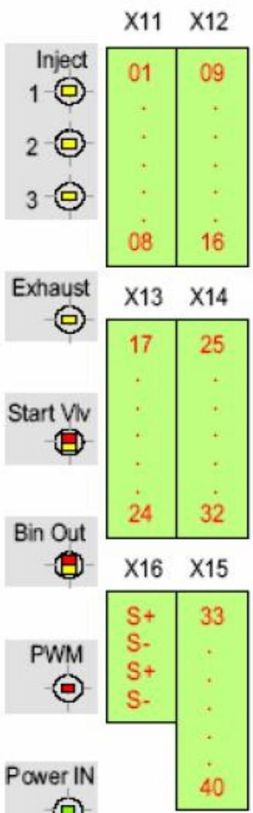
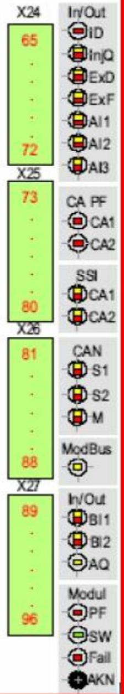
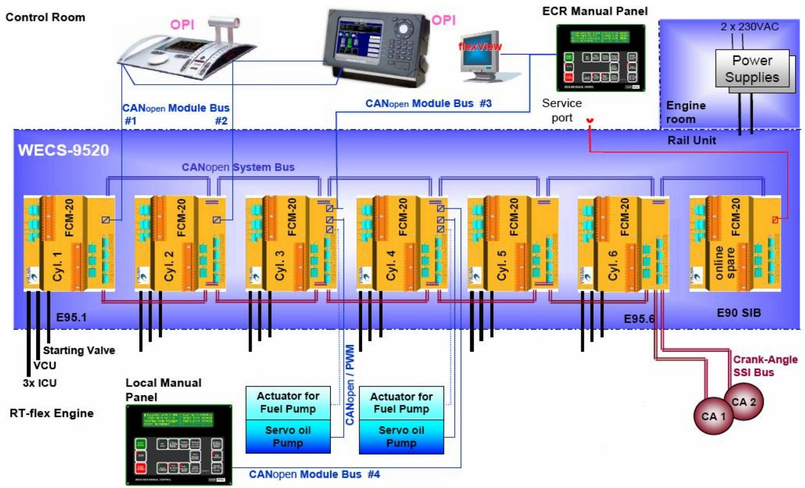
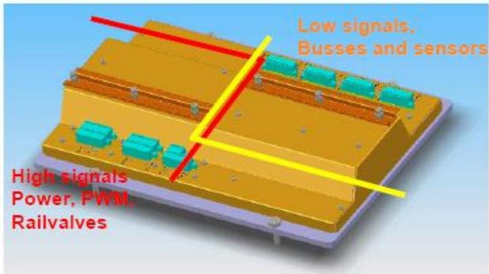
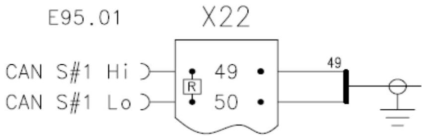

所属章节：[[第1章-发动机概述]]

# FCM-20模块

## 定义

FCM-20（Flex Control Module 20）是WECS-9520系统的核心电子模块，采用单多功能模块设计。每缸安装一个FCM-20模块在轨道单元下方的控制箱(E95)中，另有一个在线备用模块位于SIB船厂接口箱(E90)中。

## 详细说明

### 模块架构

| 项目 | 说明 |
|------|------|
| **模块分布** | 每缸一个FCM-20 + 1个在线备用 |
| **安装位置** | 缸模块在E95箱，备用模块在E90箱 |
| **通信方式** | 模块间通过快速内部CANopen系统总线通信 |
| **外部通信** | 每个模块有2条模块总线（1×CANopen、1×MODbus） |

### 高功率I/O接口（左上侧）

左上侧为高功率/脉冲功率输出接口插头：

| 接口 | 说明 |
|------|------|
| Injector 1/2/3 Railvalve | 喷油器1/2/3轨阀 |
| Exhaust V/v Railvalve | 排气阀轨阀 |
| Start Pilot Valve | 起动先导阀 |
| 24VDC out, Ctrl-Oil Pps Auto. Main Start Valve Supply Man. Ctrl. Panels | 24V直流输出、控制油泵自动、主启动阀供给、手动控制面板 |
| Servo Oil Pump Actuator | 伺服油泵执行器 |
| Power Supply 24vDC OK | 24V直流电源正常 |

LED指示I/O状态，故障或短路时变色，闪烁代码提供详细故障信息。

### 低功率I/O接口（右下侧）

右下侧为低功率信号和数据总线接口插头：

| 接口 | 说明 |
|------|------|
| FCM/20 Cylinder # Identification Error | FCM/20气缸编号识别错误 |
| Fuel Qty. Feedback ok / Failure | 燃油量反馈正常/故障 |
| Exhaust V/v Position 1/2 FB ok / Failure | 排气阀位置1/2反馈正常/故障 |
| Analogue In 1/2/3 (Rail Pressure, Charge Air...) / Failure | 模拟量输入1/2/3（轨压、扫气空气...）/故障 |
| CA Sensor 1/2 Short Circuit Power Supply | 曲柄角度传感器1/2短路电源 |
| CA-Sensor 1/2 Master / Clock or Data Failure | 曲柄角度传感器1/2主时钟/时钟或数据故障 |
| CAN System Bus 1/2 Master / Bus Failure | CAN系统总线1/2主/总线故障 |
| CAN Module Bus 1 Traffic / Bus Failure | CAN模块总线1流量/总线故障 |
| MODbus Traffic | MODbus流量 |
| Digital Input 1 (Turning Gear Engaged; TDC Pick-up) | 数字量输入1（盘车机啮合；TDC传感器） |
| Digital Input 2 (Pressure Switches) | 数字量输入2（压力开关） |
| Analogue Out (Fuel Actuator Set point) | 模拟量输出（燃油执行器设定点） |
| Power Supply Failure | 电源故障 |
| Module ready, SW OK | 模块就绪，软件正常 |
| Failure on Module | 模块故障 |

LED指示FCM-20模块和I/O状态，故障或短路时变色，闪烁代码提供详细故障信息。

### 内部模块布局

轨道单元的内部模块布局和电缆槽完全分离高EMI噪声电路（如电源线或脉冲电流线PWM、轨阀）与敏感低功率线（如数据总线电缆和传感器）。

### 功能分组

FCM-20模块内部功能分为两组：

| 分组 | 说明 |
|------|------|
| **气缸相关功能** | 每缸独立的控制功能 |
| **公共功能** | 发动机级的公共控制功能 |

### 气缸相关功能

- 读取和处理来自SSI总线的曲柄角度信号
- 计算本缸的速度、角度和旋转方向
- 根据数据容器中的设置以及通过CANopen系统总线接收的命令和参数，控制起动、喷油和排气阀

### 模块冗余与更换

| 功能 | 说明 |
|------|------|
| **故障处理** | 一个FCM故障时，对应气缸被切出，所有其他气缸保持运行 |
| **在线备用** | 任何FCM模块可与在线备用交换，相应软件和参数已存储在在线备用模块中，无需软件下载或重新编程 |
| **新模块安装** | 从库存安装新FCM-20模块时，必须先安装在E90箱（气缸"0"）作为在线备用 |

### 终端电阻

总线电缆两端**必须**安装120Ω终端电阻以避免信号反射。

### 结构示意

## 故障诊断关联

| 故障现象 | 可能故障位置 | 检查要点 |
|---------|-----------|---------|
| FCM模块故障 | 模块电源、总线通信 | 检查模块LED、电源、CAN总线 |
| 单缸不工作 | 对应FCM模块 | 检查模块I/O LED、更换备用模块 |
| 通信故障 | CAN总线、终端电阻 | 检查总线连接、120Ω终端电阻 |

## 关联

- [[WECS-9520控制系统]] - FCM-20的上级系统
- [[轨阀RV-2]] - FCM-20的控制对象
- [[曲柄角度传感器]] - FCM-20的输入信号源
