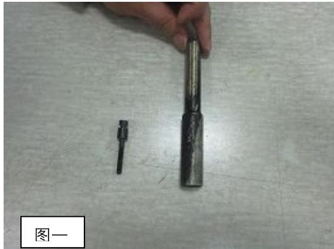
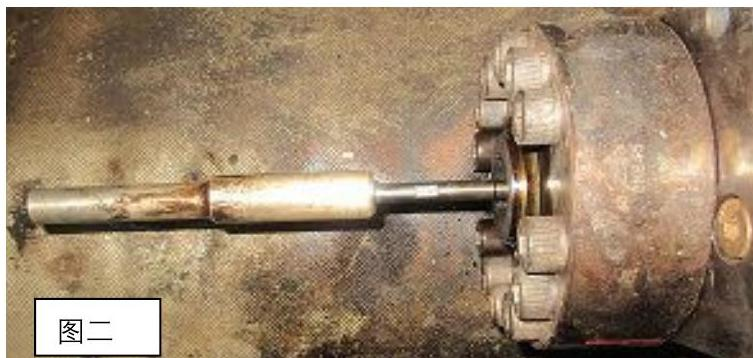

所属章节：[[第5章-故障诊断]]

# ICU流量活塞探头杆脱落故障案例

## 概述

这是一起Flex50主机5#缸ICU（喷射控制单元）流量活塞探头杆脱落导致排温异常的实际故障案例。故障发生在2020年11月17日长航琥珀轮离泊上海内高桥码头后航行期间，根本原因是ICU流量活塞探头杆固定螺栓未完全上紧到位，长时间震动后脱落。

## 故障现象

### 初始现象

| 现象 | 描述 |
|------|------|
| **运行状态** | 主机长时间在DEAD SLOW或SLOW状态运行 |
| **不发火状态** | 5号缸处于自动不发火状态（电喷机低负荷自动选择一缸不发火） |
| **排温偏差** | 5#缸与其他缸排温偏差50度 |

### 报警与参数异常

| 报警/参数 | 描述 |
|----------|------|
| **MEINJQUANTITY #05 MEASFAIL** | 5#缸喷射量传感器测量故障 |
| **WECS COMMON FAIL** | WECS公共故障 |
| **ME INJECTION QUANTITY SENSOR #5 MEAS FAIL** | 5#缸喷射量传感器测量故障 |
| **RETURN/INJECT数值** | 在正常值与N/A之间波动 |
| **INJECTION TIME** | 在12ms与5ms之间波动 |
| **MENO.5 EXHGASAFTTEMPDEVSLD** | 5#缸排气温度偏差导致SLOWDOWN |
| **MENO.5 EXHGASAFTCYLTEPMDEV** | 5#缸排气温度偏差 |
| **排温偏差** | 达到70度，触发主机SLOWDOWN |

### 后续参数变化

| 参数 | 变化描述 |
|------|---------|
| **RETURN/INJECT数值** | 固定在N/A |
| **INJECTION TIME** | 5#缸约26ms，其他缸约14ms |
| **5#缸排温** | 缓慢上升但仍与其他缸有较大差距 |

## 故障排查过程

### 第一轮排查（远程分析）

1. **故障判断**：根据报警和参数波动，初步判断为5#缸ICU流量活塞探头故障
2. **减速运行**：与驾驶台沟通后，主机以60转运行
3. **机旁检查**：确认流量活塞传感器无松动，手触高压油管有脉冲

### 第二轮排查（现场检查）

1. **流量活塞外壳检查**：旋松ICU流量活塞外壳固定螺栓，明显感觉到流量活塞的动作，确认流量活塞未卡死
2. **传感器拔插试验**：对流量传感器两次进行拔插试验，未见效果
3. **内部接线检查**：确认内部接线无松动

### 第三轮排查（解体检查）

1. **整体脱开检查**：松开流量活塞外罩固定螺栓，整体脱开检查
2. **发现根本问题**：脱开后发现流量活塞内部探头杆脱开

## 故障处理措施

### 临时处理

1. **拆卸旧件确认结构**：由于不清楚内部结构，拆卸船舶旧件，确认结构由螺栓连接紧固
2. **暂停ICU动作**：短暂拔掉5#缸ICU两个共轨电磁阀接线，暂停5#缸ICU的动作
3. **更换探头杆**：由于原探头杆杆头圆孔变形无法装复，遂装复刚拆下的旧件

### 恢复操作

1. **紧固探头杆**：紧固探头杆后，装复整个5#缸ICU部分
2. **复位接线**：复位ICU两个共轨电磁阀接线
3. **确认报警消除**：确认WECS监控报警故障消除，5#缸排温逐渐上升
4. **恢复正常运行**：1845机舱监控电脑各项报警复位，SLOWDOWN在操作车钟手柄后复位，主机恢复正常运行

### 后续检查

第二天待船舶抛锚时对各缸ICU流量传感器探头杆进行检查紧固。

## 故障原因分析

### 根本原因

ICU流量活塞解体后探头杆固定螺栓未完全上紧到位，由于长时间的震动，导致探头杆固定螺栓逐渐松动，最终导致故障的发生。

### 历史检修记录

| 时间 | 检修内容 | 备注 |
|------|---------|------|
| 2020.02.21 | 更换5#缸ICU燃油喷射控制阀 | 未检修流量活塞，但在流量活塞与本体之间有马克标记，怀疑有过解体 |
| 2020.07.14 | 更换ICU至5#缸 | — |

## 预防措施

| 措施 | 说明 |
|------|------|
| **加强检查** | 在每次的ICU流量活塞的检查活络中，应加强对各缸ICU探头杆松紧度的检查 |
| **保持检修记录** | 船舶保持良好的检修记录，以便于后期检修工作能够有据可查 |
| **定期检查** | 定期对各缸ICU流量传感器探头杆进行检查紧固 |

## 关联页面

- [[第5章-故障诊断]] - 官方故障诊断指南
- [[燃油系统]] - 燃油喷射系统相关
- [[WECS-9520控制系统]] - 喷射控制相关
- [[排气阀驱动活塞卡滞故障案例]] - 另一例实际故障案例

