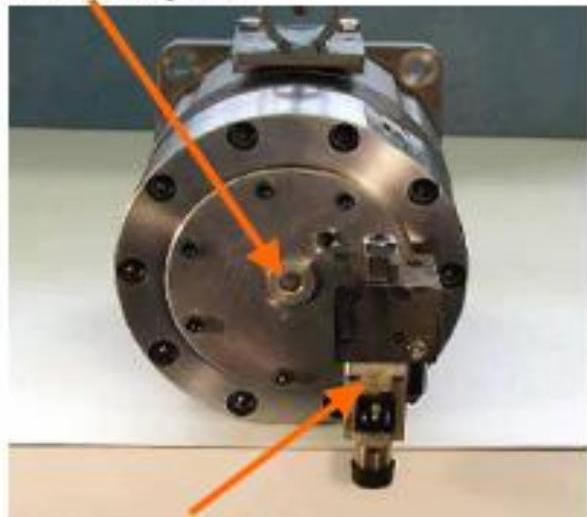

所属章节：[[第1章-发动机概述]]

# RT-flex伺服油泵

## 定义

RT-flex伺服油泵是安装在供油单元上的伺服油泵，品牌为"Dynex"，向伺服油轨供应高压伺服油。

## 详细说明

### 结构组成

| 部件 | 说明 |
|------|------|
| 吸油口（Suction port） | 伺服油吸入口 |
| 补偿阀（Compensator valve） | 压力补偿阀 |
| 电磁阀（Solenoid） | 补偿阀控制电磁阀 |

## 关联

- [[伺服油轨]] - 伺服油泵的供油对象
- [[第2章-系统描述]] - 供油单元所在系统概述
