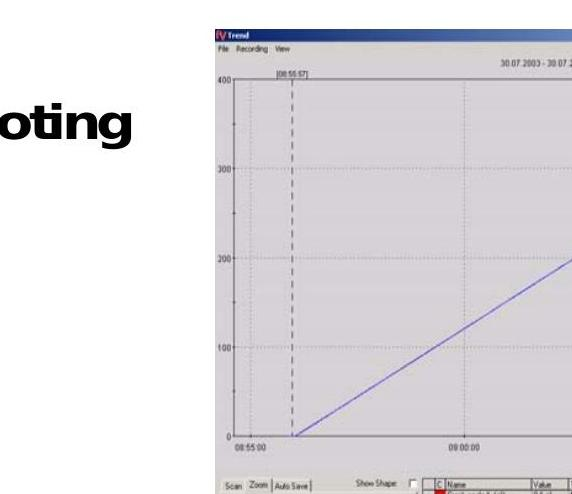
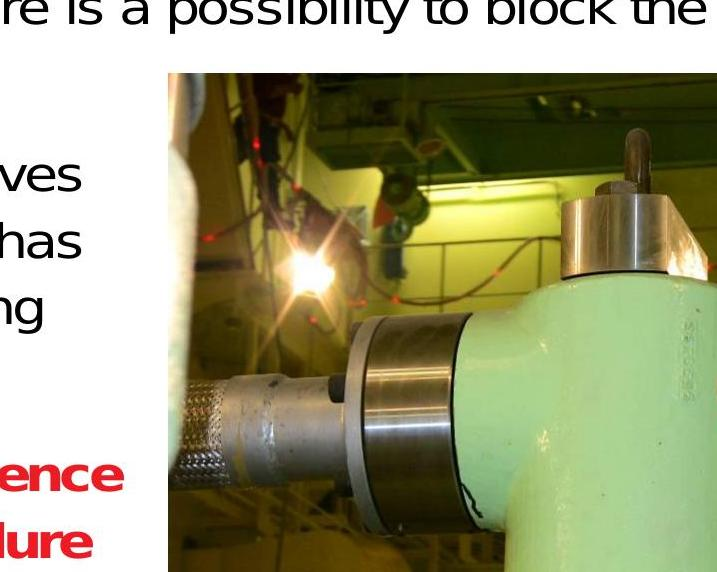
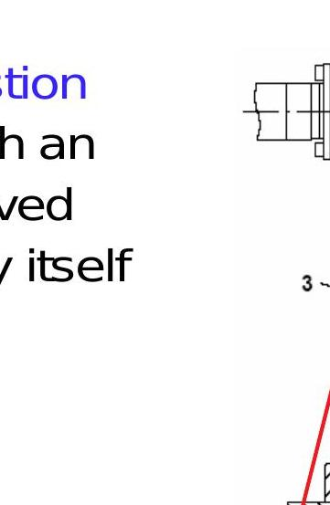
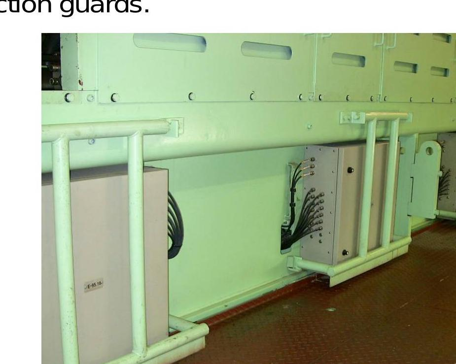

所属章节：[[第5章-故障诊断]]

# RT-flex故障排查方法论

## 定义

RT-flex 发动机故障排查方法论是一套系统化的故障分析和根因推理方法，基于实际维修经验总结而成，帮助轮机工程师快速定位和解决故障。

## 核心原则

### 1. 报警优先级原则

**第一个报警通常是根本原因**

- 某些情况会产生一系列报警，而不是一个
- 由于这可能会造成混淆，**第一个出现的报警很可能是根本原因**
- 仍然需要逻辑判断来精确定位故障源
- 需要分析当前情况：是否有人对发动机或辅助设备进行了工作？是否开关了某些设备？

### 2. 部件替换验证法

**不建议盲目更换状态不明的部件**

正确的做法：
- 将一个 FCM-20 模块与另一个气缸的模块交换
- 将一个轨阀与另一个气缸的轨阀交换
- 与其他气缸的组件交换可以非常清楚地表明组件是否有故障
- 但首先要检查这些组件还控制什么

### 3. 传感器故障处理

**间歇性报警的传感器处理**

- 检查传感器的电源和电缆连接
- 在下次机会时更换故障传感器
- 如果故障传感器不能立即更换，最好将其断开，否则可能会干扰控制系统的功能

**可临时断开的传感器清单：**
- 燃油流量传感器
- 排气阀行程传感器
- 轨压变送器
- 曲柄角度传感器（另一个必须工作！）

## 故障排查工具

### 必备工具

| 工具 | 用途 |
|------|------|
| 控制原理图 | 理解系统结构 |
| 报警日志、实际值指示 | 查看报警历史和当前状态 |
| WECS-9520 接线图 | 检查电路连接（E87、E85、E90、E95、E94、E96 等） |

### flexView 诊断工具

**趋势图用于查找不稳定值**

- flexView 趋势线可用于查明某个值是否不稳定
- flexView 的日志直接显示报警原因

**曲柄角度传感器检查方法：**
- 简单地从 View 菜单打开 CA Sensor 趋势
- 与盘车机一起运行 TrendView
- 当两条传感器曲线相互匹配时，传感器的任何丢失都会在屏幕上可见
- 要查看两条曲线，为其中一个信号添加偏移量，使其曲线在第一条曲线的下方或上方

**喷射曲线分析：**

某些错误条件需要分析喷射时间来判断故障：
- 开始死时间（begin deadtime）和返回死时间（return deadtime）是关键参数
- 死时间过长或过短都可能表明轨阀或传感器故障

如果干扰的反馈信号在 4-20mA 范围内，WECS 无法识别不稳定的信号状态。对于此类故障，使用 Service 菜单中的 Injection Curve 来研究信号形状并确定传感器是否正常工作：

**正常信号特征：**
- 清晰的曲线形状
- 无尖峰或干扰

**故障信号特征：**
- 信号形状中的尖峰表示活塞的加速度不可能，明确证明传感器故障

## 具体故障处理案例

### 喷射单元"流量活塞卡滞在终点位置"

**"卡滞"并不总是意味着活塞物理卡死**

常见原因：
- 轨阀故障
- 燃油流量传感器故障
- FCM 故障
- 冷控制油

**处理方法：**
- 通常在使用热油一段时间后或卸压燃油轨后，活塞会再次开始工作
- 通常不需要更换 ICU

**安全提醒：**
- 在处理 ICU 或燃油轨单元之前，提醒注意非常高的燃油压力！

### 燃油轨排气

**需要排气的情况：**
- 大修后
- 填充空的燃油系统

**排气方法：**
1. 每个轨必须松开一个 ICU 中的排气塞
2. 运行增压泵，燃油填充轨，空气和泡沫从塞子中逸出
3. 某些发动机类型可以通过伺服油系统对燃油轨加压
4. 也可以通过 flexView 在"User"下进行排气

### 泄漏检测

**泄漏监测：**
- ICU 和高压喷射管的内部泄漏（每个轨单元一半）由一个泄漏传感器监测

**定位泄漏源的方法：**
1. 观察所有单元的喷射时间
2. 观察气缸后的排气温度
3. 或在降低负载（即 < 减速速度）下运行发动机，并切断所有单元的喷射（逐个）
4. 如果在切断某个单元后泄漏停止，则可以怀疑该 ICU

**重要提示：**
- 只有 Wärtsilä 认可的车间才允许检修 ICU！

### 排气阀不关闭

**原因：**
- 根据手册，在启动油泵之前，必须供应弹簧空气
- 如果发动机在油泵运行但没有空气的情况下静止一段时间，排气阀有可能卡滞在打开位置

**处理方法：**
- 要释放排气阀，必须通过排气螺丝排出管中的卡滞油液
- 请遵守手册中描述的启动程序顺序

### 曲柄角度传感器安装

**安装步骤：**
1. 将曲轴转到 1 缸 TDC
2. 将轴编码器插入轴承座的导向装置中，稍微拧紧螺丝
3. 向内推动轴编码器（带黑色支架板！）
4. 检查支架板是否在轴承座中自由移动

**关键要点：**
- 在整个安装过程中，1 号气缸必须处于其实际物理 TDC！（这不一定与 TDC 信号"齿"对应……！）
- 在滑动表面上涂抹 Molykote！

**齿形皮带安装：**
1. 将齿形皮带放在齿轮上，使齿轮的两个红色标记齐平（传感器的轮子可以自由移动……）
2. 向外推动轴编码器，直到皮带稍微张紧，稍微拧紧螺丝，重新检查红色标记是否齐平！
3. 沿运行方向对齐齿形皮带并应用弹簧秤
4. 用秤稍微张紧皮带，松开螺丝并施加约 3.5kg (35N)，最大 4.5kg，拧紧螺丝

**后续步骤：**
5. 转动曲轴几圈，让齿形皮带找到其运行轨迹
6. 如果皮带张力松弛，重复张紧程序，根据下图检查皮带张力
7. 调整并弯曲锁定板
8. 拧紧所有螺丝并锁定

**重要提示：**
- 发动机几转后重新检查张力很重要，由于在轮子上对齐，张力大多会变得有点松弛
- 皮带的估计使用寿命为 3-5 年
- 皮带必须无油！

**张力目视检查：**
- TDC 和 BDC 处的皮带齿必须位于底部

**传感器对正：**
- 当 1 缸处于 TDC 时，两条红线必须对齐

**关键要点：**
- 当 1 号气缸处于 TDC 时，两条红线必须对齐
- 皮带张力约为 3.5kg，最大 4.5kg

## 应急操作措施

### 燃油压力调节阀故障

**问题：**燃油压力调节故障（如执行器故障），导致燃油压力持续过高

**应急措施：**
- 可以降低最大开启压力，以减轻燃油泵等的负载
- 合适的值在 600-700 bar 之间

### 气缸冷却水泄漏到燃烧室

**处理方法：**
- 发动机应在排气阀打开的情况下运行
- 因此，通过用户参数手动打开阀门（短时间后会自动关闭！），并可以插入 94259 号销
- 当然，喷射也必须切断！

### 电子执行器故障

**处理方法：**
- 如果一个或所有电子执行器发生故障，相应的连杆保持原位或移动到全输出位置
- 其余工作的执行器将补偿故障执行器的调节
- 每个调节轴上的扭转弹簧将在受影响的执行器不再有扭矩力（电力损失）时将连杆拉到全输出

**长期运行措施：**
- 此外，可以在受影响泵的调节齿条上安装垫片
- 根据有多少泵固定在最大位置，燃油轨压力无法正确调节，将导致持续较高的燃油轨压力
- 应急超压调节阀将相应地限制最大压力
- 对于长期运行，必须降低该阀的开启压力

## 安全注意事项

### 高压安全

**始终牢记：**
- 即使在发动机静止时，轨中可能仍有压力残留
- 在开始对其进行工作之前，卸压轨和管道！

### 电子设备安全

- 不要在任何电子单元附近使用水洗装置！
- 在开启的电子单元周围 2 米范围内不要进行焊接工作！

### FCM-20 模块

- E95 箱必须使用防护罩保护，以防损坏
- 为避免意外推动杠杆导致的减速/停机，请用盖保护它

## 关联

- [[第5章-故障诊断]] - 故障诊断章节
- [[WECS-9520控制系统]] - WECS-9520 系统
- [[FCM-20模块]] - FCM-20 模块
- [[flexView诊断工具]] - flexView 诊断工具
- [[RT-flex报警对策对照表]] - 具体报警处理
