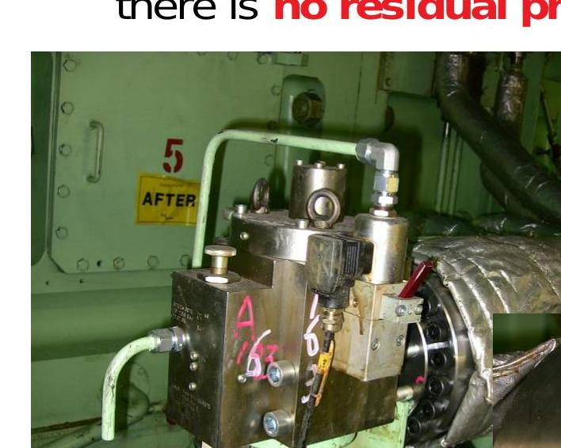
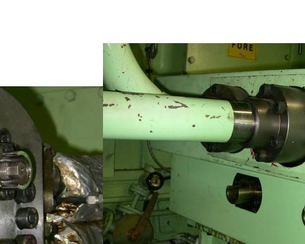
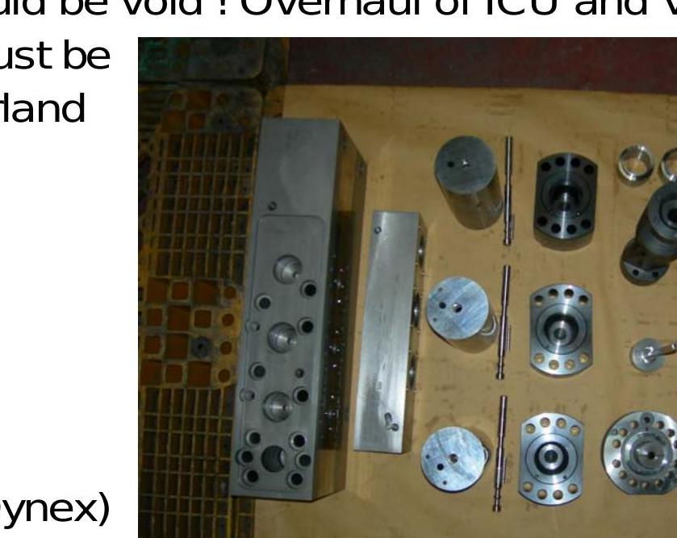
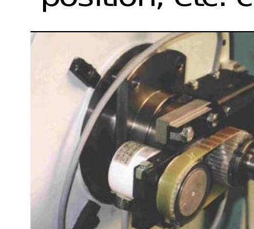
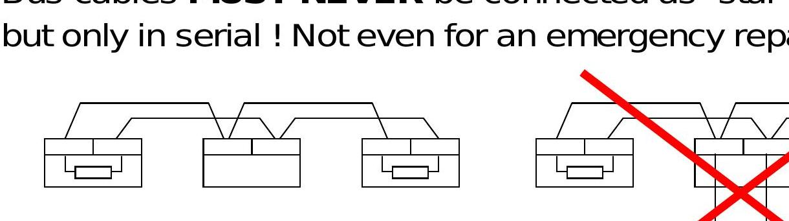

所属章节：[[第3章-操作规程]]

# RT-flex日常维护检查清单

## 定义

RT-flex 发动机日常维护检查清单是基于培训文档总结的日常巡检、定期检查和维护要点，确保发动机安全、经济运行。

## 正常运行注意事项

### 基本认识

- 发动机的 flex 部件需要与传统发动机不同的处理方式
- 但对于一般机械部件，请参考手册、工程师的知识和常识
- 以下列出了一些重要的提示和技巧，但不限于这些
- 请注意，下文提到的提示、技巧和说明只是根据实际情况解决问题的一些可能性
- 但是，随 RT-flex 发动机交付的手册和发动机制造商现场给出的说明优先于这些章节

### 安全警示

**请记住，即使在发动机静止时，轨中可能仍有压力残留！**

在开始对泵、阀或轨单元进行任何工作之前，确保没有残余压力！

## 每日巡检

### 目视检查

**每日巡回检查时的目视检查：**

| 检查项目 | 检查内容 |
|---------|---------|
| **轨单元顶盖** | 轨单元的顶盖很容易掀开，所以每天往里面看一下，检查泄漏等 |
| **燃油泵调节齿条** | 定期检查燃油泵调节齿条，所有泵上的齿条是否自由移动？可以将推杆推到较低位置，其他泵会自动补偿 |
| **泵、阀、管接头** | 燃油泵、伺服油泵和控制油泵、阀、分配块、管接头等必须每天检查是否有泄漏 |

### 轨单元和供油单元大修后

**利用 WECS-9520 和 flexView 的模拟功能：**

1. **排气阀测试：**
   - 一旦控制油泵运行，就可以手动打开和关闭排气阀
   - 这证明它们工作正常，可以检测泄漏

2. **ICU 排气：**
   - 要检查 ICU、燃油管和喷油器，使用"喷射排气"功能
   - 该功能将触发所有喷射轨阀开关 30 秒
   - 此程序可用于从新组装的部件中排出空气
   - 油将流过它们并预热它们，可以看到可能的泄漏

### ICU 泄漏监测

- ICU 和高压喷射管的内部泄漏由泄漏传感器监测
- **正常每日泄漏量：≤5 立方**（超出此值需检查或更换 ICU）
- 定期统计总泄漏量，及时维护或更换异常 ICU
- 确保各泄放管畅通，避免高压油泵泄漏燃油污染滑油系统

### 特殊注意事项

- **不要在任何电子单元附近使用水洗装置！**
- **在开启的电子单元周围 2 米范围内不要进行焊接工作！**

## FCM-20 模块管理

### 在线备用模块

- 安装在 E90 中作为"在线备用"的 FCM-20 可以安装在任何 E95 箱中
- **确保仓库中的所有 FCM-20 都加载了与发动机上使用的相同的软件版本**

### WECS-9520 电源管理

- WECS-9520 系统的电子单元应始终保持开启，无需在港口关闭电子单元
- 但建议在从模块拔下插座时以及在发动机上进行焊接工作时关闭电源
- **即使在发动机运行时，也可以切断单个气缸的电源，重新打开气缸电源后，它将启动并开始工作**

**FCM-20 模块**：
- 安装在 E95 箱中，每缸一个
- 在线备用模块安装在 E90 箱中

## 伴热系统

### 轨单元、供油单元和上升管的伴热（所有燃油部件）

- 为避免 HFO（重油）粘滞，伴热应始终开启，特别是在港口
- 上升管和轨中的燃油不循环，必须保持温暖
- 为避免启动困难，建议在发动机启动前至少 4 小时开启加热
- 所有轨单元盖应保持关闭

### 燃油切换警告

**警告：从船用油切换到 MDO（轻柴油）时，必须尽早停止伴热，以避免柴油过热！**

## 油液处理

### 液压油清洁度

- 某些液压部件非常敏感，需要清洁的油
- 这可以避免操作故障并延长其使用寿命

### 自动过滤器

- 自动过滤器是清洁油的良好高效提供者
- 如果过滤器始终显示高压差，这可能是主轴承油处理问题的指标
- 只有在真正的紧急情况下，才必须将自动过滤器切换到其旁通侧

## 主启动阀功能测试

**测试方法**：
- 两个电磁阀通常一起激活以实现高可用性
- 应不时进行功能测试：禁用其中一个阀，启动发动机，然后使用另一个阀重复

**替代测试方法**：
- 可以通过拔出插头或通过 flexView 的"User"页面禁用阀
- 可以不启动发动机，而进行"慢转"或"空气运行"

## 定期检查与维护

### 需要定期检查、检修或更换的部件（1）

| 部件 | 维护内容 |
|------|---------|
| 燃油泵 | 柱塞更换 |
| 燃油泵调节齿条 | 轴承更换 |
| 伺服油泵 | 滚子轴承、柱塞、调节阀、密封件检修 |
| 控制油泵 | 柱塞单元更换 |
| 凸轮轴凸轮表面和燃油泵滚轮 | 检查与检修 |
| 自动过滤器 | 检修 |
| 燃油压力调节阀、停机阀 | 检修 |

### 需要定期检查、检修或更换的部件（2）

| 部件 | 维护内容 |
|------|---------|
| 喷射控制单元（ICU） | 检查和检修 |
| 液压软管 | 检查 |
| 曲柄角度传感器和驱动 | 皮带、轴封、传感器检查 |
| FCM-20 模块 | 更换 |

**重要提示：**
- * 仅由 Wärtsilä 瑞士或授权车间进行！
- Wärtsilä 已为完整 ICU 建立了以更换为基础的服务，以防 ICU 被认为有故障或损坏，或者到了定期检修时间（约 24,000-36,000 运行小时）

## 部件检修限制

### 禁止非授权人员开启的部件

**ICU、VCU 和 FCM-20 严禁由非授权人员开启！**

- 任何保修都将失效！
- ICU 和 VCU 的检修需要特殊工具，必须仅在 Wärtsilä 瑞士或授权维修商处进行！

### 可部分开启的部件

- 伺服油泵（Bosch 或 Dynex）可以部分开启，请遵循各自制造商的说明
- 强烈建议将此类检修工作留给岸上车间，那里有绝对清洁的条件

## FCM-20 模块更换

### 更换步骤

FCM-20 模块无法维修，但可以非常容易地更换：

1. 将发动机功率降低到减速水平以下
2. 关闭相关单元的电源（将启动减速）
3. 取下所有连接的插头
4. 拧下固定螺栓并取下模块

**注意事项：**
- 不要过度弯曲电缆
- 不要从插头上断开电缆
- 安装在 E90 中作为"在线备用"的 FCM-20 可以安装在任何 E95 箱中以更换故障的 FCM-20
- **确保仓库中的所有 FCM-20 都加载了与发动机上使用的相同的软件版本**

### 运行时限制

- **发动机运行时，不允许同时关闭两个相邻模块 #[1 & 2] 或 #[3 & 4] 或 #[最后一个和倒数第二个]！**
- 如有必要（无备件），在气缸单元之间交换模块，以使这些配对的 FCM 组中至少有一个工作
- 同样，在发动机运行时，不要一次关闭一个以上控制伺服油泵的气缸单元（FCM #3 到 5 或最多 #8，具体取决于泵的数量）
- 安装新模块的过程相反，重新打开电源后，气缸单元将在几秒钟后开始工作

## 传感器更换

曲柄角度、轨压 PT、喷射流量活塞、排气阀位置等传感器可以轻松更换。

## 布线检查

### 常见故障原因

大多数故障出现是因为控制系统的信号错误或缺失，由以下原因引起：

- 电缆连接松动、传感器目标或链接
- 电缆端插座压接不良
- 压力传感器、变送器和开关的入口端口堵塞
- 传感器暴露在过度振动、热、污垢、湿气或异常磨损下
- 接地故障
- 短路
- 电线破损
- 噪声信号（EMC）
- 传感器类型错误
- 传感器参数或缩放错误
- 连接错误
- 电源低

### 布线要求

- 电线必须铺设在电缆槽中，用电缆固定器固定，以避免振动引起的故障
- 电线不得交叉，而应平行排列，不要在其他元件上擦伤
- 定期检查并重新拧紧所有箱中的端子
- 对于图中标注为屏蔽的电线，必须使用屏蔽电缆，屏蔽必须仅在图中定义的一端连接到接地
- 对于数据传输，必须使用特殊的屏蔽总线电缆
- "L"（低功率/敏感）和"H"（高功率）电线必须保持分开，并始终分开引导，以避免信号干扰

### 总线布线

- 定期检查所有端子排的连接是否松动
- 通常，只必须使用船级认可的屏蔽电缆
- 对于任何总线系统，只必须使用特殊的 120Ω 总线电缆！（110Ω 到 130Ω 的总线或数据电缆）
- 在总线电缆的每一端，必须有一个 120Ω 的终端电阻！
- 总线电缆绝不能连接为"星形连接"（并联），而只能串联！即使是应急维修也不行！

## 关联

- [[第3章-操作规程]] - 操作规程章节
- [[RT-flex故障排查方法论]] - 故障排查方法
- [[FCM-20模块]] - FCM-20 模块
- [[WECS-9520控制系统]] - WECS-9520 系统
- [[长航碧玉30KG到8KG减压阀损坏故障案例]] - 空气瓶放残与减压阀管理的实际案例
- [[长航碧玉主机2缸ICU伺服油液压活塞卡阻故障案例]] - 精密偶件清洁与更换周期的实际案例
