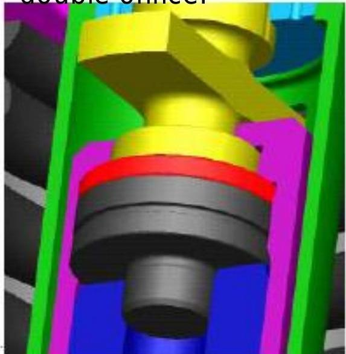
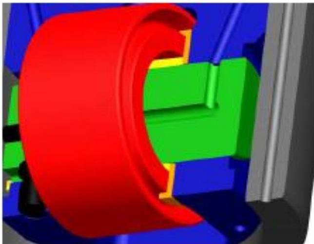

所属章节：[[第1章-发动机概述]]

# RT-flex燃油泵

## 定义

RT-flex燃油泵是安装在供油单元上的柱塞式燃油泵，向燃油轨输送可变数量的燃油，以维持所需的燃油轨压力。与传统RTA发动机不同，RT-flex燃油泵**没有任何定时**。

## 详细说明

### 功能

- **压力维持**：向中间蓄能器和燃油轨输送可变数量的燃油，以维持所需的燃油轨压力
- **无定时**：与传统RTA发动机的燃油泵不同，RT-flex燃油泵没有任何定时

### 结构组成

| 部件 | 说明 |
|------|------|
| 泵缸（Pump cylinder） | 柱塞运动的缸体 |
| 泵柱塞（Pump plunger） | 产生燃油压力的柱塞 |
| 调节套筒（Regulating sleeve） | 调节供油量的套筒 |
| 滚轮导承/滚轮组件（Roller guide/roller assembly） | 凸轮驱动机构 |
| 缓冲空间（Buffer space） | 缓冲容积 |
| 止回阀（Non return valve） | 防止燃油回流，详情见[[燃油泵止回阀NRV]] |
| 压缩弹簧（Compression spring） | 柱塞复位弹簧 |

### 供油量调节

- **调节方式**：通过调节齿条转动泵柱塞来改变供油量
- **位置0**（Pos:0）：无供油（No delivery）
- **位置5**（Pos:5）：半供油（Half delivery）
- **位置10**（Pos:10）：全供油（Full delivery）

### 润滑

- 滚轮导承/滚轮组件和调节套筒通过主轴承油经双节流孔润滑

## 关联

- [[燃油轨]] - 燃油泵的供油对象
- [[第2章-系统描述]] - 供油单元所在系统概述
- [[燃油泵止回阀NRV]] - 燃油泵入口止回阀的损坏机理与检验方法
