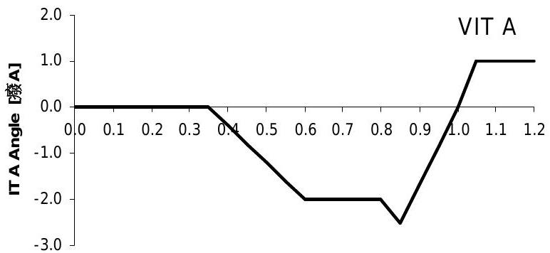
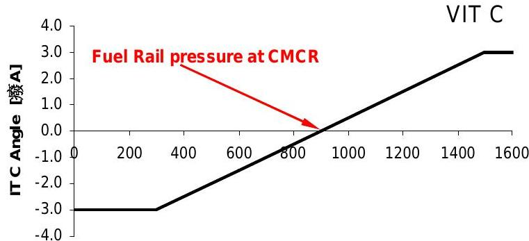
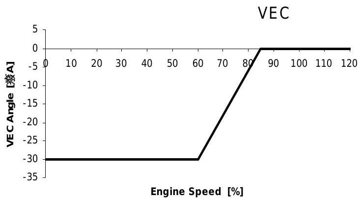
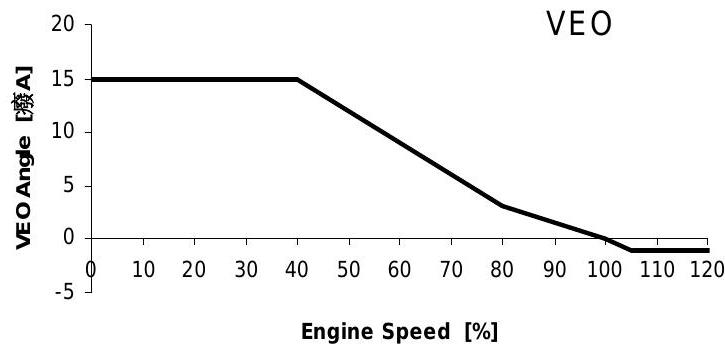
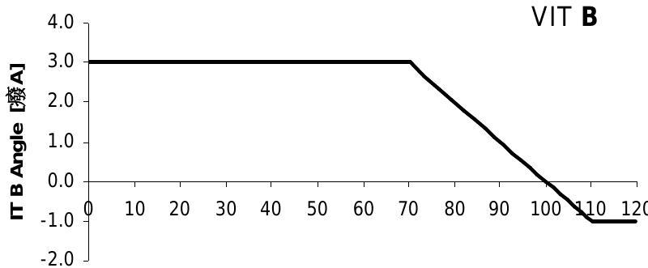

所属章节：[[第1章-发动机概述]]

# VIT/VEC/VEO/FQS控制函数

## 定义

RT-flex发动机的四个关键控制函数，用于优化燃烧效率、排放和发动机性能：

| 缩写 | 全称 | 说明 |
|------|------|------|
| **FQS** | Fuel Quality Setting | 燃油质量设定，喷油正时的手动偏移 |
| **VIT** | Variable Injection Timing | 可变喷油正时，根据发动机负荷提前/延迟喷油以优化燃油消耗和NOx排放 |
| **VEC** | Variable Exhaust-valve Closing | 可变排气阀关闭，调整压缩压力以在喷油提前时保持爆发比(Pmax/Pcompr)在允许范围内 |
| **VEO** | Variable Exhaust-valve Opening | 可变排气阀开启，在更高转速时提前开启以保持排气压力反吹恒定，提高燃油经济性并减少活塞底部沉积物 |

## 详细说明

### FQS - 燃油质量设定

- **功能**：喷油正时的手动偏移
- **用途**：调整最高爆发压力至标称值
- **与RTA的区别**：RT-flex的喷油角度不再与爆发压力相关（提前喷油开始→"+"，延迟→"-"），而是相对于0°-360°的曲柄角度
- **结果**：提前喷油开始或FQS设定[更高爆发压力]（例如，根据RTA原理+1.0°）现在相对于较早的喷油角度为-1.0°（例如2°而非3°CA）

### VIT - 可变喷油正时

- **输入参数**：转速、扫气空气压力、燃油轨压力（新参数）
- **第3个参数**：引入燃油轨压力以补偿不同喷射压力导致的喷油正时差异
- **压力影响**：更高的燃油压力导致喷油提前和更高的Pmax
- **调整方式**：随着燃油压力增加，喷油开始角度略有延迟

### VEC - 可变排气阀关闭

- **来源**：已知于当代RTA 84T B/D发动机
- **功能**：调整压缩压力
- **目的**：在喷油提前时保持爆发比(Pmax/Pcompr)在允许范围内
- **计算主体**：由WECS-9520计算
- **手动调整**：**不能**手动更改！

### VEO - 可变排气阀开启

- **功能**：在更高转速时提前开启排气阀
- **目的**：保持排气压力反吹恒定
- **益处**：提高燃油经济性，减少活塞底部沉积物
- **计算主体**：由WECS-9520计算
- **手动调整**：**不能**手动更改！

## 结构示意

## 故障诊断关联

| 故障现象 | 可能故障位置 | 检查要点 |
|---------|-----------|---------|
| 爆发压力异常 | VIT/FQS设定 | 检查VIT计算参数、FQS偏移 |
| 压缩压力异常 | VEC设定 | 检查VEC计算、排气阀关闭正时 |
| 排温异常/活塞积碳 | VEO设定 | 检查VEO计算、排气阀开启正时 |

## 关联

- [[WECS-9520控制系统]] - 控制函数的计算主体
- [[喷射控制单元ICU]] - VIT的执行对象
- [[气门控制单元VCU]] - VEC/VEO的执行对象
