所属章节：[[第2章-系统描述]]

# WECS-9520 控制系统

## 概述

WECS-9520（Wartsila Engine Control System）专为采用 Sulzer 共轨技术的二冲程发动机设计，覆盖所有发动机相关（Engine-related）和气缸相关（Cylinder-related）控制功能。

> 参考文档：OM-RT-flex50, 4002-1/A1, 4002-3/A1, 4002-4/A1, 0850-1/A1

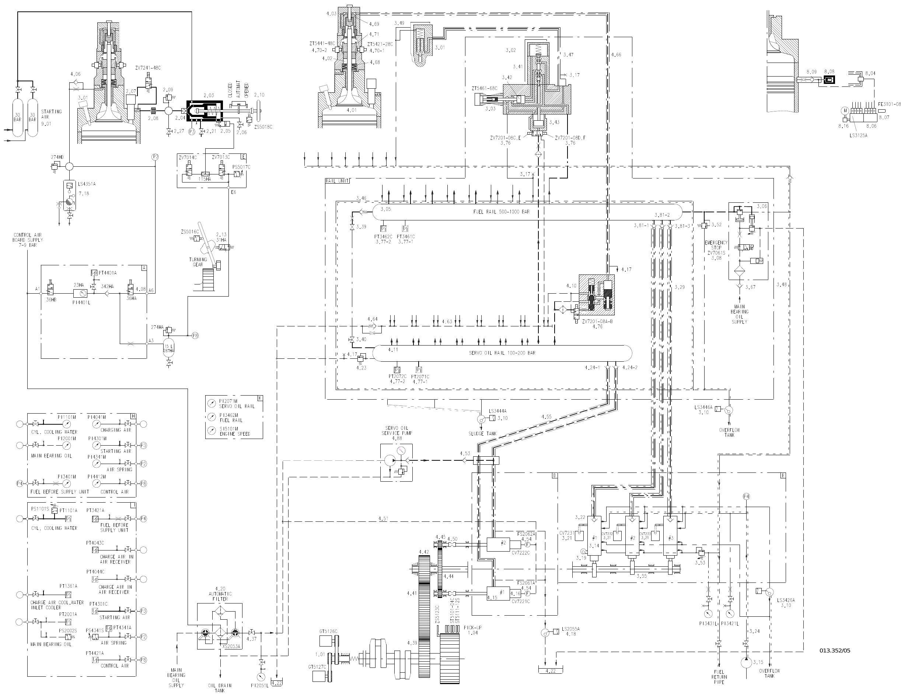

> **图解要点**：控制系统总图完整展示了发动机各控制介质的物理连接关系。燃油轨(500-1000 bar)通过燃油泵和执行器控制供油；伺服油轨(100-200 bar)驱动排气阀和喷油控制单元的液压动作；起动空气(30 bar)经电磁阀ZV7013C/14C控制截止阀，再通过气缸起动阀ZV7241-48C驱动起动；控制空气(7-9 bar)用于气动阀件驱动。关键传感器包括燃油轨压力传感器PT3461C/PT3462C、伺服油压力传感器PT2071C/PT2072C，实现闭环控制。安全系统通过紧急停机阀实现快速切断。

### 关键测量点代码（来自控制图107344463b）

当 flexView 报警时，可通过以下测量点代码快速定位传感器位置：

| 代码 | 类型 | 测量对象 | 故障表现 |
|------|------|---------|---------|
| PT2001A | 压力变送器 | 启动空气压力 | 启动空气压力低→启动失败 |
| PS2002S | 压力开关 | 主轴承油压力 | 油压低→轴承损坏风险 |
| PS3415 | 压力开关 | 空气弹簧压力 | 弹簧压力异常→发动机振动 |
| PT341A | 压力变送器 | 空气弹簧压力 | 弹簧压力监测 |
| PT4421A | 压力变送器 | 控制空气压力 | 控制气压力低→气动阀失效 |
| P12071M | 测量点 | 伺服油轨压力 | 伺服油压异常→喷油器不动作 |
| P13462W | 测量点 | 燃油轨压力 | 燃油轨压异常→燃烧不良 |
| S15101M | 转速传感器 | 发动机转速 | 转速信号异常→ECU判断错误 |

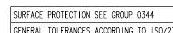

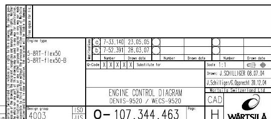

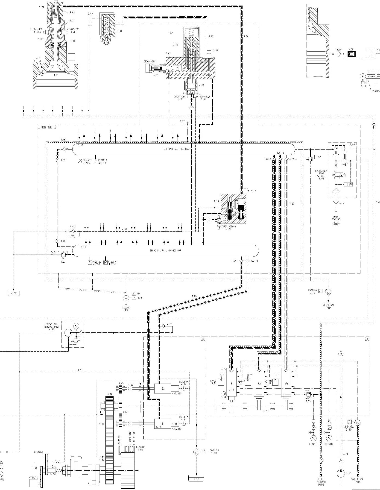

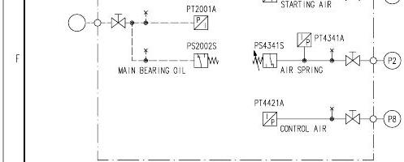

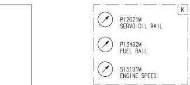

---

## 1. FCM-20 模块

FCM-20（Flexible Control Module）是 WECS-9520 的核心控制模块。

### 1.1 模块分布

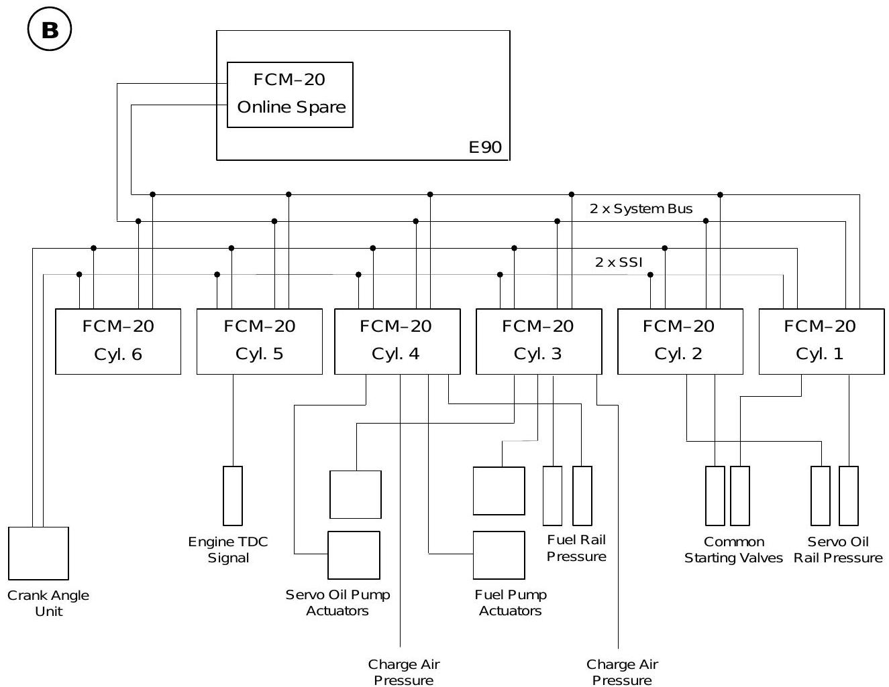

| 控制箱 | 位置 | 内容 | 功能 |
|--------|------|------|------|
| E90 (SIB) | 轨道单元自由端 | 1 个 FCM-20（在线备用模块） | 与外部系统通信 |
| E95.01 ~ E95.xx | 轨道单元各缸 | 每缸 1 个 FCM-20 | 发动机和气缸相关控制功能 |
| E85 | 机舱发动机附近 | 电源箱 | 为 FCM-20 和燃油泵执行器供电 |

### 1.2 通信架构

- 所有 FCM-20 模块通过**系统总线**（冗余 CANopen 总线）连接
- 曲轴角度信号通过**冗余 SSI 总线**传输至各 FCM-20
- 电源为**冗余供电**

> **图解要点**（FCM-20功能分配图）：每缸配备独立FCM-20模块（E95.xx），E90控制箱含"在线备用"模块。引擎级控制功能分布在前5个模块：燃油轨压力由缸3、4的FCM-20监测；伺服油轨压力由缸1、2的FCM-20监测。双冗余系统总线(2 x System Bus)确保通信可靠性。曲轴角度单元连接至所有FCM-20模块。

### 1.3 模块冗余规则

- 重要功能、输入和输出信号均为**冗余设计**
- 一个模块故障时发动机仍可运行
- 故障模块需用 "在线备用" 模块替换
- 替换后需下载所有应用数据到新的在线备用模块

---

## 2. 控制功能

### 2.1 发动机相关控制功能（分布在前 5 个 FCM-20 模块，即缸 1-5）

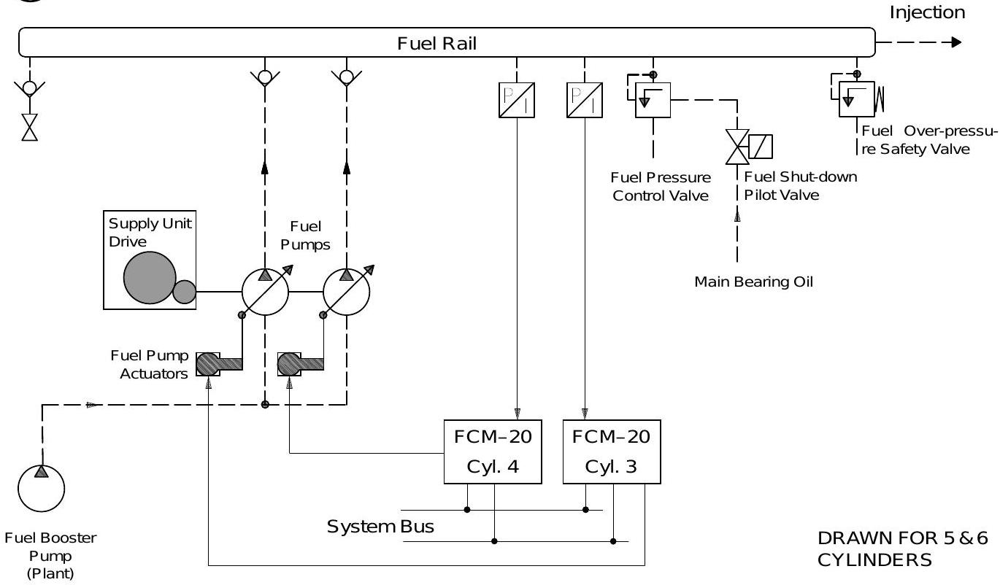

| 功能 | 描述 | 控制对象 |
|------|------|----------|
| **燃油压力控制** | 根据发动机负荷调节燃油轨压力 | 燃油泵执行器（每泵一个执行器） |
| **伺服油压力控制** | PWM 信号控制伺服油泵内机械压力调节器 | 伺服油泵（两台，分别由缸 3、4 的 FCM-20 控制） |
| 监控与触发功能 | 各类传感器监测和报警触发 | 全系统 |
| 伺服油泵控制 | 负荷均衡分配 | 两台伺服油泵 |
| 燃油泵执行器控制 | 同步控制所有燃油泵 | 燃油泵执行器 |

#### 燃油压力控制回路

1. WECS-9520 基于发动机转速和 "燃油指令" 生成控制信号
2. FCM-20 模块信号控制燃油泵执行器
3. 两个压力变送器测量燃油轨压力作为反馈（缸 3、4 的 FCM-20 模块）

> **图解要点**：燃油压力控制为闭环控制 -- WECS-9520基于发动机转速和"燃油指令"生成控制信号 -> FCM-20模块驱动燃油泵执行器 -> 燃油泵调节供油量 -> 燃油轨压力由两个压力变送器(PT3461C/PT3462C)测量 -> 反馈至缸3、4的FCM-20模块。停机时执行器归零位，安全系统激活燃油关断先导阀。

### 2.2 气缸相关控制功能（每缸一个 FCM-20）

| 功能 | 描述 | 关键参数 |
|------|------|----------|
| **喷油控制（含 VIT）** | 容积式喷油控制，参考曲轴角度和 VIT 计算喷油始点 | 喷油死区时间、燃油量活塞行程 |

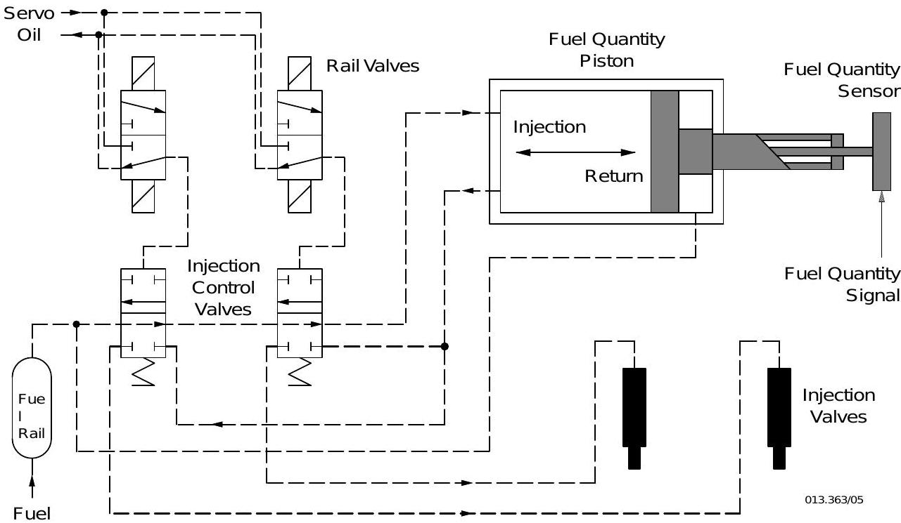
| **排气阀控制（含 VEO 和 VEC）** | 液压开启、气动关闭，参考曲轴角度控制开闭时序 | VEO = 排气阀开启，VEC = 排气阀关闭 |

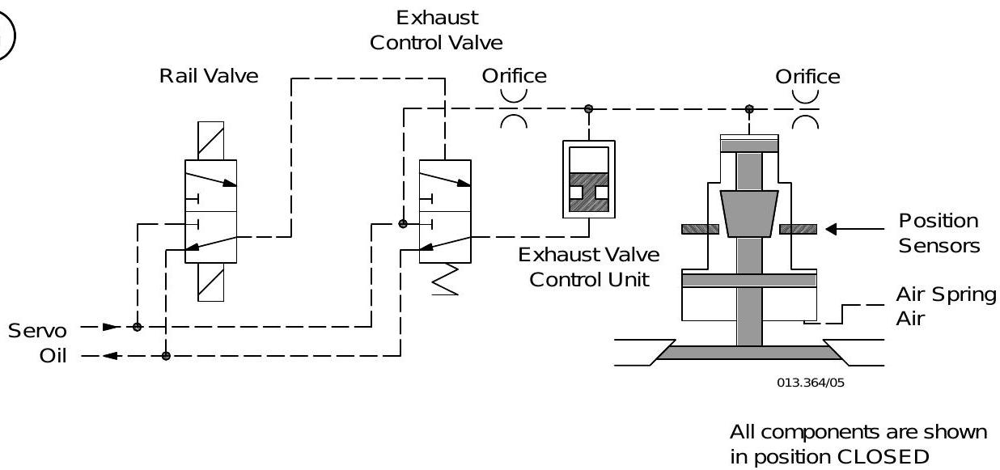
| **起动阀控制** | 每转一次在特定曲轴角度开启/关闭，直到发动机运行 | FCM-20 直接控制 |
| **曲轴角度传感器** | 两个绝对值传感器安装在自由端，通过齿形带驱动 | SSI 总线冗余传输 |

### 2.3 用户可调参数

| 参数 | 用途 |
|------|------|
| **FQS（燃油质量设定）** | 调整最高爆发压力至标称值。负校正角提前喷油增压力；正校正角延迟喷油降压力 |
| **VIT on/off** | 可关闭用于磨合。OFF 时喷油始点为标称角度，不随功率变化 |
| **Inj. cut off** | 停止单缸喷油（如拉缸/喷油系统故障时），排气阀保持正常运行 |
| **Inj. venting** | 喷油单元排气，轨道阀有节奏地激活。需开启伺服油服务泵 |
| **Exv. A/M Cmd** | 手动开闭单个排气阀（停机时），用于测试和排气 |
| **Start Valves Checking** | 检查起动空气截止阀上的控制阀功能 |
| **Heavy Sea Mode** | 大风浪模式，燃油轨压力设为恒定值，不受功率影响。航行前须关闭 |

### 2.4 维护参数（需密码）

| 参数 | 用途 |
|------|------|
| Crank Angle (PARA3) | 曲轴角度偏移和上止点偏移调整 |
| Exv. closing offset | 排气阀关闭偏移，压缩压力微调 |
| Inj. begin offset | 喷油始点偏移，最高爆发压力微调 |
| Inj. correction factor | 各缸喷油量校正因子，可降低至 80% |
| Servo oil pump Pr. setup | 伺服油泵压力设定微调 |

---

## 3. 五级故障分级体系

WECS-9520 故障分为 5 个等级，由轻到重：

| 等级 | 名称 | 影响 | 措施 |
|------|------|------|------|
| 1 | **WECS passive failure**（被动故障） | 冗余系统故障（冗余组件、系统或组件故障），**不直接影响发动机运行** | 尽早调查原因并修复 |
| 2 | **WECS common failure**（公共故障） | 公共类型故障，**对发动机运行影响较小** | 尽早调查原因并修复 |
| 3 | **WECS cylinder failure**（气缸故障） | 导致单缸失效、发动机功率下降，触发安全系统**立即减速** | 必须立即修复以恢复全功率运行 |
| 4 | **WECS pressure failure**（压力故障） | 燃油/伺服油轨等压力系统故障，影响整机，触发**立即减速** | 不建议越控减速，必须立即修复 |
| 5 | **WECS critical failure**（关键故障/发动机故障） | 导致 WECS **停机**的故障 | 必须立即修复才能重新起动发动机 |

### 3.1 LED 故障指示

FCM-20 模块上有 4 个 LED 指示灯，用于故障诊断：

| LED | 颜色 | 含义 |
|-----|------|------|
| Fail | 红色 | 闪烁=当前故障，常亮=历史故障，灭=无故障 |
| AI1 / AI2 | 黄色 | 模拟量输入（燃油轨压力/伺服油压力/扫气压力） |
| InjQ | 黄色 | 喷油量传感器 |
| Ex.D / Ex.F | 黄色 | 排气阀位置传感器 |

故障状态通过**闪烁间隔**进一步细分，不同间隔对应不同具体故障。

### 3.2 ICU燃油量传感器报警排查（来自RT-flex-01服务通报）

> **重要提示**：flexView报警如 "Injection quantity piston, stuck in max. position" 或 "Injection quantity piston, no return" **多数不是ICU机械卡死**，不要直接更换ICU！

**"Stuck"报警的9个可能原因（按排查顺序）**：

| 排查顺序 | 可能原因 | 排查方法 |
|---------|---------|---------|
| 1 | 轨道阀(3.76)卡滞 | flexView监测on time，**>3.0ms则更换轨道阀** |
| 2 | 阀门驱动模块(VDM)损坏 | 更换VDM后再测on time |
| 3 | 轨道阀插头松动 | 检查电缆连接 |
| 4 | 行程传感器(3.03)故障 | 检查电缆和插头连接 |
| 5 | 行程传感器插头松动 | 检查插头连接 |
| 6 | 传感器滑动铝套管松动 | 检查套管是否紧固 |
| 7 | 气缸控制器模块(CCM)故障 | 排查最后手段 |
| 8 | 燃油量传感器本身故障 | 检查测量套筒是否紧固于活塞杆、是否偏心 |
| 9 | 燃油轨内有压力 | 须完全泄压后才能手动移动活塞 |

> **处理流程**：先查电缆连接 → 测轨道阀on time → 换轨道阀 → 换VDM/CCM → 最后才考虑换ICU

### 3.3 ICU磨损识别——flexView喷油曲线判读（来自RT-flex-01服务通报）

通过 flexView 查看喷油曲线判断ICU控制阀是否磨损：

**操作步骤**：
1. 切换到Service访问级别，密码：flexView
2. 点击 View → Injection curve
3. 选择缸号 → One cycle → Scan

**曲线判读**：

| 状态 | 曲线特征 | 含义 |
|------|---------|------|
| 良好 | 水平线和上升线之间有**清晰弯折** | 控制边完好 |
| 磨损 | 水平线和上升线之间有**"颠簸"** | 控制边磨损 |

**磨损后果**：WECS自动延迟喷油开始 → 爆发压力降低 → 缸温升高 → **须尽快检修ICU并检查燃油分油机**

---

## 4. 传感器和执行器对照表

### 4.0 曲轴角度传感器单元

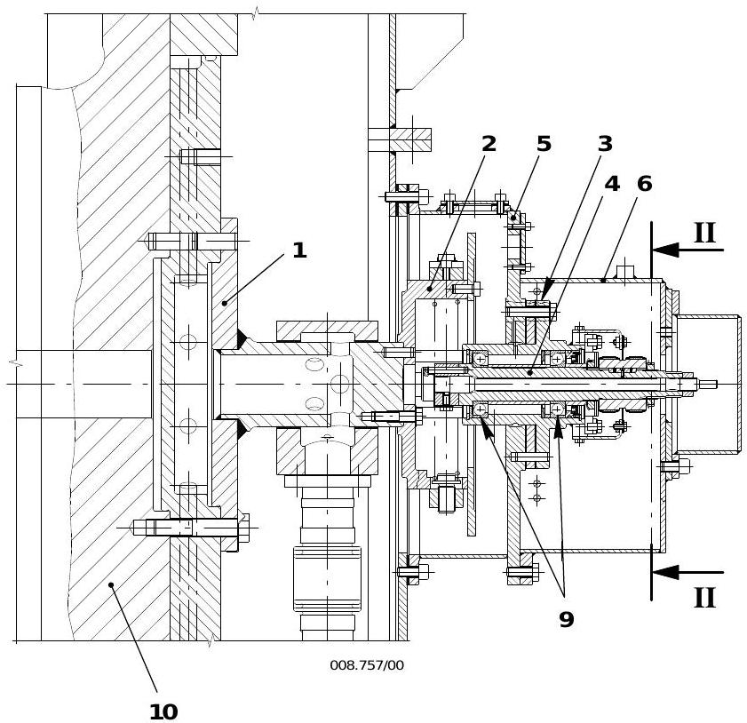

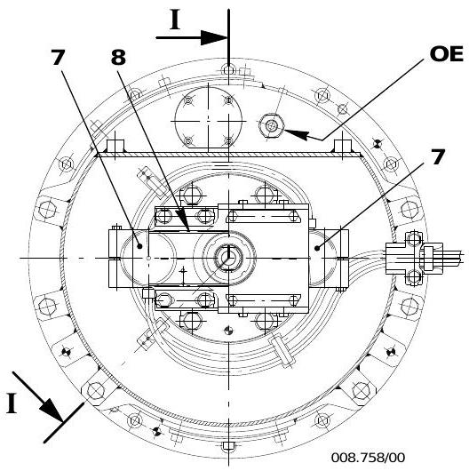

> **图解要点**：曲轴角度传感器单元安装在发动机自由端。连接单元(2)通过驱动轴(1)固定在曲轴(10)上，吸收曲轴的径向和轴向跳动。两个曲轴角度传感器(7, GT5126C/5127C)通过齿形带(8)驱动，提供曲轴位置信号。TDC信号由独立的接近传感器监测。球轴承(9)需定期润滑。

### 4.1 压力传感器

| 传感器 | 代码号 | 测量对象 | 关联 FCM-20 |
|--------|--------|----------|-------------|
| PT3461C / PT3462C | 燃油轨压力 #1/#2 | 燃油轨压力 | 缸 3、缸 4 |
| PT2071C / PT2072C | 伺服油压力 #1/#2 | 伺服油轨压力 | 缸 1、缸 2 |
| PT4043C / PT4044C | 扫气压力 #1/#2 | 扫气空气压力 | 缸 3、缸 4 |

> **补充自控制图107344463b**：
> | PT2001A | 启动空气压力 | 启动空气系统压力监测 |
> | PS2002S | 主轴承油压力开关 | 润滑系统油压低报警 |
> | PS3415 | 空气弹簧压力开关 | 空气弹簧压力异常报警 |
> | PT341A | 空气弹簧压力变送器 | 空气弹簧压力监测 |
> | PT4421A | 控制空气压力变送器 | 控制空气系统压力监测 |
> | P12071M | 伺服油轨测量点 | 伺服油轨压力（flexView监测） |
> | P13462W | 燃油轨测量点 | 燃油轨压力（flexView监测） |
> | S15101M | 发动机转速传感器 | 曲轴转速信号输入ECU |

### 4.2 位置/速度传感器

| 传感器 | 测量对象 | 数量 | 位置 |
|--------|----------|------|------|
| GT5126C / GT5127C | 曲轴角度 | 2 | 自由端 |
| ZS5123C | 上止点信号 | 1 | 自由端 |
| 排气阀位置传感器 | 排气阀开闭行程 | 每缸 2 | 气缸盖上 |
| 燃油量活塞传感器 | 喷油量 | 每缸 1 | 喷油控制单元 |
| FS2061-62A | 流量传感器 | 每台伺服油泵前 1 | 供油单元 |

### 4.3 执行器

| 执行器 | 控制对象 | 数量 | 控制方式 |
|--------|----------|------|----------|
| 燃油泵执行器 13 (3.21) | 燃油泵齿条 | 2-3 个 | 电控同步 |
| 伺服油泵压力调节器 | 伺服油泵输出压力 | 2 个 | PWM 信号 |
| 轨道阀（Rail Valve） | 排气阀开闭 | 每缸 2 个（开/关） | FCM-20 放大驱动 |
| 轨道阀（Rail Valve） | 喷油控制 | 每缸 2-3 个 | FCM-20 放大驱动 |
| 燃油关断先导阀 22 (3.08) | 燃油轨泄压 | 1 个 | 安全系统触发 |
| 起动空气电磁阀 ZV7013C/14C | 起动空气截止阀 | 2 个 | FCM-20 缸 1、2 控制 |
| 起动阀电磁阀 ZV7241C-48C | 气缸起动阀 | 每缸 1 个 | 对应 FCM-20 控制 |

### 4.4 仪表板 (9215-1)

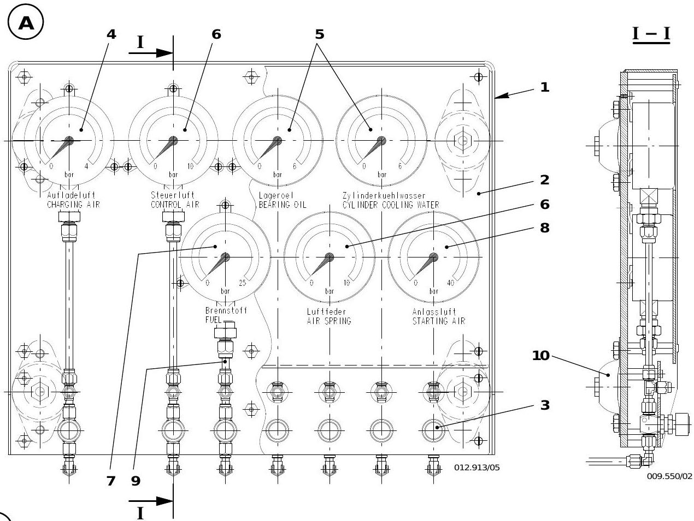

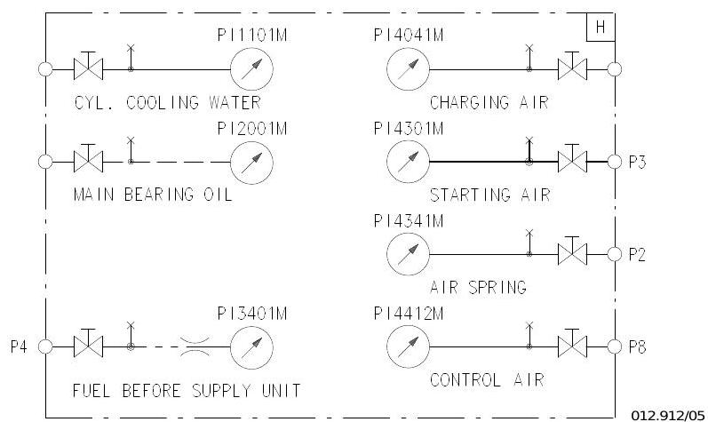

> **图解要点**：仪表板(1)安装在控制箱旁，包含5个压力表用于目视监测各系统压力：4 bar(控制空气)、6 bar(空气弹簧)、10 bar(轴承油)、25 bar(伺服油)、40 bar(燃油)。燃油和伺服油的压力指示也可在本地控制面板(4618-1)上读取。节流件(9)阻尼压力脉动，减振安装(10)保护仪表。

---

## 5. 控制介质压力表

| 介质 | 压力范围 | 备注 |
|------|----------|------|
| 控制空气（来自船用系统） | 7 - 8 bar | 经减压阀 23HA 调整至 6.5 bar |
| 起动空气（来自起动空气瓶） | 最大 25 / 30 bar | - |
| 轴承油（主轴承、十字头、活塞冷却） | 3.5 - 4.9 bar | - |
| 伺服油 | 100 - 200 bar | 取决于发动机负荷 |
| 燃油轨压力 | 负荷相关 | 由 WECS-9520 调节 |
| 空气弹簧空气 | 约 6 bar | 来自控制空气系统 |

---

## 6. 外部通信

WECS-9520 通过数据总线与以下外部系统通信：

| 系统 | 连接方式 |
|------|----------|
| 推进控制系统（RCS） | 2 条冗余数据线 |
| 船舶报警和监测系统 | 2 条冗余数据线 |
| 本地控制面板 | 1 条数据线 |
| 机舱后备控制箱 | 1 条数据线 |
| 服务人员笔记本接口 | 1 条数据线 |

### 推进控制子系统

- **遥控系统（RCS）**：起动、停车、换向、预/后润滑、自动慢转、辅助鼓风机控制、速度设定、负荷相关气缸润滑
- **电子调速系统**：维持发动机转速，传递 "燃油指令" 给 WECS-9520
- **安全系统**：紧急停车、超速保护、自动停机、自动减速
- **WECS-9520 手动控制面板**：用于本地应急操控发动机（备份模式），由 Wartsila 提供，集成于遥控系统

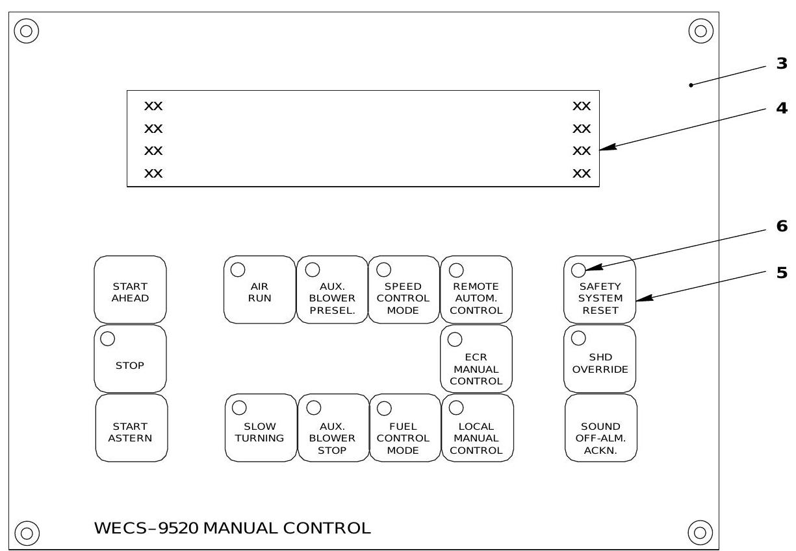

> **按钮功能说明**：面板按钮仅在对应的操作模式下激活（即当前激活的控制台）。两台手动控制面板（本地和ECR集控室）均由 WECS-9520 直接供电，独立于遥控系统运行。左列控制发动机起停方向；第二列控制辅助系统（空气运行、辅助鼓风机预选/停止、速度控制模式、慢转）；第三列切换控制权（远程自动/ECR手动/本地手动）；右列为安全系统管理（安全系统复位、SHUT DOWN越控、声光报警确认）。

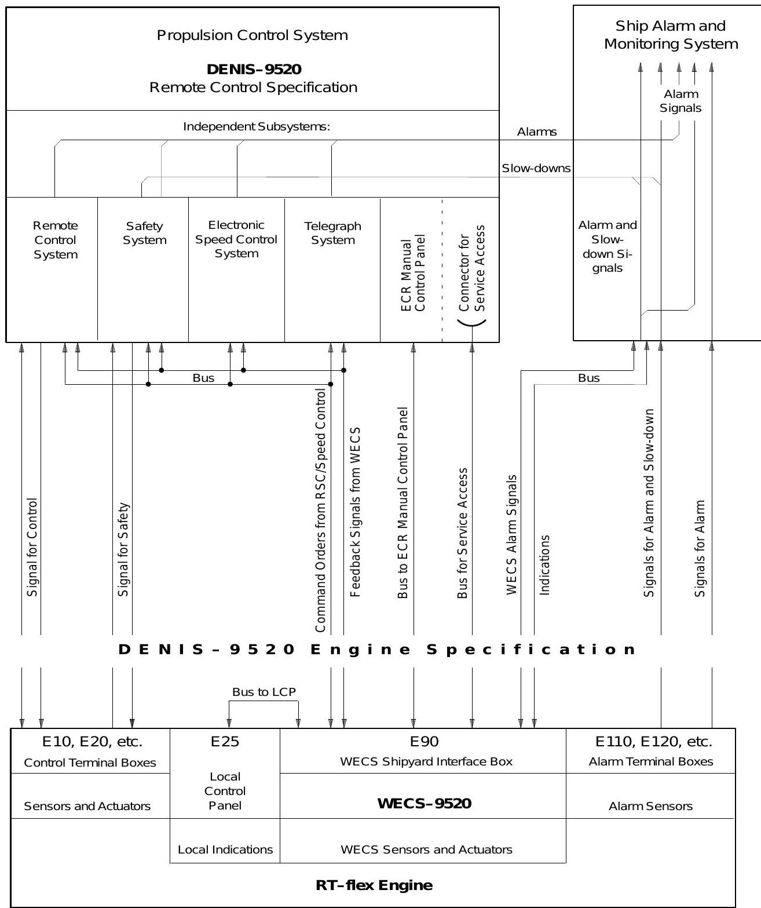

> **图解要点**：传令系统采用分层控制架构 -- 驾驶台命令指令通过传令系统总线传递至集控室手动控制面板（ECR），再转发至本地控制面板（E25模块）驱动发动机。传令系统同时将报警和慢车信号传递至船舶报警和监控系统，经处理后触发相应报警终端箱（E110/E120）。WECS-9520（E90船厂接口箱）向传令系统反馈状态信号，形成闭环控制。

---

## 关联概念

- [[第2章-系统描述]] - 8大系统概览
- [[燃油系统]] - 燃油供给与喷射详细描述
- [[第3章-操作规程]] - 各系统操作步骤与检查清单
- [[第6章-技术参数与报警设定]] - 压力、温度等参数限值 (0250-1, 0250-2)
- [[工作介质规格]] - 润滑油、冷却水等规格要求

---

*来源：OM-RT-flex50 操作说明书 (2009-07), 4002-1, 4002-3, 4002-4, 4003-1, 4003-2, 4003-3, 0850-1, 9215-1, 9223-1, 9258-1, 9362-1*
