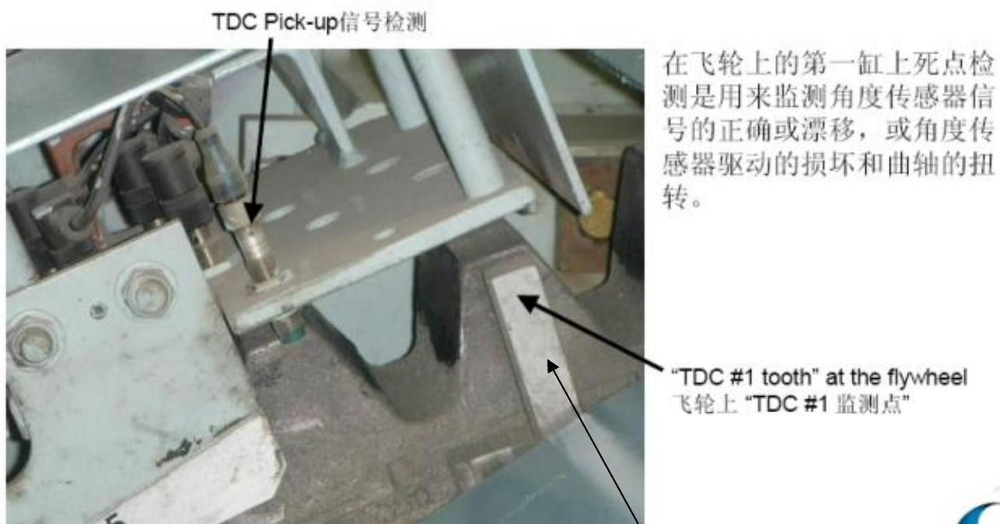

所属章节：[[第5章-故障诊断]]

# 主机不能正常启动故障案例

## 概述

这是一起长航琥珀轮2012年4月主机不能正常启动的故障案例。故障包含多个并发问题：TDC传感器支架固定螺栓断裂导致TDC传感器损坏，以及E20到E10的AC CAN A通讯线断裂导致主机无转速显示、不能加速。案例展示了系统性排查多个故障点的完整过程。

## 基本信息

| 项目 | 内容 |
|------|------|
| **船舶** | 长航琥珀轮 |
| **故障时间** | 2012年4月9日 |
| **主机机型** | RT-flex50 |
| **故障地点** | 离泊期间试验时 |

## 故障经过

### 时间线

| 时间 | 事件 |
|------|------|
| 2012-04-09 08:16LT | 主机试验时机舱监控系统报警：M/E TDC SIGNAL FAIL |
| 检查发现 | TDC传感器支架固定螺栓一个断裂，TDC传感器损坏 |
| 更换TDC传感器后 | M/E TDC SIGNAL FAIL报警复位，监控系统无报警，控制系统显示正常，主机处于备用状态 |
| 冲车试验 | 冲车效果正常 |
| 启动试验 | 可听到启动空气进入，但主机不能正常运行，一直空转不能加速 |
| 多次试验后 | 发现主机无转速显示 |
| 燃油模式试验 | 主机可以正常使用，曲柄转角器转速可正常显示 |
| 速度模式试验 | 工况不正常 |
| 排查检修后 | 主机转速显示正常，正倒车试验及加速工况正常 |

## 故障检查与排查过程

### 初步检查（TDC传感器故障）

| 检查项 | 发现 |
|--------|------|
| 报警信息 | M/E TDC SIGNAL FAIL |
| TDC传感器支架 | 固定螺栓中一个已断裂 |
| TDC传感器 | 被损坏 |

**处理**：更换TDC传感器，报警复位。

### 启动故障排查（无转速显示、不能加速）

更换TDC传感器后，主机仍不能正常启动：
- 启动空气进入正常，但主机空转不能加速
- 监控系统无任何故障警报
- 关键发现：**主机无转速显示**

### 模式对比试验

| 模式 | 结果 |
|------|------|
| **燃油模式** | 主机可以正常使用，曲柄转角器转速可正常显示 |
| **速度模式** | 工况不正常 |

**初步判断**：主机测速单元故障。

### 系统性检查（逐项排查）

| 序号 | 检查项目 | 检查内容 | 发现/处理 |
|------|---------|---------|----------|
| 1 | 遥控系统电源模块 | 检查U2、U5输出电压 | 正常，约26.7V；断电重启后试车，依然无转速显示 |
| 2 | E20-RPMD BOX电源 | 检查电源路径：U5→E25的PSO-P3→E10→E20 | 各点电压正常，约26.5~26.7V |
| 3 | 转速传感器 | 检查4个转速传感器接线头、探头间距、固定底板 | 2个松紧螺帽轻微松动（已拧紧）；间距约3mm；底板有变形（重新紧固） |
| 4 | 通讯线路 | 检查E20到E10的通讯线（AC CAN A、AC CAN B） | **AC CAN A有一根线断裂**（E10上接线号X81、X83），重新接线并固定 |

**检修空间说明**：转速传感器在飞轮处空间非常狭小，且没有检修道门，检修难度非常大。

## 故障原因分析

### 多个故障点

| 故障点 | 原因 | 影响 |
|--------|------|------|
| TDC传感器支架螺栓断裂 | 盘车机啮合时可能撞到tooth，多次碰撞导致螺栓松动脱落 | TDC传感器损坏，M/E TDC SIGNAL FAIL报警 |
| AC CAN A通讯线断裂 | 振动等原因 | 主机无转速显示，速度模式下不能加速 |

### TDC传感器支架螺栓断裂原因分析

- 该tooth虽安装于高齿上，但啮合盘车机时，通常仍存在撞到该tooth的可能（不可能保证盘车机一次性啮合进飞轮齿内）
- 多次碰撞下，固定螺栓可能造成松动脱落

## 经验教训与改进措施

| 序号 | 经验教训 | 改进措施 |
|------|---------|---------|
| 1 | 不能过度依赖监控系统，必须工作更仔细全面 | 加强人工检查与核对 |
| 2 | 主管人员要全面熟悉分管设备的各系统组成和部件功能，尤其是重要又易被忽略的部件 | 加强系统培训，确保紧急状态能及时准确判断故障原因 |
| 3 | 进一步加强管理工作细致程度，尤其是重要部件管理检查，做好备件必备库存量 | 完善检查清单，确保备件充足 |
| 4 | 船舶运行中常有较强振动，对传感器部件必须十分认真对待 | 加强防振措施，定期检查紧固件 |
| 5 | 需经常检查TDC传感器支架tooth固定螺栓情况 | 大管轮和电机员已将主机飞轮处所有传感器检查列入月度检查工作，并作为交接班事项 |

## 关键知识点

- **多个故障点并发**：本次故障同时存在TDC传感器问题和CAN总线通讯问题，需逐一排查
- **模式对比试验**：燃油模式与速度模式的对比是快速定位故障范围的有效方法
- **转速显示缺失**：主机无转速显示是重要线索，指向测速单元或通讯故障
- **CAN总线故障**：AC CAN A通讯线断裂会导致转速信号无法传输
- **振动危害**：船舶振动对传感器部件影响大，需定期检查紧固件
- **检修空间**：设计时需考虑传感器等关键部件的检修可达性

## 关联页面

- [[第5章-故障诊断]] - 官方故障诊断指南
- [[WECS-9520控制系统]] - 控制系统说明
- [[第3章-操作规程]] - 正常操作规程
- [[排气阀驱动活塞卡滞故障案例]] - 另一例实际故障案例
- [[ICU流量活塞探头杆脱落故障案例]] - 另一例实际故障案例
- [[增压器轴承损坏故障案例]] - 另一例实际故障案例
- [[滑油变质致排气阀故障案例]] - 另一例实际故障案例
- [[活塞冷却油伸缩管断裂故障案例]] - 另一例实际故障案例
- [[缸套异常磨损致活塞环断裂故障案例]] - 另一例实际故障案例

