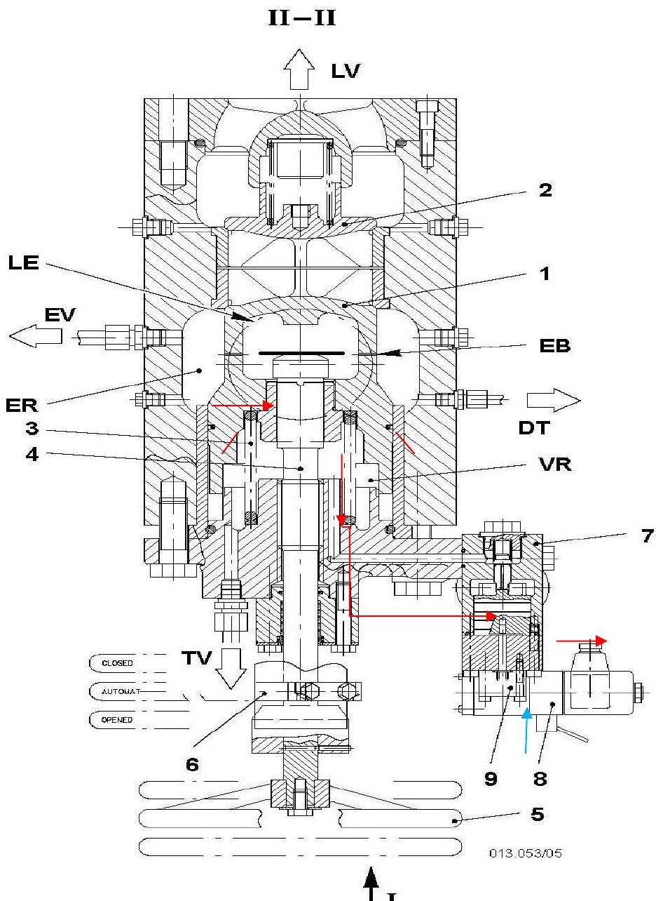
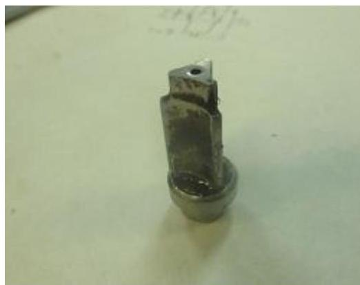
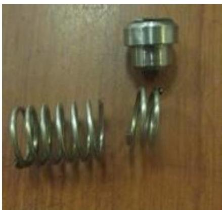

所属章节：[[第5章-故障诊断]]

# 主机主启动阀漏气故障案例

## 概述

这是一起长航水晶轮FLEX50主机主启动阀漏气的故障案例。故障表现为主启动阀排气消音器漏气，经检查发现为辅启动控制阀阀芯断裂或锁紧螺钉松动所致。案例包含详细的主启动阀控制原理说明、故障原因分析以及应急处理方法（如AB胶粘接临时使用）。

## 基本信息

| 项目 | 内容 |
|------|------|
| **船舶** | 长航水晶轮 |
| **主机机型** | FLEX50（与SULZER-RTA52U原理及结构基本相同） |
| **故障类型** | 主启动阀排气消音器漏气 |
| **故障原因** | 辅启动控制阀阀芯断裂或锁紧螺钉松动 |
| **类似案例** | 长航号及大庆号苏尔寿主机船舶时有发生 |

## 主启动阀结构与控制原理

### 结构说明

**符号说明**：
- **EV**：通往泄放阀
- **DT**：通往压力传感器及表
- **TV**：通往测试阀

### 控制原理详解

#### 1. 关闭状态（等待启动）

| 项目 | 状态 |
|------|------|
| 主空气瓶压力 | 30BAR启动空气进入ER主启动阀腔室等待 |
| 节流孔EB | 部分空气经节流孔EB进入主启动阀芯内腔室LE |
| 作用力平衡 | 阀芯顶部空气压力 + 主阀芯下部弹簧3弹力 > 启动空气作用在阀1上锥面的开阀力 |
| 结果 | 主阀1向上保持关闭 |
| LE腔室排气 | LE腔室内节流空气经芯轴4向下进入VR腔室与辅控制阀7联通 |

#### 2. 启动状态（主机启动或慢转启动）

| 项目 | 状态 |
|------|------|
| 电磁阀8 | 得电 |
| 阀块9 | 接通 |
| 控制空气 | 从盘车机来的联锁控制空气推动辅控制阀7内活塞向上顶开阀芯 |
| LE/VR腔室 | 空气快速泄放 |
| 作用力变化 | 作用在主阀1上锥面的开阀力 > 阀芯下部弹簧力 |
| 结果 | 主启动阀迅速打开，引导启动空气去启动主机 |

#### 3. 关闭过程（主机启动成功后）

| 项目 | 状态 |
|------|------|
| 电磁阀8 | 被切断供电 |
| 阀块9 | 切断盘车机来的控制空气 |
| 辅控制阀7 | 内阀芯迅速在弹簧力的作用下关闭 |
| 节流孔EB | 启动空气经节流孔EB节流进入腔室LE |
| 结果 | 主阀芯1缓慢关闭，减少冲击 |

#### 4. 故障状态（辅控制阀阀芯断裂）

| 项目 | 状态 |
|------|------|
| 辅控制阀7 | 阀芯断裂失去定位 |
| 阀面密封 | 由于偏移或冲击变形而失去密封泄漏 |
| LE腔室压力 | 下降而使主阀芯1不能关闭严密 |
| 泄漏持续 | 辅控制阀7内的阀芯泄漏将会一直存在 |

## 故障检查发现

### 故障现象

主启动阀排气消音器漏气。

### 拆检发现

| 检查项 | 发现 |
|--------|------|
| 辅启动控制阀阀芯 | 断裂 |
| 锁紧螺钉 | 松动（可能原因之一） |

## 处理措施与经验教训

### 检查步骤

| 序号 | 步骤 |
|------|------|
| 1 | 发现主启动阀泄漏后，首先检查辅启动控制阀芯锁紧螺钉有无松动 |
| 2 | 进一步拆检此阀检查阀芯及弹簧有无断裂 |

### 应急处理方法

| 方法 | 说明 |
|------|------|
| **AB胶粘接** | 阀芯断裂后，可以用AB胶粘接临时应急使用 |
| **铜棒车制备件** | 使用铜棒车制后部阀芯密封面及弹簧座，前部可以加工为三角形保持定位即可 |

### 经验教训

| 序号 | 经验教训 |
|------|---------|
| 1 | 很多大管轮初次遇见该故障时，第一判断为主启动阀阀芯关闭不严泄漏，究其原因多为未能对主启动阀的启动控制原理有深刻认识和了解 |
| 2 | 失去定位的断裂阀芯启动时的冲击将造成控制阀本体内的阀座密封面变形，进而增加备件费用支出 |
| 3 | 该故障在长航号及大庆号苏尔寿主机船舶时有发生，原因相同，均为辅启动控制阀阀芯断裂或锁紧螺钉松动造成 |

## 关键知识点

- **主启动阀类型**：Flex50柴油机使用非均衡式主启动阀
- **原理通用性**：SULZER-RTA52U及FLEX50柴油机主启动阀原理及结构基本大同小异
- **故障判断误区**：主启动阀漏气易误判为主阀阀芯关闭不严，实际多为辅控制阀问题
- **控制关键**：辅控制阀7内阀芯的密封性直接影响LE腔室压力，进而影响主阀1的关闭
- **应急方案**：AB胶粘接或铜棒车制备件可作为临时应急措施
- **预防损失**：及时发现处理可避免阀座密封面变形，减少备件费用

## 关联页面

- [[第5章-故障诊断]] - 官方故障诊断指南
- [[第4章-异常操作规程]] - 应急操作程序
- [[排气阀驱动活塞卡滞故障案例]] - 另一例实际故障案例
- [[ICU流量活塞探头杆脱落故障案例]] - 另一例实际故障案例
- [[增压器轴承损坏故障案例]] - 另一例实际故障案例
- [[滑油变质致排气阀故障案例]] - 另一例实际故障案例
- [[活塞冷却油伸缩管断裂故障案例]] - 另一例实际故障案例
- [[缸套异常磨损致活塞环断裂故障案例]] - 另一例实际故障案例
- [[主机不能正常启动故障案例]] - 另一例实际故障案例
- [[主机偶发超速报警停车故障案例]] - 另一例实际故障案例

