所属章节：[[第5章-故障诊断]]

# 主机启动无转速故障案例

## 概述

这是一起长航钻石轮6RT-FLEX50主机2025年7月发生的启动无转速故障案例。故障起因于合盘车机时碰坏TDC传感器T型块，最终导致4个转速传感器全部损坏。案例包含极其详细的13步排查过程、多次测试验证、服务商指导以及最终解决方案，极具参考价值。

## 基本信息

| 项目 | 内容 |
|------|------|
| **船舶** | 长航钻石轮 |
| **主机型号** | 6RT-FLEX50 |
| **故障时间** | 2025年7月14日 |
| **转速传感器探头型号** | omRon NPN/NC E2EL-X5E2-M1（原机） |
| **新探头型号** | PICKUPINDNPN/NCCONN M12XS6 (XS618B1NBM12) |
| **备件探头** | XS1M18KP340D（2只，亮度不一致）、omRon E2EL-X5E2-M1（1只，未标注NPN/PNP） |

## 故障经过与排查过程

### 第1步：初始故障发现（2025.07.14 08:00）

| 事件 | 详情 |
|------|------|
| 操作 | 接驾驶台移锚通知，机舱备车合盘车机，准备盘车再冲活车（此前抛锚因水流较大未完车） |
| 报警 | METDC SIGNAL FALL & WECS COMMON FAILURE两个故障报警 |
| 检查发现 | T型块固定螺栓断掉一个，T型块旋转180°，角度小侧板一端变形 |

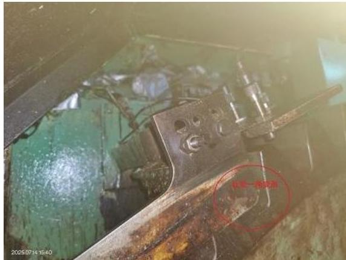

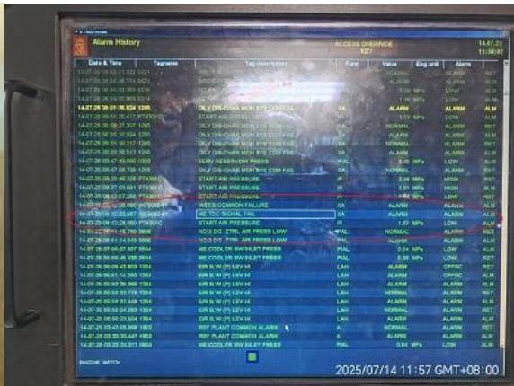

### 第2步：T型块校正装复与TDC传感器更换

| 操作 | 结果 |
|------|------|
| T型块及角度小侧板拆下校正后装复 | 故障依旧，报警没复位 |
| 检查TDC传感器 | T型块位置时指示灯不亮，监测不到上止点位置 |
| 更换TDC传感器 | 集控室各监控电脑报警消除，无报警显示 |

### 第3步：试车发现无转速显示

| 操作 | 发现 |
|------|------|
| 试车 | 主机启动无转速显示，不能启动 |
| 检查转速传感器 | 两组转速传感器四个探头无论在飞轮齿什么位置均常亮，不能进行交替闪亮 |
| 更换探头 | 由于只有三只新探头，更换三只（1.2/2.1/2.2），还有一只1.1未换 |
| 更换后 | 三只探头在盘车时可以交替闪亮 |
| 再次试车 | 转速紊乱 |
| 检查C20面板 | 正倒车指示灯都亮 |

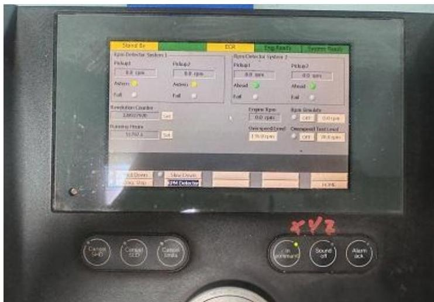

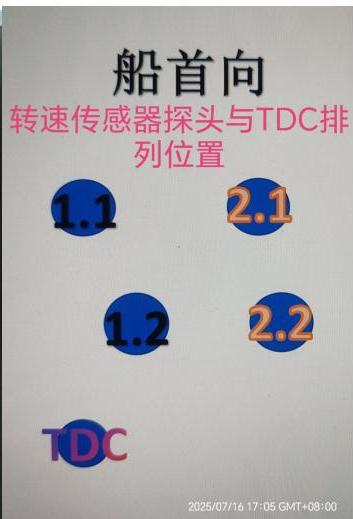

### 第4步：拆下未换的常亮探头

| 操作 | 结果 |
|------|------|
| 拆下未换的常亮的一组转速探头（1.1/1.2） | 机舱监控电脑报RPM PICKUP 1.1 & RPM PICKUP 1.2两个报警 |
| C20面板报警 | 如图所示 |

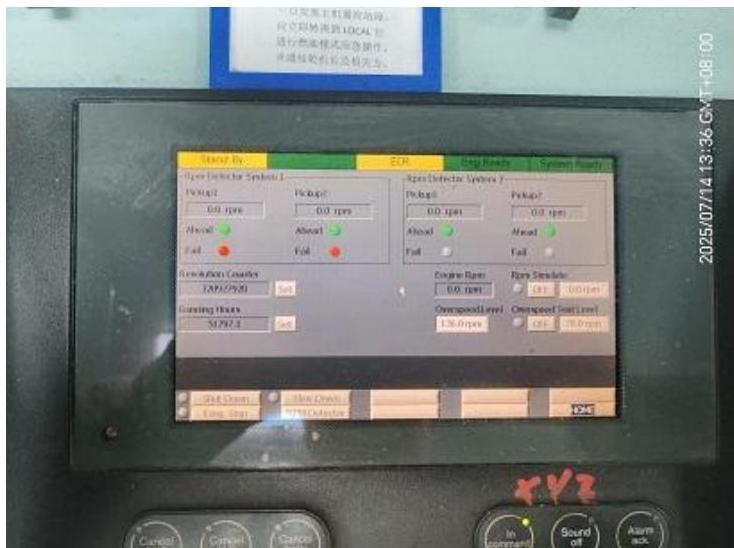

### 第5步：测试正车启动

| 测试项目 | 结果 |
|---------|------|
| 正车启动 | 能够正车启动 |
| 报警 | 报RPM detector fail & START INTERLOCK & EMERGENCY CYLINDER LUBRICATION三个报警 |
| 倒车启动 | 不能倒车启动 |

### 第6步：传感器接线对调

| 操作 | 结果 |
|------|------|
| 将两组传感器接线对调（1.1换至2.1，1.2换至2.2） | 机舱监控电脑报RPM PICKUP 2.1 & RPM PICKUP 2.2两个报警 |
| C20面板报警 | 如图所示 |

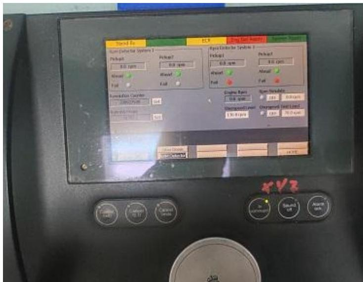

### 第7步：燃油模式测试

| 操作模式 | 结果 |
|---------|------|
| WECS-9520控制板燃油模式 | 主机能够启动，但注油器不动作 |
| 两组传感器接线换回（复原） | WECS-9520控制板燃油模式操作，主机能够正倒车启动 |
| 报警 | 报RPM detector fail & EMERGENCY CYLINDER LUBRICATION两个报警 |
| 注油器 | 机旁观察注油器有动作 |
| 转速显示 | 监控电脑及WECS-9520控制板有转速显示，但机械转速表显示倒车150RPM |

### 第8步：常指导指导

| 操作 | 结果 |
|------|------|
| 使用其他临近传感器替代1.1/1.2 | 盘车探头指示灯交替闪烁，集控室监控电脑以及C20面板内报警复位 |
| 尝试启动 | 主机无转速显示，无法启动，也不能注油 |
| 燃油模式操作 | 主机能启动，无转速显示，注油器不动作 |

### 第9步：潘指导指导

| 操作 | 结果 |
|------|------|
| 将原4只探头换回装复 | 对整个C20系统进行断电3分钟后重启 |
| 重启后 | 故障依旧 |

### 第10步：外围检查

| 检查项目 | 结果 |
|---------|------|
| E20箱U1、U2模块电源电压 | 26V左右，正常 |
| 传感器线路 | 外皮老化发硬皱裂，但通信信号正常 |
| 各探头检查 | 外在无明显机械损伤，只有一只探头（2.2探头）底面有划痕 |
| 操作习惯 | 每次探头传感器接线交换后都对E20箱U1、U2模块断电重启 |

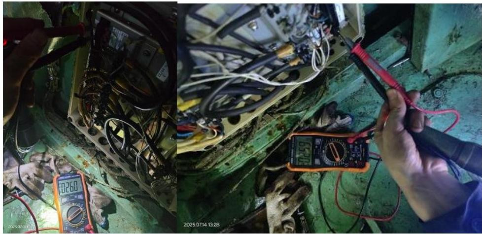

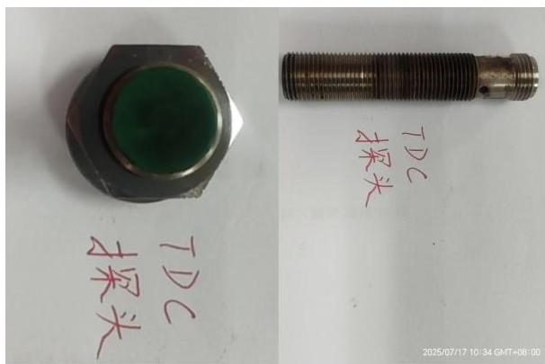

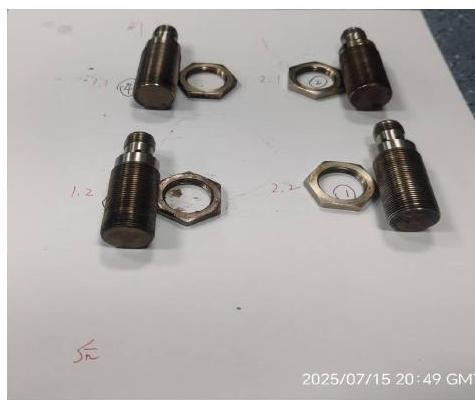

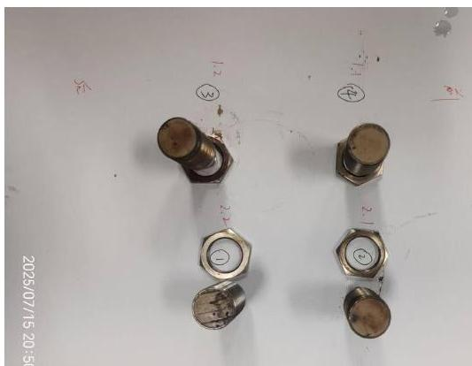

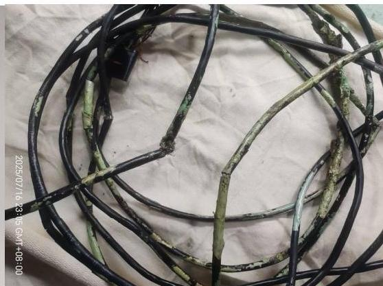

### 第11步：综合判断与临时方案

**综合判断**：主机转速传感器四只探头全部损坏。

**临时方案测试**：

| 方案 | 结果 |
|------|------|
| 在船三只探头选用一组安装至1.1/1.2探头上，2.1/2.2进行隔离，使用燃油模式进行正倒车 | 虽然能启动，但注油器不能动作 |
| 选用一组探头安装至2.1/2.2上，1.1/1.2进行隔离，使用燃油模式 | 能够进行正倒车及加减速运行（正车加速至75RPM），注油器也能进行注油动作（注油量大小未进行判断） |

**问题**：即将长江航行，用车频繁，此状态下使用燃油模式长江航行风险较大（且加速时有淡淡黑烟）。

**措施**：联系公司请求技术及备件支持，公司领导综合判断下安排常指导带相关备件上船。

### 第12步：常指导上船处理

| 步骤 | 操作 | 结果 |
|------|------|------|
| 1 | 复核检查，排除外围无接地/电源不稳定等因素 | 根据故障现象判断应该是传感器本身故障 |
| 2 | 更换4只新探头 | 新探头型号：PICKUPINDNPN/NCCONN M12XS6 (XS618B1NBM12) |
| 3 | 新探头接线后 | 指示灯为常亮，靠近飞轮齿顶时熄灭 |
| 4 | 检查船上备用三只探头 | XS1M18KP340D（2只，指示灯显示亮度不一致）、omRon E2EL-X5E2-M1（1只，外观和原旧件相似，未标注NPN或PNP） |
| 5 | 备用探头接线后 | 指示灯为常灭，靠近飞轮齿顶时常亮 |

### 第13步：最终安装调试

| 步骤 | 操作 | 结果 |
|------|------|------|
| 1 | 新探头安装并调试合适距离为4mm | 集控室进行冲车，正倒车测试正常，无报警 |
| 2 | 更换四根探头传感线 | 原四根探头传感线外皮都老化发硬皲裂 |
| 3 | 更换后冲车 | 发现1.2探头转速比其他三个探头低二十转左右 |
| 4 | 服务商指导下对该探头调至3mm | 试车时1.2探头又出现超速现象 |
| 5 | 将1.2探头传感线换回旧线 | 冲试车正常 |
| 6 | 转至驾驶台操车 | 移船位两海里，最高转速测试到86RPM，抛锚正倒车使用正常 |
| 7 | 检查更换的1.2探头传感线 | 发现传感器棕色（原黑色）线根部在扒铠装屏蔽层时碰到了，导致信号线破损 |
| 8 | 将1.2探头传感线重新换新 | 冲车及正倒车各至60RPM，转速显示正常 |

**结果**：至此主机启动无转速显示、主机无法启动故障恢复。

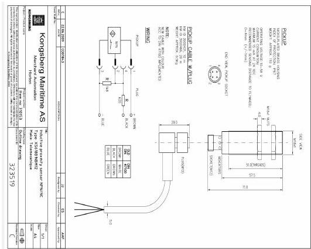

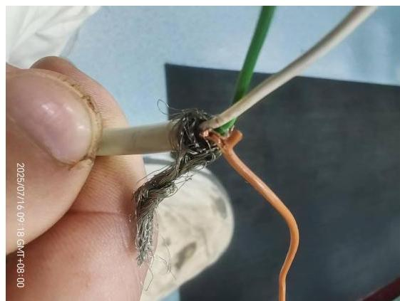

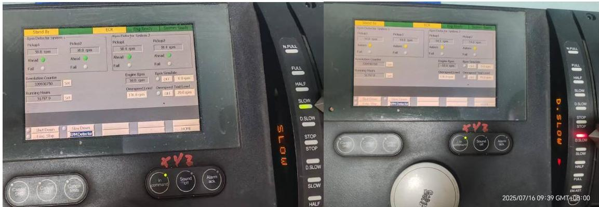

## 故障原因分析

| 序号 | 原因 | 说明 |
|------|------|------|
| 1 | T型块碰撞导致传感器损坏 | 合盘车机操作时碰到了T型块，使T型块发生轴向位移，在盘车过程中T型块顶到了固定在TDC以及转速传感器探头支架上的小刻度板，T型块滑过小刻度板后，使探头支架压力瞬间释放，产生强烈的冲击振动作用于探头传感器，导致传感器内部的电子元件、线路板等发生损坏 |
| 2 | 传感器接近使用寿命 | 传感器探头及接线使用时间较久，看记录传感器探头好像从出厂至今16年未换过，临近使用寿命，加之外部环境发生变化，导致其损坏 |
| 3 | 接线老化与铠装问题 | 传感器接线老化皲裂，飞轮位置震动较大，传感器电缆容易被铠装屏蔽层钢丝扎到，导致信号错乱，损坏探头 |
| 4 | 飞轮油脂影响 | 飞轮齿上润滑油脂甩到传感器探头上，可能会影响传感器的正常工作，导致传感器损坏 |

## 故障经验总结

| 序号 | 经验教训 | 改进措施 |
|------|---------|---------|
| 1 | 加强机舱人员培训提醒，明确T型块在盘车机附近时禁止合脱盘车机操作 | 目前在主机飞轮70°-120°转角间标记红色区域进行提醒，禁止合脱盘车机操作，并重新编制TDC及T型块管理注意事项和盘车操作要求张贴于现场 |
| 2 | 加强对TDC传感器探头及转速传感器探头维护检查，各探头包括传感器接线等备件要备足 | 建议转速传感器探头申领时最好两组四只一起申领，以确保型号完全一致（该轮由于三只备件为一只一只单独申领的，产品型号不一致，导致更换后无法正常运行） |
| 3 | 主机飞轮齿上不建议涂油脂 | 虽然油脂具有一定的润滑作用，减少与盘车机齿轮的啮合磨损，但它黏性较大，容易吸附灰尘、金属碎屑等杂质，主机运行时容易将过多的油脂甩到TDC以及转速传感器探头上，影响探头正常工作或造成腐蚀 |

## 关键知识点

- **T型块危险区域**：主机飞轮70°-120°转角间禁止合脱盘车机操作
- **传感器寿命**：转速传感器探头从出厂至今16年未换，建议定期更换
- **备件申领**：转速传感器探头最好两组四只一起申领，确保型号完全一致
- **探头标准间隙**：新探头安装调试合适距离为4mm
- **接线注意事项**：扒铠装屏蔽层时要小心，避免碰到信号线
- **飞轮润滑**：飞轮齿上不建议涂油脂，避免甩到传感器探头上
- **故障排查方法**：通过接线对调、模式切换（燃油模式）等方法逐步定位故障
- **服务商支持**：复杂故障及时联系服务商获得专业指导

## 关联页面

- [[第5章-故障诊断]] - 官方故障诊断指南
- [[WECS-9520控制系统]] - 控制系统说明
- [[主机不能正常启动故障案例]] - 另一例启动相关故障案例
- [[主机偶发超速报警停车故障案例]] - 另一例转速相关故障案例
- [[排气阀驱动活塞卡滞故障案例]] - 另一例实际故障案例
- [[ICU流量活塞探头杆脱落故障案例]] - 另一例实际故障案例
- [[增压器轴承损坏故障案例]] - 另一例实际故障案例
- [[滑油变质致排气阀故障案例]] - 另一例实际故障案例
- [[活塞冷却油伸缩管断裂故障案例]] - 另一例实际故障案例
- [[缸套异常磨损致活塞环断裂故障案例]] - 另一例实际故障案例
- [[主机主启动阀漏气故障案例]] - 另一例实际故障案例

