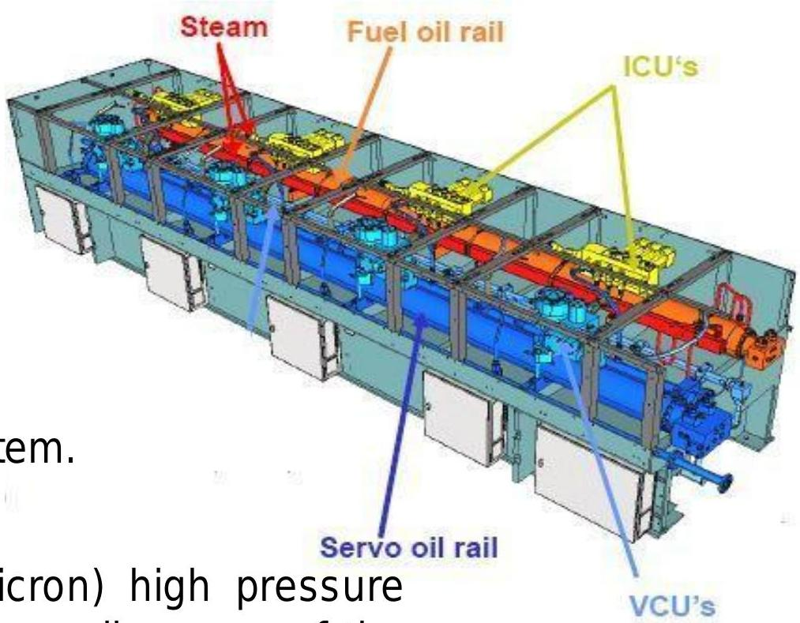

所属章节：[[第1章-发动机概述]]

# 伺服油轨

## 定义

伺服油轨（Servo Oil Rail）是RT-flex共轨系统伺服油的高压存储和分配部件，接收来自供油单元伺服油泵的高压伺服油，用于驱动排气阀和喷射控制单元。

## 详细说明

### 工作参数

| 参数 | 数值 |
|------|------|
| 伺服油压力 | ~80 - 190 bar（随发动机负载变化） |
| 过滤精度 | 6μm精细过滤（fine filtered, 6-micron） |
| 配置 | 每缸对应一个气门控制单元(VCU) |

### 结构特点

- 与燃油轨共同组成共轨系统的核心存储单元
- 气门控制单元(VCU)直接安装在伺服油轨上
- 为排气阀驱动提供高压动力油

### 油源与回路

- **油源**：来自轴承油系统，经6μm精细过滤
- **加压**：由供油单元上的[[RT-flex伺服油泵]]加压
- **分配**：通过两根上升管向伺服油轨供油
- **用途**：驱动排气阀开启、控制喷射控制单元
- **回油**：配有公共伺服油回油管

## 关联

- [[燃油轨]] - 燃油系统的高压存储部件
- [[气门控制单元VCU]] - 伺服油轨上的每缸排气阀控制单元
- [[RT-flex伺服油泵]] - 向伺服油轨供应高压伺服油
