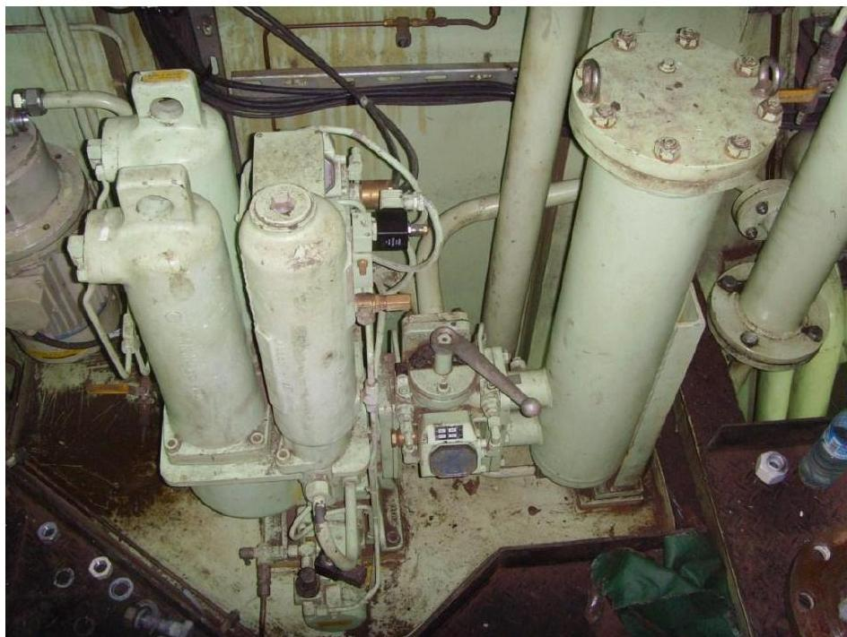

所属章节：[[第1章-发动机概述]]

# 伺服油过滤系统

## 定义

伺服油过滤系统（Servo oil filtering system）是RT-flex发动机液压系统的重要组成部分，伺服油和控制油在进入泵和液压系统之前经过精细过滤，以延长所有液压部件的使用寿命并提高安全裕度。

## 详细说明

### 过滤规格

| 项目 | 参数 |
|------|------|
| 自动滤精度 | 名义6μm（nominal 6μm） |
| 旁通滤精度 | 36μm网目（36μm mesh size） |
| 过滤目的 | 延长液压部件寿命，提高安全裕度 |

### 反冲洗功能

#### 反冲洗触发条件

自动反冲洗由控制箱自动启动，有两种触发方式：

| 触发方式 | 说明 |
|---------|------|
| **A) 标准：定时控制** | 1小时后（after 1 hour） |
| **B) 压差控制** | 如果过滤器两端的压差变得过高（0.35 bar） |

#### 反冲洗过程

1. 反冲洗启动（定时或压差触发）
2. 过滤器"污泥"（sludge）返回曲轴箱
3. 这是经过过滤的系统油，对于正常使用来说足够清洁
4. 反冲洗循环被计数

### 控制箱功能

#### 控制箱指示
- 配有指示灯的控制箱（Control box with indications）

#### 控制箱功能
- 反冲洗由定时或压差启动
- 反冲洗循环计数
- 必要时生成故障消息（过电流、压差高等）

#### 操作开关
- 箱内有开关按钮，可从"操作"切换到"调整"
- 详细信息请咨询过滤器制造商手册

### 结构示意

## 故障诊断关联

| 故障现象 | 可能故障位置 | 检查要点 |
|---------|-----------|---------|
| 压差高报警 | 滤芯堵塞 | 检查滤芯、反冲洗功能 |
| 反冲洗不启动 | 控制箱、定时器、压差传感器 | 检查控制箱电源、设置、传感器 |
| 伺服油污染 | 旁通滤开启、滤芯失效 | 检查油液清洁度、滤芯状态 |

## 关联

- [[伺服油轨]] - 过滤后的伺服油去向
- [[RT-flex伺服油泵]] - 伺服油来源
