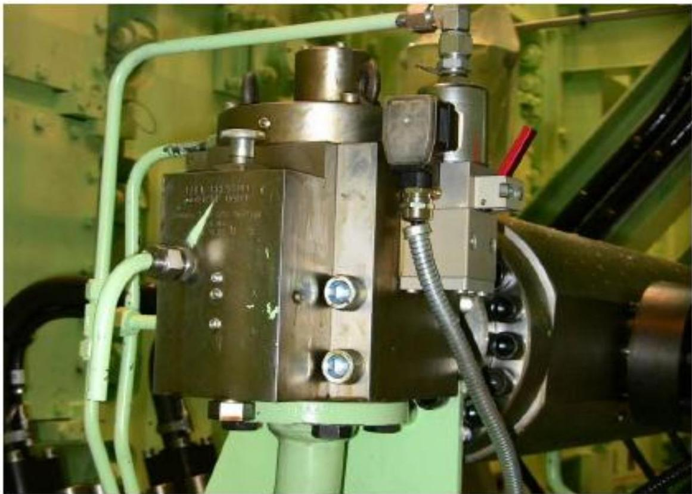
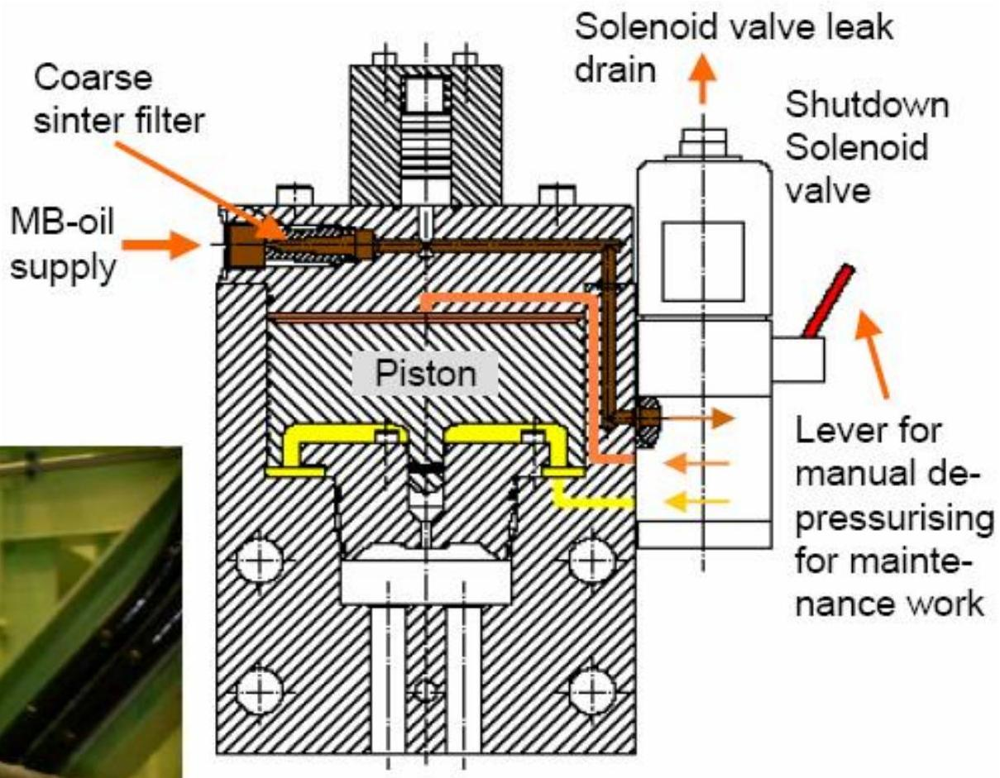

所属章节：[[第1章-发动机概述]]

# 发动机停机功能

## 定义

发动机停机功能（Engine shutdown function）是RT-flex发动机的安全保护功能，通过激励电磁阀（由安全系统而非WECS激励）来启动停机。释放活塞上方的主轴承油压，导致燃油压力下降，从而使发动机停止。

## 详细说明

### 工作原理

#### 停机触发
- **触发来源**：安全系统（Safety System），非WECS-9520控制系统
- **执行元件**：电磁阀（Solenoid valve）
- **动作方式**：电磁阀被激励（energized）

#### 停机过程
1. 安全系统向电磁阀发送激励信号
2. 电磁阀动作，释放活塞上方的主轴承油压
3. 主轴承油压下降
4. 燃油系统压力随之下降
5. 发动机因燃油压力不足而停止

### 结构示意

## 故障诊断关联

| 故障现象 | 可能故障位置 | 检查要点 |
|---------|-----------|---------|
| 发动机无法停机 | 电磁阀故障 | 检查电磁阀线圈、供电、阀芯 |
| 意外停机 | 安全系统误触发 | 检查安全系统信号、传感器 |
| 停机响应慢 | 油路堵塞 | 检查主轴承油回路、节流孔 |

## 关联

- [[WECS-9520控制系统]] - 注意：停机功能由独立的安全系统控制
- [[燃油超压调节阀]] - 共享主轴承油压控制原理
