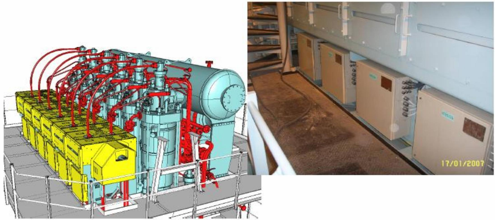
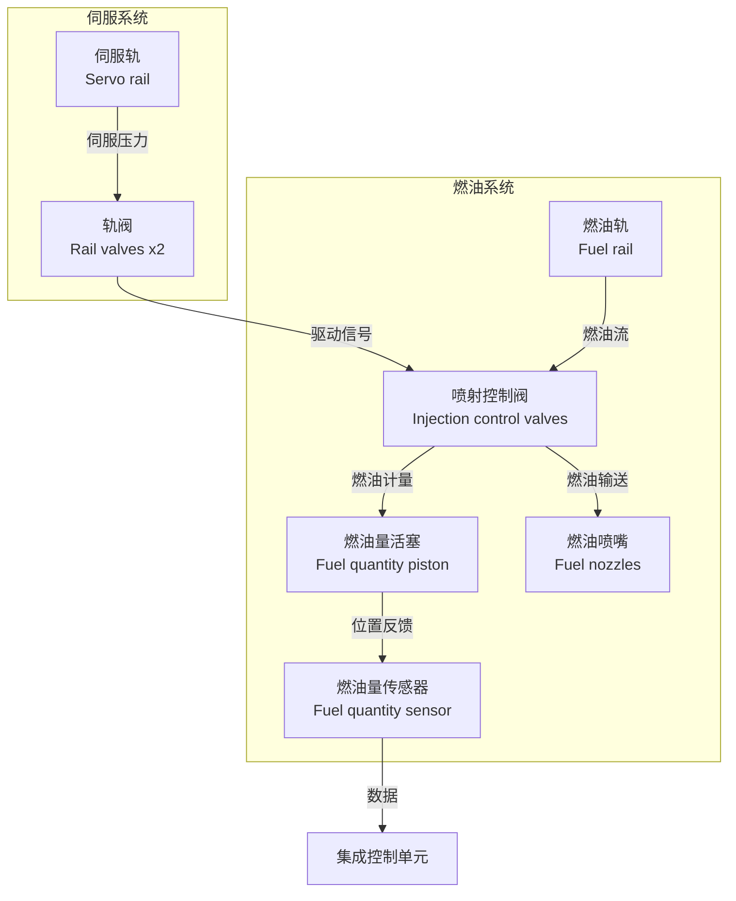
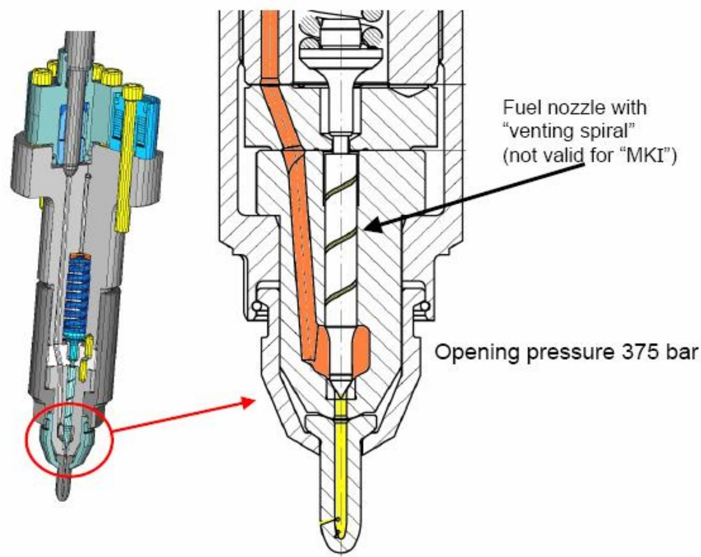
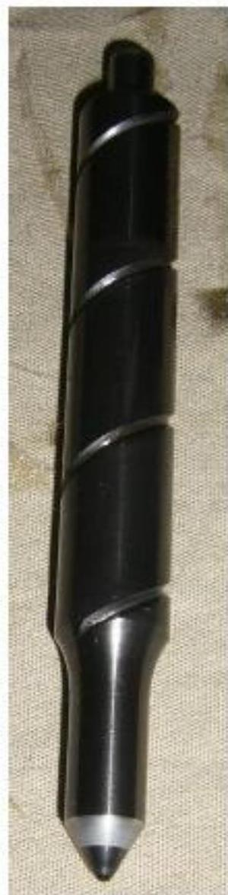

所属章节：[[第1章-发动机概述]]

# 喷射控制单元ICU

## 定义

喷射控制单元（Injection Control Unit, ICU）是RT-flex发动机每缸的燃油喷射控制执行机构，安装在燃油轨上，由两个轨阀预控制，开启或关闭燃油从燃油轨到喷油器的通路。

## 详细说明

### 系统架构

ICU系统由两个并行、相互关联的子系统组成：

#### 1. 伺服系统（控制压力回路）
- **伺服轨（Servo rail）**：高压伺服油存储罐，为轨阀提供控制压力
- **轨阀（Rail valves）**：每缸2个，调节从伺服轨到喷射控制阀的伺服压力
- 作用：将电子控制信号转换为液压动作

#### 2. 燃油系统（燃油输送回路）
- **燃油轨（Fuel rail）**：高压燃油存储罐，向喷射系统供油
- **喷射控制阀（Injection control valves）**：每缸1个，控制燃油从燃油轨到喷油器的正时和油量
- **燃油量活塞（Fuel quantity piston）**：根据控制信号调节燃油体积的液压/气动活塞
- **燃油量传感器（Fuel quantity sensor）**：反馈装置（如线性电位计或LVDT），测量活塞位置并向ICU发送数据以进行闭环控制
- **燃油喷嘴（Fuel nozzles）**：每缸1个，将燃油喷入发动机燃烧室

### 组成结构

ICU分为两个部分：

#### 燃油侧（Fuel side）
- 燃油控制阀由控制油块中的活塞驱动
- 每个喷油器对应一个阀
- ICU主体包含喷射量活塞
- **燃油量传感器**（Fuel Quantity Sensor）安装在远离热块的壳体中

#### 伺服油侧（Servo oil side）
- 轨阀控制流向控制油块的油流

### 系统隔离

- 控制油侧与燃油侧**完全分离**
- 两个系统的泄漏有共同的泄油口

### 工作原理

#### 标准工作流程

1. **预控制**：每个ICU由2个[[轨阀RV-2]]预控制
2. **燃油通路控制**：开启或关闭燃油从燃油轨到喷油器的通路
3. **喷射量计算**：计算每次喷射所需的燃油冲程
4. **喷射执行**：定量、喷射、测量并为下次喷射进行修正

#### 详细工作流程（单次喷射）：

| 阶段 | 说明 |
|------|------|
| **1. 伺服压力激活** | ICU向轨阀发送电信号，打开轨阀，允许伺服油从伺服轨进入喷射控制阀 |
| **2. 燃油流量调节** | 喷射控制阀打开，允许燃油轨的高压燃油流入燃油量活塞后的腔室 |
| **3. 活塞移动与油量控制** | 燃油压力推动燃油量活塞向前，活塞位置被燃油量传感器检测，传感器向ICU发送反馈信号，ICU通过轨阀调节伺服油压力来调节活塞行程，确保输送正确的燃油量 |
| **4. 喷射执行** | 活塞移动时，将燃油通过燃油喷嘴推入发动机 |

#### 数据流（Mermaid流程图）：

### 设计特点

#### 设计模式与原则

- **模块化分离**：伺服系统和燃油系统在物理和功能上分离（蓝色虚线 vs 橙色虚线），减少控制逻辑（伺服）与燃油输送（燃油）之间的干扰
- **闭环控制**：燃油量传感器实现实时反馈，这是现代发动机控制优化燃烧效率和排放的核心原则
- **可扩展驱动**：多个轨阀和喷射控制阀（每缸一个）支持多缸发动机，每个阀独立控制

#### 优势

- **精度**：伺服驱动阀和传感器反馈的组合允许对燃油量和正时进行微秒级控制
- **可靠性**：分离伺服（控制）和燃油（输送）系统将燃油污染影响控制逻辑的风险降至最低

#### 潜在故障点与维护考虑

- **复杂性**：协调三组阀（轨阀+喷射控制阀）和一个传感器需要强大的ICU逻辑以避免正时错误
- **维护**：多个液压/气动部件（阀、活塞）增加了泄漏或磨损的风险，需要定期检查
- **对伺服压力的依赖**：轨阀依赖伺服轨压力——如果压力下降，喷射控制失败。可能需要冗余或压力监控
- **阀协调的复杂性**：同步多个轨阀和喷射控制阀需要精确定时，增加了控制系统的复杂性

### 故障诊断关联

#### 故障传递路径

| 故障现象 | 可能故障位置 | 检查要点 |
|---------|-----------|---------|
| 喷油量偏差 | 燃油量传感器/活塞 | 检查传感器反馈、活塞位置、活塞磨损 |
| 喷油正时偏差 | 轨阀/喷射控制阀 | 检查轨阀动作、伺服压力、阀杆位置 |
| 单缸不喷油 | 喷射控制阀/喷嘴 | 检查喷射控制阀、燃油通路、喷嘴堵塞 |
| 多缸喷油量异常 | 伺服轨压力 | 检查伺服轨压力、轨阀电源、WECS控制信号 |

## 关联

- [[燃油轨]] - ICU的高压燃油来源
- [[伺服油轨]] - ICU的控制压力来源
- [[轨阀RV-2]] - ICU的预控制电磁阀
- [[WECS-9520控制系统]] - ICU的控制指挥系统
- [[长航碧玉主机2缸ICU伺服油液压活塞卡阻故障案例]] - ICU伺服油液压活塞卡阻的实际案例
