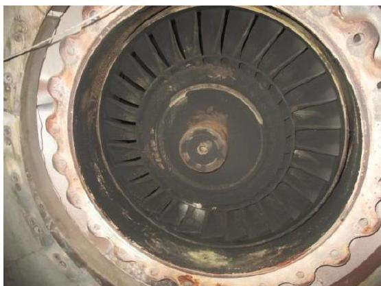
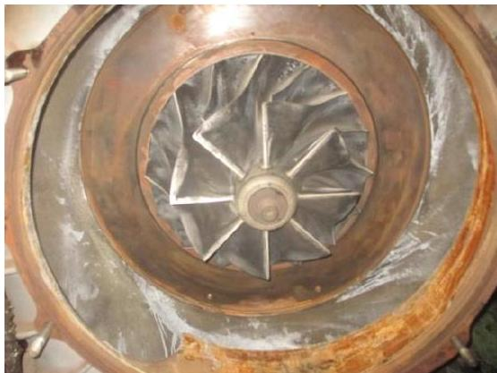
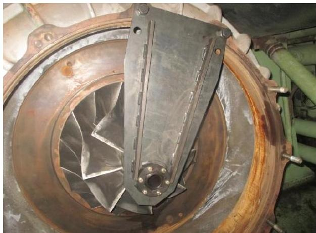
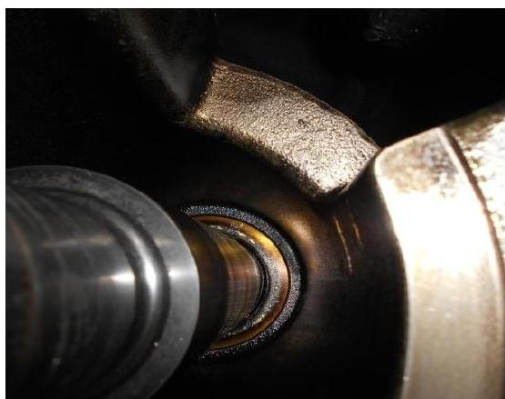
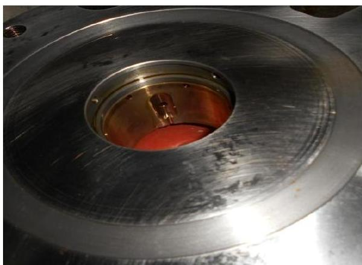

所属章节：[[第5章-故障诊断]]

# 增压器轴承损坏故障案例

## 概述

这是一起长航水晶轮Sulzer 6RT-flex50主机ABB TPL77-B12增压器轴承损坏的实际故障案例。故障发生于2016年6月1日，根本原因是1#缸排气阀座漏水导致冷却水通过排气支管进入增压器涡轮端，造成涡轮端轴承高温抱轴。

## 故障经过

### 基本信息

| 项目 | 内容 |
|------|------|
| **船舶** | 长航水晶 |
| **航次** | 1607航次（SINGAPORE至KUWAIT） |
| **主机** | Sulzer 6RT-flex50（瓦锡兰） |
| **增压器** | ABB TPL77-B12 |
| **上次保养** | 2015年9月（香港大洋专业厂家维护） |
| **正常工况** | 114RPM、油门刻度46时，增压器转速约12400RPM，扫气压力1.7bar |

### 时间线

| 日期 | 时间 | 事件 |
|------|------|------|
| 2016-05-15 | — | 起SINGAPORE至KUWAIT |
| 2016-05-29 | 11:00 | 靠妥第一港KUWAIT SHUAIBA装货 |
| 2016-05-29 | 下午 | 发现主机膨胀水箱水位减少漏水 |
| 2016-05-29 | 晚饭后 | 组织连夜抢修1#缸排气阀，打开排气总管道门清除积水 |
| 2016-05-30 | 12:50 | 离泊至锚地抛锚 |
| 2016-05-30 | 18:50 | 停止用车转集控室控制未完车 |
| 2016-05-31 | 09:40 | 冲活车后开始用车靠泊第二港 |
| 2016-05-31 | 13:24 | 完车 |
| 2016-06-01 | 08:17 | 备车离泊 |
| 2016-06-01 | 10:27 | 开始用车 |
| 2016-06-01 | 10:50 | 主机转速85RPM时增压器异常噪声，转速表很快降至0 |

### 故障现象

| 现象 | 描述 |
|------|------|
| **异常噪声** | 主机增压器有异常噪声 |
| **转速归零** | 集控室内增压器转速表很快降至0 |
| **转子卡死** | 压气叶轮只能轻微转动一点，处于卡死状态 |
| **系统油压** | 故障前后系统油压正常，未出现低油压报警 |
| **滑油畅通** | 增压器进回油均处于畅通状态 |

### 初步检查

1. **压气端检查**：打开压气端检查，用力转动时发现压气叶轮只能轻微转动一点，处于卡死状态
2. **涡轮端检查**：涡轮端打开后检查，发现涡轮叶片清洁无明显积炭，叶片末端与蜗壳间隙良好，用50丝塞尺可以轻松转满一周，无异物卡滞
3. **初步判断**：轴承卡阻所致

### 前期漏水事件

2016年5月29日靠泊第一港收载时：
- 11:00完车后下午发现主机膨胀水箱有水位减少漏水现象
- 主机机体无外漏
- 通过扫气箱检查发现1#缸套内壁有水珠
- 打开增压器涡轮端下部的清洗放残管法兰检查并放出积水
- 准确判断是1#缸排气阀座漏水所致
- 连夜抢修排气阀，打开排气总管道门清除维修前通过排气支管进入排气总管的积水
- 5月30日离泊及5月31日靠泊主机及增压器运行检查均正常

## 故障处理措施

### 船舶应急处理

由于公司同类型船舶均未配备主机增压器转子的拆卸专用液压工具，船舶无法进行进一步的解体检查：

| 步骤 | 措施 |
|------|------|
| 1 | 在机务胡主管指导下，锁住增压器转子 |
| 2 | 以56-58RPM的转速航行至卸货港DUBAI |
| 3 | 向公司进行初步情况汇报 |

### 岸基维修安排

| 时间 | 事件 |
|------|------|
| — | 公司紧急联系安排卸货港DUBAI的服务机构 |
| 2016-06-10 | 维修单位到船拆卸增压器转子（受斋月因素影响） |
| 2016-06-15 | 检修后的增压器转子送船安装及测试完毕（海关手续办理延迟） |

### 等待维修期间的工作

船舶在增压器轴承损坏后及等待转子回船安装期间，完成以下工作：

1. 对主机滑油自清滤器、分油机、增压器进出口滑油进行取样送检，制作管路对增压器进回油管路连接后进行窜油清洁
2. 主机滑油自清滤器清洗、检查
3. 主机排烟管及进增压器格栏、增压器出口烟管的检查及修整
4. 主机辅助风机的检查、维护
5. 主机扫气箱清洁，通过扫气口对缸套、活塞组件进行检查
6. 主机曲轴箱内的检查，曲轴拐档差测量
7. 为了维修的吊运对部分栏杆进行了临时切除
8. 主机行车的检查及维护
9. 协助两名维修人员进行增压器的拆卸及安装

## 故障原因分析

### 解体检查发现

维修人员对主机增压器转子拆卸及解体后检查发现：
- **压气端轴承**：处于良好状态
- **涡轮端轴承**：出现明显的高温抱轴情况

### 故障机理

| 环节 | 说明 |
|------|------|
| **起因** | 1#缸排气阀阀座有细小裂纹，渗漏很小 |
| **发展** | 完车后冷却下来，冷却水泄漏量增大 |
| **路径** | 冷却水通过排气支管进入排气总管，进而进入增压器涡轮端 |
| **结果** | 轴承内进水，导致涡轮端轴承高温抱轴 |

### 为什么检修后仍发生故障

- 检查排气阀阀座漏水时，虽然从涡轮端放残法兰拆开后放出淡水，但认为不至于影响到轴承
- 认为增压器轴承的润滑是主机系统油供给，且主机滑油泵一直处于运行状态，轴承有油封等情况，水不易进入轴承
- 主机排气阀检修后，船舶在后续的离泊及再次靠泊时主机及增压器均处于正常工作状态

## 故障损失统计

| 类别 | 明细 |
|------|------|
| **维修费及交通费用** | — |
| **备件损失** | 1) Labyrinth sleeve KY02&lt;br&gt;2) Sealing cover KP15&lt;br&gt;3) Set of spares ZS01&lt;br&gt;4) Set of spares ZS40&lt;br&gt;5) Set of spares ZS27&lt;br&gt;6) Set of spares ZS64 |
| **营运损失** | 约一周营运损失 |

## 经验教训

### 1. 值班及巡回检查质量

- 最初发现膨胀水箱有液位下降及报警时，未能及时引起足够的重视
- 值班人员没有及时汇报至设备分管人员或轮机长

### 2. 判断设备故障的全面性不足

- 抵港前主机1#缸在低速运行时已出现排温偏差大报警
- 分管人员认为是该缸喷油器工作不良所致，仅及时更换了喷油器

### 3. 排除设备故障的及时性有待提高

- 11:00靠泊后，人员于午后开始更换主机喷油器及处理锅炉通讯故障
- 担心白天PSC检查，于下午四点半左右才打开扫气箱道门对漏水情况进行检查

### 4. 对设备出现的故障分析缺乏全面性

- 检查排气阀阀座漏水时，虽从涡轮端放残法兰放出淡水，但认为不至于影响到轴承
- 认为增压器轴承有系统油润滑、滑油泵一直运行、轴承有油封，水不易进入轴承

### 5. 设备发生故障时报告不够及时

- 主机排气阀阀座漏水故障排除后，仅在当天的"每日工作报告"中进行了简单汇报
- 详细情况在月度报表中才有说明
- 检修排气阀后的离泊及靠泊未见异常而没有及时进一步汇报，错过了岸基技术支持

## 今后设备管理注意事项

| 事项 | 说明 |
|------|------|
| **加强值班与巡回检查质量** | 发现设备存在异常及报警时及时向设备分管人员或轮机长汇报 |
| **定期检查排气阀** | 结合主机排气阀的工作时间，定期检查排气阀的工作状态，必要时及早更换备件 |
| **检查排气阀阀座备件库存** | 不足时及时申领 |
| **膨胀水箱补水管理** | 正常情况下由设备分管人员或工班补水，对正常的补水量及时间做到心中有数 |

## 关联页面

- [[第5章-故障诊断]] - 官方故障诊断指南
- [[第4章-异常操作规程]] - 增压器停用应急操作
- [[排气阀驱动活塞卡滞故障案例]] - 另一例实际故障案例
- [[ICU流量活塞探头杆脱落故障案例]] - 另一例实际故障案例

