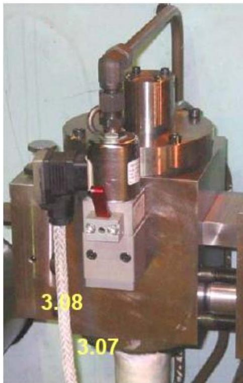

所属章节：[[第1章-发动机概述]]

# 安全系统

## 定义

安全系统由Kongsberg Maritime提供，在超速或发动机及其辅助设备的其他异常情况下激活减速和停机。**安全系统独立于WECS-9520！**

## 详细说明

### 系统独立性

| 特性 | 说明 |
|------|------|
| **独立于WECS** | 安全系统不是WECS-9520的一部分 |
| **直接停机** | 安全系统直接激活紧急停机电磁阀以泄压燃油共轨 |
| **冗余BUS通信** | WECS与安全系统使用冗余BUS通信 |
| **数字输出** | 安全系统通过CAN模块总线向WECS传递一些数字输出 |

### 安全系统传递给WECS的信号

| 信号 | 说明 |
|------|------|
| **倒车主轴承油减速信号** | 用于控制油泵的起动和干运转保护 |
| **停机信号** | 通过CAN总线向WECS传递，激活WECS内部停机响应 |

### WECS故障与安全系统的交互

- 某些WECS故障通过安全系统导致减速
- 或通过AMS激活到安全系统

### 停机功能执行（RT-flex尺寸O/50B）

1. 安全系统通过打开燃油停机阀3.07经由紧急停机电磁阀3.08（ZV7061S）将加压燃油轨释放到溢流罐
2. WECS-9520将燃油执行器输出触发为零以终止向轨道单元的燃油供给，同时发动机尚未停止
3. 喷油指令被WECS-9520阻止
4. **红色杠杆不用于紧急停机**

### 结构示意

## 故障诊断关联

| 故障现象 | 可能故障位置 | 检查要点 |
|---------|-----------|---------|
| 紧急停机误触发 | 安全系统传感器 | 检查超速/异常传感器、安全系统逻辑 |
| 无法紧急停机 | 紧急停机电磁阀 | 检查ZV7061S电磁阀、燃油停机阀3.07 |
| 安全系统通信故障 | CAN总线 | 检查安全系统与WECS的BUS通信 |

## 关联

- [[WECS-9520控制系统]] - 安全系统的联动对象
- [[远程控制系统]] - 独立于安全系统
- [[燃油超压调节阀]] - 共享主轴承油压控制原理
