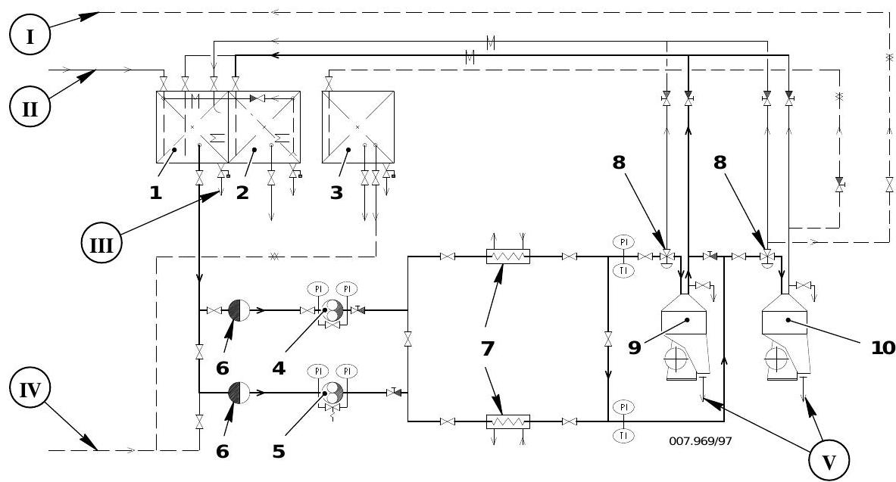
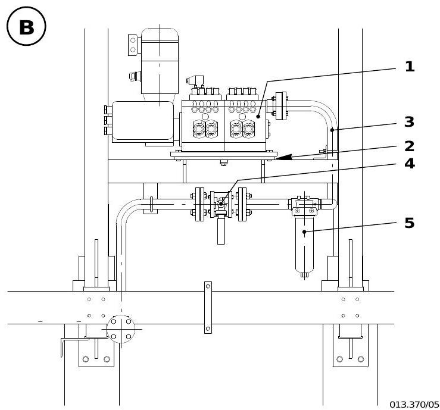
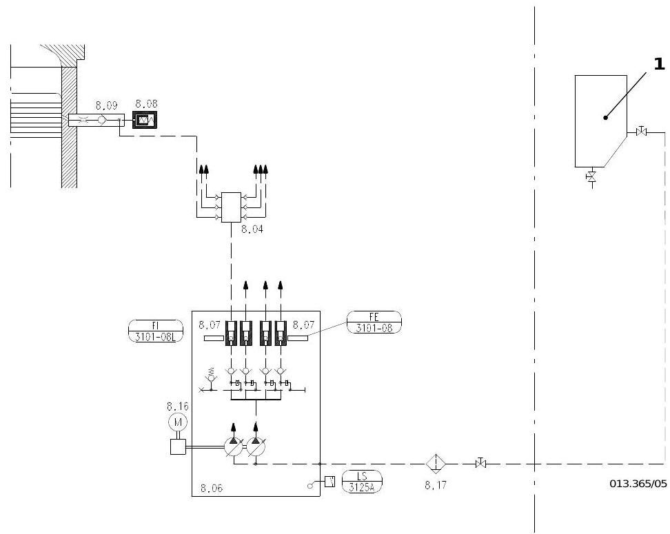
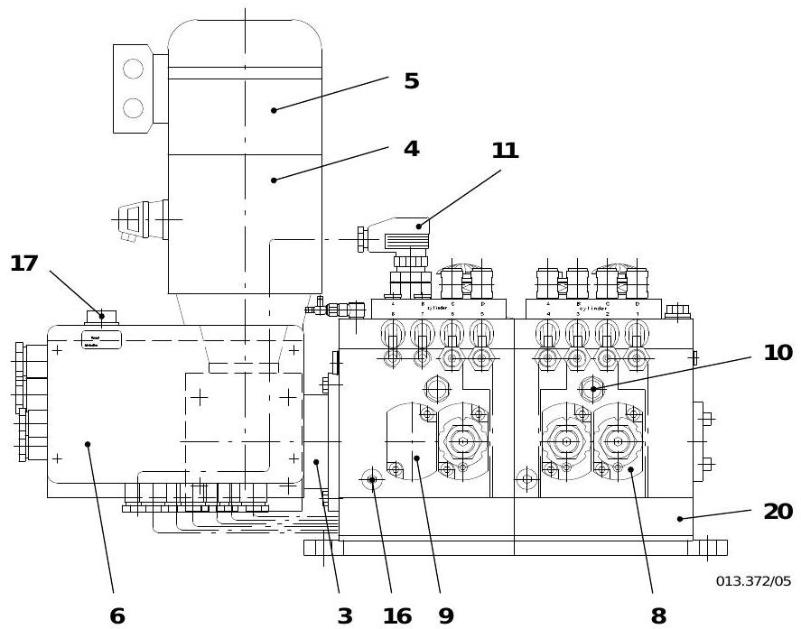
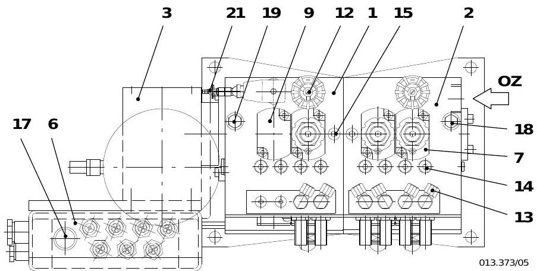
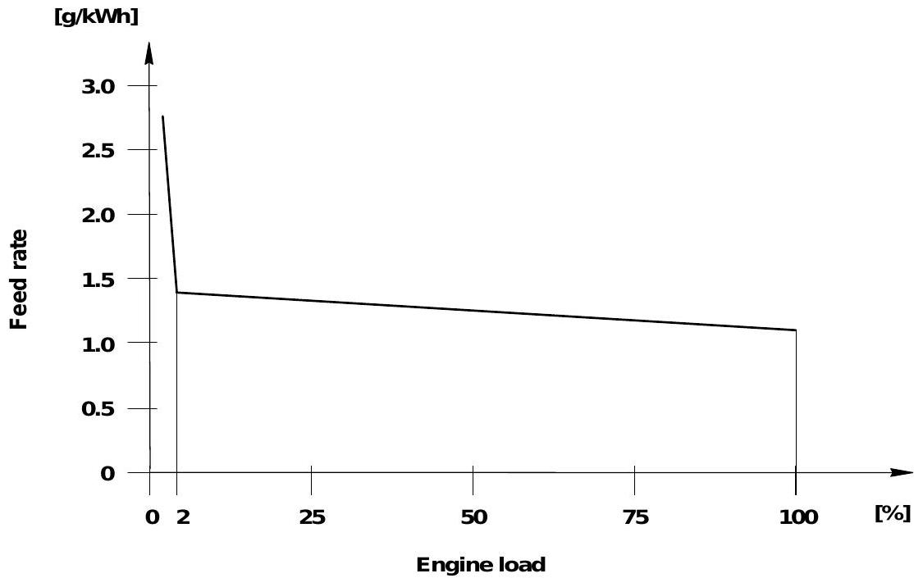
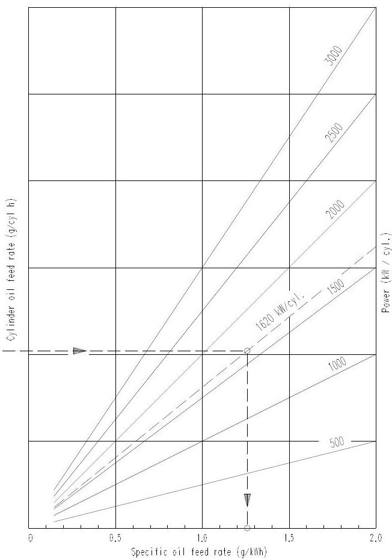
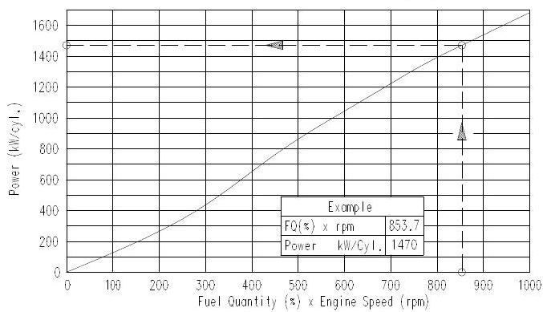
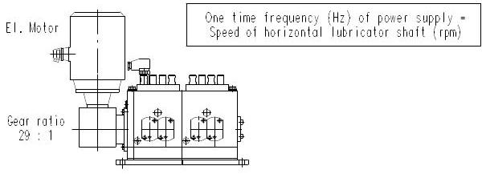

所属章节：[[第3章-操作规程]] / [[第6章-技术参数与报警设定]]

# 工作介质规格

> 源文件：OM-RT-flex50 Operating Manual, Group 0710-1, 0720-1, 0740-1, 0750-1, 0760-1
> 关联页面：[[第6章-技术参数与报警设定]], [[第1章-发动机概述]], [[第7章-发动机特性图与原理图]]

## 1. 柴油机燃油品质要求

### 1.1 船用燃油分类概览

| 属性              | 轻柴油 (MGO) | 船用柴油 (MDO) | 中间燃料油 (IFO) | 船用重油 (BFO) |
| --------------- | --------- | ---------- | ----------- | ---------- |
| 密度 15 C [kg/m3] | 820-870   | 850-920    | 900-991     | 至 1010     |
| 粘度 40 C [cSt]   | 1.5-7     | 4-14       | -           | -          |
| 粘度 50 C [cSt]   | -         | -          | 30-420      | 至 700      |
| 倾点 [C]          | -6 ~ +6   | -6 ~ +6    | 0-20        | 至 30       |
| 硫分 [%]          | 0.2-2     | 0.2-2      | 1-5         | 1-5        |
| 残碳 MCR [%]      | 至 0.20    | 至 2.5      | 至 18        | 至 20       |
| 灰分 [%]          | 至 0.01    | 至 0.02     | 至 0.15      | 至 0.20     |
| 水分 [%]          | 0-0.1     | 0-0.25     | 0.1-1       | 0.1-1      |
| 十六烷值/指数         | ~40       | 40-20      | -           | -          |
| CCAI            | -         | -          | 870         | 870        |
| 闪点 [C]          | 最低 60     | 最低 60      | 最低 60       | 最低 60      |

### 1.2 重油品质限值 (RMK55, ISO 8217:1996)

| 参数 | 单位 | 加注限值 | 推荐加注品质 | 发动机入口品质 |
|------|------|---------|------------|-------------|
| 密度 15 C | kg/m3 | max. 1010 | max. 1010 | max. 1010 |
| 运动粘度 50 C | mm2/s [cSt] | - | - | 13-17 |
| 运动粘度 100 C | mm2/s [cSt] | max. 730 / max. 55 | max. 730 / max. 55 | - |
| 残碳 | m/m [%] | max. 22 | max. 15 | max. 15 |
| 硫分 | m/m [%] | max. 5.0 | max. 3.5 | max. 3.5 |
| 灰分 | m/m [%] | max. 0.20 | max. 0.05 | max. 0.05 |
| 钒 | mg/kg [ppm] | max. 600 | max. 100 | max. 100 |
| 钠 | mg/kg [ppm] | - | max. 50 | max. 30 |
| 铝+硅 | mg/kg [ppm] | max. 80 | max. 30 | max. 15 |
| 总沉淀物(潜在) | m/m [%] | max. 0.10 | max. 0.1 | max. 0.1 |
| 水分 | v/v [%] | max. 1.0 | max. 1.0 | max. 0.3 |
| 闪点 | C | min. 60 | min. 60 | min. 60 |
| 倾点 | C | max. 30 | max. 30 | max. 30 |

> 注：若燃油处理装置无法去除高密度燃油中的水，密度限值为 max. 991 kg/m3 (ISO-F-RMH55)。

### 1.3 重油品质要点

- **粘度**：发动机入口推荐粘度 13-17 cSt，高粘度燃油须预热，参见 [[第7章-发动机特性图与原理图]] 粘度-温度图
- **残碳/沥青质**：高残碳和沥青质损害燃烧品质，促进发动机部件磨损和污染。标准重油含至 14% 沥青质，优质燃油至 8%
- **硫分**：燃烧后生成硫酸，腐蚀气缸壁和活塞环。须根据燃料硫含量选择适当 BN 值的气缸润滑油
- **灰分和微量金属**：钒和钠含量须严格控制。钠含量应低于钒含量的 1/3，以避免形成低熔点共晶化合物
- **铝+硅（催化细粉）**：10-20 微米的催化细粉对活塞环和气缸套造成严重磨损。通过合理分油机操作（降低流量、温度接近 98 C）可将 80 ppm 降至 15 ppm 以下
- **水分**：须通过离心分离和沉淀柜放水彻底去除。1.0% 海水相当于 100 ppm 钠
- **CCAI**（计算碳芳香度指数）：低速机中着火特性的重要性较低，CCAI 至 870 的燃油使用效果良好

## 2. 燃油处理规范

### 2.1 处理流程

1. **沉淀柜**：初步分离游离水，须定期排放底部泥渣和水
2. **离心分油机**：主要清洁手段，现代自清洗式分油机可处理密度 > 991 kg/m3 的重油
3. **均质器**：仅作为辅助设备改善燃烧，不能去除固体
4. **滤器**：截留特定尺寸固体，但不能去除水

### 2.2 分油机操作要点

> 图 A 展示了重油离心分油处理系统的完整流程。系统分为五个功能区（I-V）：原始重油经入口进入离心分油机（组件1-3）进行多级分离，通过泵（组件4-5）调节流量和压力，经加热器（组件7）升温降粘后进入二级分离器（组件9-10）精滤，最终输出洁净燃油。PI压力监测仪表分布在各关键节点，形成闭环压力反馈控制。

- 分离效果取决于流量和重油粘度：流量越小、粘度越低，分离效果越好
- 重油进入分油机前须加热，工作温度维持恒定（容差 +/-2 C）
- 加热温度上限为 98 C
- 须确保分油机排渣通道畅通，防止背压过高影响分离功能
- 自清洗式分油机的排渣频率须由操作人员定期监控，确保泥渣排出通道畅通无阻

### 2.3 燃油系统布置

> 图 B 展示了标准加压燃油系统的完整布置。重油从日用柜 2 经三通阀 21（可切换至柴油日用柜 3），由低压供油泵 23 送入混合单元 24（可加热保温），再由增压泵 25 经末端加热器 26 和燃油滤器 27 送至发动机燃油泵 28。系统压力由压力调节阀 31 设定，燃油泵入口压力由压力保持阀 31a 设定。多余燃油经回油管 36 返回混合单元 24。

标准加压燃油系统主要组件：
- 重油沉淀柜 -> 日用柜 -> 低压供油泵 -> 混合单元 -> 增压泵 -> 末端加热器 -> 燃油滤器 -> 燃油泵
- 系统压力由压力调节阀设定，燃油泵入口压力由压力保持阀设定（参见 [[第6章-技术参数与报警设定]]）

## 3. 润滑油规格

### 3.1 系统油（轴承油）

| 要求 | 规格说明 |
|------|---------|
| 粘度等级 | SAE 30 |
| 最低 BN | 5 |
| 要求 | 添加剂型曲轴箱油，清净性能 |
| 承载能力 | FZG 齿轮试验 IP 334/90，载荷级失效 11 |
| 其他 | 良好热稳定性、防腐蚀、抗泡沫、抗乳化性能 |

### 3.2 系统油关注限值

| 参数 | 单位 | 限值 | 试验方法 |
|------|------|------|---------|
| 粘度 40 C | mm2/s [cSt] | max. 140 | ASTM D 445 |
| 闪点 (COC) | C | min. 200 | ASTM D 92 |
| 总不溶物 | m/m [%] | max. 0.70 | ASTM D 893b |
| BN | mgKOH/g | max. 12 | ASTM D 2896 |
| 水分 | m/m [%] | max. 0.20 | ASTM D 95/D 1744 |
| 钙 | mg/kg [ppm] | max. 6000 | ICP |
| 锌 | mg/kg [ppm] | min. 100 | ICP |
| 磷 | mg/kg [ppm] | min. 100 | ICP |

### 3.3 系统油维护

- 每 3000 运行小时取样分析
- 分油机旁通净化：每天至少循环 3 次，流量为额定容量的 40%，油温 90-95 C
- 水分含量不得超过 0.3%（质量），超过时须加强处理
- 伺服油系统使用经 10 um 自动滤器精滤的系统油

#### 气缸润滑泵布置（图B，8缸版本）

> 图 B 展示了8缸发动机的气缸润滑泵管路布置。润滑泵（1）为紧凑型自支撑单元，安装在上层平台的自由端。泵端模块上设有中央进油口，供油管（3）中串联安装球阀/截止阀（4）和管路滤器（5）。管路滤器须定期检查是否堵塞（参见故障处理 0820-1"气缸润滑失效"）。
>
> 组件编号：1-气缸润滑泵 / 2-固定板 / 3-供油管 / 4-截止阀 / 5-管路滤器 / OZ-润滑油供油口

### 3.4 气缸润滑油

> 气缸润滑油系统采用模块化设计，主要包含进油过滤模块、泵送分配模块和监测执行模块。润滑油从日用油箱经进油管（8.09）进入过滤器（8.08，型号 FI 3101-08L）去除杂质，再由主分配泵单元（8.04）送至流量分配器（8.07，型号 FE 3101-08），将油均匀分配至各气缸喷嘴。润滑油泵（8.06）由电动机（8.16）驱动提供系统压力，液位开关 LS 3125A 监测油位，低于阈值时触发报警。润滑油经各气缸喷嘴（每缸6个润滑淬火器 8.09 配蓄能器 8.08）直接喷入气缸内壁，为一次性消耗式润滑。

根据燃料硫含量选择气缸油 BN 值：

| 燃料硫含量 [%] | 推荐气缸油 BN |
|--------------|-------------|
| < 1.0 | BN 40 |
| 1.0 - 1.5 | BN 40（也可用 BN 70，但须降低注油率） |
| 1.5 - 2.0 | BN 70（也可用 BN 40，但须适当提高注油率） |
| >= 2.0 | BN 70 |

- BN 40 润滑油：使用中性添加剂提高清净性和热稳定性至 BN 70 水平
- BN 70 润滑油：BN 值直接衡量碱度，适用于高硫燃料
- 磨合期间使用正常认可的气缸润滑油

#### 气缸润滑泵结构（图C）

> 图 C 展示了气缸润滑泵（PC型，模块化设计）的整体结构。泵为多柱塞模块化结构，根据气缸数配置泵元件数量。初始模块（1）和端模块（2）之间安装各缸泵元件，通过角齿轮箱（3）由电动机（4）驱动，外部风扇（5）散热。
>
> 组件编号：1-初始模块 / 2-端模块 / 3-角齿轮箱 / 4-电动机 / 5-外部风扇 / 6-接线盒 / 7~8-各缸泵元件 / 9-盲板法兰 / 10-油位计 / 11-液位开关 / 12-截止阀 / 13-出油口 / 14-超压阀（每缸一个） / 15-放气口 / 16-放油塞 / 17-手动润滑按钮 / 18-轴承油进口 / 19-轴承油出口 / 20-电缆导管 / 21-放气旋塞 / OZ-润滑油供油口
>
> 泵的传动比为 29:1，每个出油口最大供油量 1.10 cm3，最小供油量 0.27 cm3。各泵元件的调整盘有6个调节位置，通过调整可获得不同的供油量，通常各缸设定应一致。

#### 负荷相关气缸润滑调节

> 该曲线展示了比注油率（specific oil feed rate）随发动机负荷的变化关系。在低负荷（0%-2%）区域，比注油率急剧下降，最高约 2.8 g/kWh；在 2% 负荷处出现拐点，此后进入高负荷稳定区（2%-100%），比注油率缓慢下降至约 1.1 g/kWh。这意味着低负荷时每单位功率消耗的润滑油更多，以补偿低负荷工况下燃烧不良引起的酸性产物增加。
>
> - 100% 负荷时的比注油率应通过调节水平驱动轴转速设定，推荐值约 1.26 g/kWh
> - 泵速因子（pump speed factor）在 100% 负荷时宜设为 1.00，即变频器频率对应船电额定频率
> - 负荷突增或波动时，气缸润滑油流量会自动增加到正常值以上
> - 低于 2% 负荷时电动机转速保持恒定，注油率不再降低
> - 期望的注油率增量可在控制单元中编程，但须由授权技术人员操作

### 3.5 认可润滑油清单

| 供应商 | 系统油 | 气缸油 (BN 70-80, 硫 >1%) | 气缸油 (BN 40, 硫 <2%) |
|--------|--------|--------------------------|------------------------|
| BP / Castrol | Energol OE-HT 30 / CDX 30 | Energol CLO 50M / Cyltech 80AW / Cyltech 70 | Energol CL-DX 405 / Cyltech 40SX |
| Chevron (FAMM, Texaco, Caltex) | Veritas 800 Marine Oil 30 | Taro Special HT70 | Taro Special HT LS 40 |
| ExxonMobil | Mobilgard 300 / EXXMAR XA | Mobilgard 570 / EXXMAR X 70 | Mobilgard L 540 |
| Shell | Melina S Oil 30 / Melina Oil 30 | Alexia Oil 50 | Alexia LS |
| Total | Atlanta Marine D 3005 | Talusia HR 70 | Talusia LS 40 |

> 注：须遵守 Wartsila 通用润滑油要求和推荐。供油公司对油品在使用中的性能承担全部责任。

### 3.6 其他润滑油

| 系统 | 要求 |
|------|------|
| 增压器油（独立润滑系统） | 遵循供应商手册中关于粘度等级的推荐 |
| 盘车机油 | 遵循供应商手册中的推荐 |

### 3.7 气缸润滑油消耗量测量

> 实际运行中须通过测量验证气缸润滑器转速和气缸油注油率。向制造商报告润滑油消耗数据时，应同时提供发动机型号/缸数、转速、喷油量、泵元件调整位置、润滑泵水平驱动轴转速、测量时发动机输出功率、润滑油品牌、燃油规格及日耗油量等信息。

> 该图以比注油率（g/kWh）为横轴、单缸小时注油量（g/cyl·h）为纵轴，绘出不同单缸功率（500~3000 kW/cyl.）下的等功率线。功率越高，等功率线斜率越陡，说明高功率时比注油率的小幅变化会引起更大的总油量波动。图中标注的参考点（约 1.2 g/kWh，1620 kW/cyl.）为典型运行基准。

> 该图展示了燃油喷入量（%）与发动机转速（rpm）的乘积同单缸输出功率（kW/cyl.）之间的线性关系。示例数据点：燃油量% × 转速 = 853.7 时，单缸功率为 1470 kW。该线性关系可用于根据运行参数快速估算发动机功率，进而推算对应的润滑油消耗。

> 该图说明了气缸润滑泵的动力传递关系：电动机通过齿轮比为 29:1 的减速齿轮驱动水平润滑器轴。核心关系为：电源频率（Hz）= 水平润滑器轴转速（rpm），因此电动机转速 = 29 × 电源频率。润滑器轴的转速直接决定润滑油供给量，转速越高单位时间内供油量越大。表中给出了典型设定示例：水平润滑器轴转速 60 rpm、泵元件调整位置 4、比注油率 1.26 g/kWh。

## 4. 冷却水处理规范

### 4.1 原水要求

| 参数 | 要求 |
|------|------|
| 水质 | 必须使用全除盐水或凝水（淡水发生器或辅助蒸汽系统） |
| 硬度 | 3-10 dH |
| 氯化物和硫酸盐含量 | 不超过 100 mg/L |
| pH 值 | 8-10 |

> 例外情况：仅在特殊情况下可使用饮用水或工艺水，硬度不得超过 10 dH。海水严禁使用。

### 4.2 冷却水处理

- 使用含 **亚硝酸盐** 和 **硼酸盐** 为活性成分的腐蚀抑制剂
- 剂量严格按制造商说明，并定期检查浓度
- 冷却水 pH 值应保持在 8-10
- 不推荐使用腐蚀防护油（乳化油），因操作不当有堵塞冷却系统的风险
- 补充冷却水时须按正确比例加入添加剂；蒸发损失用合格原水补充

### 4.3 冷却系统清洗

- 初次填充前：系统须清洁、无油脂、无异物
- 运行中：如因油污或沉积物导致冷却效果下降，须使用合适的清洁剂处理（脱脂、溶解水垢沉积物）
- 清洗后须彻底冲洗，残留酸液须中和

## 5. 扫气空气和压缩空气质量要求

### 5.1 扫气空气

- 空气应尽可能清洁，以减小气缸套、活塞环和增压器压气叶轮的磨损
- 增压器进气口装有消音器，须定期维护和清洗
- 进气压降限值：从机舱吸入 max. 10 mbar，从舷外吸入 max. 20 mbar

### 5.2 起动空气

- 最高压力 30 bar
- 空气直接进入气缸，必须清洁干燥
- 起动空气瓶须定期排放积水

### 5.3 控制空气和空气弹簧空气

- 取自船用系统，必须清洁干燥
- 控制空气正常压力 6.5 bar，范围 6.0-7.5 bar
- 空气弹簧空气正常压力 6.5 bar，范围 6.0-7.5 bar

## 6. 关联页面

- [[第6章-技术参数与报警设定]] - 各介质压力/温度/报警/停机设定值
- [[第7章-发动机特性图与原理图]] - 粘度温度图、螺旋桨特性、示功图
- [[第3章-操作规程]] - 操作中引用的工作介质要求
- [[第2章-系统描述]] - 各系统功能描述
