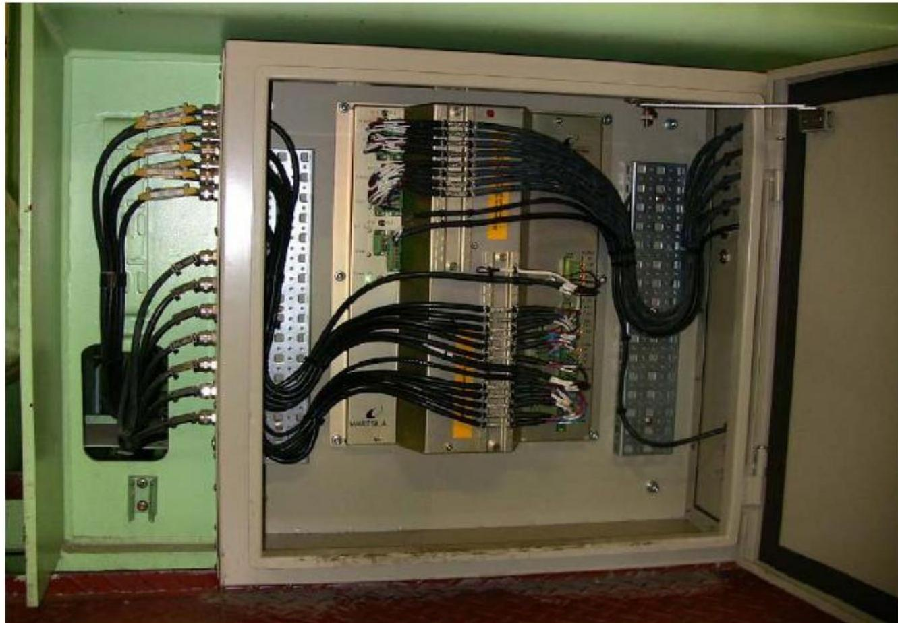

所属章节：[[第1章-发动机概述]]

# 报警监控系统

## 定义

报警监控系统由Kongsberg Maritime提供（Datachief C20），接收报警消息。监控系统可以通过CANopen接口直接访问WECS-9520的FCM-20 #1和FCM-20 #2，无需Modbus连接。

## 详细说明

### 报警消息分组

监控系统接收的报警消息分为两组：

#### 第一组：硬线连接的一般故障报警信号

通过E130和E90硬线连接：

| 报警类型 | 说明 |
|---------|------|
| **泄漏报警** | 轨道单元、供油单元、喷油组件 |
| **燃油压力执行器故障** | - |
| **燃油泵出口温度偏差监测** | - |
| **伺服油流量监测** | - |
| **WECS电源监测** | - |

#### 第二组：冗余总线连接的其他WECS故障信号

通过冗余（模块-）总线连接传输。

### 推进控制和报警监控系统

- **供应商**：均来自Kongsberg Maritime（Autochief C20和Datachief C20）
- **直接访问**：监控系统可以通过CANopen接口直接访问WECS-9520的FCM-20 #1和FCM-20 #2
- **无需Modbus**：无需Modbus连接

### WECS-9520故障分类（6组）

通过CAN/Modbus向报警监控系统传输共6组不同的WECS-9520故障：

| 分组 | 名称 | 说明 |
|------|------|------|
| **1. Passive Failures** | 被动故障 | 冗余传感器、总线或组件的故障 |
| **2. Common Failures** | 公共故障 | 无冗余的气缸单元故障或不导致任何减速的公共系统故障 |
| **3. Cylinder Failures** | 气缸故障 | 导致通过AMS减速的任何气缸单元故障 |
| **4. Rail Pressure Failures** | 轨压故障 | 导致通过AMS减速的共轨压力故障 |
| **5. Cylinder Lubrication Malfunction** | 气缸润滑故障 | （仅脉冲润滑）导致通过AMS减速的任何气缸润滑故障 |
| **6. WECS-9520 Critical Failures** | WECS-9520关键故障 | 导致主机立即停机且不能被安全系统越控的系统关键故障 |

### WECS-9520使用的总线系统

| 总线 | 说明 |
|------|------|
| CANopen System Bus | CANopen系统总线 |
| CANopen Module Bus | CANopen模块总线 |
| ModBus | ModBus |
| SSIBus | SSI总线 |

### 结构示意

## 故障诊断关联

| 故障现象 | 可能故障位置 | 检查要点 |
|---------|-----------|---------|
| 报警不显示 | 监控系统通信 | 检查CANopen/Modbus连接、FCM-20 #1/#2访问 |
| 泄漏报警 | 硬线信号 | 检查E130/E90硬线连接、泄漏传感器 |
| 故障分组异常 | 故障分类逻辑 | 检查6组故障定义、AMS减速触发条件 |

## 关联

- [[WECS-9520控制系统]] - 报警信号的来源
- [[远程控制系统]] - Autochief C20与Datachief C20配合
- [[FCM-20模块]] - 报警监控直接访问FCM-20 #1/#2
