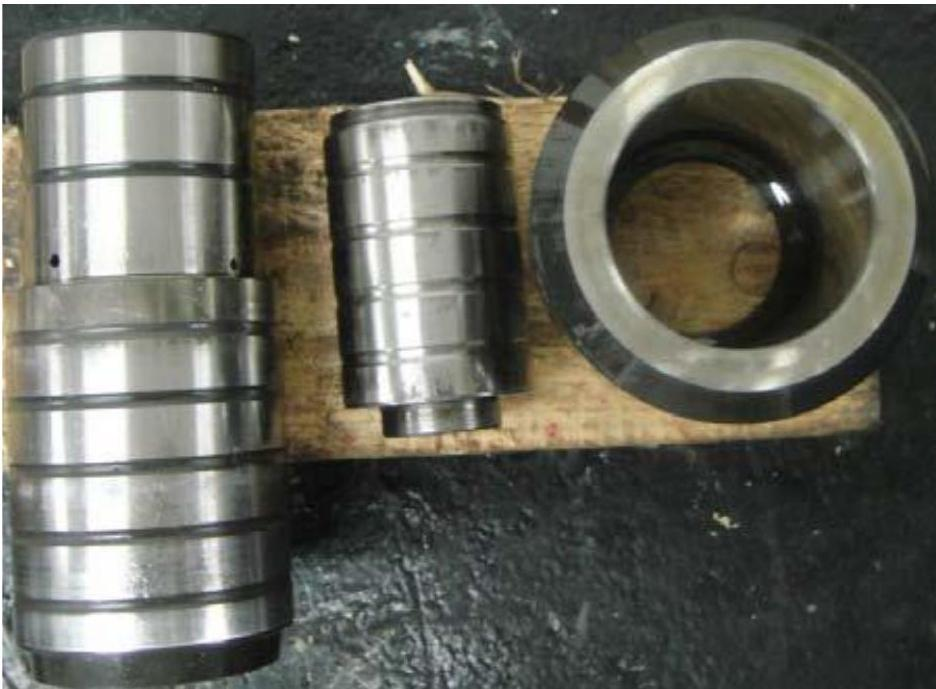
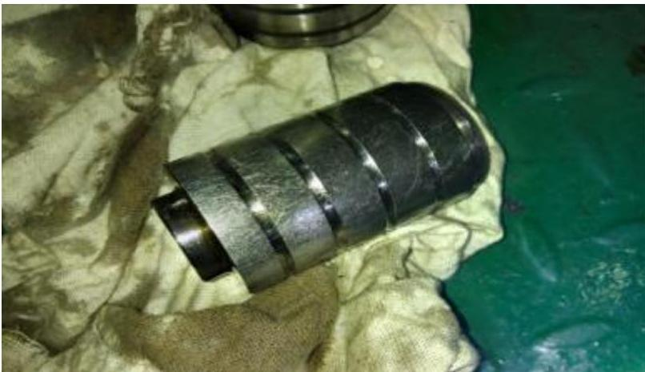
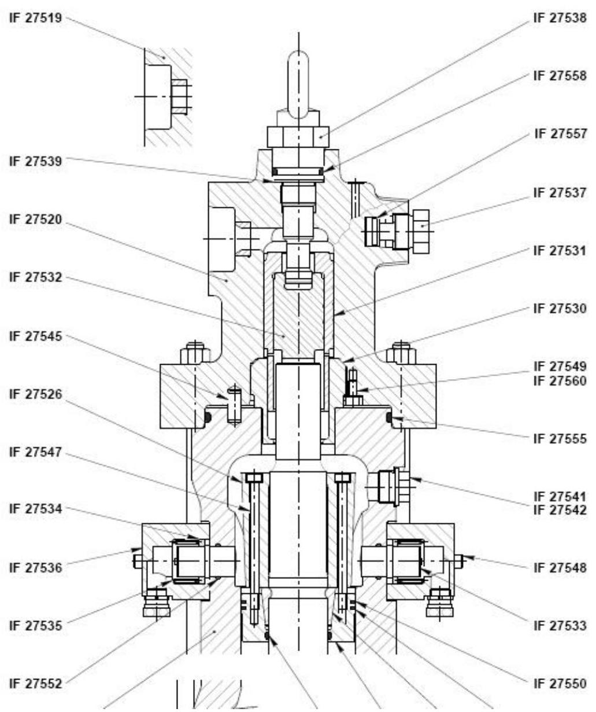

所属章节：[[第5章-故障诊断]]

# 排气阀驱动活塞卡滞故障案例

## 概述

这是一起Flex50主机排气阀驱动活塞卡滞导致的排温异常故障实际案例。该故障表现为高转速时（115rpm）单缸排温异常、透平喘振、扫气温度急速升高，根本原因是排气阀驱动活塞（备件号IF27532）磨损卡滞。

## 故障现象

### 初始现象

| 现象 | 描述 |
|------|------|
| **转速触发点** | 主机转速加到115rpm时突然发生故障 |
| **透平喘振** | 主机透平喘振 |
| **扫气温度** | 扫气温度急速升高 |
| **排烟温度** | 排烟温度升高 |
| **转速降低后** | 将转速降至FULL后，NO.2缸恢复正常 |

### 关键参数异常

- **Closed dead Time（关闭死区时间）**：从正常78ms突然降至60ms
- **排气阀状态**：显示提前关闭或延后开启
- **驱动液压油管**：脉动手摸感觉较其他缸强烈

## 故障排查过程

### 第一轮排查（常规检查）

1. **空气弹簧止回阀检查**：已更换，确认无问题
2. **VCU伺服油滤器检查**：拆洗，确认正常
3. **试车验证**：装复后试车，加至115RPM附近时故障重现

### 第二轮排查（深入分析）

1. **方向判断**：分析应为液压油开阀问题
2. **拆检排气阀驱动头**：发现内活塞有轻微磨痕
3. **临时处理**：用油石和细砂纸打磨后装复
4. **试车验证**：主机加至115RPM时故障消除，NO.2缸的Closed dead Time稳定在75ms

### 故障复发与根本解决

1. **故障复发**：该排气阀继续使用，后再次发生高转速时单缸排温高
2. **拆检发现**：排气阀内部活塞有明显磨损痕迹

3. **最终解决**：更换排气阀上部组件后，主机恢复正常

## 故障原因分析

### 故障机理

1. **活塞卡阻后果**：
   - 造成排气阀动作延迟
   - 高温高压燃气进入扫气箱
   - 导致扫气箱温度高

2. **液压系统反应**：
   - 活塞动作不及时
   - 驱动液压油受阻
   - 造成驱动液压油管脉动增强

### 易损件识别

**关键备件**：IF27532（排气阀驱动活塞）

### 故障可能原因

该故障曾多次出现，具体原因可能包括：

| 可能原因 | 说明 |
|---------|------|
| **备件质量** | 备件质量不好 |
| **安装间隙** | 安装间隙不满足要求 |
| **耐磨性** | 材料耐磨性不好 |
| **滑油污染** | 滑油污染导致磨损加剧 |

## 处理措施总结

| 阶段 | 措施 | 效果 |
|------|------|------|
| **临时处理** | 用油石和细砂纸打磨活塞 | 短期有效，故障会复发 |
| **根本解决** | 更换排气阀上部组件（含IF27532活塞） | 彻底解决，主机恢复正常 |

## 预防措施

### 备件准备

- **吊缸时检查**：吊缸时检查该易磨损IF27532活塞组件
- **备件储备**：至少备用2套IF27532、IF2731备件
- **扩展储备**：必要时申请IF27520备用

### 监测要点

- 关注Flexview中排气阀启闭参数
- 注意Closed dead Time的异常变化（正常值约75-78ms）
- 手感检查排气阀液压驱动管脉动情况
- 高负荷时特别注意单缸排温变化

## 关联页面

- [[第5章-故障诊断]] - 官方故障诊断指南
- [[第2章-系统描述]] - 排气阀驱动系统说明
- [[燃油系统]] - 共轨系统相关
- [[WECS-9520控制系统]] - 排气阀控制相关
