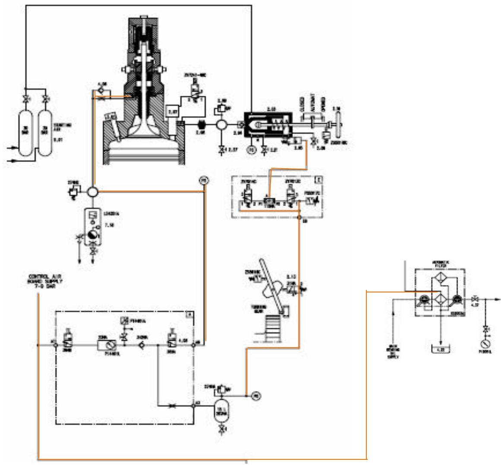
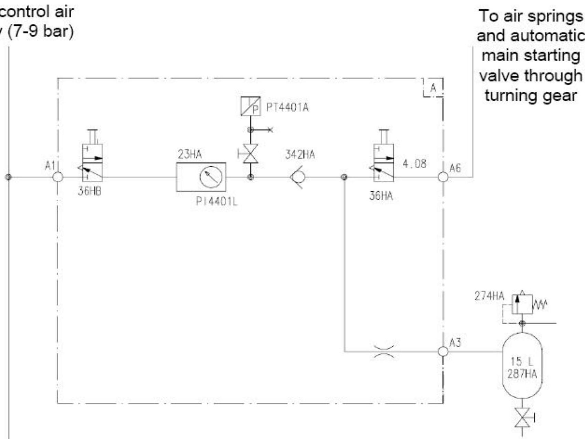

所属章节：[[第1章-发动机概述]]

# 控制空气系统

## 定义

控制空气系统（Control air system）是RT-flex发动机的气动辅助系统，提供7-9 bar的压缩空气，用于多个关键功能的驱动和控制。

## 详细说明

### 空气压力

- **控制空气供应压力**：7-9 bar

### 空气用途

控制空气用于以下方面：

| 用途 | 说明 |
|------|------|
| **自动启动阀驱动** | 自动启动阀的气动执行 |
| **发动机启动** | 发动机启动空气控制 |
| **空气弹簧供气** | 排气阀空气弹簧供气 |
| **油雾探测器** | 油雾探测器用气 |
| **伺服和控制油自动滤反冲洗** | 过滤器反冲洗用气 |

### 系统结构

#### 气源路径
- 来自控制空气供应（7-9 bar）
- 通过盘车机（turning gear）
- 通往空气弹簧和自动主启动阀

### 结构示意

## 故障诊断关联

| 故障现象 | 可能故障位置 | 检查要点 |
|---------|-----------|---------|
| 空气弹簧压力低 | 泄漏、调压阀 | 检查管路、接头、调压阀 |
| 无法启动 | 启动阀控制空气 | 检查控制空气压力、电磁阀 |
| 过滤器反冲洗失效 | 控制空气供应 | 检查反冲洗空气管路、压力 |

## 关联

- [[伺服油过滤系统]] - 使用控制空气进行反冲洗
- [[气门控制单元VCU]] - 排气阀的驱动控制单元
- [[长航碧玉30KG到8KG减压阀损坏故障案例]] - 控制空气减压阀密封垫老化的实际案例
