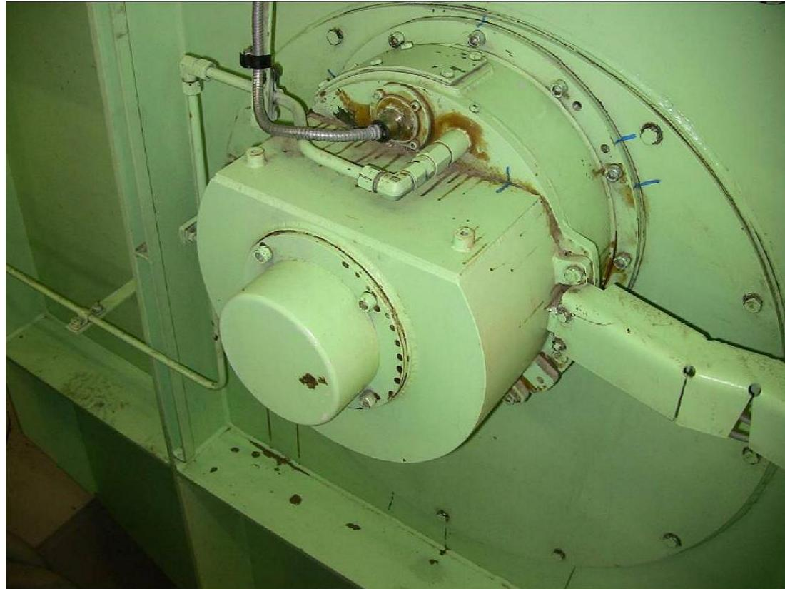
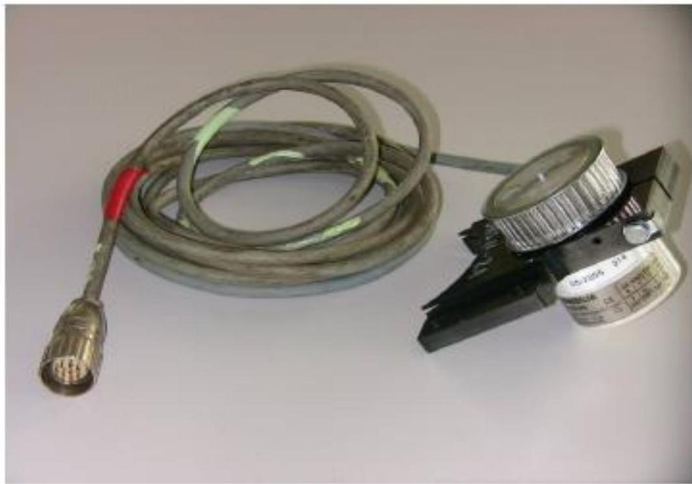

所属章节：[[第1章-发动机概述]]

# 曲柄角度传感器

## 定义

曲柄角度传感器（Crank Angle Sensors, CA-sensors）是RT-flex发动机的关键安全部件，位于曲轴自由端（或Geislinger减振器），为WECS-9520控制系统提供精确的曲轴位置信号。

## 详细说明

### 安装位置

- 位于曲轴**自由端**（free end of the crankshaft）或Geislinger减振器上
- 通过特殊联轴器与曲轴分离

### 技术参数

| 参数 | 数值 |
|------|------|
| 分辨率 | 0.1° |
| 测量范围 | 0....360° |
| 配置 | 冗余设计（至少两个传感器） |
| 信号类型 | 精确的数字信号 |
| 传输 | 屏蔽总线电缆 |

### 系统重要性

- **绝对不可缺少**（absolutely indispensable）：曲柄角度信号对于发动机运行是绝对不可缺少的
- **冗余运行**：至少一个传感器必须工作。如果一个传感器故障，WECS-9520可以检测到故障并继续使用健康信号（合理性检查）
- **无应急操作**：如果两个传感器都故障，发动机将立即停止，没有至少一个CA传感器无法进行应急操作

### 结构组成

| 部件 | 说明 |
|------|------|
| 弹簧加载联轴器（Spring loaded coupling） | 吸收曲轴的所有纵向和轴向运动 |
| 驱动轴（Driveshaft） | 由联轴器驱动，由两个球轴承支撑 |
| 球轴承（Ball bearings） | 油润滑 |
| 齿形带（Toothed belt） | 从驱动轴驱动每个传感器 |
| 屏蔽总线电缆（Shielded BUS cables） | 将信号传输到WECS-9520控制器 |

### 交付方式

- CA传感器以盒装形式交付（delivered in a box）
- 完整套件包括传感器、支架和电缆

## 定期检查项目（来自RT-flex-01服务通报）

> RT-flex-01服务通报建议每3000运行小时进行以下检查：

| 检查项目 | 方法 | 判定标准 | 处理 |
|---------|------|---------|------|
| **轴向间隙** | 检查传感器轮与壳体间是否有轴向移动 | 有间隙 | **须立即更换传感器** |
| **皮带张力** | 使用弹簧秤测量 | **不得超过4.5kg** | 张力过大会导致传感器自毁 |
| **油流** | 用手触摸供油管，感受温度 | 不发热=入口小孔堵塞 | 须尽快疏通，避免轴承干运转 |
| **插头编号** | 拔掉传感器1插头，应触发传感器1报警 | 编号错误会导致误判 | 确保E96箱内插头编号正确 |

> **皮带张力警告**：更换传感器时必须按维护手册设置皮带张力，超张力会自我毁坏传感器。

## 关联

- [[WECS-9520控制系统]] - CA传感器的信号接收方
- [[第1章-发动机概述]] - 所属章节
