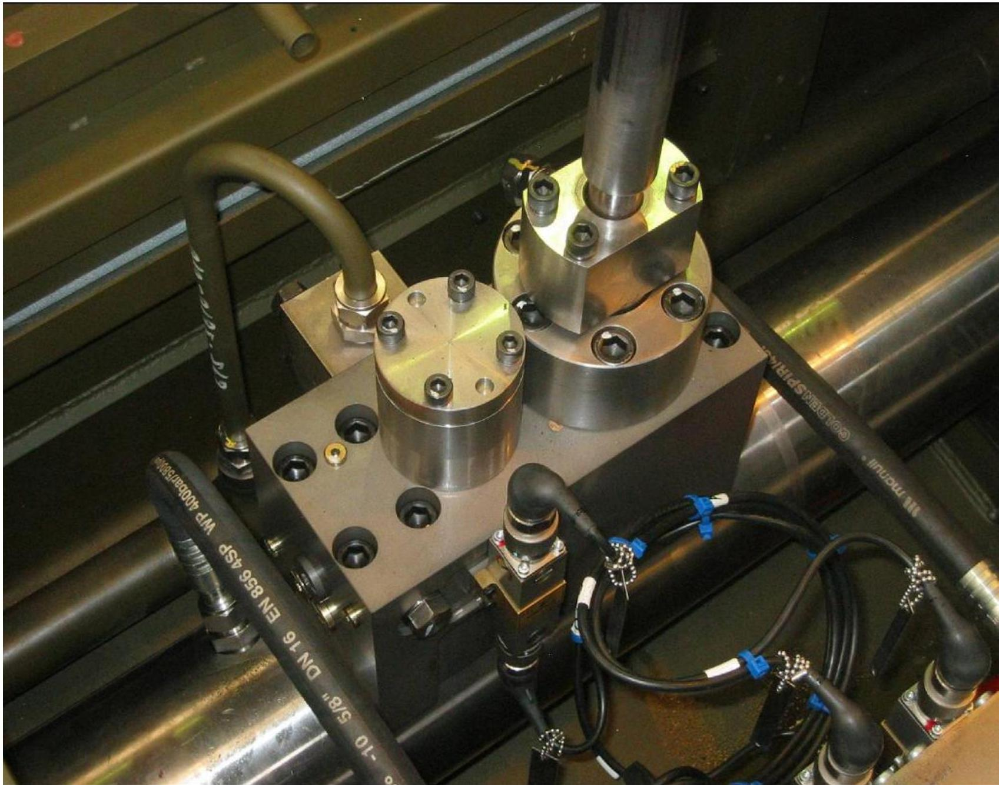
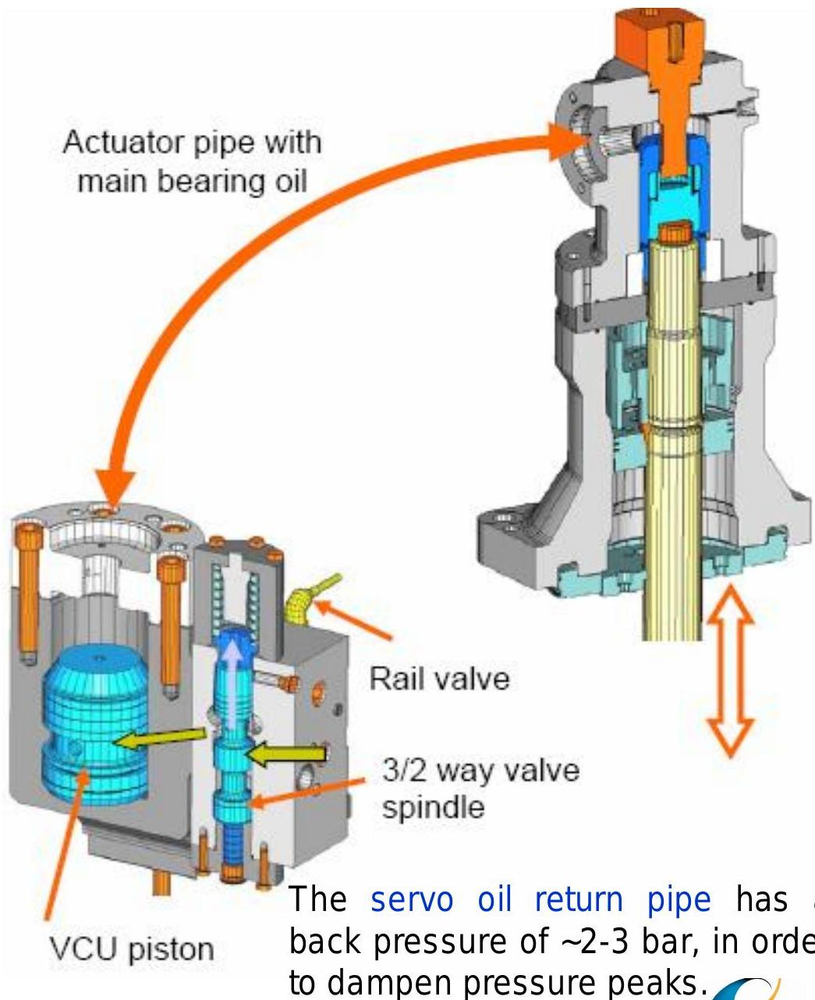
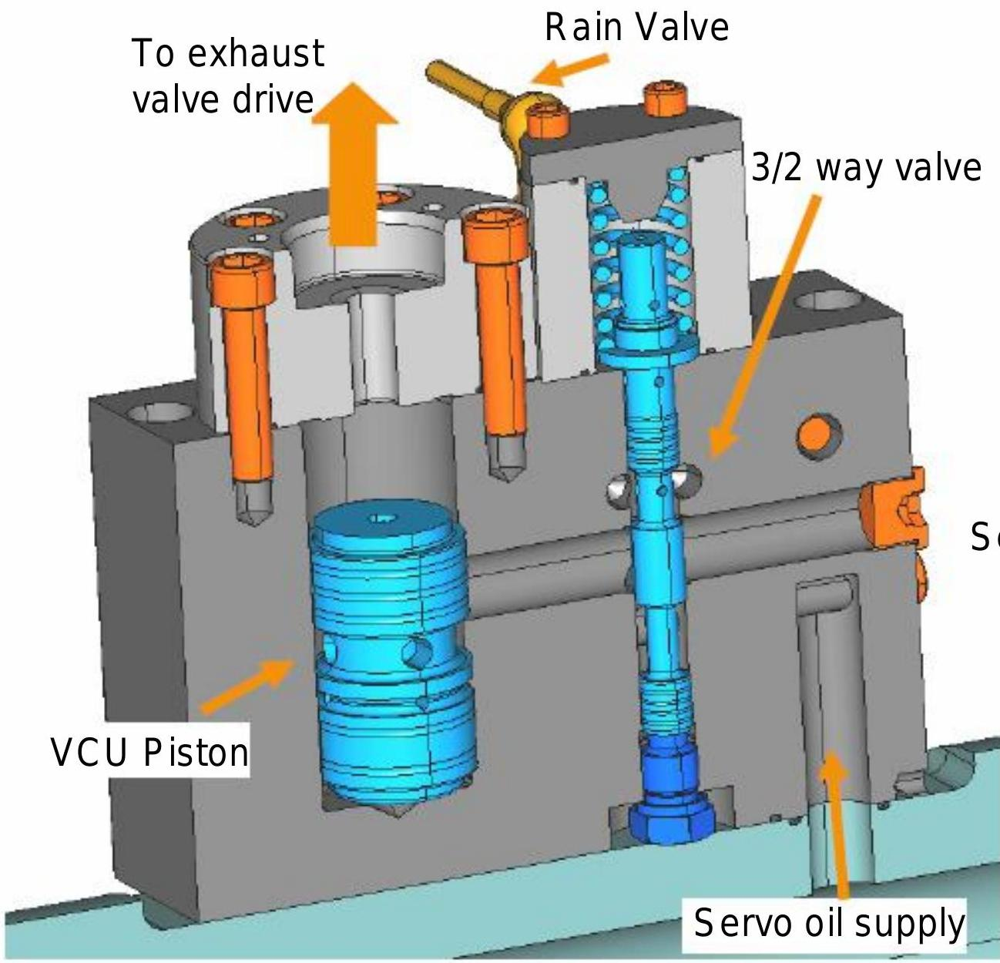
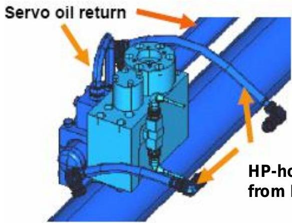
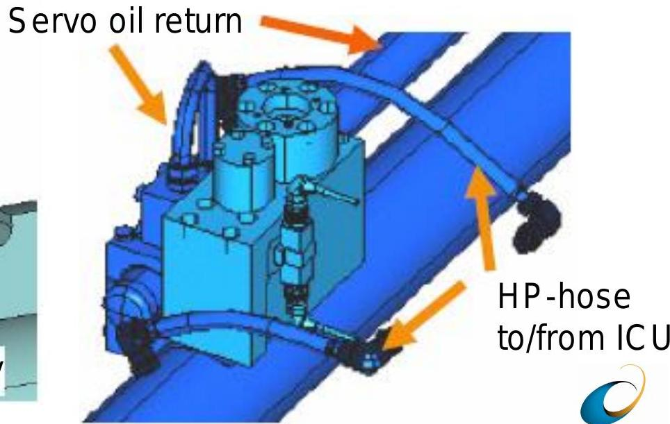

所属章节：[[第1章-发动机概述]]

# 气门控制单元VCU

## 定义

气门控制单元（Valve Control Unit, VCU）是RT-flex发动机每缸的排气阀控制执行机构，直接安装在伺服油轨上，由一个轨阀预控制，控制排气阀的开启和关闭。

## 详细说明

### 安装位置

- **直接安装在伺服油轨上**（sits directly on the servo rail）
- 通过高压软管连接到/来自ICU

### 补偿功能

为了补充排气阀驱动上壳体中通过恒定节流孔的预期油损失，VCU/执行器管路上部设有内部节流孔。

### VCU工作原理

#### 排气阀开启过程

1. **预控制**：气门控制单元由轨阀预控制
2. **开启信号**：在特定曲柄角度，从WECS接收到"排气阀开启"脉冲信号
3. **伺服油流动**：伺服油经轨阀流向3/2通阀杆的下侧
4. **阀杆上移**：阀杆向上移动
5. **伺服油流入VCU缸**：使伺服油流向VCU缸的通路被启用
6. **油流入活塞下侧**：通过VCU活塞中的孔，油流入活塞的下侧
7. **活塞向上端移动**：活塞向上端移动
8. **结果**：排气阀开启

#### 排气阀关闭过程

1. **关闭信号**：在另一个计算角度，WECS-9520向轨阀发送"排气阀关闭"信号
2. **阀杆下移**：3/2通阀杆向下移动
3. **油释放**：从VCU活塞下侧释放油，允许排气阀中的油体积返回VCU
4. **伺服油排放**：VCU活塞下方的伺服油被排放到伺服油回油管
5. **结果**：排气阀关闭

### VCU活塞运动特性

- **渐进运动**：由于特定的控制孔或倒角，VCU活塞具有渐进运动
- **运动规律**：开始快速移动，当接近终点挡块时减慢
- **泄漏补偿**：通过排气阀侧节流孔的伺服油损失在VCU中用伺服油补偿

### 伺服油回油管

- **背压**：伺服油回油管有约2-3 bar的背压
- **目的**：为了缓冲压力峰值（dampen pressure peaks）

### 与传统RTA气门驱动的主要区别

| 区别项 | 传统RTA | RT-flex |
|-------|---------|---------|
| 排气阀驱动 | 凸轮驱动 | 双活塞驱动（节省油体积） |
| 排气阀行程传感器 | — | 两个冗余传感器用于监控 |
| 行程传感器测量锥 | — | 一个测量锥 |
| 空气弹簧活塞 | — | 直接在壳体中运行 |
| 碟形弹簧组 | — | 在空气弹簧压力低时缓冲开启冲程 |

### 结构示意

## 故障诊断关联

| 故障现象 | 可能故障位置 | 检查要点 |
|---------|-----------|---------|
| 排气阀无法开启 | 轨阀、3/2通阀、伺服油压力 | 检查轨阀动作、伺服油压力、阀杆运动 |
| 排气阀无法关闭 | 阀杆卡滞、回油堵塞 | 检查阀杆、回油管背压、节流孔 |
| 排气阀动作异常 | VCU活塞渐进运动失效 | 检查控制孔、倒角、活塞磨损 |
| 单缸排温异常 | VCU动作正时偏差 | 检查WECS信号、曲柄角度、活塞位置 |

## 关联

- [[伺服油轨]] - VCU的高压伺服油来源
- [[轨阀RV-2]] - VCU的预控制电磁阀（每缸一个）
- [[排气阀驱动活塞卡滞故障案例]] - VCU控制的排气阀相关故障案例
- [[伺服油过滤系统]] - 伺服油清洁度对VCU至关重要

