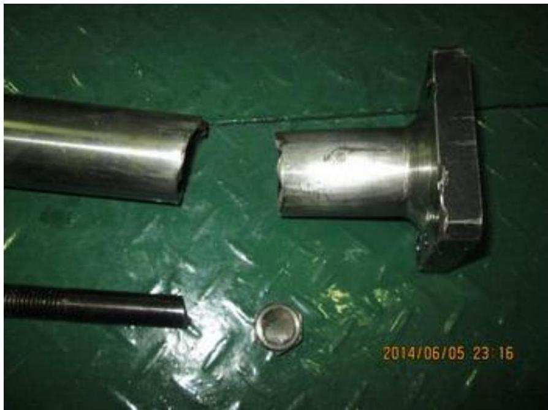
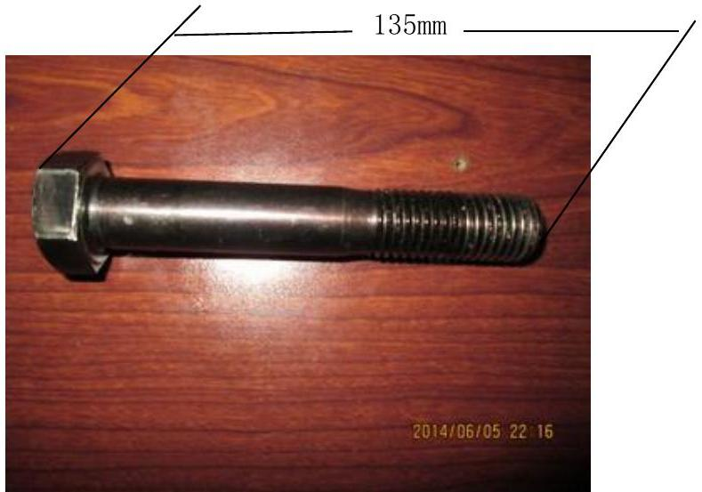
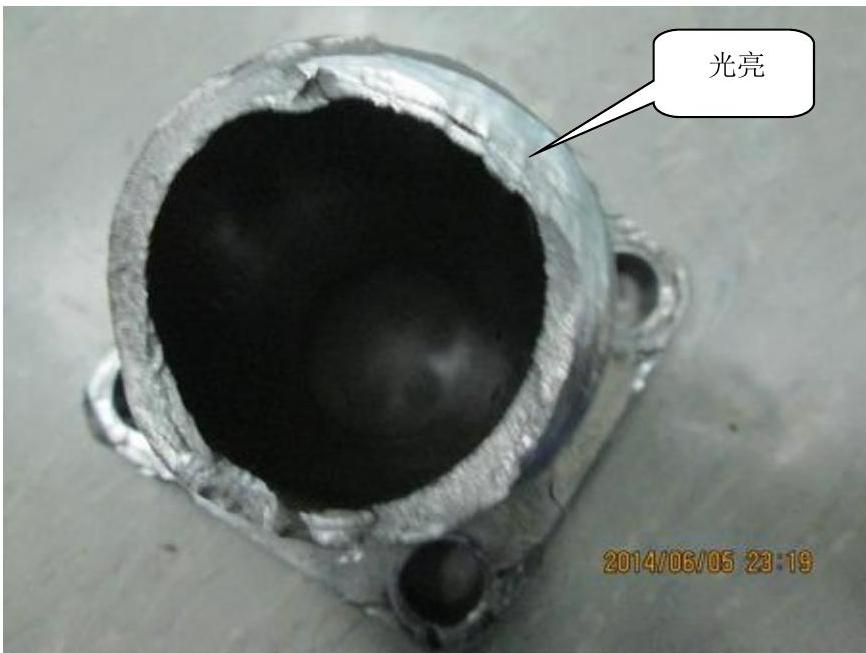
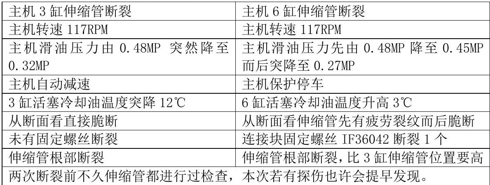

所属章节：[[第5章-故障诊断]]

# 活塞冷却油伸缩管断裂故障案例

## 概述

这是一起长航玛瑙轮RT-flex50主机6缸活塞冷却油伸缩管断裂的故障案例。故障发生于2014年6月5日，主机突然安全保护停车，检查发现滑油压力低并且上下波动。同一缸在2013年6月也发生过类似故障，提示有共性问题需要解决。

## 基本信息

| 项目 | 内容 |
|------|------|
| **船舶** | 长航玛瑙轮 |
| **主机** | RT-flex50 |
| **故障时间** | 2014年6月5日 |
| **故障缸** | 6缸 |
| **历史故障** | 同一缸6缸在2013年6月也发生过故障 |
| **备件** | 连接块IF36037、固定螺丝IF36042（M20mm×135mm，牙距2.5mm） |

## 故障现象

| 现象 | 描述 |
|------|------|
| **时间** | 2014-6-5日1948LT |
| **故障** | 主机突然安全保护停车 |
| **滑油压力** | 滑油压力低并且上下波动 |
| **初步怀疑** | 主机活塞冷却油伸缩管出问题 |

## 检查发现

主机停车半小时后打开曲拐箱道门检查发现：

1. **主机6缸活塞冷却油伸缩管断裂**
2. **连接块IF36037固定螺丝IF36042折断一个**

## 备件信息

| 备件 | 规格 |
|------|------|
| **固定螺丝IF36042** | M20mm×135mm，牙距2.5mm |

## 临时处理措施

由于固定螺丝IF36042船上没有备件，也无合适螺栓：

| 措施 | 说明 |
|------|------|
| 1 | 临时破坏分油机专用工具做了一个螺栓维持使用 |
| 2 | 固定螺丝IF36042在备件申领单CHMNP014015中申领8只 |
| 3 | 主机目前已恢复运转，转速115RPM未全速运转 |
| 4 | 观察一段时间再行恢复全速运转 |

## 与上次3缸断裂对比分析

| 对比项 | 主机3缸伸缩管断裂 | 主机6缸伸缩管断裂 |
|--------|------------------|------------------|
| **主机转速** | 117RPM | 117RPM |
| **滑油压力变化** | 由0.48MP突然降至0.32MP | 先由0.48MP降至0.45MP而后突降至0.27MP |
| **主机反应** | 自动减速 | 保护停车 |
| **活塞冷却油温度** | 突降12℃ | 升高3℃ |
| **断面情况** | 直接脆断 | 先有疲劳裂纹而后脆断 |
| **固定螺丝** | 未有固定螺丝断裂 | 连接块固定螺丝IF36042断裂1个 |
| **断裂位置** | 伸缩管根部断裂 | 伸缩管根部断裂，比3缸伸缩管位置要高 |
| **检查历史** | 断裂前不久伸缩管都进行过检查 | 断裂前不久伸缩管都进行过检查，本次若有探伤也许会提早发现 |

## 历史故障记录

查阅以前故障报告，主机6缸伸缩管在**2013年6月**也发生过故障。

**关键提示**：同一缸发生两次问题，应该有共性问题没有解决，到港后需再行进一步仔细检查确认。

## 经验教训

| 教训 | 说明 |
|------|------|
| **预警信号** | 主机滑油压力降低，在排除自动冲洗滤器后可直接怀疑伸缩管故障 |
| **重复故障** | 同一缸重复发生故障，提示有共性问题需彻底排查 |
| **探伤建议** | 两次断裂前不久伸缩管都进行过检查，若有探伤也许会提早发现 |
| **备件准备** | 关键备件需保持充足库存 |
| **临时方案** | 无备件时可考虑临时改制，但需密切监控 |

## 故障图片

## 关联页面

- [[第5章-故障诊断]] - 官方故障诊断指南
- [[第4章-异常操作规程]] - 应急操作程序
- [[排气阀驱动活塞卡滞故障案例]] - 另一例实际故障案例
- [[ICU流量活塞探头杆脱落故障案例]] - 另一例实际故障案例
- [[增压器轴承损坏故障案例]] - 另一例实际故障案例
- [[滑油变质致排气阀故障案例]] - 另一例实际故障案例

