所属章节：[[第5章-故障诊断]]

# 滑油变质致排气阀故障案例

## 概述

这是一起长航紫晶轮RT-flex50主机厂修后新旧滑油混合导致滑油变质，引发排气阀卡堵的完整故障案例。故障始于2017年8月1日出厂开航28小时后，NO.5缸先出现排温异常，更换排气阀总成后NO.4缸又出现相同故障。初期所有现象都指向机械/控制问题，直到NO.6缸也出现类似问题（未进厂吊检），才开始怀疑滑油系统。最终彻底更换系统滑油后，所有故障迎刃而解。

## 基本信息

| 项目 | 内容 |
|------|------|
| **船舶** | 长航紫晶轮 |
| **主机** | RT-flex50 |
| **故障时间** | 2017年8月 |
| **背景** | 出厂开航28小时后出现故障 |
| **厂修内容** | 1,2,3,4,5缸排气阀外协吊检，更换排气阀座和内部密封原件；循环油舱彻底清洁，补充近5个方新系统滑油 |

## 故障现象

### NO.5缸初始故障（2017-08-01）

| 现象 | 描述 |
|------|------|
| **报警** | NO.5缸短时间排温达到450度，排温偏差报警，主机降速 |
| **排气阀状态** | 主机启动时缸排气阀无法打开 |
| **Flexview参数** | EXHV界面气阀POENPOS.SENSOR电流值显示与CLOSEDPOS.SENSOR电流值相同（说明排气阀处在关闭位置） |
| **报警** | 排气阀无法打开报警 |
| **机旁确认** | 排温显示排气阀没有打开 |
| **反复启动** | 反复多次启动主机排气阀将会打开，位置传感器电流值恢复正常 |
| **提速异常** | 提速过程中，POENPOS.SENSOR电流值会慢慢增加，该缸排温快速上升，温度偏差快速增大，最后导致主机SLOWDOWN |

### 参数异常详情

| 转速 | POENPOS.SENSOR电流 | 排温偏差 | 措施 |
|------|------------------|---------|------|
| 102转 | 升至12.4mA | 35度左右 | 减速至86转 |
| 86转 | 无明显下降 | 无下降 | 再次降速至75转 |
| 75转 | 升至13.1mA | — | 停车 |

## 第一阶段排查（NO.5缸）

### 初步检查（2017-08-01 03:25）

| 检查项 | 结果 |
|--------|------|
| 滑油压力 | 正常（0.48MPa） |
| 伺服油压测试泵 | 9.6MPa |
| 伺服油滤器 | 无报警，压差正常 |

**初步排除**：油路故障

### 怀疑对象

1. 主机NO.5缸排气阀驱动活塞卡死导致排气阀不动作
2. 共轨电磁阀阀芯有卡堵导致排气阀不动作
3. 控制空气单向止回阀卡堵导致排气阀不动作

### 排查措施

| 措施 | 操作 | 结果 |
|------|------|------|
| 吊检5缸驱动头 | 解体检查驱动活塞，活络正常无明显磨损；节流螺钉检查无脏堵，清洁后装复 | 正常 |
| 检查5缸VCU共轨电磁阀 | 解体检查移动活塞无卡堵现象，清洁后装复；同时将5缸VCU节流阀和控制滤器拆检清洁疏通后装复 | 正常 |
| 拆检控制空气单向止回阀 | 清洁疏通后装复 | 正常 |

### 模拟测试

上诉怀疑故障排除后，模拟测试5缸排气阀动作情况同时放气，**测试正常**。

### 复发现象（05:42）

启动主机正常，Flexview监控电脑EXHV界面各参数及监控电脑各参数正常，转为驾控正常运行。

**当转速运行至102转时**：
- Flexview监控电脑EXHV界面气阀POENPOS.SENSOR电流值升至12.4mA
- 单缸排温升高，排温偏差已达35度左右
- 申请驾驶台减速至86转
- Flexview监控电脑EXHV界面气阀POENPOS.SENSOR电流没有明显下降，但缸排温也没有下降
- 再次申请降速至75转
- Flexview监控电脑EXHV界面气阀POENPOS.SENSOR电流值升至13.1mA
- 最后向船长申请停车，经船长同意后停车

## 第二阶段排查（NO.5缸）

### 措施

| 措施 | 操作 |
|------|------|
| 再次吊检5缸驱动头 | 更换驱动活塞（新件）和新共轨电磁阀（节流螺钉和控制滤器再次检查无脏堵） |
| 装复测试 | 启动主机现象仍无好转 |

### 新的怀疑

开始怀疑是排气阀本身的原因（因为在厂修理期间1,2,3,4,5缸排气阀外协吊检更换排气阀座和内部密封原件）

### 申请更换排气阀总成

向船长和公司指导申请对5缸排气阀总成进行更换（船上有一个新的排气阀总成）

### 海况延误

由于当时海况不好，和船长商量评估后，吊检工作存在风险。最后决定用60转的转速维持向前开，大约开了4小时左右（期间停车或45转运行）。

### 更换排气阀总成（海况见好后）

- 停车准备更换排气阀（提前将新排气阀总成拆检测试正常）
- 大约下午6点左右更换完毕
- 指导发邮件建议检查排气阀上的单向止回阀18号阀（因为flexview监控电脑出现的报警时气阀无法打开）
- 将六个缸的单向阀全部拆检清洁（检查发现2，4，缸有脏堵）装复
- 加水暖缸，送气启动滑油泵，一切正常后，模拟测试5缸排气阀开关功能正常
- 启动主机运行各参数正常，大概1930左右提速至112转运行（各参数正常）

## NO.4缸故障（大概2300左右）

### 故障现象

- 主机再次降速
- NO.4缸排温偏差导致降速
- Flexview监控电脑EXHV界面气阀POENPOS.SENSOR电流值14.3mA
- 与NO.5缸现象相同

### 排查措施

| 措施 | 操作 | 结果 |
|------|------|------|
| 吊检4缸驱动头 | 解体检查驱动活塞活络正常无明显磨损，驱动头的节流螺钉检查没有脏堵，清洁后装复 | 正常 |
| 检查4缸VCU共轨电磁阀 | 解体检查移动活塞无卡堵现象，清洁后装复，同时将4缸VCU节流阀和控制滤器拆检清洁疏通后装复 | 正常 |
| 模拟测试 | 模拟测试4缸排气阀动作情况同时放气，测试正常 | 正常 |

### 复发现象

启动主机，提速至102转，Flexview监控电脑EXHV界面气阀POENPOS.SENSOR电流变化与5缸相同。

## 第三阶段排查（NO.4缸）

### 决定更换4缸排气阀总成

由于船上没有备用排气阀总成，备件因在厂里吊检排气阀部分用完，临时将两个旧的排气阀拼凑成一个，测试正常后准备更换。

### 液压工具故障

附件拆掉使用液压工具时发现一个液压工具泄漏严重（厂修时将备件交给外协，由于修船时机舱人员复杂，导致液压工具密封备件丢失）。由于1500公斤压力船上无法找到替代品。

### 服务商建议

向指导汇报同时和服务商请教，服务商建议：
- 将4缸盘车至上止点
- 打开IF27521检查气封件IF27529和空气弹簧
- 检查驱动油腔及密封原件

### 关键发现

按服务商说法检查4缸时发现：**在关闭控制空气（滑油系统已经停掉）4缸排气阀杆依然在关闭位置！**

（这是不应该的，正常情况停止控制空气后排气阀杆回受自身重力打开，等了大概30分钟依然没有打开，这一现象更加确定了对排气阀机械原因卡堵的怀疑）

### 尝试措施

保护性敲击也无法打开。

### 公司建议

将这一现象汇报公司，公司来电建议研磨IF27529，用旧件测试无法研磨。后来公司建议在缸头上更换IF27529部件，已做好更换准备，后来公司经评估取消此建议。

### 对调驱动头

公司建议对调4,6缸驱动头试一试，对调后6缸正常4缸阀位置指示仍不正常，再次组装驱动头（驱动活塞换新）安装后效果仍不明显。

### 关键转机

更换驱动头时发现排气阀杆已打开，Flexview监控电脑EXHV界面气阀POENPOS.SENSOR电流值正常。

### 原因判断

此时岸基地和船上都认为是**气封件IF27529对阀杆有摩擦导致阀杆不能开关到位**。

## 磨合尝试

在无能力更换排气阀总成（液压工具无法使用)和没有更好的解决方案时，用慢车运行（45-60转）试图让阀杆与IF27529气封件磨合。

### 磨合结果

- 运行大概4个小时后，Flexview监控电脑EXHV界面气阀POENPOS.SENSOR电流值正常
- 试图提速至75转运行正常
- 由于进港时间限制和船长商量还是用50转运行
- 8月4号早上快进锚地再提速测试，进锚地前转速提至86转测试正常

**这一现象恰恰证实了气封件IF27529对阀杆有摩擦导致阀杆不能开关到位的原因（因为经过长时间运行将特氟龙密封圈于阀杆良好磨合，直至卡堵现象消失）**

## 滑油系统怀疑

### 岸基怀疑

向岸基地汇报后，岸基领导怀疑滑油系统也可能有问题。

### 滑油检查情况

| 检查项 | 结果 |
|--------|------|
| 滑油乳化现象 | 没有 |
| 测水膏测试 | 没有发现油中含有水 |
| 自清滤器、伺服油滤器 | 不脏，前后压差正常 |
| 系统滑油压力 | 没有下降现象 |
| 系统取样滑油粘度 | 感觉没有明见变化 |

**以上现象都不能说明滑油是直接原因。唯一不正常的现象是滑油颜色不正常**（由于在厂里对循环油舱进行彻底清洁，导致系统滑油损耗将近5个方，后来补充近5个方新系统滑油，当时怀疑是新旧油混合导致颜色变化）

### 机械原因判断

加上四缸排气阀缸在关控制空气时无法打开这一现象，判断还是**排气阀机械卡堵或者是摩擦的原因比较大**。

## 再次故障（8月5日）

### 靠泊正常

上午靠泊时正常，8月5日离泊正常。

### 加装燃油后再次故障

由于加装燃料油原因再次靠泊正常，加装完燃油离泊时再次出现4缸排气阀无法打开。

### 应急措施

使用各种方法（因为当时引水在船），请示公司封缸运行开到锚地。

### 转机发现

后来尝试将伺服油滤器转至旁通，启动主机，4缸排气阀动作。

### 锚地检查

利用机动航行将船开至锚地，立即打开伺服油滤器检查（之前已经清洗过两次没有发现脏），更换下没有清洗的滤器。

**我和大管轮对滑油系统加大了怀疑**（但是在没有一定的把握的情况下，还是不能轻易换系统油，船上主机滑油只剩14.6方）

## NO.6缸异常

开出交管范围后再次请求停车对所有滤器节流螺钉清洁疏通，放气后启动主机，Flexview监控电脑EXHV界面气阀POENPOS.SENSOR电流值仍然随转速增加而增加，排温也随之升高，一直用60-75转速运行。

**在运行过程中NO.6缸出现过短时排气阀开关位置不正常现象**（六缸排气阀是进厂之前吊检的，运行一直正常）

**这一现象让我们对滑油系统问题有了更大的怀疑！**

## 最终解决（更换滑油）

### 申请更换滑油

于是请示指导建议更换滑油，经公司同意后，在8月5号1500至次日凌晨0430进行彻底更换：

| 更换内容 |
|----------|
| 循环油舱旧油全部清除 |
| 自清滤器旧油全部清除 |
| 伺服油滤器旧油全部清除 |
| 共轨油管旧油全部清除 |

### 清洁检查

| 清洁/检查项 | 发现 |
|------------|------|
| 循环油舱内部旧油 | 没有发现明显有水，但是底部发现有薄薄一层变质的油 |
| 所有滤器 | 全部清洁检查疏通 |
| 节流螺钉 | 全部清洁检查疏通 |
| VCU共轨电磁阀 | 全部清洁检查疏通 |
| 驱动活塞 | 全部清洁检查疏通 |

### 恢复测试

滑油更换完毕，串油放气系统恢复正常：
- 先利用伺服油模拟泵进行单缸放气，测试
- 测试各缸排气阀开关正常
- Flexview监控电脑EXHV界面各参数正常

### 正常运行

申请驾驶台启动主机运行：
- Flexview监控电脑EXHV界面各参数正常
- 监控电脑各排温正常
- 机旁温度表温度正常
- 开示工阀检查发火正常

- 8月6日靠泊使用正常
- 8月7日离泊使用正常
- 离泊后正常用车至112转检查各参数正常直至现在一切正常

## 故障原因总结

RT-FLEX50这种机型排气阀故障通常出现在：

### 1. 机械部分

| 故障点 | 说明 |
|--------|------|
| IF27529气封 | 会导致阀杆卡堵 |
| 驱动活塞 | 磨损或偏磨会导致活塞卡堵无法驱动 |
| 驱动头上的节流螺钉IF27523 | 堵塞会导致驱动油无法泄掉导致气阀无法正常关闭 |
| 驱动油管 | 安装若有泄漏会导致排气阀打不开 |

### 2. 控制部分（VCU）

| 故障点 | 说明 |
|--------|------|
| 共轨电磁阀故障 | 会导致排气阀不能正常关闭或开启 |
| 节流螺钉IF56138堵塞 | 会导致排气阀不能正常工作 |
| VCU滤器IF56135脏堵 | 也会导致排气阀不能正常工作 |
| VCU控制阀弹簧IF56133偏磨 | 同样会导致排气阀不能正常工作 |
| 控制阀滑动杆IF56127磨损或卡阻 | 同样会导致排气阀不能正常工作 |

### 3. 控制空气部分

排气阀上的单向止回阀（18 操作手册 2752-1/A1），该单向止回阀容易卡堵会导致排气阀无法关闭。

### 4. 伺服油系统

滑油系统导致主机故障是比较常见的，主要是油质问题。

**船舶通常的处理方法**：
- 加强分离并且适当提高分离温度（92摄氏度）
- 分离只能减少滑油中的杂质和水分

**局限性**：
- 如果有变质或轻微乳化以船上的技术是无法第一时间发现的
- 船上只能通过滑油压力，滤器压差，滤器脏堵情况，观察滑油颜色，闻滑油的味道，手指捏一捏感觉滑油的粘度等等简单的方法来判断优质好坏
- 对于伺服油系统的滑油要求，这些是远远不够的

## 经验教训

### 排查弯路

就本轮这次排气阀故障来说：
- 种种现象都指向机械部分故障和控制部分故障（控制空气部分与排除）
- 统统检查，清洗疏通或更换新部件后故障仍未消除
- 也曾对滑油油质问题提出怀疑，但通过上述对滑油系统的检查和一些现象的判断又不敢确定是滑油的问题
- 结果导致走了很多弯路，做了很多无用功
- 最后将系统化油更换，所有故障迎刃而解

### 建议

在该机型船上配一套简单的滑油化验设备，主要能够化验出油的粘度，是否变质或有轻微乳化。船上定期化验对比，便于及时发现问题采取相应措施。

## 故障图片

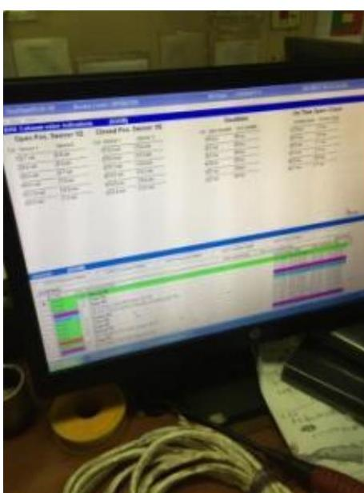

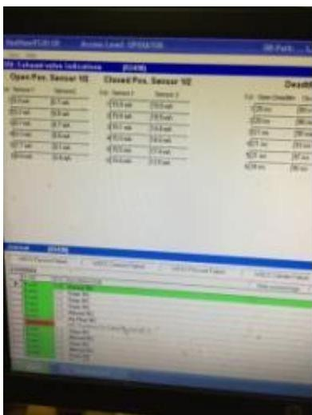

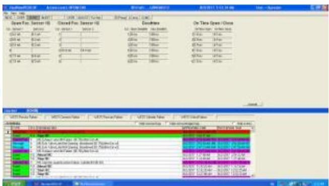

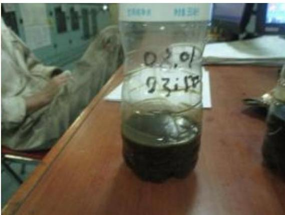

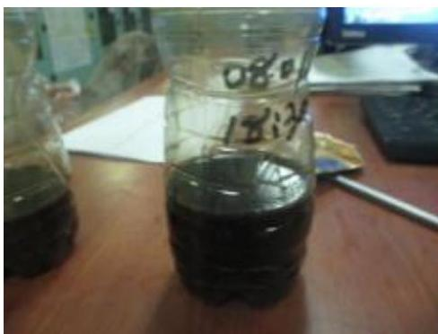

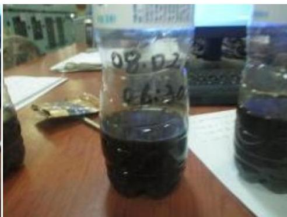

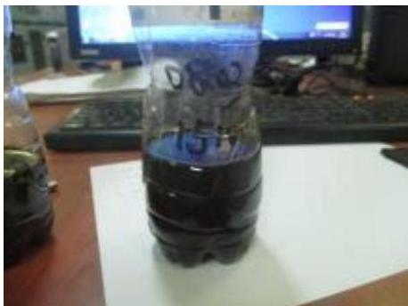

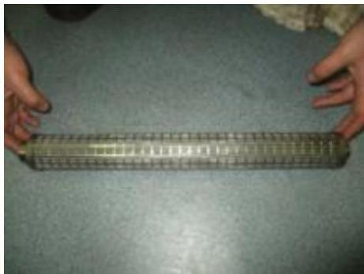

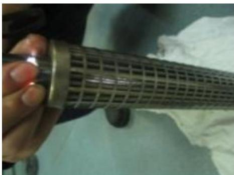

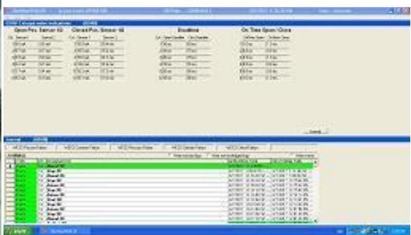

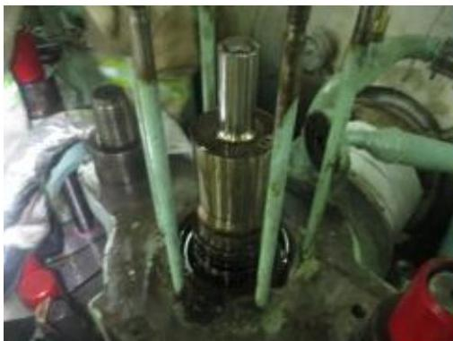

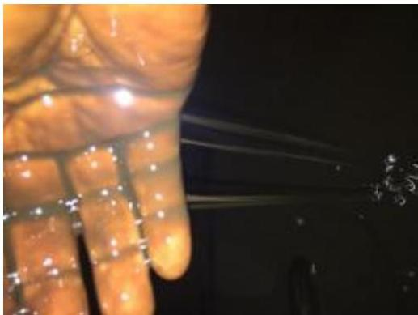

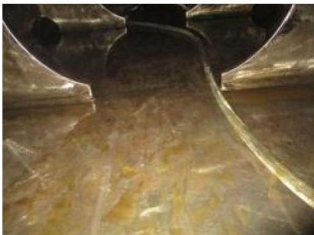

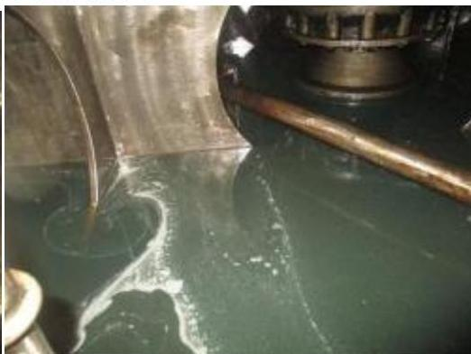

## 关联页面

- [[第5章-故障诊断]] - 官方故障诊断指南
- [[第4章-异常操作规程]] - 应急操作程序
- [[工作介质规格]] - 滑油规格要求
- [[排气阀驱动活塞卡滞故障案例]] - 另一例实际故障案例
- [[ICU流量活塞探头杆脱落故障案例]] - 另一例实际故障案例
- [[增压器轴承损坏故障案例]] - 另一例实际故障案例

