所属章节：[[第2章-系统描述]]

# 燃油系统

## 概述

Wartsila RT-flex50 的燃油系统采用 Sulzer 共轨（Common Rail）技术，分为低压回路和高压回路。重油运行时，所有管路均配有加热管道并保温。高压回路在轨道单元外为双层壁设计，确保安全。

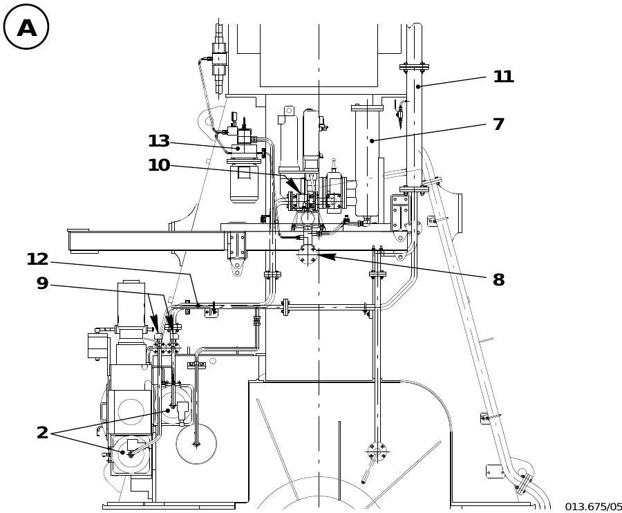

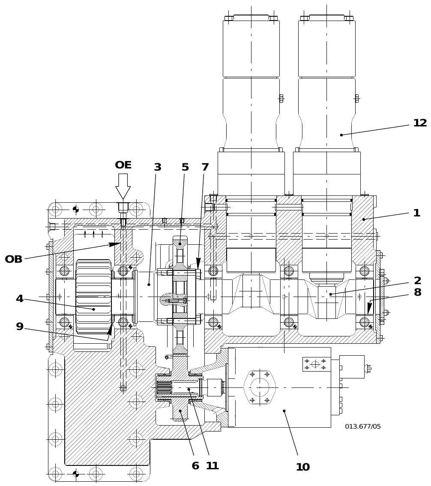

> 参考文档：OM-RT-flex50, 8019-1/A1, 5556-1/A1, 5556-2/A1, 5562-1/A1, 0120-1

---

## 1. 系统布局 — 低压回路组件对照表

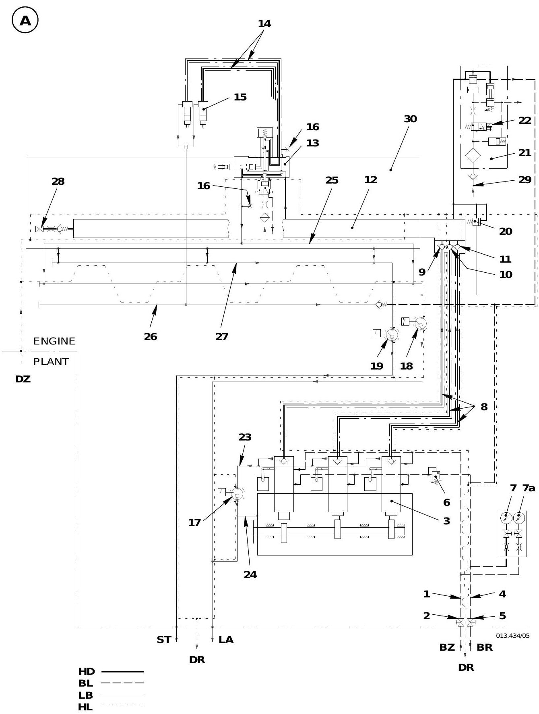

> **图解要点**：燃油系统分为两条独立回路。低压回路（BL线）：增压泵 -> 燃油进口管1 -> 燃油泵3（低压侧）-> 燃油出口管4 -> 压力保持阀6 -> 回油。高压回路（HD线）：燃油泵3 -> 燃油上升管8 -> 止回阀9/10/11 -> 燃油轨12 -> 喷射控制单元13 -> 喷油管14 -> 喷油阀15。燃油压力控制阀21(3.06)和安全阀20(3.52)保护燃油轨超压。

| 编号 | 名称 | 代码号 | 功能 |
|------|------|--------|------|
| 1 | 燃油进口管 | 3.24 | 来自机舱增压泵的燃油进入发动机 |
| 2 | 截止阀 | - | 进油侧关断 |
| 3 | 燃油泵 | 3.14 | 将燃油加压送入燃油轨（2-3台，视缸数） |
| 4 | 燃油出口管 | - | 多余燃油返回系统 |
| 5 | 截止阀 | - | 出油侧关断 |
| 6 | 压力保持阀 | 3.53 | 调节低压回路压力 |
| 7, 7a | 压力表 | - | 显示燃油泵进口/回油压力 |
| 8 | 燃油上升管 | 3.29 | 高压燃油从泵到燃油轨的输送管 |
| 9 | 止回阀 | 3.81-1 | 防止燃油轨泄压 |
| 10 | 止回阀 | 3.81-2 | 防止燃油轨泄压 |
| 11 | 止回阀 | 3.81-3 | 7、8 缸机专用 |
| 12 | 燃油轨 | 3.05 | 共轨，储存和分配高压燃油 |
| 13 | 喷油控制单元 | 3.02 | 控制每缸喷油量（由 [[WECS-9520控制系统]] 驱动） |
| 14 | 喷油管 | 3.47 | 从控制单元到喷油阀 |
| 15 | 喷油阀 | 3.01 | 将燃油雾化喷入燃烧室 |
| 16 | 泄漏检测点 | 3.17 | 泄漏检查 |
| 17 | 液位开关 | LS3426A | 监测上升管和燃油泵泄漏 |
| 18 | 液位开关 | LS3446A | 监测喷油管和喷油控制单元泄漏 |
| 19 | 液位开关 | LS3444A | 监测轨道单元泄漏（燃油和伺服油） |
| 20 | 燃油超压安全阀 | 3.52 | 燃油轨超压保护 |
| 21 | 燃油压力控制阀 | 3.06 | 超压时开启泄压（正常关闭） |
| 22 | 燃油关断先导阀 | 3.08 | 紧急停机时将燃油轨压力降至 200 bar 以下 |
| 23a | 上升管和燃油泵泄漏燃油收集管 | - | 收集高压管路泄漏燃油 |
| 25 | 泄漏燃油管 | 3.46 | 收集喷油阀泄漏燃油 |
| 28 | 堵头 | 3.39 | 燃油轨连接工具接口 |
| 30 | 轨道单元（壳体） | - | 包含燃油轨和伺服油轨的保护壳体 |
| 31 | 调节主轴 | - | 压力保持阀调节 |
| 32, 33 | 锁紧螺母 | - | 压力保持阀固定 |

---

## 2. 燃油泵 3 (3.14)

### 2.1 结构与功能

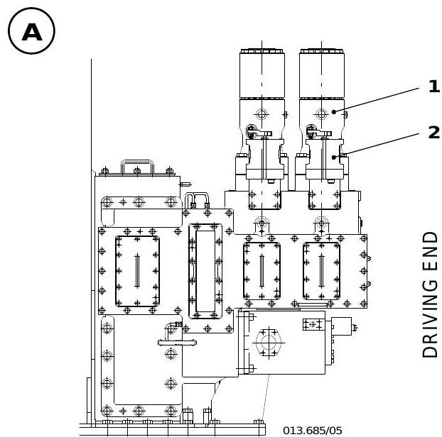

- 根据发动机缸数安装 2 或 3 台燃油泵
- 压缩弹簧 11 将导向活塞 12 和滚轮 14 压在凸轮 16 上
- 泵柱塞 18 由旋转凸轮轴上的凸轮驱动往复运动
- 通过控制槽 'ST' 控制供油量（位置 '0'=零供油，位置 '10'=最大供油）
- 齿条 9 连接燃油泵执行器，实现电控调节

> 泵柱塞的运动原理：当柱塞经过下止点 (BDC) 时，柱塞空间 'PR' 通过泵缸体上的两个进油孔 'ZB' 和泵柱塞上的两条控制槽 'ST' 充油。齿条 9 的移动通过齿形调节套 8 和驱动件 'KM' 带动泵柱塞旋转，改变控制槽与进油孔的相对位置，从而调节供油量。

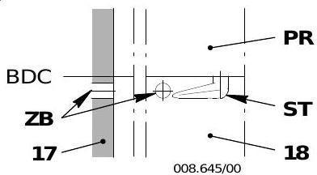

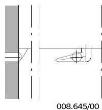

### 2.2 润滑

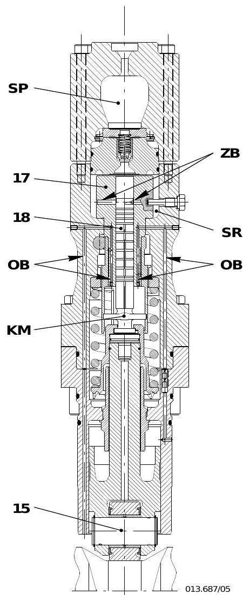

- 燃油泵由发动机润滑油润滑（通过供油单元壳体的进油孔 'OE'）
- 导向活塞、浮销、滚轮通过导向活塞内的面槽、环槽和孔润滑
- 调节套 8 通过上壳体 4 和泵缸体 17 中的润滑油孔 'OB' 润滑
- 泵柱塞 18 用泄漏燃油润滑，通过排油孔 'BB' 排出，连同调节套的泄漏油经供油单元壳体内部油道排出

---

## 3. 燃油泵切除与恢复

当燃油泵故障（如泵柱塞卡死）或上升管破裂时，可切除相应燃油泵。

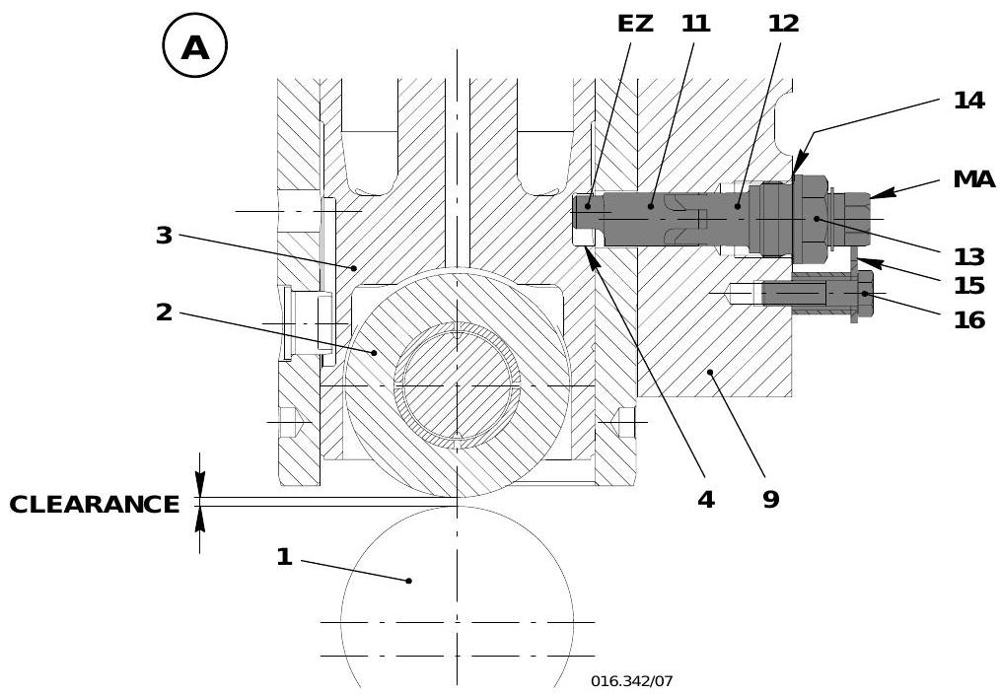

### 3.1 切除后可用功率

| 机型 | 切除 1 台泵后可用功率 |
|------|----------------------|
| 5、6 缸机 | 约 40% |
| 7、8 缸机 | 约 70% |

### 3.2 切除操作步骤

- 切除操作**只能在停机状态下进行**
- 需使用工具 94430 和盲板法兰 94569/94569a

操作流程：
1. 拆除检查盖 6，确认对应凸轮位置，用盘车机将滚轮 2 转至最高位置（凸轮峰值）
2. 松开并拆下螺塞 5（图B）
3. 装入工具 94430（带垫片 14），旋入导螺钉 13 至止点并拧紧，同时转动弹簧导杆 12 使标记 'MA' 朝下，偏心销 'EZ' 插入方孔 4（图C）
4. 用开口扳手 AF22 将弹簧导杆旋转 180度，标记 'MA' 朝上，偏心销 'EZ' 的锪平面将导向活塞抬起（图A）
5. 用爪件 15 和螺钉 16 锁定弹簧导杆

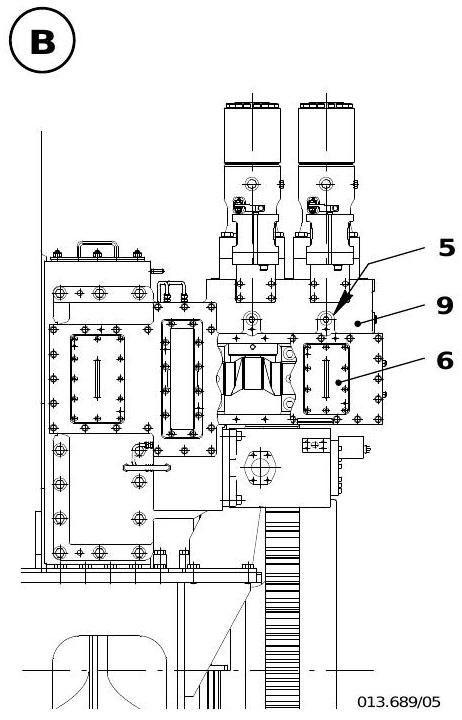

### 3.3 恢复操作步骤

恢复操作**只能在停机状态下进行**，按切除的逆序操作：
1. 用开口扳手 AF22 将弹簧导杆 12 旋转 180度，使标记 'MA' 朝下（图C）
2. 松开导螺钉 13，抽出工具 94430（带垫片 14）
3. 装入并拧紧螺塞 5（带垫片）
4. 拆除盲板法兰 7 和 8，重新安装燃油上升管 17

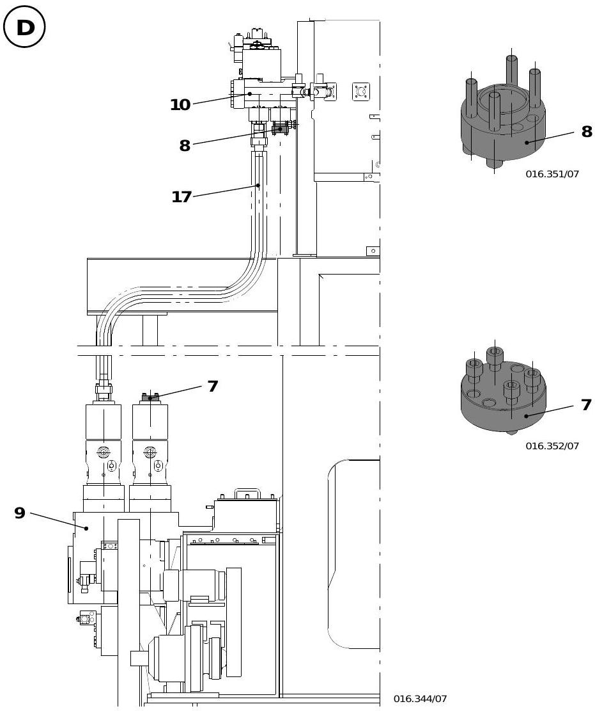

---

## 4. 柴油操作准备步骤

### 4.1 柴油运行准备

1. 将三通阀 21 设在从柴油日用柜 1 吸油位置
2. 排放沉淀柜、日用柜和混合单元的积水
3. 用压力调节阀 31 设定燃油系统压力（低燃油温度时微过压即可）
4. 用压力保持阀 31a (3.53) 设定燃油泵进口压力（压差见操作数据表 0250-1）

---

## 5. 重油操作准备步骤

**重要**：高压回路在长时间停机（超过 24 小时）后，必须**预热至少 4-6 小时**才能使用重油起动。

### 5.1 准备步骤

1. 开启重油日用柜 2、混合单元 24、终端加热器 26 和过滤器 27 的加热
2. 开启发动机上燃油系统的加热（燃油轨 12、燃油上升管 8、燃油泄漏系统）
3. 检查蒸汽管路密封性，发现泄漏必须在首次投入使用前消除
4. 将三通阀 21 设在从重油日用柜 2 吸油位置
5. 排放沉淀柜、日用柜和混合单元的积水
6. 确认发动机前后截止阀已打开
7. 起动泵 23 和 25
8. 加热重油至要求粘度（见粘度-温度图 0270-2）
9. 用压力调节阀 31 设定燃油系统压力
10. 用压力保持阀 31a (3.53) 设定燃油泵进口压力（压差见操作数据表 0250-1）

> 燃油系统必须在重油达到要求温度后才算准备就绪。

---

## 6. 燃油系统排气步骤

### 6.1 手动排气

前提：[[WECS-9520控制系统]] 已开启

1. 起动低压输油泵 (23) 和增压泵 (25)
2. 增压泵起动后，燃油循环通过燃油泵 3，燃油轨 12 经上升管 8 充油
3. 通过燃油关断先导阀 22 (3.08) 上的手动杆，燃油轨可经燃油压力控制阀 21 (3.06) 排气

### 6.2 WECS 辅助排气

使用用户参数 "Inj. venting" 功能：
- 轨道阀将有节奏地激活
- 需开启伺服油服务泵
- 建议在每次停机数小时后的起动前执行

---

## 7. 燃油泄漏试验步骤

燃油系统泄漏试验通过伺服油服务泵 (4.88) 产生压力。

### 7.1 操作步骤

1. 拆除堵头 28 (3.39) 和截止阀 (3.40) 上的锥形螺塞螺母
2. 用工具 94583（管路）连接燃油轨 12 (3.05) 和伺服油轨 (4.11)
3. 打开截止阀 (3.40)
4. 开启轴承油泵和伺服油服务泵 (4.88)
5. 压力（70-100 bar）可在伺服油服务泵压力表上读取
6. 执行泄漏检查
7. 关闭截止阀 (3.40)
8. 拆除工具 94583，在堵头 28 (3.39) 的螺纹和密封面涂抹 Never-Seez NSBT-8，拧紧力矩 300 Nm
9. 重新安装截止阀 (3.40) 上的锥形螺塞螺母并拧紧

---

## 8. 燃油压力控制阀 21 (3.06)

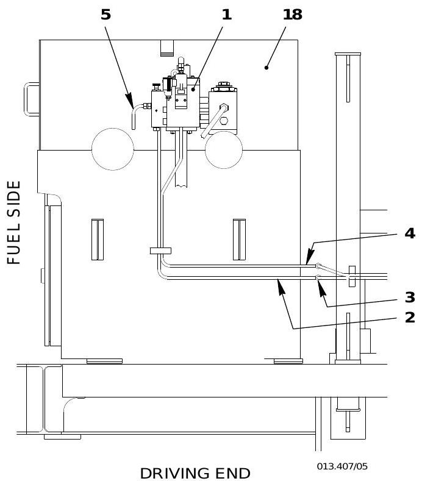

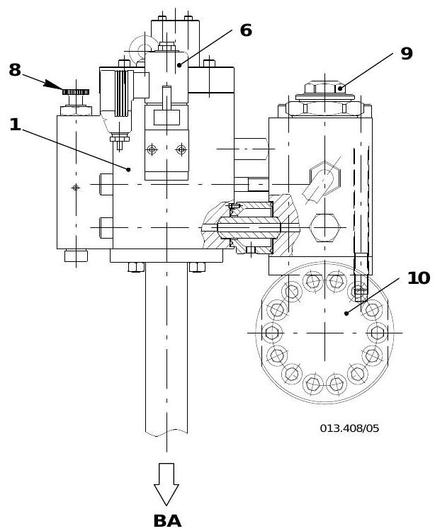

### 8.1 正常运行

- WECS-9520 调节燃油压力，使其保持**低于控制阀开启压力**
- 控制阀**正常关闭**
- 超压约 **1050 bar** 时开启作为安全阀泄压
- 开启压力通过调整盘 7 和滚花螺钉 8 设定
- 燃油压力同时作用于内部油压调节阀 17，燃油压力升高时油压下降，当油压低于阈值时阀尖脱离阀座泄压

> 注意：正常运行时滚花螺钉必须完全拧紧！

### 8.2 紧急停机

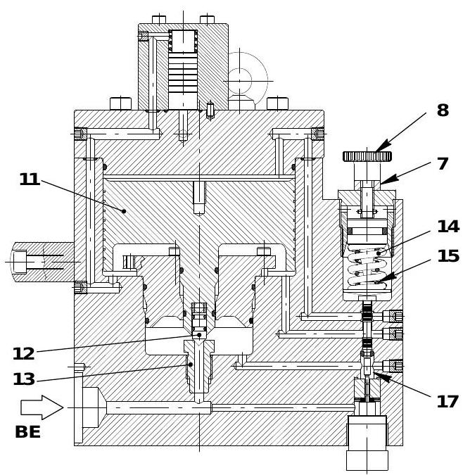

安全系统激活燃油关断先导阀 6，燃油压力降至 200 bar 以下（大多数情况降至 0 bar），喷油不再可能。

停机的三重保护：
1. 立即停止喷油（WECS-9520）
2. 燃油泵供油设为 '0'
3. 燃油关断先导阀泄压

### 8.3 应急运行

当燃油压力调节系统出现故障（如控制信号缺失、执行器故障、调节连杆卡死）时：

- 燃油泵固定在最大供油位置
- 燃油压力控制阀接管调压功能
- 滚花螺钉必须**完全拧出**（逆时针到止点），将开启压力降至约 **600 bar**
- 此模式应避免长时间运行

> 控制阀开启时可听到明显的"啸叫"噪声，表示燃油正在被排泄。

### 8.4 7缸和8缸机的特殊情况

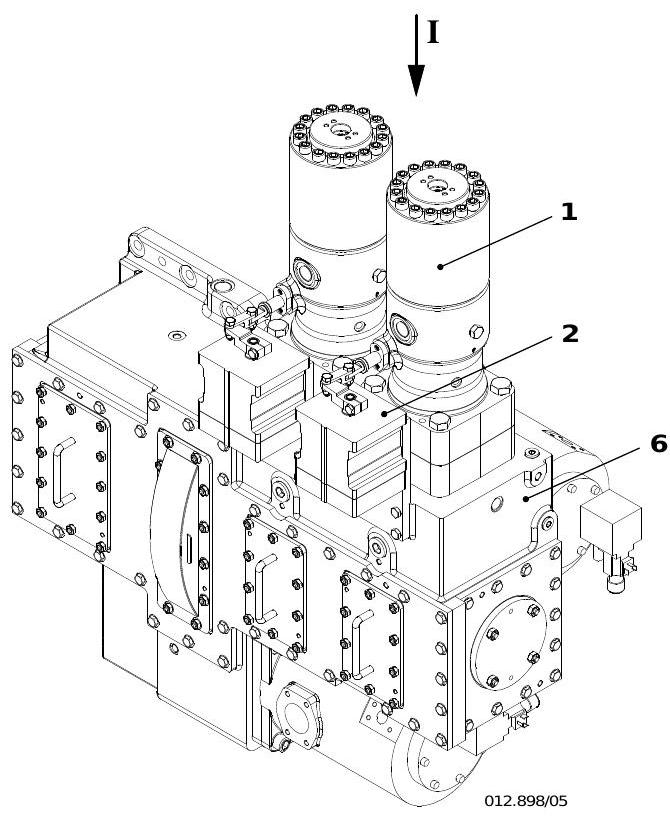

- 7、8 缸机安装 3 台燃油泵和 3 个执行器
- 如果一个执行器故障，其调节输出保持原位或缓慢归零，其余执行器接管燃油量调节
- 在低负荷范围内（燃油消耗量低时），执行器无法进一步减少供油量，燃油压力控制阀 3.06 接管燃油压力调节功能

---

## 9. 燃油泄漏监测

### 9.1 液位开关与监测范围

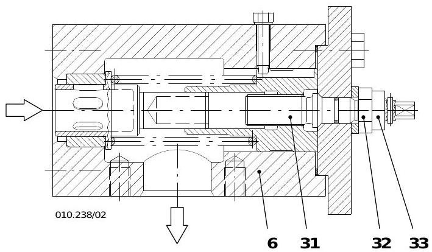

| 液位开关 | 监测组件 |
|----------|----------|
| LS3444A | 轨道单元泄漏（燃油和伺服油） |
| LS3446A | 喷油管 14、喷油控制单元 13（燃油量活塞）、燃油超压安全阀 20 动作 |
| LS3426A | 上升管 8、燃油泵 3 |

### 9.2 泄漏定位方法

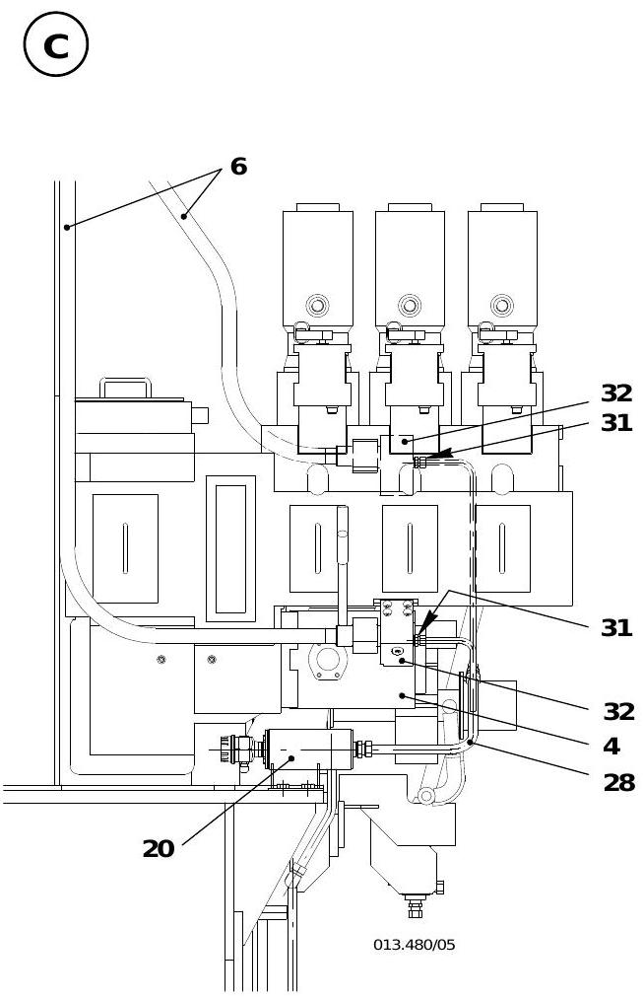

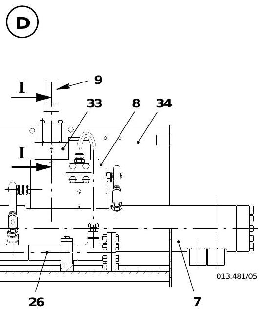

| 报警开关 | 检查步骤 | 处理 |
|----------|----------|------|
| LS3426A | 旋松泄漏管 37 的管接头最多 2 圈，检查是否有燃油流出 | 更换故障上升管 |
| LS3446A | 旋松喷油管 14 法兰 35 上的排放螺钉 34 约 2 圈 | 更换故障喷油管 |
| LS3446A（喷油管无泄漏时） | 旋松回油管 38 上锥形螺塞螺母 36 最多 2 圈 | 更换故障喷油控制单元 |

> 注意：泄漏组件只能在停机时更换。如无法立即更换，须切除相应气缸喷油或切除燃油泵。

---

## 10. 压力保持阀设定

### 10.1 调节方法

- 燃油泵进口压力通过压力保持阀 6 (3.53) 调节
- 压力设定值依据操作数据表 0250-1 中 "燃油泵进口" 和 "燃油泵回油"（压力保持阀后）的数值
- 压力表 7 上 "燃油泵回油" 的压力：
  - 调节主轴 31 **顺时针** (+) 旋转：**压力升高**
  - 调节主轴 31 **逆时针** (-) 旋转：**压力降低**
- 调节时须松开两个锁紧螺母 32 和 33

---

## 关联概念

- [[第2章-系统描述]] - 8大系统概览
- [[WECS-9520控制系统]] - 燃油压力控制与喷油控制逻辑
- [[第3章-操作规程]] - 燃油系统操作步骤
- [[第6章-技术参数与报警设定]] - 燃油压力参数限值 (0250-1)
- [[工作介质规格]] - 燃油规格与处理要求 (0720-1, 0270-2)

---

*来源：OM-RT-flex50 操作说明书 (2009-07), 8019-1, 5556-1, 5556-2, 5562-1, 0120-1, 0270-1*
