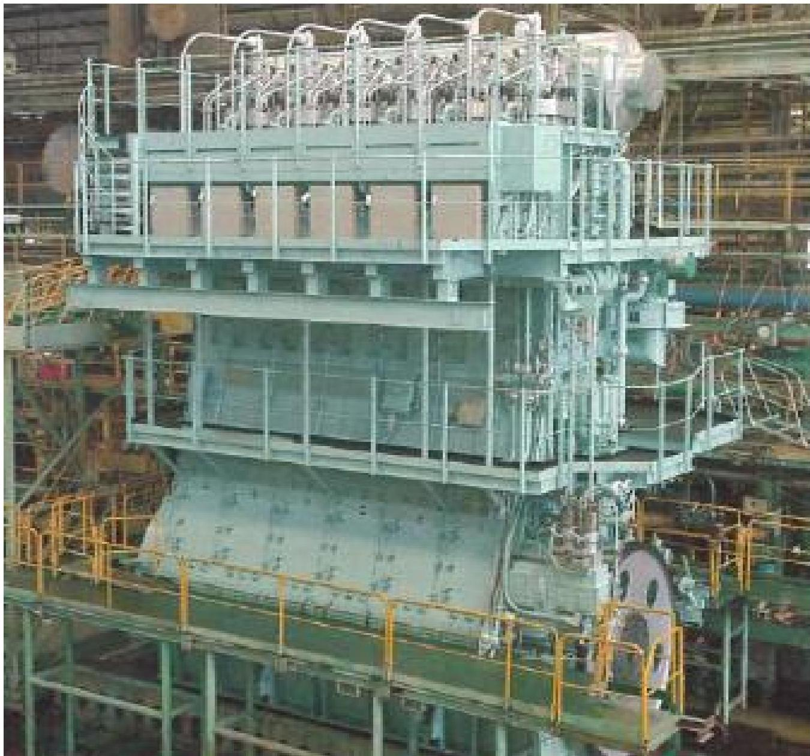
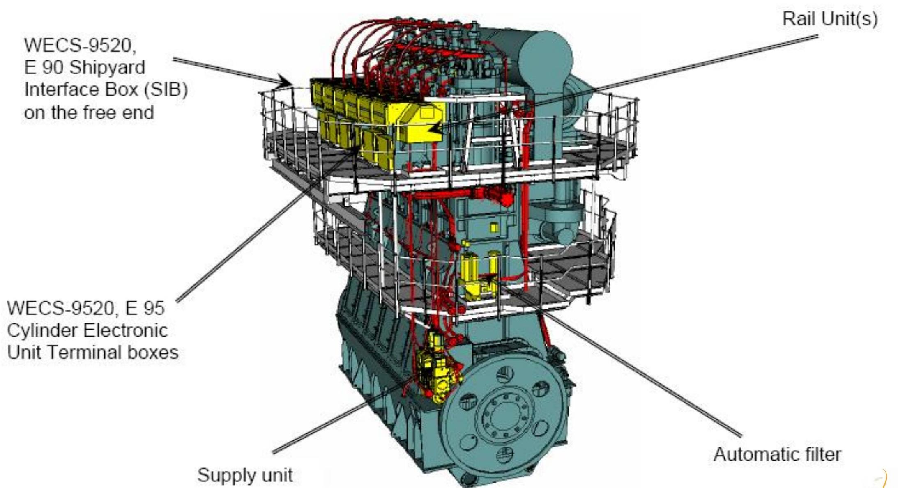

所属章节：[[第1章-发动机概述]]

# 燃油轨

## 定义

燃油轨（Fuel Rail）是RT-flex共轨燃油系统的高压燃油存储和分配部件，接收来自供油单元燃油泵的高压燃油，并分配给各缸的喷射控制单元(ICU)。

## 详细说明

### 工作参数

| 参数 | 数值 |
|------|------|
| 燃油压力 | ~600 - 800 bar |
| 配置 | 每缸对应一个喷射控制单元(ICU) |
| 加热系统 | 配备伴热管路系统（trace heating piping system） |

### 结构特点

- **整体式燃油轨管（fuel rail pipe made of one piece）
- **"花生"形内腔**（the bore has a shape of a "peanut"）
- 与伺服油轨共同组成共轨系统的核心存储单元

### 管路配置

每个气缸在燃油轨上配置：
- 每缸一个[[喷射控制单元ICU]]
- 燃油从燃油轨经ICU控制流向喷油器
- 额外的回油/泄漏管路：
  - 燃油ICU泄漏管
  - 公共回油管

## 关联

- [[伺服油轨]] - 伺服油系统的高压存储部件
- [[喷射控制单元ICU]] - 燃油轨上的每缸燃油控制单元
- [[RT-flex燃油泵]] - 向燃油轨供应高压燃油
