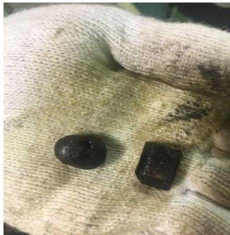
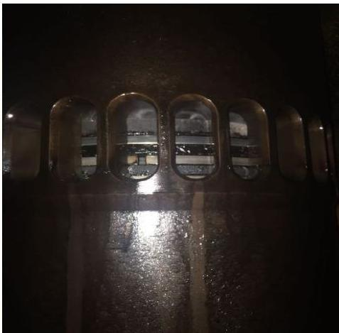
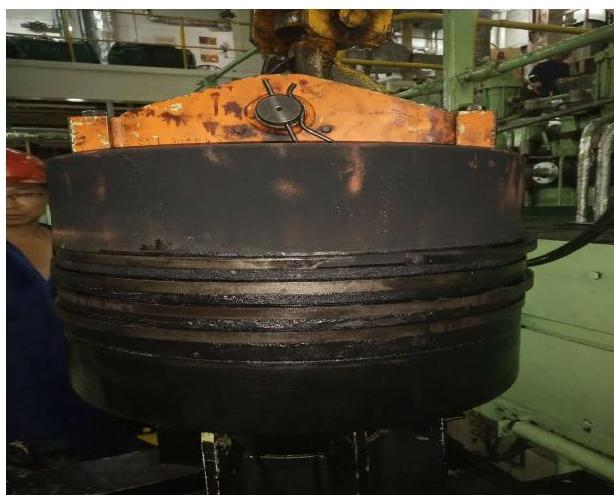
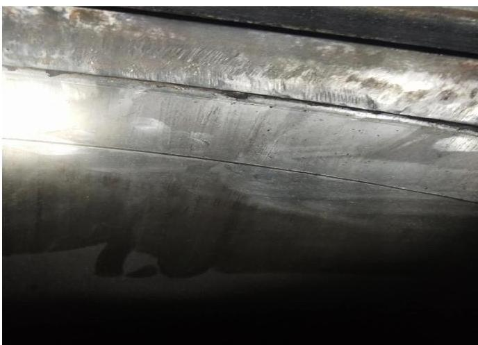
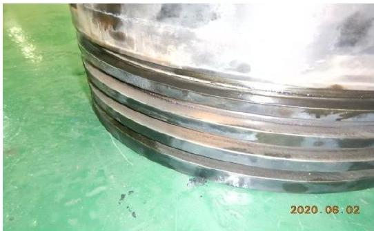
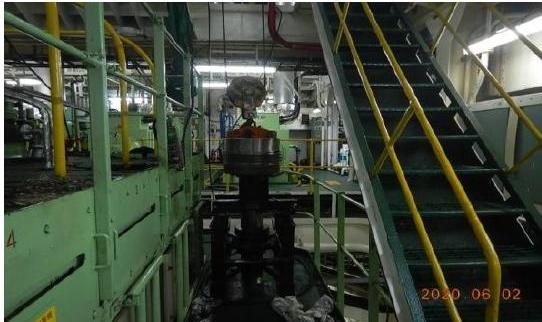

所属章节：[[第5章-故障诊断]]

# 缸套异常磨损致活塞环断裂故障案例

## 概述

这是一起长航珊瑚轮RT-flex50主机6#缸缸套异常磨损导致活塞环断裂的故障案例。故障发生于2020年6月，航行途中6#缸扫气温度逐渐上升，最终达到84℃。检查发现缸套左侧位置有明显两道台阶，最大磨损量达3.9mm（5个月前仅2.1mm），第一道活塞环断裂。根本原因可能是低硫燃油导致缸套异常磨损、恶劣海况高负荷运转、船舶污底增大主机负荷等多种因素共同作用。

## 基本信息

| 项目 | 内容 |
|------|------|
| **船舶** | 长航珊瑚轮（CSC CORAL） |
| **航次** | 2005航次（SOHAR开南非DURBAN） |
| **主机** | RT-flex50 |
| **故障时间** | 2020年6月 |
| **故障缸** | 6#缸 |
| **故障位置** | 莫桑比克海峡北部水域 |
| **缸套历史** | 从出厂一直没有更换过，已运行5万多小时 |
| **上次吊检** | 2020年1月2日，缸套磨损量最大为2.1mm |
| **本次吊检** | 2020年6月2日，缸套磨损量最大为3.9mm |

## 故障经过

### 时间线

| 日期/时间 | 事件 | 扫气温度 |
|----------|------|----------|
| 2020-05-28 | 船舶正常航行，主机转速106rpm，roughsea | 发现6#缸扫气温度有上升迹象 |
| 2020-05-29 08:00 | — | 上升到最高61℃ |
| 2020-05-29 23:00 | — | 上升到最高68℃ |
| 2020-05-30 08:15 | 停车检查，发现6#缸第一道环断裂两小节掉落在扫气箱内，检查其他缸无异常 | — |
| 2020-05-30~06-01 | 海况和航次任务限制暂时无法停车吊检，调大汽缸油注油率到"5"，主机降速到102转继续运转 | 5月31日04:00达72-78℃，继续降速到100转；6月1日波动74-81℃ |
| 2020-06-02 | 温度波动76-84℃，鉴于温度上涨速度和剩余航程，进行紧急修理 | 最高达84℃ |
| 2020-06-02 12:00~18:30 | 吊检作业开始至结束 | — |
| 2020-06-02 19:20 | 主机修复，恢复正常航行 | — |

## 故障检查发现

### 初步检查（2020-05-30 08:15）

| 检查项 | 发现 |
|--------|------|
| 6#缸 | 第一道环断裂两小节掉落在扫气箱内 |
| 其他缸 | 无异常现象 |

### 应急措施（无法吊检期间）

由于海况和航次任务限制暂时无法停车吊检：
1. 主管轮机员调大汽缸油注油率到"5"
2. 主机降速到102转继续运转
3. 持续监控扫气温度变化

## 吊检处理（2020-06-02 12:00~18:30）

### 1. 缸头检查

| 检查项 | 发现 |
|--------|------|
| 缸套 | 左侧位置有明显的两道台阶，目测缸套磨损偏大 |
| 活塞环 | 第一道断裂，其余各道完好 |
| 缸套内壁 | 光滑无明显拉伤痕、粘着迹象 |
| 注油检查 | 各注油器工作正常 |
| 缸盖燃烧室 | 内壁无明显异常 |
| 排气阀阀座 | 无明显异常 |

**初步判断**：缸套异常磨损产生的台阶导致的活塞环断裂

### 2. 活塞头检查

| 检查项 | 发现 |
|--------|------|
| 活塞头 | 有红砖色物质 |
| 第一道环槽 | 出现明显的局部异常磨损，局部出现较大台阶 |
| 第2,3,4道环槽 | 正常 |
| 各道活塞环 | 除第一道断裂外，其余各环经测量未发现异常磨损现象 |

### 3. 缸套磨损测量

| 项目 | 数据 |
|------|------|
| 本次最大磨损量 | 3.9mm |
| 上次最大磨损量（2020-01-02） | 2.1mm |
| 磨损增长（5个月） | 1.8mm |
| 是否超极限 | 已超极限值 |
| 备用缸套 | 船上已无备用缸套 |

**处理措施**：只能打磨台阶，维持使用，再次检查缸套注油情况正常。

### 4. 其他缸检查

| 缸号 | 发现 |
|------|------|
| 5#缸 | 活塞头有相似的红砖色物质，但没有6#缸严重，已加大该缸汽缸油注油率 |
| 其余各缸 | 检查无明显异常 |

### 5. 更换与装复

| 步骤 | 操作 |
|------|------|
| 1 | 更换活塞头、活塞环，测量数据正常，连杆活塞落位 |
| 2 | 缸盖清洁后检查正常，缸盖落位 |
| 3 | 缸盖落位装复后，装复缸头附件等 |
| 4 | 油、水、气测试正常后暖缸 |

### 6. 测试与磨合

| 阶段 | 操作 |
|------|------|
| 测试运行 | 待一切检查正常满足主机测试条件后，进行主机测试运行正常 |
| 告知船长 | 告知船长可以开航，恢复航行初期，主机运行执行磨合程序 |
| 磨合监控 | 经过四个小时的磨合监控，主机各项工况参数基本正常 |
| 现状 | 由于6#缸缸套磨损偏大，该缸扫气温度还是高于其他各缸，目前主机RPM105运行检查正常 |

## 原因分析

### 缸套磨损数据对比

| 测量时间 | 最大磨损量 |
|----------|-----------|
| 2020-01-02（上次吊检） | 2.1mm |
| 2020-06-02（本次吊检） | 3.9mm |
| 5个月磨损增长 | 1.8mm |

如此快的磨损率，说明近期出现了比较明显的磨损加剧。

### 可能原因

| 原因 | 说明 |
|------|------|
| 低硫燃油 | 船舶使用低硫燃油产生的燃烧产物使缸套异常磨损 |
| 缸套台阶刮碰 | 缸套异常磨损产生的台阶，刮碰活塞环使活塞环断裂，并使活塞头环槽出现异常磨损 |
| 恶劣海况高负荷 | 持续恶劣海况主机高负荷运转，活塞环负荷过大 |
| 船舶污底 | 在阿联酋跑内贸时，抛锚时间过长，船舶产生了污底，主机负荷增大 |

## 后续措施建议

| 序号 | 措施 |
|------|------|
| 1 | 1#、3#、6#缸三个老缸套合适时机更换，再备两个缸套备用 |
| 2 | 寻找合适时机对船舶进行刮底 |
| 3 | 适当加大汽缸油注油率 |
| 4 | 平时加强通过扫气口对缸内检查，特别是顶环槽天地间隙，设法自制内窥镜检查缸套内部情况并查看上部有无明显台阶 |

## 故障图片

## 关联页面

- [[第5章-故障诊断]] - 官方故障诊断指南
- [[第4章-异常操作规程]] - 应急操作程序
- [[工作介质规格]] - 汽缸油规格要求
- [[排气阀驱动活塞卡滞故障案例]] - 另一例实际故障案例
- [[ICU流量活塞探头杆脱落故障案例]] - 另一例实际故障案例
- [[增压器轴承损坏故障案例]] - 另一例实际故障案例
- [[滑油变质致排气阀故障案例]] - 另一例实际故障案例
- [[活塞冷却油伸缩管断裂故障案例]] - 另一例实际故障案例

