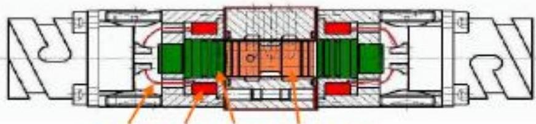
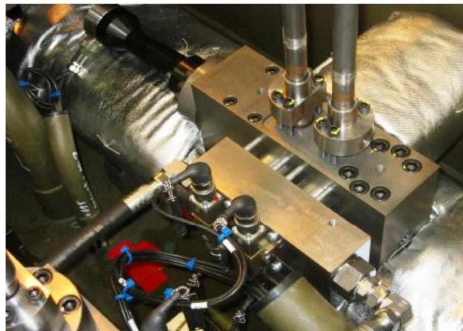

所属章节：[[第1章-发动机概述]]

# 轨阀RV-2

## 定义

轨阀（Rail Valve, RV-2）是RT-flex共轨系统的快速动作3/2通电磁阀，是WECS-9520控制系统与ICU/VCU之间的接口部件。

## 详细说明

### 配置数量

每缸单元配备**3个轨阀**：
- 2个用于预控制ICU
- 1个用于预控制VCU

### 技术参数

| 参数 | 数值 |
|------|------|
| 阀类型 | 3/2通电磁阀（3/2-way solenoid valve） |
| 正常动作时间 | ~1 ms |
| 最大动作时间 | 4.5 ms |
| 驱动电流 | ~50-60 A（高电流脉冲） |
| 阀杆行程 | ~0.3 mm |

### 工作原理

1. **指令接收**：接收WECS-9520的喷射/回油或开/关指令
2. **线圈通电**：相应线圈在极短时间内通电（正常~1ms，最大4.5ms）
3. **高电流脉冲**：以50-60A的高电流脉冲驱动
4. **阀杆移动**：阀杆向通电线圈方向移动（~0.3mm行程）
5. **油路切换**：实现燃油或伺服油通路的快速切换

### 设计特点

- **快速动作**：高电流脉冲和阀杆短行程实现极短的动作时间，这对于精确的喷射或排气阀控制是必不可少的
- **不可维修**（non-serviceable）：轨阀设计为不可维修部件
- **可吹气清洁**：如果怀疑污垢颗粒影响正常操作，可以打开阀并用空气吹出

### 装配注意事项

- 注意阀杆的装配位置（Pay attention to the assembly position of valve spindle）

## 超高速切换特性

轨阀是超高速切换（~2ms）的电液电磁阀。由于高驱动电流和电磁阀线圈的热负载，通电时间**不得超过4.5ms**。这个"接通"时间由WECS-9520采样、监测和限制。

### 双稳态特性

轨阀是双稳态的，即选定位置保持不变，直到WECS-9520设置反向方向。

### 安装/更换后的初始位置

安装或更换双稳态阀后，其打开/关闭位置未知。

### 安全脉冲

为了确保发动机停止时阀始终处于安全的"无喷射"和"排气阀关闭"位置，WECS-9520定期（~10s）向所有轨阀发送设定脉冲。

### 结构示意

## 关联

- [[喷射控制单元ICU]] - 2个轨阀预控制ICU
- [[气门控制单元VCU]] - 1个轨阀预控制VCU
- [[WECS-9520控制系统]] - 轨阀的控制指挥系统
- [[FCM-20模块]] - 轨阀的驱动模块
