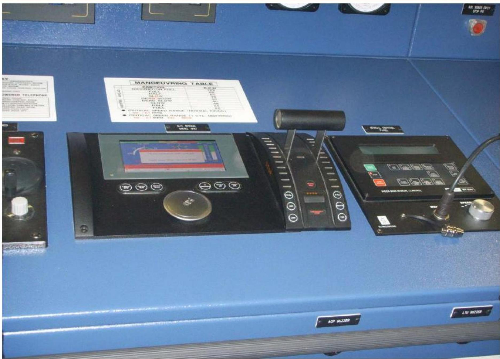

所属章节：[[第1章-发动机概述]]

# 远程控制系统

## 定义

RT-flex发动机的远程控制系统由Kongsberg Maritime提供，包括Autochief C20（推进控制）和Datachief C20（报警监控）。遥控系统是操作员与发动机的接口，可选择的控制面板通过CAN总线连接向WECS-9520传递操纵命令。

## 详细说明

### 系统组成

| 子系统 | 供应商 | 功能 |
|-------|---------|------|
| **推进控制系统** | Kongsberg Maritime | Autochief C20，发动机操纵控制 |
| **报警监控系统** | Kongsberg Maritime | Datachief C20，报警监测 |
| **电子调速器系统** | Kongsberg Maritime | 为WECS-9520提供燃油指令，调节发动机转速 |

### 操纵命令

可选择的控制面板通过CAN总线连接向WECS-9520传递以下操纵命令：

| 命令 | 说明 |
|------|------|
| Start, Brake Air | 起动、制动空气 |
| Stop Slow Turning | 停止慢转 |
| Ahead | 正车 |
| Astern | 倒车 |
| Air Run | 空气运行 |
| Slow Turning | 慢转 |
| Slow Turning Failure Reset | 慢转故障复位 |

### 电子调速器系统

- **功能**：为WECS-9520提供燃油指令，调节发动机转速
- **燃油指令计算**：根据RC系统的速度参考信号相对于发动机负载计算
- **燃油限制器**：调速系统中的燃油限制器根据实际转速和扫气空气压力限制燃油指令，以避免发动机运行超出螺旋桨特性曲线（烟度&扭矩限制器）

### 遥控系统处理

遥控系统将车钟指令通过内部设置（缩放、负载程序等）处理为调速系统的速度参考信号。

### 结构示意

## 故障诊断关联

| 故障现象 | 可能故障位置 | 检查要点 |
|---------|-----------|---------|
| 遥控无响应 | CAN总线通信 | 检查CAN总线连接、模块状态 |
| 车钟指令不执行 | 遥控系统处理 | 检查控制面板、缩放设置、负载程序 |
| 燃油指令异常 | 电子调速器 | 检查调速器、燃油限制器、转速/扫气压力输入 |

## 关联

- [[WECS-9520控制系统]] - 遥控系统的控制对象
- [[安全系统]] - 独立于遥控系统的安全保护
- [[报警监控系统]] - Datachief C20报警监控
