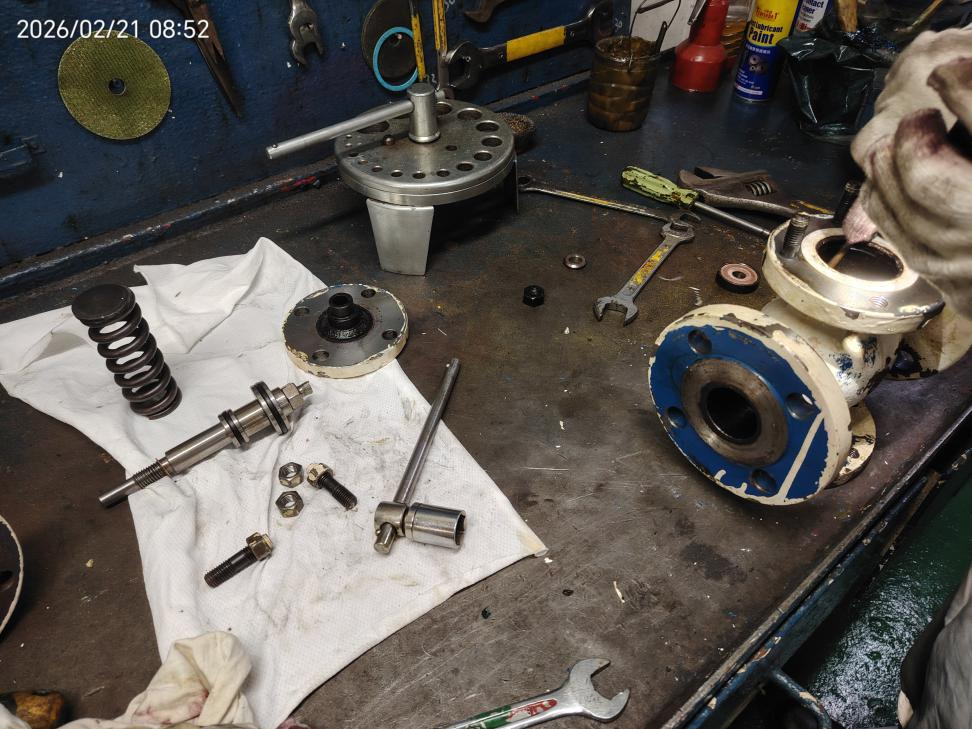

所属章节：[[第5章-故障诊断]] / [[控制空气系统]]

# 长航碧玉30KG到8KG减压阀损坏故障案例

## 概述

这是一起长航碧玉轮控制空气系统减压阀故障案例。2026-05-23 船舶出现主机控制空气进口压力低报警，检查发现控制空气瓶压力只有 6.0KG，最终锁定为 30KG->8KG 减压阀阀芯密封垫老化所致。现场先切换备用减压阀恢复供气，再对故障阀拆检、清洁和临时修复。

## 故障信息

| 项目 | 内容 |
|------|------|
| 报警时间 | 2026-05-23 21:28:40 |
| 报警内容 | 主机控制空气进口压力低报警 |
| 当时压力 | 控制空气瓶压力约 6.0KG |
| 初步判断 | 船艏方向那组减压阀存在问题 |
| 现场处置 | 开启备用减压阀进出口阀门，保证供气正常 |
| 拆检结论 | 减压阀阀芯密封垫老化 |
| 临时修复 | 用材质相近垫片制作阀芯密封垫，清洁后组装 |
| 结果 | 测试正常，待备件供船后更换 |
| 损失 | 未造成实质性损失 |
| 备件 | 8KG减压阀总成 HRD-FA（后期更换） |

## 现场拆检

减压阀工作状态正常时，控制空气瓶压力应维持在约 8KG 左右。该船的控制空气瓶和杂用空气瓶压缩空气，来自主空气瓶经 30KG->8KG 减压阀减压后供给；日常当杂用空气用气量较大时，控制空气瓶压力会下降并触发报警。

减压阀调节范围为 30bar-8bar，通过阀顶部调节螺栓改变内部弹簧预紧力，从而稳定阀后压力。该船设置了两组减压阀，正常情况下 1 台运行、1 台备用，后续计划两组减压阀均投入使用并定期拆检。

## 原因分析

- 使用时间久，阀芯密封垫老化。
- 压缩空气含水，湿度大，加速了密封垫老化。
- 空气瓶放残不及时，会进一步放大水分和杂质对密封件的影响。

## 经验教训

1. 值班及巡回检查中，要加强空气瓶放残，及时将压缩空气中的残水排掉。
2. 对关键但易忽视的减压阀类部件，应提前申请备件并保持可用状态。
3. 发现设备异常和报警后，要及时汇报并切换备用设备，避免扩大影响。
4. 后续应把两组减压阀都纳入定期检修和交替使用计划。

## 关联

- [[控制空气系统]] - 控制空气来源、减压阀用途和系统组成
- [[RT-flex日常维护检查清单]] - 空气瓶放残、巡回检查和备件管理
- [[RT-flex故障排查方法论]] - 报警优先级与逐步排查思路
- [[长航碧玉30KG到8KG减压阀损坏故障报告0523]] - 原始报告来源
