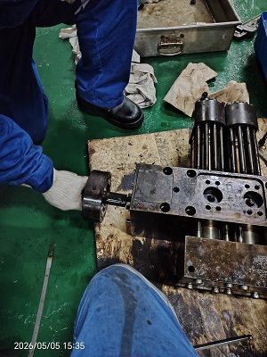

所属章节：[[第5章-故障诊断]] / [[喷射控制单元ICU]] / [[伺服油系统]]

# 长航碧玉主机2缸ICU伺服油液压活塞卡阻故障案例

## 概述

这是一起长航碧玉轮 2#ICU 伺服油液压活塞卡阻故障案例。故障最初表现为 2#缸流量活塞报警和排温偏差报警，现场检查发现流量活塞卡在最大位（供油位），多次停车泄压后仍无法恢复。后续在江阴抛锚检修时更换 2#缸 ICU 总成，确认根因是伺服油液压活塞严重卡阻。

## 故障经过

| 时间 | 经过 |
|------|------|
| 2026-04-30 23:13 | 主机停车等待上引水 |
| 2026-04-30 23:21 | 主机启动 |
| 2026-04-30 23:27 | 主机排温偏差报警，触发 SLOW DOWN |
| 2026-04-30 23:33 | 主机 2#缸流量活塞报警 |
| 2026-04-30 晚间 | 现场检查发现流量活塞卡在最大位（供油位），多次停车泄压仍无法恢复 |
| 2026-05-01 01:11 | 单缸停油，78RPM 低速运行 |
| 2026-05-01 11:30 左右 | 江阴抛锚 |
| 2026-05-01 11:38 | 停主机供油单元，切断燃油供油，更换 2#缸 ICU 总成 |
| 2026-05-01 12:26 | 恢复燃油供应，主机测试正常 |

## 现场拆检

由于当时长江航行条件限制，短时间内无法彻底排除故障，只能先低速运行至江阴抛锚检修。拆检故障缸 ICU 后，发现伺服油液压活塞卡阻严重。

现场拆检还可见：
- 表面有微量积碳，可能与 IPV 微量燃油渗漏或伺服油高温积碳有关
- 表面有划痕，推测来自之前拆检清洁时留下

## 原因分析

| 可能原因 | 结论 |
|---------|------|
| 流量活塞卡阻 | 曾作为初步怀疑项 |
| ICU 电磁阀卡阻或电缆接头松动、短路 | 曾作为初步怀疑项 |
| IPV 卡阻 | 曾作为初步怀疑项 |
| 伺服油液压活塞卡阻 | 最终确认的根因 |
| FCM-20 模块死机 | 曾作为初步怀疑项 |

最终根因是伺服油液压活塞卡阻严重，导致 ICU 工作异常，进而触发流量活塞报警和排温偏差。

## 损失与教训

| 项目 | 内容 |
|------|------|
| 直接影响 | 耽误半天船期 |
| 额外影响 | 江阴锚地抛锚相关费用 |
| 清洁要求 | 精密偶件清洁除垢只能使用柴油或清洁剂和干净抹布，不可使用砂纸 |
| 维护建议 | 2025-12 曾拆检清洁，后续应进一步缩短检查清洁周期 |
| 更换建议 | 年限较长、保养工艺不佳、状态较差的精密偶件应尽早更换 |
| 管理建议 | 已出现多起同类问题，应制定针对性改进措施 |

## 经验教训

1. ICU 伺服油液压活塞是精密偶件，不能用粗糙材料处理表面。
2. 既往检修记录提示要缩短清洁和复检周期，避免卡阻累积。
3. 对已显老化、状态较差的偶件，应优先更换而不是反复修复。
4. 若现场无法快速恢复，应先保船舶运行安全，再安排靠泊检修。

## 关联

- [[喷射控制单元ICU]] - ICU 结构、控制逻辑和报警关联
- [[伺服油系统]] - ICU 伺服油来源和系统关系
- [[WECS-9520控制系统]] - 喷油量活塞报警与控制系统关系
- [[RT-flex故障排查方法论]] - 逐步排查、先验证后更换的思路
- [[长航碧玉主机2缸ICU伺服油液压活塞故障报告0430]] - 原始报告来源
