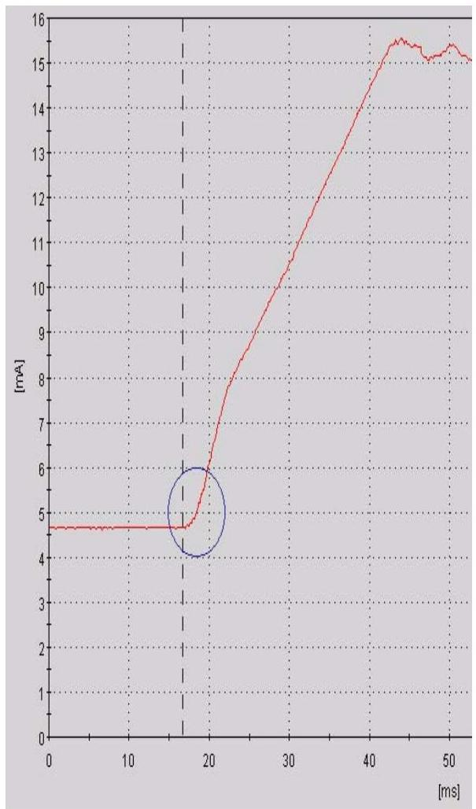
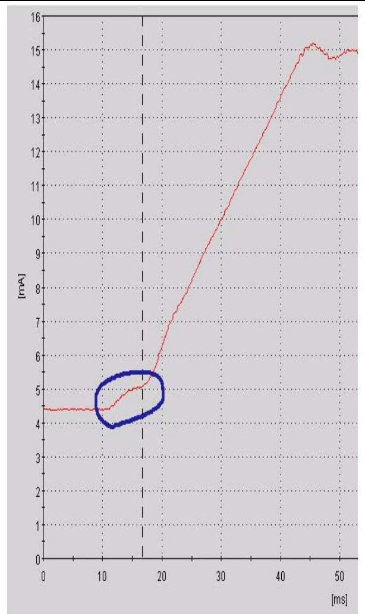

# RT-flex-01服务通报

## 元信息

- **来源**：RT-flex-01 Service Bulletin - Practical Tips Based on Service Experience
- **类型**：Wärtsilä 服务通报
- **日期**：2005-08-31
- **适用范围**：Sulzer RT-flex58T-B / RT-flex60C / RT-flex96C

## 内容概述

本服务通报汇集了 RT-flex 发动机实际运行中积累的故障排查经验，是对发动机手册的补充。涵盖以下主题：

1. **机械部件**：ICU燃油量传感器报警误判、ICU磨损识别（喷油曲线）、曲轴角度传感器检查、燃油超压安全阀、缸喷油切断、燃油泵调节齿条
2. **WECS控制系统**：焊接作业注意事项、WECS-9500硬盘故障诊断
3. **附录**：WECS模块返回表格（故障代码/LED状态）

## 覆盖知识点

- [[喷射控制单元ICU]] - ICU磨损识别和燃油量传感器报警排查
- [[WECS-9520控制系统]] - 硬盘故障诊断、WECS模块返回流程
- [[曲柄角度传感器]] - 定期检查项目（间隙/皮带张力/油流）
- [[燃油超压调节阀]] - 开启后密封不良问题
- [[RT-flex故障排查方法论]] - 传感器/执行器故障排查

## 核心故障排查知识点

### ICU燃油量传感器报警排查（2.1节）

"Stuck"/"no return" 报警多数**不是ICU机械卡死**，而是以下原因：

| 可能原因 | 排查方法 |
|---------|---------|
| 轨道阀(3.76)卡滞 | flexView监测on time，>3.0ms则更换轨道阀 |
| 阀门驱动模块(VDM)损坏 | 更换VDM |
| 轨道阀插头松动 | 检查电缆连接 |
| 行程传感器(3.03)故障 | 检查电缆、测量套筒是否紧固、偏心 |
| 传感器插头松动 | 检查插头连接 |
| 传感器滑动铝套管松动 | 检查套管固定 |
| 气缸控制器模块(CCM)故障 | 排查最后手段 |

> **重要**：只有在排查完所有上述原因后，才能判断是否需要更换ICU

### ICU磨损识别——喷油曲线判读（2.2节）

通过 flexView 查看喷油曲线判断ICU控制阀磨损：

> 良好状态：clear bend between horizontal line and rising line

> 磨损状态：Bump between horizontal line and rising line

**操作步骤**：
1. 切换到Service访问级别，密码：flexView
2. 点击View → Injection curve
3. 选择缸号 → One cycle → Scan

**磨损后果**：WECS自动延迟喷油开始 → 爆发压力降低 → 缸温升高 → 必须尽快检修ICU

### 曲轴角度传感器定期检查（2.3节）

| 检查项目 | 方法 | 判定标准 |
|---------|------|---------|
| 轴向间隙 | 每3000小时检查传感器轮与壳体间是否有轴向移动 | 有间隙须立即更换 |
| 皮带张力 | 使用弹簧秤，张力**不得超过4.5kg** | 超张力会导致传感器自毁 |
| 油流 | 用手触摸供油管，感受温度 | 不发热=入口小孔堵塞，须尽快疏通 |
| 编号 | 拔掉传感器1插头应触发传感器1报警 | 确保插头编号正确 |

### 燃油超压安全阀（2.4节）

- 此安全阀(3.52)**平时不应开启**，只在燃油高压峰值时保护性开启
- 若开启后密封不良（漏油），会导致燃油轨压无法建立
- 原因：燃油压力调节阀(3.06)动作过慢，导致安全阀被迫开启
- **处理**：一旦漏油，须更换新阀

### 气缸喷油切断——双重保险（2.5节）

需要切断单缸喷油时，应**双重保险**：
1. 在flexView的USER页面（或WECS-9520的RCS面板）使用"Inj. cut-off"功能
2. 拔掉该缸轨道阀(3.76)的电缆插头

### 燃油泵调节齿条（2.6节）

- 每1500小时检查调节齿条是否移动自如
- 仅受扭簧限制，应能全程拉动
- 每1500小时润滑齿条

### WECS-9500硬盘故障诊断（3.2节）

硬盘故障前兆：弹出窗口含关键词 "sync fail"、"HD"、"back-up"，或电脑死机

> 硬盘故障不影响发动机安全运行，但flexView功能受影响

**硬盘溢出处理**：
1. 最小化flexView，打开Windows资源管理器
2. 进入 `c:\program\files\flexview\<plant>\`
3. 删除所有 `-000x.h5` 文件，**保留最后3个**
4. flexzip子文件夹中已有压缩备份，不会丢失数据

### WECS模块返回表格（附录）

返回WECS模块给Wärtsilä调查时须填写表格，flexView截屏应附在表格中。

**常用FlexView报警代码速查**：

| 模块 | 报警类型 | 可能原因 |
|------|---------|---------|
| MCM - CAN Bus Failure | Bus Failure CAN # | CAN总线故障 |
| MCM - Analog Input Error | Control oil/Fuel rail/Servo oil/Charge air pressure meas. fail | 模拟量输入故障 |
| MCM - Digital I/O Error | Digital input/output defective | 数字量输入/输出故障 |
| MCM - COM EU Failure | COM EU #... Fail | 通讯模块故障 |
| CCM - Output Error | Inj. Ch / Exh. Ch defective | 喷油/排气通道故障 |
| CCM - SSI Bus Failure | Crank angle fail, Crank angle diff. | 曲轴角度传感器故障 |
| VDM - Output Channel Error | Inj. / Exh. channel defective | 通道输出故障 |
| VDM - Power Supply | Power supply failure, On-time feedback failure | 电源/反馈故障 |
| ASM | Selector failure, No RC-fuel command | 通讯/燃油指令故障 |

---

*本服务公报编号RT-flex-01，日期2005-08-31，应单独存档于轮机长办公室。*
